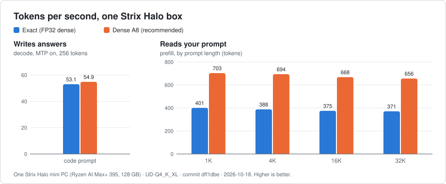
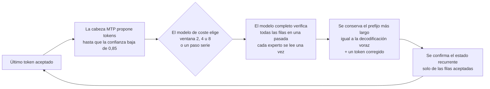
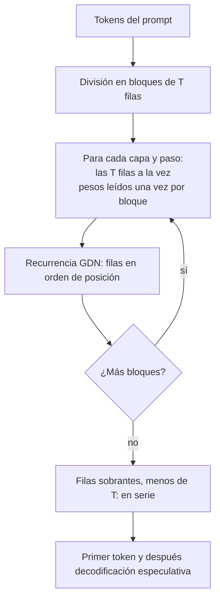

# Strix Halo engine

**Un motor de inferencia de LLM rápido y exacto para un mini PC de AMD y un modelo grande.**

[English](README.md) · [Español](README.es.md)

<p align="center">
  <picture>
    <source media="(prefers-color-scheme: dark)" srcset="docs/media/speed-dark.svg">
    
  </picture>
</p>

<!-- SCREENSHOT: captura del panel de monitorización del motor cuando exista, p. ej.
<p align="center"></p>
-->

> Esta es una traducción del [README en inglés](README.md), que es la referencia. La documentación técnica
> detallada ([docs/ENGINE.md](docs/ENGINE.md), [DECISIONS.md](DECISIONS.md) y `docs/`) está en inglés.

Este motor ejecuta **Qwen3.8-Flash-Next**, un modelo grande de mezcla de expertos (MoE), en un único equipo
**AMD Strix Halo** (Ryzen AI Max+ 395, 128 GB de memoria unificada) con Linux y ROCm. Está escrito desde cero
para ese chip y ese modelo, así que cada kernel, cada disposición de memoria y cada decisión de planificación
puede dar por sentado exactamente cómo son el hardware y el modelo.

Responde a unos **53-55 tokens por segundo** con un prompt de código y lee prompts a **unos 700 tokens por
segundo**, y el texto que escribe es **exactamente** el que escribiría la decodificación voraz (greedy) normal,
token a token. La velocidad sale de adivinar varios tokens por adelantado y comprobarlos todos a la vez, nunca de
cambiar la respuesta.

**AMD primero e independiente.** Los kernels de ejecución del modelo, la planificación y el decode especulativo son
código propio en C++/HIP para Strix Halo (`gfx1151`); el motor no envuelve otro runtime de inferencia y todos los
números de este README salen de nuestro ejecutable `strix-hip-decode-token`. ROCm/HIP, Linux, el formato GGUF y las
herramientas de compilación habituales siguen siendo dependencias: *independiente* no significa sin dependencias. El
motor está pensado para funcionar por completo en una sola Strix Halo sin el trabajo de orquestación distribuida de
[TensorMeld](https://github.com/hyukudan/tensormeld); el funcionamiento multinodo y otras GPUs son etapas aparte,
cualificadas explícitamente. Primera prioridad: el mejor rendimiento correcto de extremo a extremo en hardware AMD.

> **Estado: motor de investigación.** Funciona de principio a fin y los números de abajo son medidos, pero la
> interfaz es una herramienta de línea de comandos que recibe IDs de token e imprime un recibo JSON. Todavía no
> hay servidor de chat; ver la [hoja de ruta](#hoja-de-ruta).

## Contenido

[Qué lo hace distinto](#qué-lo-hace-distinto) ·
[Velocidad](#velocidad) ·
[Calidad](#calidad) ·
[Más allá del inglés](#más-allá-del-inglés) ·
[Qué necesitas](#qué-necesitas) ·
[Compilar](#compilar) ·
[Ejecutar](#ejecutar) ·
[Cómo funciona](#cómo-funciona) ·
[Decisiones de diseño](#decisiones-de-diseño) ·
[Hoja de ruta](#hoja-de-ruta) ·
[Preguntas frecuentes](#preguntas-frecuentes) ·
[Licencia](#licencia)

## Qué lo hace distinto

- **Decodificación especulativa exacta.** Un pequeño predictor integrado (la cabeza MTP del modelo) propone los
  siguientes tokens. El modelo completo comprueba 2, 4 u 8 de ellos en una sola pasada y se queda con la racha
  correcta más larga. Cada kernel multifila hace la aritmética de cada fila exactamente igual que el kernel de
  una fila, así que cada token emitido es idéntico, bit a bit, a la decodificación voraz en serie. Sin
  tolerancias, sin "casi igual".
- **Perfiles numéricos con nombre y calidad medida.** Cómo redondea el motor es una elección con nombre y
  versión, no un detalle oculto. Hoy se recomiendan dos: el **perfil exacto** (proyecciones densas en FP32) y
  **dense A8** (activaciones int8 en las proyecciones densas; más rápido, con un coste de calidad pequeño y
  medido). El prompt puede leerse con un perfil y la respuesta escribirse con otro (D-033).
- **La calidad se mide, no se supone.** Un arnés teacher-forced compara la distribución de salida completa del
  motor con una referencia Q8_0 en decenas de miles de posiciones (divergencia KL y acuerdo top-1), desglosada
  por categoría e idioma.
- **Opcional hasta demostrarlo.** Toda optimización empieza desactivada. Solo pasa a ser la opción por defecto
  cuando se demuestra que es exacta bit a bit (o, para un perfil numérico nuevo, que tiene una calidad medida)
  y más rápida en el hardware real, con la carga de trabajo completa. Las ideas que fallaron quedan registradas
  con sus números.
- **Primero AMD, e independiente.** Escrito para `gfx1151` con HIP, con su propio lector GGUF, sus propios
  kernels y su propio planificador de memoria unificada.

## Velocidad

Medido en **un Bosgame M5** (Ryzen AI Max+ 395, 128 GB), modelo UD-Q4_K_XL, una petición cada vez, en el commit
`dff1dbe` el **2026-10-18**. Estos números se actualizarán tras la campaña de benchmarks en curso.

<!-- BENCH: actualizar todos los valores de esta sección (y tools/gen_readme_chart.py, y volver a ejecutarlo) con el commit final de la campaña; actualizar commit y fecha. -->

**Escribe respuestas** (decodificación especulativa con ventanas MTP 2/4/8, prompt de código, 256 tokens
generados, error de replay 0):

| Perfil | Tokens por segundo |
|---|---|
| Exacto (FP32 denso) | **53,1** |
| Dense A8 (recomendado) | **54,9** |

<!-- BENCH: decodificación por carga (prosa en inglés, prosa en español, otros idiomas, chat) con ambos perfiles. -->

El código es el caso más fácil para el predictor. La prosa acepta menos tokens propuestos por comprobación, así
que se decodifica más despacio: en un commit anterior (`b0d1cd1`) la prosa en inglés iba a 37,2 tok/s donde el
código iba a 48,5 tok/s. La tabla por carga de trabajo del build actual está pendiente; ver
[docs/ENGINE.md](docs/ENGINE.md#decode-by-workload-earlier-measurement).

**Lee tu prompt** (prefill en bloques, tokens por segundo de la petición completa):

| Longitud del prompt | Exacto (FP32 denso) | Dense A8 (recomendado) |
|---|---|---|
| 1K tokens | ~401 | **703** |
| 4K tokens | ~388 | **694** |
| 16K tokens | ~375 | **668** |
| 32K tokens | ~371 | **656** |

**Tiempo hasta el primer token:**

| Longitud del prompt | Exacto | Dense A8 |
|---|---|---|
| 1K tokens | <!-- BENCH: TTFT 1K exacto --> pendiente | <!-- BENCH: TTFT 1K dense A8 --> pendiente |
| 4K tokens | <!-- BENCH: TTFT 4K exacto --> pendiente | <!-- BENCH: TTFT 4K dense A8 --> pendiente |
| 16K tokens | <!-- BENCH: TTFT 16K exacto --> pendiente | <!-- BENCH: TTFT 16K dense A8 --> pendiente |
| 32K tokens | <!-- BENCH: TTFT 32K exacto --> pendiente | <!-- BENCH: TTFT 32K dense A8 --> pendiente |

Mientras no se mida el TTFT directamente: a los ritmos de prefill de arriba, leer un prompt de 32K tokens lleva
unos 50 s con dense A8 y 88 s con el perfil exacto (cuenta hecha a partir del rendimiento, no una medida
aparte). Cargar el modelo lleva unos 11 s cuando su checksum está en caché; el primer arranque calcula el hash
del archivo de 111 GB, unos 50 s.

## Calidad

El arnés pasa los mismos documentos al motor y a una referencia Q8_0 del mismo modelo, token a token
("teacher-forced"), y compara la distribución de probabilidad completa en cada posición:

- **Divergencia KL**: cuánto se alejan las probabilidades del motor de las de la referencia. Menos es mejor; 0
  significa idénticas.
- **Acuerdo top-1**: con qué frecuencia el siguiente token más probable del motor coincide con el de la
  referencia.

| Perfil | KL respecto a Q8_0 | Acuerdo top-1 |
|---|---|---|
| Exacto (FP32 denso) | 0,01940 | 95,52 % |
| Dense A8 (recomendado) | 0,01978 (+1,9 ± 2,0 %) | 95,55 % |

49.001 posiciones, medido para [D-032](DECISIONS.md#d-032-dense-a8-in-the-recommended-profile). Dicho
llanamente: dense A8 está tan cerca de la referencia como el perfil exacto, dentro del margen que separa dos
implementaciones exactas cualesquiera de los mismos pesos. Donde los dos perfiles discrepan (2,8 % de las
posiciones) casi siempre es entre dos candidatos prácticamente empatados. Como comparación, cuantizar las
activaciones a Q8_1 costaba +30 % de KL y no se adoptó.

<!-- BENCH: actualizar esta tabla con la campaña de calidad final (por categoría: multilingüe, prosa en español, prosa en inglés, código, agente, matemáticas, chat). -->

Metodología: [docs/teacher-forced-tiled-prefill.md](docs/teacher-forced-tiled-prefill.md) (cómo se producen los
logits, idénticos byte a byte a la ruta serie),
[docs/decode-optimization-profile.md](docs/decode-optimization-profile.md) (puntuación y formato del archivo de
logits) y [docs/qualification-ledger.md](docs/qualification-ledger.md).

## Más allá del inglés

Trabajamos para no perder calidad ni velocidad fuera del inglés.

- **Velocidad: paquetes de vocabulario de borrador por idioma.** El predictor solo propone tokens de un
  subconjunto del vocabulario, lo que abarata la propuesta. El repositorio incluye un núcleo de 32k independiente
  del idioma y paquetes de 16k para alemán, español, francés, italiano, portugués, ruso, japonés y chino en
  [`data/draft-vocab/`](data/draft-vocab/). Con `--mtp-draft-vocab auto:data/draft-vocab` el motor elige el
  paquete que corresponde al prompt. Con un prompt de chat en español la decodificación pasó de 32,9 a 38,9 tok/s
  (+18 %). El paquete solo cambia cuántas propuestas se aceptan, nunca el texto.
- **Calidad: medida por idioma y categoría.** El arnés de calidad da KL y top-1 por separado para texto
  multilingüe, prosa en español, prosa en inglés, código, tareas de agente, matemáticas y chat, cada uno con un
  margen explícito. Una elección numérica que perjudica a una de estas categorías se rechaza aunque la media
  salga bien; por ejemplo, la decisión de dense A8 registra la única señal por categoría que encontró (top-1 en
  prosa española, −0,55 ± 0,23 puntos, con la KL sin cambios).

## Qué necesitas

| | |
|---|---|
| **Máquina** | AMD Strix Halo con la iGPU Radeon 8060S (`gfx1151`), p. ej. Ryzen AI Max+ 395, con **128 GB** de memoria unificada. Medido en un Bosgame M5. |
| **Sistema** | Linux. |
| **Pila de GPU** | ROCm/HIP. Probado con ROCm **core 10.1** instalado en `/opt/rocm/core-10.1`. |
| **Herramientas** | CMake >= 3.24, Ninja, un compilador C++20 y, opcionalmente, OpenSSL para calcular hashes rápido. |
| **Modelo** | GGUF **UD-Q4_K_XL** de Qwen3.8-Flash-Next (unos 111 GB) y el GGUF **sidecar MTP Q8_0**, del snapshot fijado en [SOURCES_LEDGER.md](SOURCES_LEDGER.md). El perfil automático solo admite exactamente ese contenido. |
| **Disco** | Espacio para los archivos del modelo (111 GB más el sidecar), la compilación y, para MTP, un pequeño archivo de referencia por prompt (alrededor de 1 MB por token del prompt). Un NVMe rápido acorta el arranque. |
| **Tokenizador** | El motor recibe IDs de token. Usa el tokenizador del propio modelo para pasar de texto a IDs y al revés. |

## Compilar

```sh
export PATH=/opt/rocm/core-10.1/bin:$PATH
cmake -S . -B build -G Ninja \
  -DCMAKE_BUILD_TYPE=Release \
  -DCMAKE_HIP_ARCHITECTURES=gfx1151 \
  -DCMAKE_HIP_COMPILER=/opt/rocm/core-10.1/bin/amdclang++ \
  -DSTRIX_ENABLE_HIP_RUNTIME=ON \
  -DSTRIX_ENABLE_EXPERIMENTAL_Q4K_A8_RUNTIME=ON \
  -DSTRIX_BUILD_EXPERIMENTAL_Q4K_A8_PROBE=ON \
  -DSTRIX_USE_OPENSSL_SHA256=ON \
  -DBUILD_TESTING=ON
ninja -C build strix-hip-decode-token
```

`ctest --test-dir build` ejecuta los tests de host y de dispositivo (muchos tests de dispositivo necesitan la GPU
y los archivos del modelo). Todas las opciones de CMake están en [docs/ENGINE.md](docs/ENGINE.md#build-options).

## Ejecutar

La ejecución más sencilla: decodificación voraz normal con el perfil recomendado, 256 tokens.

```sh
./build/strix-hip-decode-token Qwen3.8-Flash-Next-UD-Q4_K_XL.gguf $(cat prompt.ids) \
  --context 8192 --execution-mode eager --residency register --generate 256 \
  --optimization-profile auto \
  --numerical-profile hc-splitk-f32+q51-q80-a8-down+q5k-a8-gateup+dense-a8-v1
```

`prompt.ids` contiene el prompt como IDs de token separados por espacios, obtenidos con el tokenizador del
modelo. El motor imprime un recibo JSON con `generated_tokens` y tiempos; decodifica los tokens con el
tokenizador del modelo.

Para la velocidad completa de arriba, añade las opciones de decodificación especulativa (sidecar MTP, ventanas
de verificación 2/4/8, vocabulario de borrador). Son explícitas y extensas a propósito: los archivos se fijan por
SHA-256 y cada reserva de memoria se declara. El comando completo, listo para copiar y con cada opción
explicada, está en **[docs/ENGINE.md → Command line](docs/ENGINE.md#command-line)**, y las opciones MTP en
[docs/mtp-native-cli.md](docs/mtp-native-cli.md). Los prompts largos usan el prefill en bloques
([docs/ENGINE.md → Prompt prefill](docs/ENGINE.md#prompt-prefill)).

Para usar el perfil exacto, pasa
`--numerical-profile hc-splitk-f32+q51-q80-a8-down+q5k-a8-gateup-v1`.

Varias peticiones (hasta cuatro) pueden decodificar juntas en un proceso: `--mtp-cohort-request TOKENS_FILE,GOLDEN,SHA256`
(repetible) añade peticiones junto al prompt posicional, cada una con su estado, su runtime MTP y su golden. Sus
borradores se verifican en ventanas de cohorte que leen una sola vez los pesos de proyección, expertos, HC y cabeza para
las filas de todas las peticiones, y cada petición produce exactamente los tokens que produce sola. Ver
[docs/multi-request-cohort.md](docs/multi-request-cohort.md) (D-039).

La decodificación es greedy salvo que `--mtp-sample-temperature` sea mayor que cero: el muestreo (top-k/top-p/min-p,
semilla) mantiene los borradores MTP como propuestas especulativas y es reproducible para una semilla. Ver
[docs/sampled-decoding.md](docs/sampled-decoding.md) (D-040).

## Cómo funciona

**Un ciclo de decodificación.** El predictor propone tokens hasta que deja de estar seguro; un modelo de coste
elige el tamaño de la ventana; el modelo completo comprueba toda la ventana en una pasada; se conserva la racha
más larga de tokens coincidentes, más el siguiente token del propio modelo completo.



Un paso de un token está limitado por el ancho de banda de memoria (se leen todos los pesos activos para un solo
token), así que comprobar 4 u 8 tokens cuesta mucho menos que 4 u 8 pasos. Como el modelo completo tiene la
última palabra sobre cada token, una propuesta errónea solo cuesta tiempo, nunca corrección.

**Leer un prompt largo (prefill en bloques).** El prompt se divide en bloques de T filas (hasta 2048). Dentro de
un bloque el motor ejecuta cada paso de la capa para las T filas antes de avanzar, así que cada peso se lee una
vez por bloque en lugar de una vez por token. Las capas recurrentes (GDN) siguen actualizando las filas
estrictamente en orden, así que el resultado es idéntico bit a bit a leer el prompt token a token con el mismo
perfil.



La guía de arquitectura está en [docs/README.md](docs/README.md); la referencia detallada del motor, en
[docs/ENGINE.md](docs/ENGINE.md).

## Decisiones de diseño

El registro completo, con alternativas, evidencia y la condición para reabrir cada una, está en
[DECISIONS.md](DECISIONS.md). Las principales:

- **Verificación exacta en lugar de tolerancia (D-021).** Los kernels multifila repiten exactamente la
  aritmética de una fila, así que la decodificación especulativa nunca cambia la salida. La verificación con
  tolerancia se rechazó porque la identidad de la salida es la puerta de corrección.
- **Ventanas adaptativas 2/4/8 con un modelo de coste en línea (D-022).** La ventana crece cuando el predictor
  está seguro y se reduce cuando no; pasar de {2,4} a {2,4,8} fue la mayor mejora individual.
- **Aceptación del prefijo más largo sin checkpoints (D-023).** Las filas aceptadas se confirman en el estado
  recurrente en la ventana siguiente, en lugar de guardar y restaurar el estado en cada ciclo (un 46 % más
  rápido en la ejecución donde se midió).
- **Perfiles numéricos con nombre (D-024, D-032).** Activaciones int8 en el MoE y después en las proyecciones
  densas, cada una adoptada solo con una tabla de calidad medida.
- **Un perfil de prefill separado (D-033).** El prompt puede leerse con un perfil más rápido mientras la
  decodificación mantiene el suyo; ambas identidades viajan en cada recibo y archivo de referencia.
- **Prefill en bloques y puntuación teacher-forced sobre él (D-034).** Los mismos bytes que la ruta serie; una
  puntuación de 16K tokens pasó de 1001 s a 66 s.
- **Medido y rechazado.** La captura con hipGraph del bucle de decodificación, el registro de pesos
  coarse-grained, la normalización HC fusionada, varias variantes de kernels y otros umbrales de propuesta se
  midieron y no se adoptaron; los números están en la
  [tabla de rechazos](DECISIONS.md#measured-and-rejected).

## Hoja de ruta

En curso, sin un orden concreto y sin números prometidos:

- **Caché de prefijos con estado GDN** *(ya integrada, D-035)*: una petición cuyo prompt empieza por un prefijo en caché restaura el estado completo del modelo en un límite de bloque del prefill por bloques y solo lee el resto, con salida idéntica bit a bit (`--prefix-cache-host-bytes N`, opcional `--prefix-cache-dir DIR`; ver [docs/prefix-state-cache.md](docs/prefix-state-cache.md)). Los tiempos llegarán con la próxima campaña de medidas.
- **Panel de monitorización**: vista en vivo de peticiones, velocidad y memoria.
- **Varias peticiones a la vez**.
- **Caché KV en int8**.
- **Muestreo con decodificación especulativa** (hoy la decodificación es voraz).
- **Pesos del tronco en 6 bits**.

## Preguntas frecuentes

**¿La decodificación especulativa cambia la respuesta?**
No. El modelo completo verifica cada token emitido, y los kernels de verificación repiten exactamente la
aritmética de un token. La salida es igual a la decodificación voraz normal con el mismo perfil numérico, bit a
bit.

**¿Qué perfil debo usar?**
Dense A8 es el recomendado por defecto: más rápido y con una calidad dentro del margen de medida del perfil
exacto. Usa el perfil exacto cuando necesites la aritmética densa en FP32.

**¿Los dos perfiles dan el mismo texto?**
No siempre. Redondean distinto, así que pueden elegir tokens diferentes donde dos candidatos están casi
empatados (2,8 % de las posiciones en la medida de calidad). Cada uno es determinista y exacto respecto a sí
mismo.

**¿Funciona en otras GPU o con otros modelos?**
No. Está hecho para `gfx1151` y solo admite el contenido fijado de Qwen3.8-Flash-Next. Ese foco es la razón de
ser del proyecto.

**¿Por qué necesita 128 GB?**
Solo el archivo del modelo a 4 bits ocupa unos 111 GB. La memoria unificada permite que la GPU lea los pesos
donde están.

**¿Qué longitud de contexto admite?**
El perfil automático está cualificado a 8192 tokens. Los contextos más largos funcionan con
`--unqualified-context`; así se midieron los números de prefill hasta 32K.

**¿Por qué IDs de token y no texto?**
El motor es el núcleo de cómputo. La tokenización, la plantilla de chat y el servicio quedan fuera de él por
ahora.

**¿De dónde salen los números?**
De nuestras propias ejecuciones en nuestras propias máquinas, con el commit y la fecha junto a cada tabla. Nada
de lo que aparece aquí es una estimación teórica presentada como resultado.

## Licencia

El código del motor se distribuye con la **[licencia Apache 2.0](LICENSE)**, salvo el módulo experimental del kernel
de Linux en `lab/direct_gpu_stream/kernel/`, que es **GPL-2.0-only** como exige el código del kernel (sus textos de
licencia están en ese directorio). El código adoptado de otros proyectos conserva su licencia y avisos originales.
Los pesos del modelo se distribuyen con su propia licencia (Qwen Community License). Las referencias de terceros
usadas para formatos y semántica del modelo figuran con sus licencias en [SOURCES_LEDGER.md](SOURCES_LEDGER.md).
