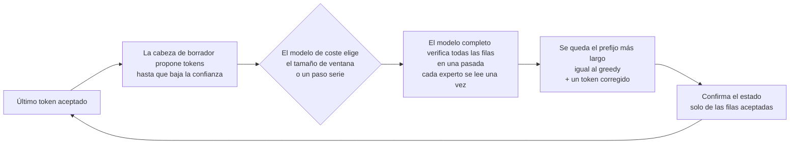
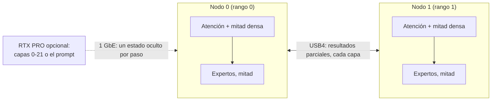

# Strix Halo engine lab

**Inferencia de LLM rápida y exacta, escrita desde cero para AMD Strix Halo: un mini PC, dos unidos por USB4, y una
GPU dedicada cuando la hay.**

[English](README.md) · [Español](README.es.md)

<!-- SCREENSHOT: captura del panel de monitorización del motor cuando exista, p. ej.
<p align="center"></p>
-->

> Esta es una traducción del [README en inglés](README.md), que es la referencia. La documentación técnica
> ([docs/performance.md](docs/performance.md), [docs/ENGINE.md](docs/ENGINE.md), [DECISIONS.md](DECISIONS.md) y
> `docs/`) está en inglés.

Es nuestro propio motor de inferencia en C++/HIP para **AMD Strix Halo** (Ryzen AI Max+ 395, Radeon 8060S
`gfx1151`, 128 GB de memoria unificada) con Linux y ROCm. Ejecuta modelos grandes de mezcla de expertos (MoE):

- **Qwen3.8-Flash-Next** en un nodo, o como dos réplicas en dos nodos. Una petición de chat de código decodifica a
  **90,7 tok/s**; ocho chats de código a la vez suman **255 tok/s** de decode.
- **DeepSeek V4.1 Flash** repartido entre **dos nodos por USB4** (paralelismo tensorial de expertos), con una
  **RTX PRO 6000** opcional que se encarga de las 22 primeras capas. Los prompts de código decodifican a
  **62,3 tok/s** en el par y a **81,1 tok/s** con la RTX PRO.

Cada kernel, disposición de memoria y decisión de planificación está escrita para este chip y estos modelos. La
velocidad sale del decode especulativo exacto (el modelo completo comprueba cada token propuesto), del batching y de
las réplicas, nunca de cambiar la respuesta: la salida especulativa es igual a la decodificación voraz (greedy)
normal allí donde lo afirmamos, y cada una de esas afirmaciones la comprueba una puerta (gate).

> **Estado: motor de investigación.** Funciona de principio a fin y todos los números de abajo son medidos. Cada
> modelo tiene una herramienta de línea de comandos que imprime un recibo JSON y un servidor HTTP compatible con
> OpenAI/Anthropic (`strix-hip-decode-token --http-serve` para Qwen, `strix-deepseek41-serve` para DeepSeek). El
> laboratorio acoge también la puesta en marcha de más modelos; ver [Modelos](#modelos).

## Contenido

[Modelos](#modelos) ·
[Hardware](#hardware) ·
[Velocidad](#velocidad) ·
[Exactitud y calidad](#exactitud-y-calidad) ·
[Qué lo hace distinto](#qué-lo-hace-distinto) ·
[Idiomas](#más-allá-del-inglés) ·
[Qué necesitas](#qué-necesitas) ·
[Compilar](#compilar) ·
[Ejecutar](#ejecutar) ·
[Cómo funciona](#cómo-funciona) ·
[Decisiones de diseño](#decisiones-de-diseño) ·
[Hoja de ruta](#hoja-de-ruta) ·
[Repositorios relacionados](#repositorios-relacionados) ·
[Preguntas frecuentes](#preguntas-frecuentes) ·
[Licencia](#licencia)

## Modelos

| Modelo | Dónde corre | Estado | Puntos clave |
|---|---|---|---|
| **Qwen3.8-Flash-Next** (UD-Q4_K_XL, 111 GB) | 1 nodo; 2 réplicas tras un router | **Producción** | Decode especulativo MTP con cabeza de borrador destilada, idéntico bit a bit al greedy serie; servidor con batching y ventanas de verificación conjuntas; caché de estado de prefijos |
| **DeepSeek V4.1 Flash** (1017; expertos de 2 bits, denso de 6,5 bits + trellis) | 2 nodos por USB4 | **Producción** (defaults de dos nodos D-061) | Decode con paralelismo tensorial de expertos, prefill en dispositivo con paralelismo de expertos, decode especulativo DSpark, decode por lotes, servidor; puertas bit a bit |
| DeepSeek V4.1 Flash + RTX PRO 6000 | RTX PRO (capas 0-21) + 2 nodos (22-39) | **Experimental** (opt-in, D-064) | Reparto en tubería por 1 GbE, servicio de prefill CUDA, colocación de expertos calientes |
| MiniMax M3.1 Flash (EXL3, 3,06 bpw) | 2 nodos | **Puesta en marcha**, no está en esta versión | Lector del formato y referencia en CPU; aún sin cifras de velocidad |
| GLM-5.3 Flash (GGUF) | 2 nodos | **Pruebas previstas** | Sin empezar en el motor |

El núcleo no conoce ningún modelo: cada familia es un módulo con su contrato, su plan, sus kernels y sus puertas
([docs/model-families.md](docs/model-families.md)). Los perfiles automáticos solo admiten los ficheros de modelo
fijados en [SOURCES_LEDGER.md](SOURCES_LEDGER.md).

## Hardware

- **Nodo:** un mini PC AMD Strix Halo, Ryzen AI Max+ 395 con la iGPU Radeon 8060S (`gfx1151`), 128 GB de memoria
  unificada, Linux, ROCm.
- **Par:** dos nodos unidos por dos cables USB4 directos (un enlace de 40 Gb/s y otro de 20 Gb/s), con nuestra
  [serie de parches del driver USB4](https://github.com/hyukudan/strix-halo-usb4-driver): unos 37 Gb/s por sentido
  con los dos sentidos ocupados, 18,4 µs por un intercambio de 20 KB.
- **GPU dedicada opcional:** una NVIDIA RTX PRO 6000 Blackwell (96 GB) en un PC, conectada al par por 1 GbE (solo
  DeepSeek, opt-in).

## Velocidad

Todos los números están medidos en el hardware de arriba, greedy (temperatura 0), medianas de 3 o más ejecuciones,
el 2026-10-22/23. La tabla completa, con las condiciones y la comprobación de exactitud de cada fila, está en
**[docs/performance.md](docs/performance.md)**.

> Una campaña de defaults está volviendo a cronometrar el 2026-10-23 los flags opt-in más nuevos de los dos
> modelos. Cuando cierre se actualizarán las filas de DeepSeek de greedy, lotes, prefill y servidor, y las de Qwen
> de prefill y servidor por réplica. Los valores de abajo son las últimas mediciones limpias.

### Código

| Carga | Configuración | Decode |
|---|---|---|
| Qwen, chat de código, una petición | un nodo (a través del router) | **90,7 tok/s** |
| Qwen, chat de código, 2 / 4 / 8 peticiones a la vez | dos réplicas | **181,5 / 201,6 / 255,0 tok/s** sumados por petición |
| Qwen, código con un prompt de 1K tokens | un nodo | **59,9 tok/s** |
| Qwen, código con un prompt de 32K tokens | un nodo | 51,8 tok/s |
| DeepSeek, prompts de código (8 × 256 tokens), DSpark | par | **62,3 tok/s** |
| DeepSeek, chat de código por el servidor, un cliente | par | 66,9 tok/s tras el primer token |
| DeepSeek, prompts de código, DSpark | par + RTX PRO | **81,1 tok/s** |

El código es donde más rinde el decode especulativo: repite nombres y estructura, así que las cabezas de borrador
aciertan tramos largos. El decode sumado cuenta la velocidad de decode de cada petición; un cliente además espera a
su primer token (chat de código, agregado de pared 68,1 / 136,2 / 146,9 / 166,7 tok/s con 1 / 2 / 4 / 8 peticiones).

### Qwen3.8-Flash-Next

Un nodo, perfil dense A8, ventanas MTP 2/4/8, 256 tokens generados:

| Decode | Código, prompt 1K | Prosa, 1K | Prosa, 8K | Código, 32K |
|---|---:|---:|---:|---:|
| tok/s | **59,9** | **55,5** | 48,9 | 51,8 |

| Lectura del prompt (perfil rápido de prompt) | 1K | 4K | 16K | 32K |
|---|---:|---:|---:|---:|
| Prefill, tok/s | 916 | 1.085 | 1.089 | 1.065 |
| Tiempo hasta el primer token | **1,13 s** | 3,78 s | 15,05 s | 30,76 s |

Dos réplicas, un modelo completo por nodo, tras el router de [TensorMeld](https://github.com/hyukudan/tensormeld)
(D-060), conjunto corto de 8 categorías (prompts de 36-303 tokens), agregado de pared incluido el primer token:

| Clientes | 1 | 2 | 4 | 6 | 8 |
|---|---:|---:|---:|---:|---:|
| tok/s | **42,8** | **85,8** | **102,9** | **110,6** | **120,4** |
| TTFT p50 | 0,89 s | 0,85 s | 1,32 s | 1,91 s | 2,55 s |

Cada respuesta es igual a la de un solo nodo, 570/570.

### DeepSeek V4.1 Flash

Dos nodos por USB4, defaults de producción:

| Qué | Medido |
|---|---|
| Decode greedy, un flujo | **28,5** tok/s |
| Decode especulativo DSpark, un flujo (inglés / español / código) | **37,5 / 39,3 / 62,3** tok/s (46,4 en 24 prompts) |
| Decode por lotes, 8 flujos, agregado | **95,9** tok/s |
| Prefill en dispositivo, 8K tokens | **734** tok/s (1K / 4K / 16K: 458 / 640 / 758 en una build anterior) |
| Servidor, conjunto corto de 8 categorías, 1 / 2 / 4 / 8 clientes | **38,4 / 52,7 / 59,3 / 66,8** tok/s agregados |
| Tiempo hasta el primer token por el servidor, prompt de 8K, en reposo | **15,8 s** |

Con la RTX PRO 6000 (opt-in), la misma build del par en las dos columnas:

| Qué | Solo el par | Par + RTX PRO |
|---|---:|---:|
| Decode DSpark, los 24 prompts | 46,4 tok/s | **61,8** tok/s (×1,33) |
| Decode DSpark, inglés / español / código | 37,5 / 39,3 / 62,3 | **50,3 / 54,2 / 81,1** tok/s |
| Decode greedy | 27,7 tok/s | 38,3 tok/s |
| Tiempo hasta el primer token, 2K / 8K / 32K (servicio de prefill CUDA exacto) | 15,8 s a 8K | **3,6 / 4,4 / 12,2 s** |

Los tiempos del prefill en la RTX se miden en un servicio residente y caliente hasta el estado de atención exportado
(entregado a un endpoint de importación local). Existe un perfil de prefill CUDA más rápido, pero no pasa la puerta
de calidad con prompts largos; sigue siendo experimental y no se cita.

## Exactitud y calidad

**Exacto donde lo decimos.** Estas salidas se comprueban token a token (o byte a byte) contra una referencia:

- El decode especulativo MTP de Qwen es igual al greedy serie con el mismo perfil numérico, bit a bit (error de
  replay del golden 0 en cada ejecución cronometrada; réplicas 570/570 iguales a un nodo).
- El prefill en teselas y la puntuación teacher-forced de Qwen producen los mismos bytes que la ruta serie dentro de
  un perfil.
- DeepSeek en el par: las ventanas greedy y DSpark son iguales a las referencias guardadas en los dos rangos; los
  tokens por lotes y 64/64 respuestas del servidor son iguales a las referencias de la campaña.
- DeepSeek repartido con la RTX PRO: igual bit a bit al par sin los sitios trellis (24/24 prompts). Con ellos es una
  identidad compuesta declarada (KL 1,7e-3 frente al par), no bit a bit.

**La calidad se mide, no se supone.** Un arnés teacher-forced compara la distribución de salida completa del motor
con una referencia en cada posición (divergencia KL y acuerdo top-1), por categoría e idioma.

| Perfil de Qwen | KL frente a la referencia Q8_0 | Acuerdo top-1 |
|---|---|---|
| Exacto (denso FP32) | 0,01940 | 95,52 % |
| Dense A8 (recomendado) | 0,01978 (+1,9 ± 2,0 %) | 95,55 % |

49.001 posiciones ([D-032](DECISIONS.md#d-032-dense-a8-in-the-recommended-profile)): dense A8 está tan cerca de la
referencia como el perfil exacto, dentro del margen que separa dos implementaciones exactas de los mismos pesos.
Donde los dos perfiles discrepan (2,8 % de las posiciones) casi siempre es entre candidatos casi empatados.

En DeepSeek, los pesos densos codificados con trellis (mix-B) están tan cerca del modelo en precisión original como
el formato de 6,5 bits (KL 0,0446 frente a 0,0447 en 103.908 tokens) leyendo 2,27 en lugar de 3,63 GB por token y
nodo; se calculó con una emulación de los formatos, no con los kernels del motor.

Metodología: [docs/teacher-forced-tiled-prefill.md](docs/teacher-forced-tiled-prefill.md),
[docs/decode-optimization-profile.md](docs/decode-optimization-profile.md),
[docs/qualification-ledger.md](docs/qualification-ledger.md).

## Qué lo hace distinto

- **Decode especulativo exacto.** La cabeza MTP de Qwen y el borrador DSpark de DeepSeek proponen varios tokens; el
  modelo completo los comprueba en una pasada y se queda con el tramo correcto más largo. Los kernels de varias filas
  repiten la aritmética de una fila, así que un fallo cuesta tiempo, nunca exactitud.
- **Varias formas de usar más hardware, cada una medida.** Ventanas de verificación por lotes en un nodo, una réplica
  por nodo, un modelo repartido entre dos nodos por USB4 (paralelismo tensorial de expertos) y una GPU dedicada para
  las primeras capas o para el prompt.
- **Perfiles numéricos con nombre y calidad medida.** El redondeo es una elección con nombre y versión. El prompt
  puede leerse con un perfil y la respuesta escribirse con otro (D-033).
- **Opt-in hasta que se demuestre.** Toda optimización empieza desactivada y solo pasa a ser default cuando se
  demuestra exacta (o de calidad medida) y más rápida en la carga completa, en una campaña de tiempos intercalada.
  Las ideas que fallaron quedan registradas con sus números.
- **AMD primero e independiente.** Los kernels, la planificación, el decode especulativo, el lector GGUF, el
  planificador de memoria y el comunicador de dos nodos son código propio; el motor no envuelve otro runtime de
  inferencia. ROCm/HIP, Linux, el formato GGUF y las herramientas de compilación habituales siguen siendo
  dependencias. El motor sigue siendo plenamente usable en una sola Strix Halo; el multinodo y otras GPUs son etapas
  aparte, cualificadas explícitamente.

## Más allá del inglés

- **Paquetes de vocabulario de borrador por idioma (Qwen).** La cabeza de borrador solo propone desde un subconjunto
  del vocabulario. El repositorio incluye un núcleo de 32k y paquetes de 16k para alemán, español, francés, italiano,
  portugués, ruso, japonés y chino en [`data/draft-vocab/`](data/draft-vocab/); `--mtp-draft-vocab
  auto:data/draft-vocab` elige el paquete que corresponde al prompt. En un prompt de chat en español subió el decode
  de 32,9 a 38,9 tok/s (+18 %). DSpark de DeepSeek usa la misma idea (`--dspark-vocab auto:`). El paquete solo cambia
  cuántas propuestas se aceptan, nunca el texto.
- **Calidad por idioma y categoría.** El arnés da KL y top-1 para texto multilingüe, prosa en español, prosa en
  inglés, código, tareas de agente, matemáticas y chat, cada uno con su margen. Una elección que perjudica a una
  categoría se rechaza aunque la media parezca buena.

## Qué necesitas

| | Qwen3.8-Flash-Next | DeepSeek V4.1 Flash |
|---|---|---|
| **Máquinas** | una Strix Halo (`gfx1151`) con **128 GB** | dos Strix Halo de 128 GB, dos cables USB4 directos, la [serie del driver USB4](https://github.com/hyukudan/strix-halo-usb4-driver); opcionalmente un PC CUDA con una RTX PRO 6000 |
| **SO / pila GPU** | Linux, ROCm/HIP (probado con ROCm core 10.1 en `/opt/rocm/core-10.1`) | igual; CUDA para las partes RTX opcionales |
| **Ficheros del modelo** | GGUF UD-Q4_K_XL (~111 GB) + sidecar MTP Q8_0 | el GGUF de expertos de 2 bits, el overlay denso de 6,5 bits, los paquetes trellis y el borrador DSpark ([docs/ds41-production-defaults.md](docs/ds41-production-defaults.md#production-identity-environment-of-both-ranks)) |
| **Herramientas** | CMake >= 3.24, Ninja, un compilador C++20, opcionalmente OpenSSL para hashes rápidos | igual |

Las herramientas de línea de comandos reciben IDs de token; los servidores HTTP llevan el tokenizador y la plantilla
de chat de cada modelo.

## Compilar

```sh
export PATH=/opt/rocm/core-10.1/bin:$PATH
cmake -S . -B build -G Ninja \
  -DCMAKE_BUILD_TYPE=Release \
  -DCMAKE_HIP_ARCHITECTURES=gfx1151 \
  -DCMAKE_HIP_COMPILER=/opt/rocm/core-10.1/bin/amdclang++ \
  -DSTRIX_ENABLE_HIP_RUNTIME=ON \
  -DSTRIX_ENABLE_EXPERIMENTAL_Q4K_A8_RUNTIME=ON \
  -DSTRIX_BUILD_EXPERIMENTAL_Q4K_A8_PROBE=ON \
  -DSTRIX_USE_OPENSSL_SHA256=ON \
  -DBUILD_TESTING=ON
ninja -C build strix-hip-decode-token                         # Qwen
ninja -C build strix-deepseek41-rank strix-deepseek41-serve   # DeepSeek (módulo de familia, STRIX_FAMILY_DEEPSEEK41=ON por defecto)
```

Las partes CUDA para la RTX PRO se compilan aparte con `-DSTRIX_ENABLE_CUDA_DS41=ON`. `ctest --test-dir build`
ejecuta los tests de host y de dispositivo (muchos necesitan la GPU y los ficheros del modelo). Todas las opciones
de CMake están en [docs/ENGINE.md](docs/ENGINE.md#build-options).

## Ejecutar

**Qwen, la ejecución más simple:** decode greedy normal con el perfil recomendado, 256 tokens.

```sh
./build/strix-hip-decode-token Qwen3.8-Flash-Next-UD-Q4_K_XL.gguf $(cat prompt.ids) \
  --context 8192 --execution-mode eager --residency register --generate 256 \
  --optimization-profile auto \
  --numerical-profile hc-splitk-f32+q51-q80-a8-down+q5k-a8-gateup+dense-a8-v1
```

`prompt.ids` contiene el prompt como IDs de token del tokenizador del modelo; el motor imprime un recibo JSON con
`generated_tokens` y los tiempos. Para las velocidades de arriba añade las opciones especulativas (sidecar MTP,
ventanas de verificación 2/4/8, vocabulario de borrador): el comando completo está en
**[docs/ENGINE.md → Command line](docs/ENGINE.md#command-line)** y en [docs/mtp-native-cli.md](docs/mtp-native-cli.md).
El servidor HTTP, los slots por lotes (`--http-batch`) y la caché de prefijos están en
[docs/serving.md](docs/serving.md); varias peticiones en un proceso, en
[docs/multi-request-cohort.md](docs/multi-request-cohort.md); el muestreo, en
[docs/sampled-decoding.md](docs/sampled-decoding.md).

**DeepSeek en el par:** un rango por nodo, el mismo entorno en los dos (la identidad de producción),
`--transport usb4gpu`; el servidor recibe `--prefill-path device --dspark <DSpark.gguf> --dspark-vocab auto:<vocab>`.
El entorno, los defaults y cómo desactivarlos están en
[docs/ds41-production-defaults.md](docs/ds41-production-defaults.md); las líneas de comando del reparto con la RTX,
en [docs/ds41-pipeline-stage.md](docs/ds41-pipeline-stage.md); la colocación de expertos calientes, en
[docs/ds41-hot-placement.md](docs/ds41-hot-placement.md); los contextos largos, en
[docs/deepseek41-long-context.md](docs/deepseek41-long-context.md).

### Cómo exponer los servidores

Los servidores HTTP (`strix-hip-decode-token --http-serve` y `strix-deepseek41-serve`) escuchan en `127.0.0.1`
salvo que `--http-bind` diga otra cosa. No tienen TLS propio. La autenticación es una única clave compartida
opcional: con `--http-api-key-file FICHERO` todas las rutas de API y de administración (completions,
`/admin/drain`, `/admin/import-state`) exigen `Authorization: Bearer <clave>` o `x-api-key: <clave>`; sin ella el
servidor acepta a cualquier cliente. `/health`, `/metrics` y `/api/status` responden sin clave. Los cuerpos, las
peticiones en cola y las conexiones abiertas están acotados (`--http-max-queue`, `--http-max-connections`). Mantén
los servidores en loopback o en una red privada y pon a los clientes remotos detrás de un frontal con autenticación,
como el router de [TensorMeld](https://github.com/hyukudan/tensormeld) o su canal de control; los rangos de DeepSeek
en dos nodos intercambian tensores por el enlace USB4, y el reparto con la RTX (puerto TCP de la etapa de tubería) y
los servidores de expertos hablan TCP sin cifrar: ninguno lleva autenticación, así que deben quedarse en un cable
directo o en una red privada. Las claves por usuario, el TLS y una interfaz de configuración segura son tareas
pendientes, no funcionalidades.

## Cómo funciona

**Un ciclo de decode especulativo** (el MTP de Qwen y el DSpark de DeepSeek siguen la misma forma):



Un paso de un token está limitado por el ancho de banda de memoria (se leen todos los pesos activos para un token),
así que comprobar 4 u 8 tokens cuesta mucho menos que 4 u 8 pasos. El servidor por lotes va un paso más allá: las
ventanas conjuntas verifican juntas las filas de varias peticiones y leen cada peso una vez para todas.

**DeepSeek en dos nodos.** Cada nodo guarda la mitad de los expertos enrutados y la mitad de cada proyección densa con
paralelismo tensorial. En cada capa las dos GPUs intercambian resultados parciales pequeños por USB4 (cuatro flujos de
host sobre los dos cables); el prompt se lee con paralelismo de expertos y el estado de atención se reparte entre los
nodos.



**Leer un prompt largo (prefill en teselas de Qwen).** El prompt se corta en bloques de hasta 2048 filas; dentro de
un bloque cada peso se lee una vez para todas las filas, y las capas recurrentes (GDN) siguen actualizando las filas
en orden, así que el resultado es idéntico bit a bit a leer el prompt token a token con el mismo perfil.

La guía de arquitectura es [docs/README.md](docs/README.md) (multinodo y USB4:
[docs/architecture/12-multi-node-and-usb4.md](docs/architecture/12-multi-node-and-usb4.md)); la referencia del motor
es [docs/ENGINE.md](docs/ENGINE.md); el estado actual por área, [IMPLEMENTATION_STATUS.md](IMPLEMENTATION_STATUS.md).

## Decisiones de diseño

El registro completo, con alternativas, evidencia y la condición para reabrir cada una, está en
[DECISIONS.md](DECISIONS.md). Las principales:

- **Verificación exacta en lugar de tolerancia (D-021)** y **ventanas adaptativas 2/4/8 con un modelo de coste en
  línea (D-022)**.
- **Perfiles numéricos con nombre (D-024, D-032)** y **un perfil de prefill aparte (D-033)**.
- **Prefill en teselas con bytes idénticos (D-034)**: una puntuación de 16K tokens pasó de 1001 s a 66 s.
- **Servidor: reinicio del controlador por petición (D-057), ventanas conjuntas para peticiones concurrentes (D-058),
  dos réplicas completas tras el router (D-060)**: C4 +8-9 %, y C6/C8 ya escalan por encima de C4.
- **Defaults de DeepSeek en dos nodos (D-061), transporte acotado con envíos pequeños anticipados y staging fusionado
  (D-062), intercambio directo entre GPUs (D-063), una GPU dedicada en el decode (D-064, opt-in).**
- **Medido y rechazado:** captura con hipGraph del bucle de decode, paralelismo tensorial de una petición de Qwen
  entre los nodos (X-021) y más; los números están en la [tabla de rechazados](DECISIONS.md#measured-and-rejected).

## Hoja de ruta

En curso, sin cifras prometidas:

- **MiniMax M3.1 Flash (EXL3) en el par:** el lector del formato y la referencia en CPU de la atención están en
  puesta en marcha; después vienen los kernels de dispositivo y una puerta por capas.
- **GLM-5.3 Flash:** primeras pruebas en el par.
- **DeepSeek:** una ruta de "listo" de menor latencia para el intercambio USB4 y cerrar la campaña de defaults de los
  flags opt-in más nuevos; tiempo hasta el primer token de extremo a extremo del prefill CUDA exacto a través del
  servidor del par.
- **Qwen:** planificaciones de prefill exactas (MoE y densa) que superen al default.
- **Panel de monitorización**, claves por usuario y TLS a través de la capa de producto.

## Repositorios relacionados

- [strix-halo-usb4-driver](https://github.com/hyukudan/strix-halo-usb4-driver): la serie de parches de Linux que
  convierte los controladores USB4 de Strix Halo en el enlace directo entre los dos nodos.
- [strix-trellis](https://github.com/hyukudan/strix-trellis): la biblioteca de cuantización trellis (estilo
  EXL3/QTIP) que usan los pesos densos de DeepSeek y la puesta en marcha de MiniMax.
- [TensorMeld](https://github.com/hyukudan/tensormeld): colocación y enrutado entre nodos y GPUs; su router sirve
  las réplicas de Qwen.

## Preguntas frecuentes

**¿El decode especulativo cambia la respuesta?**
No, allí donde afirmamos exactitud (ver [Exactitud y calidad](#exactitud-y-calidad)). Cada token emitido lo
comprueba el modelo completo con la misma aritmética que un paso de un token. La única excepción documentada es el
reparto con la RTX con sitios trellis, que es una identidad compuesta declarada.

**¿Qué perfil de Qwen uso?**
Dense A8 es el recomendado por defecto; usa el perfil exacto si necesitas la aritmética densa en FP32. Los dos
pueden elegir tokens distintos donde dos candidatos están casi empatados (2,8 % de las posiciones); cada uno es
determinista y exacto respecto a sí mismo.

**¿Funciona en otras GPUs u otros modelos?**
La ruta de Strix Halo es para `gfx1151`. DeepSeek tiene además un backend CUDA para las partes RTX opcionales. Los
modelos se admiten por contenido fijado; las familias nuevas se añaden como módulos con sus propias puertas
([Modelos](#modelos)).

**¿Por qué hacen falta 128 GB por nodo?**
Solo el fichero de 4 bits de Qwen ocupa unos 111 GB; los expertos de DeepSeek se reparten entre los dos nodos. La
memoria unificada permite a la GPU leer los pesos donde están.

**¿Qué longitud de contexto admite?**
El perfil automático de Qwen está cualificado a 8192 tokens; los contextos más largos funcionan con
`--unqualified-context` (así llegan las cifras de prefill hasta 32K). Los límites de contexto largo de DeepSeek
están en [docs/deepseek41-long-context.md](docs/deepseek41-long-context.md).

**¿De dónde salen los números?**
De nuestras propias ejecuciones en nuestras máquinas, con fecha, configuración y comprobación de exactitud por fila
en [docs/performance.md](docs/performance.md). Nada de esto es una estimación presentada como resultado.

## Licencia

El código del motor tiene licencia **[Apache License 2.0](LICENSE)**, salvo el módulo experimental del kernel de
Linux en `lab/direct_gpu_stream/kernel/`, que es **GPL-2.0-only** como debe serlo el código del kernel de Linux (sus
textos de licencia están en ese directorio). El código adoptado de otros proyectos conserva su licencia y sus avisos
originales. Los pesos de los modelos se distribuyen con sus propias licencias. Las referencias de terceros usadas para
formatos y semántica de modelos están listadas con sus licencias en [SOURCES_LEDGER.md](SOURCES_LEDGER.md).
