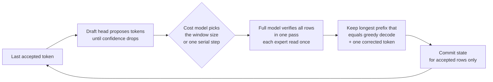
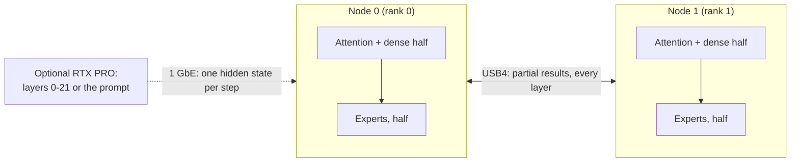

# Strix Halo engine lab

**Inferencia de LLM rápida y exacta escrita desde cero para AMD Strix Halo: un mini PC, dos enlazados por USB4 y una
GPU discreta cuando la hay.**

[English](README.md) · [Español](README.es.md)

Este motor de inferencia en C++/HIP está dirigido a **AMD Strix Halo** (Ryzen AI Max+ 395, Radeon 8060S
`gfx1151`, 128 GB de memoria unificada) en Linux con ROCm. Cinco motores están en **Production**, con ejecución
exacta y valores predeterminados rápidos: Qwen en un nodo, DeepSeek en un par USB4 o en una RTX independiente, y
MiniMax y GLM en el par. DeepSeek también admite ejecución RTX + par. Otros dos son opcionales (opt-in):
**Nemotron 3.5 Bolt E4B** en un nodo (`--profile default|fast|quality`, con un [drafter MTP](https://huggingface.co/hyukudan/Nemotron-3.5-Bolt-E4B-MTP-Drafter) y un
[paquete de calidad EXL3](https://huggingface.co/hyukudan/Nemotron-3.5-Bolt-E4B-EXL3) publicados) y **GLM-5.3 Flash en una RTX PRO 6000** (borrador, Windows).

Entre las mediciones publicadas se incluyen:

- **Nemotron 3.5 Bolt E4B (un nodo):** 92.9 tok/s con una petición y el drafter MTP sobre el Q4_K_M oficial
  (100.6 con `fast`); 340.2 tok/s agregados con ocho peticiones en `fast`; el paquete EXL3 de `quality` coincide con BF16 en el 92.9 %
  de los tokens top-1 (Q4_K_M: 87.0 %).
- **Qwen3.8-Flash-Next:** 59.59 / 54.00 tok/s en prompts de código de 1K / 8K con MTP;
  dos réplicas alcanzan 158.1 tok/s de rendimiento de reloj (wall) con ocho chats de programación concurrentes.
- **Par DeepSeek V4.1 Flash:** 70.6 tok/s en código con DSpark; ocho filas de decode simple
  alcanzan 113.9 tok/s agregados (calculado a partir del tiempo de paso medido); procesamiento exacto del prompt
  (tiempo hasta el primer token del servidor, un cliente, caché desactivada) de 8.29 / 29.77 / 42.72 s con
  8.4K / 32.5K / 44.7K tokens.
- **DeepSeek en RTX PRO 6000 independiente:** decode de código / inglés / español con la misma carga
  a 82.3 / 87.7 / 94.4 tok/s con el modelo objetivo y el draft en la GPU.
- **MiniMax M3.1 Flash:** 44.57 ms/token a 1K con decode simple; DSpark alcanza
  54.4 / 34.1 / 24.1 tok/s en JSON / Python / prosa.
- **GLM-5.3 Flash:** la autoespeculación MTP exacta predeterminada alcanza
  37.1 / 44.5 / 40.0 tok/s en chat / código / JSON.
- **GLM-5.3 Flash en una RTX PRO 6000, presupuestos de todo el dispositivo:** prefill y decode exactos con una caché de
  expertos repartida entre VRAM, RAM pinned y disco. Tarjeta completa sin cambios: TTFT 17.7 s con 8K y 41.2 s con 32K;
  decode de 3.3 tok/s en caliente. Ahora también funciona de forma exacta con 24 GiB de VRAM + 32 GiB de RAM del host
  (expertos leídos del disco): TTFT 64.8 s con 1K y 76.7 s con 8K; decode de 0.67 tok/s en caliente (0.63 en frío).
  Exacto = cada digest de estado y de logits es igual al de un prefill nuevo de prompt+t.

Son resultados específicos de cada carga de trabajo, no garantías de velocidad. [Qué velocidad](#how-fast) conserva el
hardware, los perfiles, la concurrencia y los límites de medición; el [rendimiento publicado](docs/performance.md)
contiene los registros que lo respaldan.

**Exactitud significa idéntico token a token a la ruta de referencia declarada.** La especulación y la concurrencia
preservan ese contrato; cambiar los pesos, la semántica rotatoria, la identidad numérica o la política de peticiones
cambia la referencia. Véase [Exactitud](#exactness).

Cada familia incluye herramientas de ejecución por línea de comandos y de cualificación. Qwen y el par DeepSeek exponen
rutas HTTP de chat, completions y Responses sin estado; MiniMax incluye `strix-minimax-serve`.
La RTX independiente usa un worker persistente con cola de ficheros. Véase [Ejecución](#run) para el contrato de lanzamiento de cada motor.

## De un vistazo

**¿Para quién es?** Desarrolladores que despliegan o estudian inferencia de LLM nativa y específica por modelo en Ryzen AI Max / Strix Halo.

| Pregunta | Respuesta corta |
|---|---|
| ¿Qué es? | Un motor de inferencia independiente en C++/HIP, con rutas de ejecución, kernels, gates de verificación y servicio HTTP específicos por modelo. |
| ¿Qué hardware? | Un nodo Linux Strix Halo, dos nodos enlazados por USB4 y asistencia opcional de una RTX PRO para perfiles seleccionados. |
| ¿Qué modelos? | Qwen, DeepSeek (par, RTX independiente y RTX + par), MiniMax y GLM están en Production; Nemotron 3.5 Bolt E4B (un nodo) y GLM en una RTX PRO 6000 son opcionales (opt-in). Véase [Modelos](#models). |
| ¿Cambia las salidas del modelo? | Exacto por defecto respecto a un perfil y una referencia declarados; la ejecución especulativa y concurrente preserva esa secuencia. Véase [Exactitud](#exactness). |
| ¿Cómo verifico los assets de una versión? | Use la herramienta de CPU del [manifiesto de assets de la versión](docs/operations/release-assets.md) para obtener hashes completos y un cierre explícito de roles. |
| ¿Qué diagnósticos de arranque hay disponibles? | Qwen tiene, activados por defecto, un [preflight de solo lectura y la identidad de compilación configurada](docs/operations/startup-preflight.md), con interruptores de desactivación explícitos. |
| ¿Por dónde empiezo? | Lea los [requisitos](#what-you-need), la [compilación](#build) y después la [ejecución](#run). |
| ¿Dónde están los resultados reproducibles? | En la [metodología y resultados de rendimiento](docs/performance.md), con condiciones de prueba y verificación; el rendimiento destacado no es una garantía universal. |

**Límites del proyecto:** [TensorMeld](https://github.com/hyukudan/tensormeld) se encarga de la planificación y el enrutamiento; el [driver USB4](https://github.com/hyukudan/strix-halo-usb4-driver) se encarga de la interconexión en Linux. Este repositorio es responsable de la **ejecución de la inferencia**, no de la gestión del clúster.

Para los detalles internos de la implementación, use [Cómo funciona](#how-it-works) y los documentos enlazados a lo largo de las secciones de modelos. Los pesos de los modelos y sus licencias son independientes del código del motor.

## Inicio rápido: compilar y ejecutar un modelo

Para otros motores, vaya a [par DeepSeek](#deepseek-pair), [RTX independiente](#deepseek-standalone-rtx),
[MiniMax](#minimax-pair) o [GLM](#glm-pair).

Este ejemplo mínimo es para **un nodo Linux Strix Halo** con la cadena de herramientas ROCm necesaria, el GGUF del modelo y un fichero `prompt.ids` generado por el tokenizador. Ejecuta **la generación de Qwen con los valores predeterminados de producción**, incluido el prefill rápido automático para los prompts que lo admiten.

```bash
git clone https://github.com/hyukudan/strix-halo-engine-lab.git
cd strix-halo-engine-lab
export PATH=/opt/rocm/core-10.1/bin:$PATH
cmake -S . -B build -G Ninja -DCMAKE_BUILD_TYPE=Release \
  -DCMAKE_HIP_ARCHITECTURES=gfx1151 \
  -DCMAKE_HIP_COMPILER=/opt/rocm/core-10.1/bin/amdclang++ \
  -DSTRIX_ENABLE_HIP_RUNTIME=ON \
  -DSTRIX_ENABLE_EXPERIMENTAL_Q4K_A8_RUNTIME=ON \
  -DSTRIX_BUILD_EXPERIMENTAL_Q4K_A8_PROBE=ON \
  -DSTRIX_USE_OPENSSL_SHA256=ON -DBUILD_TESTING=ON
ninja -C build strix-hip-decode-token
ctest --test-dir build --output-on-failure
```

Cada target HIP se compila para los objetivos de GPU AMD de `STRIX_HIP_ARCHITECTURES` (por defecto `gfx1151`); para añadir
una arquitectura, pase por ejemplo `-DSTRIX_HIP_ARCHITECTURES="gfx1151;gfx1160"`. El runtime sigue decidiendo qué conjuntos
de kernels puede ejecutar cada arquitectura.

Con el modelo Qwen correspondiente y los IDs de token disponibles en su directorio de trabajo:

```bash
./build/strix-hip-decode-token Qwen3.8-Flash-Next-UD-Q4_K_XL.gguf $(cat prompt.ids) --generate 256
```

Añada `--print-effective-config` para inspeccionar antes de la inicialización de HIP. Véase [Valores predeterminados e interruptores de desactivación](#defaults-and-off-switches) para el alcance de la línea base.

El comando produce un recibo JSON con los IDs de token y los tiempos. Los ficheros reales del modelo y los tokens del prompt **no se incluyen**. Para los assets del modelo, la aceleración opcional MTP/DSpark, el servicio y el transporte entre dos nodos, continúe con los [requisitos](#what-you-need), la [compilación](#build), la [ejecución](#run) y la [referencia completa del motor](docs/getting-started/engine-reference.md). Algunos casos de CTest requieren la GPU y los assets del modelo.

## Contenido

[Modelos](#models) ·
[Hardware](#hardware) ·
[Qué velocidad](#how-fast) ·
[Qué exactitud, qué calidad](#how-exact-how-good) ·
[Exactitud](#exactness) ·
[Por qué es diferente](#why-it-is-different) ·
[Idiomas](#beyond-english) ·
[Qué se necesita](#what-you-need) ·
[Compilación](#build) ·
[Ejecución](#run) ·
[Valores predeterminados e interruptores de desactivación](#defaults-and-off-switches) ·
[Optimizaciones](#optimizations) ·
[Cómo funciona](#how-it-works) ·
[Decisiones de diseño](#design-decisions) ·
[Hoja de ruta](#roadmap) ·
[Repositorios relacionados](#related-repositories) ·
[Preguntas frecuentes](#faq) ·
[Licencia](#license)

<a id="models"></a>

## Modelos

| Modelo | Se ejecuta en | Estado | Aspectos destacados |
|---|---|---|---|
| **Qwen3.8-Flash-Next** (UD-Q4_K_XL, 111 GB) | 1 nodo; 2 réplicas tras un router | **Production** | MTP exacto con una cabeza de draft destilada; contexto nativo hasta 262K y YaRN explícito hasta 1M; prefill por tiles HTTP automático; servidor con tantos slots de petición como admita la memoria (construidos bajo demanda); el decode sigue emitiendo durante prompts largos y las peticiones cortas se admiten dentro de ellos; caché de estado de prefijos; [perfil GSQ opcional (opt-in)](#gsq-opt-in-speed-over-quality-profile) |
| **DeepSeek V4.1 Flash** (1017; expertos de 2 bits, densos de 6.5 bits + trellis) | 2 nodos sobre USB4 | **Production** | Decode con paralelismo tensorial de expertos, prefill en dispositivo con paralelismo de expertos, decode especulativo DSpark, decode por batch, servidor; descubrimiento de expertos preparados y retención acotada de prefijos; gates bit a bit |
| DeepSeek V4.1 Flash + RTX PRO 6000 | RTX PRO (capas 0-21) + 2 nodos (22-39) | **Production** (D-064) | División del pipeline sobre 1 GbE, servicio de prefill CUDA, colocación de expertos calientes |
| DeepSeek V4.1 Flash, RTX independiente | RTX PRO 6000 (96 GB, Windows WDDM) | **Production** | Expertos GGUF Q2, densos Q8_0; VRAM exclusiva + caché en memoria de host fijada (pinned); DSpark en la GPU con el controlador caliente seleccionado como opción especulativa predeterminada |
| MiniMax M3.1 Flash (EXL3, 3.06 bpw) | 2 nodos TP2 sobre USB4 | **Production** | Gate de calidad de ocho textos superado; prefill/decode exactos; admisión automática de DSpark en el servicio y modo MSA 5; valores predeterminados de prefill/intercambio activados |
| GLM-5.3 Flash (EXL3, 4.05 bpw) | 2 nodos TP2 sobre USB4 | **Production** | Identidad de decode R1b por defecto; autoespeculación MTP exacta por defecto; prefill por fragmentos R1 exacto; `--identity r1` restaura R1; corrección R≥3 verificada en el par |
| GLM-5.3 Flash en una RTX PRO 6000 (borrador) | RTX PRO 6000 (96 GB, Windows) | **Opcional (opt-in)** | Prefill y decode greedy exactos; expertos enrutados servidos por la caché con compuerta en el dispositivo de [tierstream](https://github.com/hyukudan/tierstream) (dispositivo, RAM pinned, archivo de unidades); `--profile`; [guía](src/glm/rtxpf/README.md) |
| Nemotron 3.5 Bolt E4B (Q4_K_M; paquete EXL3 para `quality`) | 1 nodo | **Compilación opcional (opt-in)** (`STRIX_FAMILY_GEMMA4=ON`) | `--profile default\|fast\|quality`; decode exacto con cualquier tamaño de batch; drafter MTP exacto en C1; servidor con batching continuo |

El núcleo no conoce ningún modelo: cada familia es un módulo con su propio contrato, plan, kernels y gates
([docs/models/model-families.md](docs/models/model-families.md)). Las rutas automáticas admiten los assets de modelo según sus contratos documentados; la procedencia y las licencias se registran en
[docs/reference/sources-ledger.md](docs/reference/sources-ledger.md).

<a id="hardware"></a>

## Hardware

- **Nodo:** un mini PC AMD Strix Halo, Ryzen AI Max+ 395 con la iGPU Radeon 8060S (`gfx1151`), 128 GB de
  memoria unificada, Linux, ROCm.
- **Par:** dos nodos unidos por dos cables USB4 directos (un enlace de 40 Gb/s y otro de 20 Gb/s), gestionados por nuestra
  [serie de parches del driver USB4](https://github.com/hyukudan/strix-halo-usb4-driver): unos 37 Gb/s por sentido con ambos
  sentidos ocupados, 18.4 µs para un intercambio de 20 KB.
- **GPU discreta opcional:** una RTX PRO 6000 (96 GB, Windows WDDM), usada para DeepSeek independiente o para descargar
  el prompt; la división del pipeline de DeepSeek llega al par sobre 1 GbE.

<a id="how-fast"></a>

## Qué velocidad

Use el [kit de benchmarks y la guía de reproducción](docs/reproduce.md) para obtener los comandos actuales, los requisitos de los modelos, las interfaces para máquinas y los informes listos para abrir incidencias.

Todas las velocidades siguientes se miden en el laboratorio con decodificación greedy (temperatura 0). La exactitud es relativa al
perfil numérico indicado; la división del pipeline RTX con trellis y el decode R1b de GLM tienen identidades propias, como
se indica más abajo. Los techos de ancho de banda son cotas calculadas, no rendimiento medido. Las pruebas, los métodos y los valores anteriores están en
**[docs/performance.md](docs/performance.md)**.

Cómo leer las tablas:

- **Mejor** es el mejor resultado medido para ese modo, en la carga de trabajo que más le conviene (normalmente código o
  texto con mucha copia). **Típico** es el mismo modo con texto corriente, para saber qué esperar de un chat general.
- **tok/s** es la velocidad de decode una vez leído el prompt, para una petición salvo que la concurrencia indique
  otra cosa. **TTFT** es el tiempo hasta el primer token.
- **Build** identifica la revisión del código medida; los resultados se aplican a esa compilación y configuración.
  Los metadatos de calendario y la procedencia completa se conservan en los registros de rendimiento enlazados.
- El número de repeticiones se indica cuando se registró. No debe suponerse que los recuentos no especificados son medianas;
  las ejecuciones únicas y las campañas separadas siguen etiquetadas.

Hardware: **1 nodo** = un Strix Halo (128 GB). **2 nodos** = dos Strix Halo unidos por dos cables USB4.
**RTX PRO** = una RTX PRO 6000 Blackwell (96 GB) en un PC con 1 GbE.

### DeepSeek V4.1 Flash

Fuentes: [rendimiento publicado](docs/performance.md) y [valores predeterminados actuales del par](docs/models/deepseek-v4.1/production-defaults.md).

Filas solo del par: DeepSeek V4.1 Flash (checkpoint 1017), expertos enrutados en el GGUF publicado de 2 bits (Q2), pesos densos en
una superposición de 6.5 bits con pesos de atención, expertos compartidos y cabeza codificados con trellis. 2 nodos, paralelismo tensorial de expertos
(TP2) sobre USB4.

| Modo | Hardware | Prompt / contexto | Concurrencia | Mejor | Típico | Build |
|---|---|---|---:|---:|---:|---|
| Decode greedy | 2 nodos | benchmark de decode corto, R1 | 1 | **28.333 ms/token** (35.3 tok/s; 59.5 % del techo calculado, suelo de 16.87 ms) | 2 pares intercalados; tokens idénticos | `6a5604bf` |
| Decode especulativo DSpark | 2 nodos | 8 prompts por tipo, 256 tokens cada uno | 1 | **70.6 tok/s** (código) | 41.9 (inglés) / 45.3 (español); 50.0 sobre los 24 | `cab238d6` |
| Decode por batch, sin draft | 2 nodos | benchmark de decode N8, todas las filas iguales a la referencia | 8 | **70.24 ms/step** (113.9 tok/s agregados, calculado; 66.2 % del techo calculado, suelo de 46.48 ms) | | `6a5604bf` |
| Prefill en dispositivo (paralelismo de expertos) | 2 nodos | prompt de benchmark de 1K, tipo no especificado | 1 | TTFT **1.954 s** | mediana de 4; logits idénticos bit a bit en ambos ranks | `6a5604bf` |
| Prefill en dispositivo | 2 nodos | prompt de benchmark de 8K, tipo no especificado | 1 | TTFT **9.757 s** | mediana de 3; logits idénticos bit a bit en ambos ranks | `6a5604bf` |
| Prefill en dispositivo | 2 nodos | 16K | 1 | TTFT **20.40 s** (803 tok/s) | | `f9332f3e` |
| Prefill en dispositivo | 2 nodos | 32K | 1 | TTFT **39.6 s** (828 tok/s), 2 ejecuciones | | `43086d05` + valores predeterminados de prefill |
| Servidor, un cliente, chat | 2 nodos | prompt de chat | 1 | **66.9 tok/s** (código) | 34.9 tok/s (prosa) | versión publicada |
| Servidor, 8 chats × 128 tokens | 2 nodos | prompts de chat | 1 / 2 / 4 / 8 | **41.4 / 54.0 / 59.7 / 67.9 tok/s** agregados | | versión publicada |
| Servidor, conjunto corto de 8 categorías | 2 nodos | prompts de 36-303 tokens | 1 / 2 / 4 / 8 | | **39.88 / 61.66 / 66.53 / 74.25 tok/s** agregados | `cab238d6` |
| Servidor precalentado, conjunto corto de 8 categorías | 2 nodos | el mismo conjunto corto que arriba | 1 / 2 / 4 / 8 | **48.00 / 63.97 / 69.20 / 77.00 tok/s** agregados | 64/64 IDs iguales; ejecución C8 limpia (véase abajo) | `6a5604bf` |
| TTFT del servidor | 2 nodos | 8K, servidor caliente inactivo | 1 | **11.80 s** | **26.40 s** mientras otros 4 flujos hacen decode; primera petición a servidor recién arrancado 12.72 s | `cab238d6` |

**Activado por defecto** en la compilación del par (`6a5604bf`): fusión de shared-down
(`STRIX_DS41_SHARED_DOWN_FUSED=0` para desactivarla), kernel de prefill MoE con gate/up separados "forma 7"
(`STRIX_DS41_MOE_PREFILL=0`), selector exacto de prefill denso por sitio (`STRIX_DS41_DENSE_SELECT=0`;
las formas FP16 siguen desactivadas), plegado de ventana de atención / fragmentos vivos / tile f16
(`STRIX_DS41_ATTN_WINDOW_FOLD=0` / `STRIX_DS41_ATTN_LIVE_CHUNKS=0` / `STRIX_DS41_ATTN_TILE_F16=0`),
y precalentamiento del servidor + calibración de DSpark (`STRIX_DS41_SERVE_WARM=0` / `STRIX_DS41_DSPARK_CALIB=0`).
Mejoras medidas frente a `69c6bdab`, con los mismos turnos de GPU, el perfil de expertos Q2 + densos de 6.5 bits/trellis,
y dos nodos Strix Halo con paralelismo tensorial de expertos sobre USB4:

| Medición | `69c6bdab` → `6a5604bf` | Cambio | Verificación / condiciones |
|---|---:|---:|---|
| TTFT de prefill en dispositivo, 1K | 2.098 → **1.954 s** | −6.9 % | mediana de 4 |
| TTFT de prefill en dispositivo, 8K | 11.090 → **9.757 s** | −12.0 % | mediana de 3 |
| Decode greedy, R1 | 28.873 → **28.333 ms/token** | −1.9 % | 2 pares intercalados; tokens idénticos; 35.3 tok/s, 59.5 % del techo calculado (suelo de 16.87 ms) |
| Ventana de verificación de seis filas, R6 | 54.01 → **52.70 ms/window** | −2.4 % | idéntico |
| Ocho flujos, sin draft, N8 | 71.84 → **70.24 ms/step** | −2.2 % | todas las filas iguales a la referencia; 113.9 tok/s agregados (calculado), 66.2 % del techo calculado (suelo de 46.48 ms) |
| Servidor precalentado, conjunto corto de 8 categorías, C1 / C2 / C4 / C8 | 43.58 / 61.13 / 66.53 / 75.72 → **48.00 / 63.97 / 69.20 / 77.00 tok/s** agregados | +9.9 / +3.0 / +2.9 / +1.7 % | IDs de token 64/64 iguales en todas las ejecuciones |
| Streaming, un solo cliente | 54.67 → **58.77 tok/s** | +7.4 % | misma campaña de servidor precalentado |

El prefill usa prompts de benchmark de tipo no especificado; los logits son idénticos bit a bit a la referencia archivada
en todas las ejecuciones y en ambos ranks. El tipo de prompt y el contexto no se especifican en los benchmarks de decode cortos.
Servidor: dos ejecuciones por brazo en ambos órdenes; una de las dos ejecuciones de la nueva compilación tuvo un único bloqueo de una unidad de prefill
de 3.8 s (causa en investigación), por lo que C8 usa la ejecución limpia. La compilación del par medida sustituye
a la regresión anterior en el servicio con un solo cliente: sirve más rápido que `69c6bdab`.

**Activados por defecto** (exactos, mismos logits e ids generados):
kernel de atención por fragmentos «lean» (`STRIX_DS41_ATTN_LEAN=0` para desactivarlo), kernels MoE de prefill
separados v2 (`STRIX_DS41_PREFILL_MOE_V2=0`) y lectura anticipada de Engram entre piezas de prefill del servidor
(`STRIX_DS41_ENGRAM_LOOKAHEAD=0`). TTFT del servidor, un cliente, caché desactivada, prompts en inglés en frío,
2 nodos; la columna del valor predeterminado actual incluye además los cambios predeterminados posteriores hasta el PR #184:

| Prompt | Antes (main #148) | Estas tres palancas | Predeterminado actual (tras #184) | Cambio frente a antes |
|---|---:|---:|---:|---:|
| 8,399 tokens | 10.44 s | 9.70 s (−7.1 %) | **8.29 s** | −20.6 % |
| 32,499 tokens | 36.85 s | 33.79 s (−8.3 %) | **29.77 s** | −19.2 % |
| 44,699 tokens | 53.62 s | 48.27 s (−10.0 %) | **42.72 s** | −20.3 % |

Los logits y los 32 ids generados son iguales a las referencias publicadas en las tres longitudes. Por palanca (mismo
turno de GPU o turnos separados, una carga por brazo): MoE v2 −5.9 / −6.9 / −8.0 %, lectura anticipada de Engram
−3.3 % con 32,499 y −2.8 % con 44,699 tokens, atención «lean» −1.4 a −2.4 %.

`--profile fast` activa la palanca MoE de orden relajado `STRIX_DS41_FAST_MOE=1`: **8.53 / 29.24 / 41.90 s** con los
mismos prompts. Cambia los logits; su cualificación de calidad está en curso, y `default` no cambia.

**DeepSeek con la RTX PRO, división del pipeline** (los mismos ficheros de modelo; la RTX ejecuta las capas 0-21 con CUDA, los dos nodos ejecutan
las capas 22-39 y la cabeza):

| Modo | Hardware | Prompt / contexto | Concurrencia | Mejor | Típico | Build |
|---|---|---|---:|---:|---:|---|
| Decode por batch, sin draft | RTX PRO + 2 nodos | 8 prompts de benchmark, 48 tokens; 2 grupos en curso | 2 / 4 / 8 | **60.1 / 97.5 / 137.2 tok/s** agregados | igual bit a bit a la referencia solo del par | par `6525d5e8`, línea CUDA `463c08ec` |
| Decode DSpark por batch | RTX PRO + 2 nodos | mismo benchmark, ventanas del controlador | 1 / 2 / 4 | **52.4 / 91.3 / 156.8 tok/s** agregados de reloj | gates de referencia bit a bit | misma línea |
| Servidor, conjunto corto de 8 categorías | RTX PRO + 2 nodos | prompts cortos, DSpark; 2 grupos en curso | 1 / 2 / 4 / 8 | **43.2 / 65.8 / 77.9 / 91.7 tok/s** agregados | IDs de token iguales a solo el par en 32/32 peticiones | par `6525d5e8`, CUDA `463c08ec` |
| Lectura del prompt en la RTX PRO (perfil exacto) | RTX PRO | 2K / 8K / 32K | 1 | TTFT **3.64 / 4.39 / 12.20 s** | | versión publicada |

El pipeline de batch/servicio solapa dos grupos de peticiones: la RTX procesa uno mientras el par procesa
el otro (un solo grupo para una única petición). Estas filas de batch/servicio usan expertos Q2, la superposición densa de 6.5 bits y la identidad expert-TP
con gate propio; no usan el perfil compuesto con trellis de petición única.

La división RTX de petición única
es igual bit a bit al par sin los sitios trellis; con los sitios trellis es una identidad compuesta
declarada, comprobada frente al par (KL 1.7e-3), no bit a bit. TTFT de la RTX: servicio residente caliente, carga del modelo
excluida, hasta el estado de atención exportado entregado al endpoint de importación. Un perfil de prefill CUDA más rápido no supera
el gate de calidad en prompts largos y no se cita.

**DeepSeek en RTX independiente — Production.** Modelo objetivo DeepSeek V4.1 Flash completo en una
RTX PRO 6000 (96 GB, Windows WDDM): GGUF Q2 con gate/up enrutados **IQ2_XXS**, down enrutado **Q2_K**, densos **Q8_0**.
Los expertos usan VRAM exclusiva + una caché en memoria de host fijada; el modelo objetivo y el draft de DSpark comparten la GPU. El draft conserva
los 64 expertos más usados por etapa. Se han adoptado las escrituras diferidas/acotadas (write-backs), la corrección de instanciación de grafos CUDA y
el controlador caliente por defecto; la poda keep-64 midió **+16 %** en código con una ventana de cuatro filas.

| Modo | Código | Inglés | Español | Proporción del techo calculado |
|---|---:|---:|---:|---|
| Decode DSpark exacto, controlador caliente + write-backs diferidos, misma carga | **82.3 tok/s** | **87.7 tok/s** | **94.4 tok/s** | **51–58 %** del suelo de 6.18 ms/token con todos los aciertos |
| Decode DSpark exacto, mejores ejecuciones entre cargas | **94–95 tok/s** | **97 tok/s** | **100–101 tok/s** | **58–63 %** del mismo techo |

Cite el rendimiento en código como **82–95 tok/s**: las cargas varían hasta un **~10 %**, por lo que las comparaciones son válidas dentro de una misma carga.
Los gates exactos se superan para este perfil RTX; no se afirma igualdad con el perfil trellis del par.
Las longitudes de prompt y los recuentos de tokens generados no se especifican para estas últimas mediciones de decode.

| Trabajo de carga / servicio | Resultado medido | Estado |
|---|---|---|
| Carga de expertos en pipeline | Carga completa **108.7 → 61.8 s**; llenado de expertos **83.1 → 38.0 s**, **2.25 → 6.73 GB/s**, limitado por el disco | **Publicado, activado por defecto** ([PR #52](https://github.com/hyukudan/strix-halo-engine-lab/pull/52)); colocación y salidas idénticas bit a bit |
| Worker persistente cargado | **8–18 s por petición** en cargas de prueba sin recarga; reinicio de caché con carga nueva **3.4 s** | **Publicado** (`--serve`, PR #52); cada petición es idéntica bit a bit a un proceso nuevo |
| Prefetch de ventana | Sin ganancia repetible en comparaciones emparejadas en caliente | Exacto; desactivado por defecto |

**Arranque en frío, mismo perfil de RTX independiente.** Worker persistente,
binario probado `1569bce5`; los interruptores de write-back/flush en tiempo de ejecución preservan los tokens, logits y estado de un proceso nuevo
(6/6 comparaciones offline). Son tiempos por paso, no rendimiento de chat ni TTFT:

| Configuración | Paso 0 | Media pasos 0–15 | Media pasos 16–63 |
|---|---:|---:|---:|
| Carga nueva | 332.6 ms | 56.05 ms | 28.15 ms |
| Carga nueva con semilla de residencia guardada | 156.0 ms | 44.67 ms | 25.66 ms |
| Worker con precaptura de grafos | 11.0 ms | 33.99 ms | 27.26 ms |
| Worker, caché de expertos caliente | 10.9 ms | 11.63 ms | 11.49 ms |

La precaptura de grafos añade **1.5 s antes de estar listo**. El tipo y la longitud del prompt no se especifican para este benchmark
de la fase exacta. El worker, la semilla de residencia y la precaptura de grafos se publican con
[PR #52](https://github.com/hyukudan/strix-halo-engine-lab/pull/52): los ajustes exactos adoptados (keep-64, write-backs
diferidos, controlador caliente, paquete de kernels de decode y fusiones) están activados por defecto con interruptores de desactivación, y una ejecución sin flags
coincidió con la configuración explícita (todos los gates 64/64, trazas de especulación idénticas, 21/21 tokens de chat) en una caché
fijada reducida, por lo que ese gate no aporta cifras de velocidad. El rango medido de **82–95 tok/s** en código sigue siendo el resultado citado.
Compilación, ejecución y valores predeterminados: [docs/models/deepseek-v4.1/rtx-standalone.md](docs/models/deepseek-v4.1/rtx-standalone.md).

### Qwen3.8-Flash-Next

Fuentes: [mediciones de prefill/valores predeterminados](docs/performance.md#qwen-prefill-and-defaults) y [resultados de decode/servicio](docs/performance.md).

Todas las filas: Qwen3.8-Flash-Next, GGUF UD-Q4_K_XL (111 GB) más una cabeza de draft MTP Q8_0 destilada (2.8 GB), decodificación
especulativa MTP con ventanas 2/4/8, perfil A8 denso, thinking desactivado, 256 tokens generados salvo que se indique otra cosa.

| Modo | Hardware | Prompt / contexto | Concurrencia | Mejor | Típico | Build |
|---|---|---|---:|---:|---:|---|
| Decode MTP | 1 nodo | 1K, código, ventanas automáticas | 1 | **59.59 tok/s** (69 % del techo de bytes de 86.8 tok/s) | prosa: 55.7 tok/s (`0117a140`) | `702bc074` |
| Decode MTP | 1 nodo | 8K | 1 | **54.00 tok/s** (código, ventanas automáticas) | prosa: 49.58 tok/s (`226bb691`, atención de draft exacta) | código `702bc074`; prosa `226bb691` |
| Decode MTP | 1 nodo | 32K | 1 | **47.9 tok/s** (código; rango observado 44.5–52.6) | mediana de 4 | `0117a140` |
| MTP + ventanas de copia (opt-in), edición larga con copia | 1 nodo | documento Markdown (~10 KB) a corregir, respuesta de 2,047 tokens | 1 | **183.5 tok/s** | | `e1b115a2` |
| MTP + ventanas de copia (opt-in), edición larga con copia | 1 nodo | fichero Python + diff a aplicar, respuesta de 1,417 tokens | 1 | **163.9 tok/s** | | `e1b115a2` |
| MTP + ventanas de copia (opt-in), edición larga con copia | 1 nodo | fichero C++ a reescribir con renombrados, respuesta de 1,711 tokens | 1 | **155.1 tok/s** | | `e1b115a2` |
| MTP + ventanas de copia (opt-in), 7 tareas de edición con copia | 1 nodo | entradas de 5-10 KB, respuestas de 1,114-2,047 tokens | 1 | | **125.2 tok/s** (90.2 sin ventanas de copia) | `dd65dbd5` |
| MTP + ventanas de copia (opt-in), sesiones de agente | 1 nodo | 6 sesiones de agente de programación | 1 | | 59.9 tok/s (sin cambios con ventanas de copia) | `dd65dbd5` |

Las ventanas de copia (`--mtp-ngram-draft=wide --mtp-copy-wide-rows 32`) verifican hasta 32 filas cuando la respuesta copia texto
del prompt; los tokens son idénticos a los predeterminados en todas las ejecuciones. Ayudan cuando la respuesta vuelve a emitir tramos largos
de la entrada (reescrituras, parches, correcciones de documentos), no hacen nada con texto nuevo y actualmente funcionan para una petición por
proceso (todavía no con el servidor por batch).

**Dos réplicas** (un modelo completo por nodo tras el router, `--http-batch 8`, servidores reiniciados antes de cada
una de las 3 rondas, sin precalentamiento; los ids de token son iguales a la ejecución en un solo nodo en 570/570 respuestas). Las tasas de reloj más recientes
de chat de programación usan la compilación `0117a140`, servidores recién arrancados con una petición de precalentamiento excluida, 3 rondas ABBAAB; 90/90
respuestas iguales a la referencia de un solo nodo:

| Modo | Hardware | Prompt / contexto | Concurrencia | Mejor: chat de programación | Típico: conjunto corto de 8 categorías | Build |
|---|---|---|---:|---:|---:|---|
| Servidor, dos réplicas | 2 nodos | chat de ~70 tokens / prompts de 36-303 tokens | 1 | **68.2 tok/s** de reloj | 42.8 tok/s de reloj, TTFT p50 0.89 s | `0117a140` programación; conjunto corto de la versión publicada |
| Servidor, dos réplicas | 2 nodos | igual | 2 | **136.4 tok/s** de reloj | 85.8 de reloj, TTFT p50 0.85 s | `0117a140` programación; conjunto corto de la versión publicada |
| Servidor, dos réplicas | 2 nodos | igual | 4 | **146.8 tok/s** de reloj | 102.9 de reloj, TTFT p50 1.32 s | `0117a140` programación; conjunto corto de la versión publicada |
| Servidor, dos réplicas | 2 nodos | igual | 8 | **158.1 tok/s** de reloj | 120.4 de reloj, TTFT p50 2.55 s | `0117a140` programación; conjunto corto de la versión publicada |

*De reloj* (wall) es el total de tokens de completion sobre el tiempo de reloj, incluidos el primer token y la espera en cola. La campaña
anterior de chat de programación midió **90.7 / 181.5 / 201.6 / 255.0 tok/s** de decode sumado por petición
con concurrencia 1 / 2 / 4 / 8; el decode sumado excluye el tiempo de prompt y de cola de cada petición.

**Lectura del prompt, un nodo** (perfiles y condiciones más abajo) y **con la RTX PRO** (prefill CUDA exacto
en la RTX, estado de atención y recurrente enviado al nodo sobre 1 GbE a medida que termina cada capa; después el
nodo hace el decode; 64 tokens generados idénticos a la ejecución solo en el nodo para cada longitud; una ejecución por longitud):

| Modo | Hardware | 1K | 4K | 8K | 16K | 32K | Build |
|---|---|---:|---:|---:|---:|---:|---|
| Prefill, TTFT | 1 nodo | **1.12 s** | **3.02 s** | | **14.64 s** | **22.95 s** | `0117a140` (1K/16K); perfil combinado más abajo (activado por defecto) |
| Descarga de prefill, TTFT | RTX PRO + 1 nodo | **1.36 s** | **1.92 s** | **2.94 s** | **4.95 s** | **8.99 s** | `70b93af3` |
| Mismo servidor sin la RTX, TTFT | 1 nodo | 1.80 s | 5.20 s | 10.46 s | 21.43 s | 44.02 s | misma compilación del servidor |

La descarga se compara con el mismo servidor de producción al que reenvía (tiles de prompt de 2,048 filas), que lee
los prompts más despacio que la fila de prefill de un nodo anterior (tiles de 8,192 filas). A 32K la ruta RTX es 4.9× más rápida que
ese servidor. Con la descarga activada, el router envía los prompts de 1K tokens o más a la RTX PRO; los más cortos
se leen en el nodo.

**Build `0117a140`** (medida frente a la compilación publicada en la misma sesión, ejecuciones intercaladas,
todas exactas): TTFT un 2.3 % (1K), un 3.4 % (4K) y un 5.1 % (16K, 32K) menor; decode igual o hasta un 0.4 % más rápido;
dos réplicas con concurrencia 4 y 8: un 3.9 % y un 3.6 % más de rendimiento de reloj, y un TTFT un 6.9 % menor con
concurrencia 4. Detalles en [docs/performance.md](docs/performance.md#qwen38-flash-next-1).

**Prefill combinado exacto.** Un nodo Strix Halo, Qwen3.8-Flash-Next UD-Q4_K_XL,
decode A8 denso con una identidad de prefill FP16 rápida separada; compilación `8b99cf58`, valores predeterminados sin variables de entorno que los sustituyan. Comparaciones en el mismo nodo
frente a `4a44683b`, excepto la comparación con contexto máximo y desactivado en la misma compilación. Los logits FP32 finales y los tokens
coinciden con la referencia en todas las longitudes; los recibos de cualificación code-1K y prose-8K coinciden con la línea base archivada.
El tipo de prompt no se especifica para el barrido de longitudes.

| Tokens del prompt | TTFT de línea base | TTFT predeterminado | Cambio | tok/s predeterminado | Proporción del techo del contrato |
|---|---:|---:|---:|---:|---:|
| 4,096 | 3.53 s | **3.00 s** | −15.0 % | 1,363 | 43.4 % de 3,139 tok/s |
| 17,700 | 14.97 s | **12.81 s** | −14.4 % | 1,382 | 44.7 % de 3,089 tok/s |
| 32,768 | 25.95 s | **23.49 s** | −9.5 % | 1,395 | 45.3 % de 3,078 tok/s |
| 65,536 | 55.37 s | **48.18 s** | −13.0 % | 1,360 | 44.9 % de 3,030 tok/s |
| 131,072 | 120.96 s | **105.84 s** | −12.5 % | 1,238 | 42.6 % de 2,907 tok/s |
| 262,143 | 291.82 s (misma compilación, desactivado) | **240.62 s** | −17.5 % | 1,089 | 40.5 % de 2,687 tok/s |

Dos ejecuciones por brazo a 4K / 17,700; 32K tiene una ejecución de línea base y dos predeterminadas; las filas más largas son ejecuciones únicas.
Tiles de prompt: 4,096 a 4K / 128K, 8,192 a 17,700 / 32K / 64K, 2,048 con colas de 256/16 filas a 262,143.
La dispersión entre ejecuciones y entre nodos llega a ~5 %; las comparaciones únicas son orientativas.

[PR #49](https://github.com/hyukudan/strix-halo-engine-lab/pull/49) incorpora como valores predeterminados el prefill combinado, el batching/core16 de los gates GDN
y el staging de selección/activación del router. [PR #50](https://github.com/hyukudan/strix-halo-engine-lab/pull/50)
añade la salida HC v3 con banda 16 (`5011b842`): TTFT a 32K **−0.52 s (−2.2 %)** en tres pares alternos,
4K **−54 ms (−1.8 %)** en dos pares; los logits y los tokens siguen siendo iguales. Una ejecución única posterior a 32K con esa compilación
midió **22.03 s, 1,487 tok/s (48.3 % del techo del contrato de 3,078 tok/s)**.
`STRIX_QPF2K_DEFAULTS=0` suprime el conjunto de valores predeterminados de prefill y rechaza el tiling automático; los interruptores de desactivación específicos de HC son
`STRIX_QPF2K_HC_OUTPUT3=0` / `STRIX_QPF2K_HC_OUTPUT3_BAND=0`.

**Batching de etapas QSA — activado por defecto, [PR #51](https://github.com/hyukudan/strix-halo-engine-lab/pull/51).**
TTFT exacto a 32K **22.21 / 22.66 / 22.76 → 21.57 / 22.32 / 22.58 s** (tres pares, media **−0.39 s, −1.7 %**);
en la compilación publicada, 32K en cuatro pares ABBA **−0.17 s** de media (todos los pares más rápidos) y 64K **46.76 → 46.01 s (−1.6 %)**;
17,700 **12.54 → 12.46 s** (un par). Los tokens, los logits finales y los recibos de cualificación code-1K / prose-8K coinciden.
`STRIX_QPF2K_QSA_MASK=0x57` restaura las etapas anteriores (predeterminado `0x2257`; `0x257` mantiene todo excepto la variante de ocupación de attend).
Estos tiempos son comparaciones separadas, no un nuevo barrido de longitud completa.

La CLI simple ahora se resuelve a la ruta de producción medida. En un nodo Strix Halo, la identidad de prefill FP16
rápida midió **22.03 s / 1,487 tok/s a 32K**, **100.3 s a 131,072 tokens** y
**202.8 s / 1,293 tok/s a 262,143 tokens** (T8192 en las longitudes largas, recuperación de páginas PLE admitida).
Los digests coinciden con la referencia de esa identidad a 32K/64K/128K/262K; esto no es igualdad de bits con el serial A8 denso
ni una nueva cualificación de fidelidad del modelo en contexto largo. Véase el [catálogo](docs/optimizations.md#qwen-tiled).

La atención de draft MTP exacta y los valores predeterminados del router están activados en la línea pública de Qwen.
El drafting MTP por batch sigue siendo opt-in. El servidor HTTP dimensiona sus slots de petición a partir de la memoria (`--http-batch N` pone el límite, `0` = de uno en uno), atiende las peticiones en decode en los límites de capa dentro de bloques de prompt largos (`STRIX_BATCH_SERVICE_MS=250`), ejecuta primero los prompts cortos y los anida en un prompt largo en pausa (`STRIX_BATCH_NEST_ROWS=2048`), y cancela en esos límites; cada petición conserva los IDs de token y el estado confirmado que tendría sola. Con un prompt de 32K llegando entre tres flujos en decode (comando predeterminado), el hueco de decode p90 pasó de 14.3 s a 0.54 s y el primer token de una petición corta de 42-52 s a 2.3-3.8 s ([servicio](docs/engine/serving/serving.md#batched-decoding)).

**Almacenamiento BF16 de las rutas MoE: candidato opcional (opt-in), pendiente de cualificación.** `STRIX_QPF2K_MOE_ROUTE_BF16=1`
(o `--prefill-moe-route-bf16 on`) guarda en BF16 los productos escalares MoE de cada ruta y los amplía de forma exacta en
la fusión ordenada. Cambia bits (identidad de almacenamiento del prefill `fp16-v1+moeroute16`), está desactivado por
defecto y solo `--profile fast` lo aplica, como fila provisional, hasta que supere la cualificación. Misma compilación, CLI simple, tres
ejecuciones emparejadas cada una: TTFT a 32K **21.83 → 21.15 s (−3.2 %)**, a 16K **10.38 → 10.11 s (−2.3 %)**, todos
los pares más rápidos. A 262K (YaRN factor 2, ruta en serie, `--profile default` frente a `--profile fast`, dos pares
intercalados) el prefill pasó de **191.2 a 185.7 s (−2.9 %, 1,371 → 1,412 tok/s)**, cada ejecución fast más rápida
que cada ejecución default; el decode no cambia. Véase el [catálogo](docs/optimizations.md#qwen-moe-route-bf16).
GSQ, más abajo, es un perfil separado que prioriza la velocidad sobre la calidad.

<a id="gsq-opt-in-speed-over-quality-profile"></a>

### GSQ: perfil opcional (opt-in) de velocidad sobre calidad

GSQ HYB-Q2 sustituye los expertos enrutados de la receta de calidad por pesos Q2_0; **nunca es el valor predeterminado**.
En la puntuación por fichero de pesos sobre el conjunto de calidad bloqueado de 64 prompts (23,552 posiciones puntuadas, contextos de 2K–32K), la concordancia top-1 con la
referencia Q8_0 es del **76.6 %**, frente al **88.1 %** de UD-Q4_K_XL: una pérdida de **11.5 puntos porcentuales**. Este perfil
no supera el criterio de aceptación de la receta de calidad. Estas puntuaciones de calidad no vuelven a puntuar la ruta de prefill FP16 del motor.

Medido en un nodo Strix Halo, Qwen3.8-Flash-Next, una sola petición, 256 tokens generados,
`702bc074`; el tiempo de decode excluye el prompt. Cada ejecución coincide con los tokens de referencia (golden) de su propia receta.
Las dos recetas tienen pesos distintos y pueden producir respuestas distintas.

| Prompt de código | Ventana MTP | GSQ HYB-Q2, tok/s | Receta de calidad, tok/s | GSQ / calidad |
|---|---|---:|---:|---:|
| 1K | auto | **73.18** | **59.59** | 1.23x |
| 1K | ruta {2} | **49.16** | **41.85** | 1.17x |
| 1K | R2 forzada | **49.17** | **41.82** | 1.18x |
| 1K | R4 forzada | **64.42** | **51.56** | 1.25x |
| 1K | R8 forzada | **66.56** | **52.07** | 1.28x |
| 8K | auto | **65.96** | **54.00** | 1.22x |
| 8K | ruta {2} | **45.51** | **40.05** | 1.14x |
| 8K | R2 forzada | **45.42** | **40.27** | 1.13x |
| 8K | R4 forzada | **59.61** | **51.44** | 1.16x |
| 8K | R8 forzada | **56.60** | **50.05** | 1.13x |

Auto usa la política MTP de producción. La ruta {2} es el ajuste MTP "R1" del arnés, no el decode greedy serial.
Aceptación MTP en auto: 1K 0.72 (GSQ) frente a 0.66 (calidad); 8K 0.66 frente a 0.73. Procesamiento del prompt en las mismas ejecuciones
(en caliente): 1K 1.03 s frente a 1.17 s; 8K 7.7-7.8 s frente a 7.9 s. Respecto al techo de bytes de cada receta para código 1K con MTP,
GSQ auto alcanza alrededor del 64 % (techo de 113.8 tok/s) y la receta de calidad alrededor del 69 % (techo de 86.8 tok/s).

### MiniMax M3.1 Flash

Fuentes: [registros de rendimiento](docs/performance.md) y [pruebas actuales de optimización](docs/optimizations.md#minimax).

Todas las filas: pesos trellis EXL3 a 3.06 bpw, dos nodos Strix Halo TP2 sobre USB4, referencia greedy.
El motor está en Production; los conjuntos de optimización cualificados siguientes son públicos y están activados por defecto.
Los [cambios de planificación del prefill agrupado en el host](docs/minimax-grouped-prefill.md) están activados por defecto para
las llamadas agrupadas en las que cada miembro tiene al menos 2048 filas. Prompts equilibrados de 7940 tokens midieron
un tiempo de prefill un 2.3–2.6% menor con IDs de token completos idénticos; las colas pequeñas desequilibradas usan la ruta ordinaria.

| Modo | Prompt / contexto | Resultado medido | Build / exactitud |
|---|---|---|---|
| Decode greedy | prompts de benchmark de 1K / 8K, 256 tokens | **44.57 / 46.10 ms/token** (22.44 / 21.69 tok/s) | `8cc30ac0`; los ranks coinciden, IDs de referencia iguales |
| Prefill combinado nuevo | prompt de benchmark de 8K | **17.731 s**, 462 tok/s; línea base 21.874 s (**−19 %**); **36–39 %** del suelo de kernel calculado de 6.3–7.0 s | `e0bad3d1`; el estado y los logits finales de ambos ranks son iguales a la producción archivada |
| Prefill combinado nuevo | prompt de benchmark de 32K | **91.508 s**, 358 tok/s; **28–32 %** del suelo de kernel calculado de 26–29 s | `e0bad3d1`; referencia nueva, no una comparación de exactitud con una referencia archivada |
| Prefill combinado, mismo proceso | 1K / 8K, tres pares alternos | **2.73–2.77 / 20.3–20.8 s**, **0.848–0.853× / 0.783–0.797×** el tiempo de la línea base | `561de319`; comprobaciones de estado/fila final y tokens iguales en ambos ranks |
| Batch, proceso nuevo por brazo | N=1 / N=8, benchmark de 1K | **43.92 / 130.24 ms/step** (N8: **61.4 tok/s agregados**, calculado) | `8cc30ac0`; cada fila es igual a ejecutarse sola; la invariancia de batch se cumple |
| DSpark | JSON / Python / prosa, 256 tokens | **54.4 / 34.1 / 24.1 tok/s** | `8cc30ac0`; IDs iguales a greedy |

Los tipos de prompt no se especifican para los benchmarks de prefill y de batch. Las filas de prefill nuevo son ejecuciones únicas;
el resultado del primer uso a 1K fue de **3.509 s**. La ejecución combinada alcanzó después su límite de tiempo en otro brazo; solo se citan
las mediciones completadas. Los nuevos valores predeterminados de prefill en `561de319` incluyen proyecciones densas por tiles, atención/router por batch
y tiles de filas MoE de ajuste exacto. Preservan la identidad de producción.

Los valores predeterminados de límites de intercambio en `8cc30ac0` están cualificados a 1K/8K/16K (16K con repetición sintética): las repeticiones
emparejadas ahorran **4.20 / 2.82 / 3.09 ms/token**. En el A/B de batch con proceso nuevo, N1/N8 bajan de **48.22 / 134.03**
a **43.92 / 130.24 ms/step**; la ralentización anterior de N8 se debió a la limitación térmica/de potencia de la GPU bajo
carga sostenida (unos 96 °C, reloj de shaders −20 % en ~100 s), no al motor. Las filas anteriores son
cifras de arranque en frío con procesos nuevos; con servicio sostenido, el decode medido es alrededor de un 5 % y el prefill
alrededor de un 15 % más lento con esta refrigeración (29 peticiones secuenciales: 44.9 → 47.2 ms/step). Esto no justifica una afirmación general de velocidad de servicio. Los valores predeterminados selectivos posteriores de MoE/atención figuran en el [catálogo](docs/optimizations.md#minimax).

**Gate de calidad: superado** en la evaluación prerregistrada de ocho textos, incluidas dos ejecuciones TP2 independientes
e idénticas byte a byte y todas las comprobaciones de prompt/régimen. La KL media respecto a la referencia exacta es **0.1449** frente a
**0.1425** de la aritmética de CPU de producción. La concordancia top-1 es **0.47 puntos porcentuales menor** que la referencia
de CPU, dentro del margen prerregistrado de 2 puntos; la precisión del siguiente token difiere en **+0.01 puntos**. Esta
cualificación está condicionada a esos ocho textos; sustituye al fallo anterior con dos prompts.

### GLM-5.3 Flash

Fuentes: [registros de rendimiento](docs/performance.md) y [valores predeterminados/pruebas actuales de GLM](docs/optimizations.md#glm).

EXL3 4.05 bpw, dos nodos Strix Halo TP2 sobre USB4. Motor en Production. R1b es la identidad de decode predeterminada; los prompts usan prefill por fragmentos R1 exacto;
el decode usa autoespeculación MTP exacta por defecto (`--mtp 0` = decode simple).
`--identity r1` restaura R1 en todo el proceso. Las mediciones históricas de R1 siguientes conservan su identidad original.

El prefill del prompt en las ejecuciones de decode con dos ranks usa por defecto 8192 filas cuando ambos ranks admiten la carga calibrada
y todos los propietarios del prefill; en caso contrario, ambos usan 4096. Esto se aplica al decode de producción con autoespeculación MTP
y al prefill por fragmentos simple dentro de ejecuciones `--decode`. La selección usa el margen de RAM
y GTT de la admisión de carga, el staging, las reservas, las lecturas de tensores completos y el búfer de rebote, más el crecimiento de prefill y de comunicación
y la protección de memoria libre del dispositivo.
Se conserva el mayor entre el margen de carga, el margen de prefill y 8 GiB. El decode Comm normal con dos ranks reutiliza
su intercambio de configuración existente y su voto de discrepancia para acordar el modo y el mínimo de filas propuestas.
Los modos fijos conservan sus bytes de carga útil y el orden de etiquetas; los modos mixtos auto/fijo se rechazan en ambos ranks.
Los pools de comunicación automáticos empiezan en 4096 y solo crecen tras acordar 8192. Una nueva comprobación de admisión
tras el crecimiento usa un único voto mínimo solo automático y reduce ambos pools en caso de volver a 4096.
Las ejecuciones Comm con dos ranks sin ese handshake (solo prefill, gates de referencia y solo batch) usan 4096 en modo
auto, con origen `auto-4096-no-handshake`, sin intercambio de control. Los recuentos de filas explícitos deben coincidir.
`--pf-ttft` y los arneses de gates mantienen 4096 salvo que se indique explícitamente `--max-rows 8192`.
Ahí no se pueden comprobar discrepancias de filas fijas al arrancar sin
cambiar el protocolo existente. `--xch xfer` externo en auto usa 4096 sin intercambio de acuerdo.
El prefill de referencia (`--prefill ref`, prefill automático con `r1b-all` o `--idcheck` con decode) usa
4096 en modo auto (`auto-4096-ref`) sin intercambio de acuerdo del recuento de filas.
La ruta de prefill exacta conserva su aritmética entre tamaños de fragmento; el TTFT medido en la ruta de prefill por fragmentos
con 8192 filas mejora un 4 % a 8K y de 116.3 a 109.9 s (5.5 %) a 32K, usando unos 7.3 GiB más de
memoria de GPU por nodo.
`STRIX_GLM_MAX_ROWS_AUTO=0` restaura el valor fijo 4096; `--baseline` mantiene 1024, y un `--max-rows` explícito mantiene su valor.
`--print-effective-config` informa del candidato independiente del host y de la política de arranque; stderr informa
del margen de admisión y del valor final con su origen. Véase el [catálogo](docs/optimizations.md#glm-max-rows-auto).

| Modo | Prompt / contexto | Medido | Build / exactitud |
|---|---|---:|---|
| Decode greedy, R1 | prompt de chat de 31 tokens + 64 tokens generados | **45.29 ms/token = 22.1 tok/s**; **51 %** del suelo calculado de 23.2 ms | `1836c99c`; tokens iguales a la referencia |
| Decode por batch, R1 | Ocho filas independientes, contexto del benchmark no especificado | **122.0 ms/step = 65.5 tok/s agregados** | `1836c99c`; tokens iguales a la referencia anterior del par real |
| Prefill por fragmentos exacto | prompts de benchmark de 1K / 8K / 32K, tipo no especificado | TTFT **4.268 / 34.70 / 144.75 s** (240 / 236 / 226 tok/s) | `875ca821`, integrado en `41d8cfdc`; los logits de ambos ranks son iguales bit a bit al prefill exacto anterior |
| R1b-fast, ahora la identidad de decode predeterminada | Mismo benchmark de chat, comparación alterna de 96 tokens | **41.93–41.96 ms/token**, frente a R1 47.33–47.48 (**−11.5 %**, **55 %** del suelo de 23.2 ms) | `8877de1d`; estable dentro de cada identidad, no igual bit a bit a R1 |
| Autoespeculación MTP (predeterminada) | Prompts de chat / código / JSON, 64–128 tokens generados, rank 0 | **26.98 / 22.46 / 24.98 ms/token = 37.1 / 44.5 / 40.0 tok/s** (1.50× / 1.79× / 1.62× el simple de 40.3–40.6 ms/token); TTFT 8K **31.13 s** (+2.9 %), 32K **140.9 s** (+8.7 %: llenado de la caché MTP de la capa adicional) | Vectores de tokens completos y logits del prompt iguales a `--mtp 0` en 7 prompts, ambos ranks; TTFT simple sin cambios |
| Prefill por fragmentos exacto, núcleo lineal X2 (predeterminado) | prompts de benchmark de 1K / 8K / 32K | TTFT **3.78 / 27.93 / 120.26 s** (271 / 293 / 272 tok/s); misma ejecución con `STRIX_GLM_PF_EXACT_X=0`: 1K 3.84 s, 8K 29.59 s (**−5.6 %** a 8K) | logits iguales bit a bit a la ruta X=0 en ambos ranks; anclas de decode y oráculo especulativo sin cambios |
| Prefill por fragmentos exacto, núcleo lineal X2 + MoE auto (predeterminado) | prompts de benchmark de 1K / 8K / 32K | TTFT **3.74 / 26.85 / 113.73 s** (274 / 305 / 288 tok/s); misma ejecución con `STRIX_GLM_PF_EXACTMOE_V=3`: 1K 3.76 s, 8K 28.17 s (**−4.7 %** a 8K) | salidas iguales bit a bit a la ruta v3 en ambos ranks (las cargas útiles NaN FP32 internas solo pueden diferir en el caso de desbordamiento FP16); anclas de decode y oráculo especulativo sin cambios |
| Prefill por fragmentos exacto, núcleo MoE X3 y cubetas de filas (predeterminado actual, PR #183) | prompts de benchmark de 1K / 8K, fragmentos de 8192 filas | TTFT **3.18 / 20.32 s**; misma ejecución con `STRIX_GLM_PF_EXACTMOE_V=7`: 1K 3.75 s, 8K 25.24 s (**−15 % / −19.5 %**) | dos pares por brazo; R1 bit a bit (mismas cadenas DOT2, reduce4 y orden de división) |
| Concordancia R1b con teacher forcing | 32 prompts, 256 posiciones cada uno; chat, código, JSON, matemáticas, razonamiento, traducción | **8,126/8,192 = 99.19 %** top-1; KL media **~1.8e-3 nats** | `4dad4c19`; las ejecuciones libres divergen en **28/32** prompts entre 19 y 227 tokens |

La corrección del búfer R≥3 está verificada en el par real. La integración más reciente usa intercambio directo para los forwards
simples y MoE v3 exacto para el prefill; el oráculo especulativo también se supera con conmutación de intercambio drenado.
Las filas de prefill son ejecuciones únicas. Sustituyen al resultado anterior, solo sintético.

R1b cambia el orden de la suma FP32 y no es idéntico bit a bit a R1; qué identidad está más cerca de float64 a profundidad completa
sigue sin resolverse. Los grafos HIP **no están implementados**: el perfil más reciente (`41d8cfdc`) mantiene la GPU ocupada el **96.3 %** de cada forward (antes 80.8 %; 909 lanzamientos en lugar de 1,679) y deja solo **2.10 ms de inactividad por forward**
y un hueco recuperable calculado de **≤1.8 ms** (una cota, no una aceleración medida). El avance del host a través de
los límites de intercambio requiere captura segmentada; los kernels de dispositivo y el desfase entre ranks tienen prioridad.

**GLM-5.3 Flash en una RTX PRO 6000 (borrador, opcional, Windows).** El tronco, las capas densas y los expertos
compartidos se quedan en la tarjeta; los 43 x 288 expertos enrutados los sirve la caché con compuerta en el dispositivo
de [tierstream](https://github.com/hyukudan/tierstream), y el prefill los lee a través de la misma caché, así que la
tarjeta guarda una sola copia de cada experto. El prefill y el decode son exactos (digests bit a bit de logits y
estado; estado del prefill igual con tiles de 2048 / 4096 / 8192 filas). Tarjeta completa: TTFT **17.7 s** con 8K y
**41.2 s** con 32K con el mejor tile (17.7-22.7 s / 41-55 s según el tile); decode de unos **3.3 tok/s** en caliente
(2.5 en frío), limitado por el cómputo y el coste de lanzamiento, y aún en optimización. Con 24 GiB de VRAM + 32 GiB de
RAM del host (la mayoría de los expertos leídos del archivo de unidades en disco) también funciona de forma exacta: TTFT
**64.8 s** con 1K y **76.7 s** con 8K; decode de **0.67 tok/s** en caliente (0.63 en frío). Compilación, archivo de unidades y opciones: [guía de GLM RTX](src/glm/rtxpf/README.md).

### Nemotron 3.5 Bolt E4B

Fuentes: [guía del modelo](docs/models/nemotron-3.5-bolt-e4b/README.md).

Un nodo Strix Halo (gfx1151, 128 GB), GGUF Q4_K_M oficial para `default` y `fast`, paquete EXL3 para `quality`;
decode de chat en inglés de 256 tokens, greedy. C4 y C8 son tok/s agregados entre peticiones concurrentes. Cada valor
de llama.cpp procede de la misma sesión de medida que la fila con la que se compara.

| Perfil | C1 con el [drafter MTP](https://huggingface.co/hyukudan/Nemotron-3.5-Bolt-E4B-MTP-Drafter) (configuración publicada) | C1, sin drafter | C4 | C8 |
|---|---:|---:|---:|---:|
| `default` (exacto, `g4-v1`) | **92.9** | 56.0 | 169.3 | 238.5 |
| `fast` (`g4-a8-v1`, cualificado) | **100.6** | 54.1 | 206.7 | 340.2 |
| `quality` ([paquete EXL3 M4](https://huggingface.co/hyukudan/Nemotron-3.5-Bolt-E4B-EXL3), `g4-exl3-v3`) | **83.8** | 44.4 | 153.1 | 258.3 |
| llama.cpp `74a4fb00`, mismo Q4_K_M | — | 55.5 | 193.8 | 283.4 |

Con el drafter, los ids de los tokens son iguales a los obtenidos sin draft (verificado en inglés, español, japonés y
código en C1, y en C4). Con una petición, el motor verifica solo los tokens propuestos de los que el drafter está
seguro (una ventana de probabilidad acumulada, con umbral guardado por drafter), lo que subió C1 con drafter de
85.1 / 92.2 / 72.1 a 92.9 / 100.6 / 83.8 tok/s (`default` / `fast` / `quality`, misma máquina);
`STRIX_G4_MTP_CONF=0` restaura la política de ventana anterior.

El decode de una petición también propone tokens a partir del propio texto (prompt lookup): propone la continuación
de la coincidencia anterior más larga de los últimos tokens del prompt y de la salida, y el modelo principal verifica
cada token, así que los ids de los tokens son iguales a los obtenidos sin draft. Sin drafter gana mucho (C1,
`default`, 256 tokens): prompt de agente con edición (2.2K tokens) **114.9** tok/s frente a 48.2 sin draft, prompt de
herramienta JSON (1.2K) **122.9** frente a 49.3, documento de 29.5K tokens **35.0** frente a 28.1, código **55.8**
frente a 51.9; chat en inglés, español y japonés +1 a 2 %. Junto al drafter MTP, un selector por petición solo propone
una ventana de lookup ante una coincidencia fuerte y se retira tras los fallos, así que no estorba: igual que el
drafter solo dentro del ruido en chat, código, prompts de agente y 32K (agente con edición 146.8 frente a 146.2,
herramienta JSON 172.2 frente a 171.6, código 112.6 frente a 112.5, 29.5K 50.5 frente a 50.4, chat en inglés 92.8 frente
a 92.8). `STRIX_G4_LOOKUP=0` lo desactiva.

El servidor HTTP agrupa las peticiones de chat concurrentes: hasta ocho peticiones (`STRIX_G4_SERVE_SLOTS`) comparten
un planificador y se decodifican en la misma pasada del modelo, las peticiones nuevas entran entre pasos y los ids de
tokens de cada petición son iguales a los de esa misma petición servida sola (verificado con `default`, `fast` y
`quality` con ocho a once peticiones solapadas: chat greedy en cuatro idiomas, un documento largo, muestreo con
semilla, continuación del presupuesto de razonamiento, streaming y un cliente que se desconecta a mitad). Una sola
petición no cambia (C1 con el drafter, mismos ids y velocidad). `STRIX_G4_SERVE_BATCH=0` restaura un trabajo de chat
cada vez. Si no se indica `--streams`, la identidad del núcleo EXL3, fijada por sesión, se elige para el número de
ranuras (ocho), así que un paquete M5 selecciona `g4-exl3-v3` en lugar de `v1`; M4 y M6 usan siempre `v3`.

| `default`, streaming, 128 tokens por petición | 1 cliente | 4 clientes | 8 clientes |
|---|---:|---:|---:|
| Prompts mixtos (chat, código, un documento de ~1.3K tokens): batching activado, tok/s agregados | 70.1 | **87.9** | **73.1** |
| Igual, una petición cada vez (`STRIX_G4_SERVE_BATCH=0`) | 70.0 | 62.8 | 63.0 |
| Igual, tiempo hasta el primer token p50, activado / desactivado | 0.10 / 0.10 s | **0.26** / 4.6 s | **0.60** / 13.8 s |
| servidor de llama.cpp `74a4fb00` (`-np 8`, mismo Q4_K_M, misma sesión) | 50.1 | 124.4 | 239.7 |
| Prompts de chat cortos, 256 tokens: batching activado / servidor de llama.cpp | — | — | **172.4** / 245.9 |

El paso de decode con ocho peticiones iguala el paso C8 del propio motor. Con prompts largos en la mezcla, el
procesamiento exacto del prompt (unos 435 tok/s) todavía pausa a las demás peticiones mientras corre un fragmento del
prompt; es la principal diferencia pendiente.

**Drafter MTP** - [hyukudan/Nemotron-3.5-Bolt-E4B-MTP-Drafter](https://huggingface.co/hyukudan/Nemotron-3.5-Bolt-E4B-MTP-Drafter). Un modelo asistente pequeño (el asistente MTP
de Gemma-4-E4B-it de Google, 78.8M parámetros) propone los siguientes tokens y el modelo principal los verifica, así
que la salida es idéntica a la del decode sin él; solo cambia la velocidad. La aceleración procede de la arquitectura
del asistente MTP y del decode especulativo exacto del motor: el decode en C1 pasa de 52.0 a 92.9 tok/s en inglés
(`default`, con y sin drafter en la misma sesión, x1.79); el [asistente de Google sin ajustar](https://huggingface.co/google/gemma-4-E4B-it-assistant) es casi igual de rápido
en este motor (véase la comparación más abajo). Lo ajustamos ligeramente (fine-tuning) con unos 6.3M tokens generados
por Nemotron 3.5 Bolt E4B a partir de 17,865 prompts en ocho idiomas, más código, llamadas a herramientas y
razonamiento; en un conjunto reservado de 697 prompts eso añade alrededor de un 1.5 % de tokens esperados por ciclo
(inglés 3.61 -> 3.65, japonés 2.52 -> 2.60); con la ventana de confianza es más rápido que el asistente sin ajustar
en español, japonés y código y más lento en inglés (+1.4 % de media geométrica en los cuatro). Descárguelo en
`MODEL_DIR/drafter-mtp/`; el motor lo usa automáticamente.

**Paquete EXL3 M4 (perfil `quality`)** - [hyukudan/Nemotron-3.5-Bolt-E4B-EXL3](https://huggingface.co/hyukudan/Nemotron-3.5-Bolt-E4B-EXL3). Una cuantización EXL3
(codificada con trellis, Hessiana escalada) del modelo BF16: MLP a 4 bits, atención q/o a 5, k/v y la cabeza de salida
a 6, embedding y tablas por capa en BF16; 4.65 bits por peso en las capas lineales cuantizadas, una descarga de 9.7 GB
(2.5 GB de pesos cuantizados) que lee 2.70 GB de pesos por token (alrededor de un 14 % menos que Q4_K_M). En un
conjunto reservado de 40 documentos en 8 idiomas, su salida está más cerca del modelo BF16 original que la del Q4_K_M
estándar: coincidencia top-1 del 92.94 % frente al 87.0 % y KL media de 0.0367 frente a 0.141. Elíjalo
(`--profile quality --exl3-arm DIR`) cuando quiera una salida más cercana a BF16; quédese en `default` o `fast` con
Q4_K_M para obtener la máxima velocidad. `quality` decodifica a 83.8 tok/s con el drafter (44.4 sin él, mismos ids de
token); su prefill y su decode se siguen optimizando.

**Comparación con las versiones oficiales de NVIDIA.** NVIDIA publica el modelo principal en [BF16](https://huggingface.co/nvidia/NVIDIA-Nemotron-3.5-Bolt-E4B-BF16) y en
una sola cuantización, el [GGUF Q4_K_M](https://huggingface.co/nvidia/NVIDIA-Nemotron-3.5-Bolt-E4B-4GB), además de un [drafter DFlash](https://huggingface.co/nvidia/NVIDIA-Nemotron-3.5-Bolt-E4B-4GB-DFlash). Solo celdas medidas; una celda vacía
no se midió. Misma máquina, greedy, decode de chat de 256 tokens, tok/s.

| Modelo (perfil del motor) | Descarga GB | Bytes de pesos leídos por token | Top-1 frente a BF16 | KL media frente a BF16 | C1 con drafter MTP | C1 simple | C4 | C8 | Prefill 2K | Prefill 8K |
|---|---:|---:|---:|---:|---:|---:|---:|---:|---:|---:|
| BF16 oficial, referencia | 16.06 | 9.29 GB | 100 % | 0 | 38.1 ¹ | 19.8 | 72.4 | 156.7 | 565 | 534 |
| Q4_K_M oficial, `default` | 6.18 | 3.13 GB | 87.0 % | 0.141 | 92.9 | 56.0 | 169.3 | 238.5 | 466 | 429 |
| Q4_K_M oficial, `fast` | 6.18 | 3.13 GB | 86.7 % | 0.150 | 100.6 | 54.1 | 206.7 | 340.2 | 458 | 414 |
| **EXL3 M4**, `quality` | 9.71 | **2.70 GB** | **92.94 %** | **0.0367** | 83.8 | 44.4 | 153.1 | 258.3 | 769 | 701 |
| llama.cpp `74a4fb00`, Q4_K_M oficial | 6.18 | 3.13 GB | | | | 55.5 | 193.8 | 283.4 | 2,052 | 1,873 |

Bytes de pesos por token: todas las capas lineales más una fila de las tablas de embedding y por capa (la descarga EXL3
es mayor porque lleva esas tablas en BF16). Fidelidad: el conjunto reservado de 40 documentos en 8 idiomas frente a los
logits del BF16 oficial; la fila `fast` procede de la evaluación de activaciones int8, que midió `default` en
86.95 % / 0.144 en paralelo. C4 y C8 se ejecutan sin draft. Las celdas de prefill de EXL3 proceden de una sesión
posterior, en la que llama.cpp midió 2,053 / 1,875 tok/s. ¹ Fila BF16 medida antes de la ventana de confianza; las celdas de decode de
Q4_K_M, EXL3 y llama.cpp proceden de una misma sesión posterior.

Drafters sobre el Q4_K_M oficial (`default`, C1, ids de token idénticos a los obtenidos sin draft con todos los drafters; drafters MTP con la ventana
de confianza en su propio umbral, 0.4 el nuestro y 0.6 el de Google; DFlash de una sesión anterior):

| Prompt | Nuestro drafter MTP: tokens / paso | tok/s | Asistente de Google sin ajustar: tokens / paso | tok/s | DFlash de NVIDIA (360M): tokens / paso | tok/s | Sin draft: tok/s |
|---|---:|---:|---:|---:|---:|---:|---:|
| Inglés | 2.39 | 93.8 | 2.59 | **97.6** | 2.21 | 69.0 | 52.1 |
| Español | 2.10 | **86.7** | 2.10 | 83.4 | 1.55 | 58.5 | 52.0 |
| Japonés | 2.13 | **85.9** | 2.19 | 85.0 | 1.56 | 59.9 | 52.0 |
| Código | 3.46 | **113.3** | 3.32 | 108.1 | 2.15 | 73.6 | 52.0 |

DFlash obtiene más tokens por paso en inglés, pero cada uno de sus pasos de draft cuesta unos 10 ms en esta máquina
frente a ~1 ms del asistente MTP, así que su aceleración es menor (x1.12-1.41 frente a x1.60-2.18).

Decode con contexto largo (`default`, una petición, Q4_K_M, tok/s con la profundidad de contexto indicada; la
atención de las capas globales lee cada fragmento K/V una vez por pasada, idéntico byte a byte,
`STRIX_G4_ATTN_KV_SHARED=0` restaura el kernel anterior):

| Contexto | Antes | Ahora | llama.cpp `74a4fb00`, misma profundidad |
|---|---:|---:|---:|
| 8K | 33.9 | **38.7** | 49.4 |
| 32K | 9.8 | **26.7** | 42.6 |
| 64K | 5.7 | **18.4** | 36.2 |

llama.cpp sigue por delante con contexto largo; la siguiente palanca reduce los bytes de la caché KV leídos por token.

Prefill (tok/s; todos los perfiles usan prefill exacto):

| Prompt | `default` | `fast` | `quality` | llama.cpp |
|---|---:|---:|---:|---:|
| 512 | 471 | 474 | 768 | 2,065 |
| 2K | 466 | 458 | 769 | 2,052 |
| 8K | 429 | 414 | 701 | 1,873 |
| 16K | 404 | 403 | 618 | 1,684 |
| 32K | 358 | 355 | 520 | 1,373 |

El prefill exacto usa aritmética FP32 sin contracción: `default` y `fast` alcanzan aproximadamente una cuarta parte
de la velocidad de llama.cpp, y `quality` (EXL3, prefill exacto de muchas filas) alrededor del 37-38 % en todas
las longitudes. La columna `quality` se midió en una sesión posterior, en la que llama.cpp dio
2,048 / 2,053 / 1,875 / 1,664 / 1,371 tok/s; `STRIX_G4_PREFILL_EXACT_MANYROW=0` restaura las pasadas de ocho filas
con los mismos bytes. El prefill WMMA del perfil `fast` está pendiente de cualificación y no se aplica. En C4/C8,
`default` queda por debajo de llama.cpp y `fast` por encima.

Comandos de llama.cpp: C1 `llama-bench -m Q4_K_M.gguf -fa 1 -ngl 99 -n 128 -p 0 -r 3`; C4/C8
`llama-batched-bench -m Q4_K_M.gguf -fa on -ngl 99 -c 2048 -npp 64 -ntg 32 -npl 1,4,8`; prefill
`llama-bench -m Q4_K_M.gguf -fa 1 -ngl 99 -n 0 -r 2 -p 512,2048,8192` y `-r 1 -p 8192,16384,32768`.

### Cambios incorporados más allá de las campañas históricas

Las campañas detalladas anteriores conservan sus identidades de compilación medidas. Main también incorpora los siguientes
cambios; estas mediciones no forman un nuevo barrido de rendimiento combinado:

| Valor predeterminado incorporado | Medición publicada y alcance | Pruebas |
|---|---|---|
| Prefill por tiles HTTP automático de Qwen | T8192 frente a T2048 explícito: TTFT en frío a 17K 21.95 frente a 22.93 s; dos prompts de 8.5K 11.08/11.11 frente a 11.53/11.58 s. Mismo binario, brazos intercalados, IDs idénticos. Compromiso de memoria: 29 frente a 55 slots en esta configuración. | [Prefill del servicio](docs/optimizations.md#qwen-serve-prefill) |
| Filas XOR de MoE de Qwen | Tiempo de llamada enrutada −2.6% a −8.2% con 3072–4864 filas en capas reales, ABBA; sin cambios en T8192. Predeterminado solo para formas de CLI automáticas admitidas. | [Filas XOR](docs/optimizations.md#qwen-moe-xor-rows) |
| Merge+commit vectorial de Qwen | 3.81 frente a 3.99 ms por llamada de merge T8192 admitida; alrededor de −0.02 s a 32K. Salidas de fixture iguales byte a byte y tokens generados iguales a 4K/32K. | [Merge vectorial](docs/optimizations.md#vector-moe-mergecommit-in-tiled-prefill) |
| Descubrimiento de expertos preparados de DeepSeek | ABBA ×2 con proceso nuevo: media del tiempo de reloj de toda la ejecución 66.0 → 43.8 s; incluye una visita en frío a la caché de páginas en el brazo del cargador original. Registros de posición R1 iguales en ambos ranks. Esto es carga, no rendimiento de decode. | [Carga preparada](docs/optimizations.md#ds-prepared-load) |
| Retención acotada de prefijos de agente de DeepSeek | Prefijo de 2K en caché dentro de un prompt de 8K: −3.63 s (−24%) de media; ABBA ×2 con proceso nuevo, texto e IDs idénticos. | [Cualificación de prefijos](docs/engine/serving/ds41-prefix-cache-qualification.md) |
| Prefetch de la proyección Engram F16 de DeepSeek | Proyección aislada de 1024 filas 88.1 → 75.8 ms; solo vistas F16 alineadas, salida igual byte a byte. TTFT de extremo a extremo no medido por separado. | [Prefetch de Engram](docs/optimizations.md#engram-prefill-projection-tile-with-prefetch) |
| Swizzle LDS de atención de DeepSeek | Decode R6 −0.20%, R1 neutro; mediana N8 −0.04%. Gates exactos en ambos ranks; no se afirma una ganancia de rendimiento general. | [Valores predeterminados de operadores del par](docs/models/deepseek-v4.1/production-defaults.md) |
| Flujo de write-back / ritmo del motor de copia de la RTX | Flujo: tiempo por commit de DSpark simple/controlador −2.0%/−6.4% en cuatro cargas alternas, tokens de chat idénticos. Ritmo: comparación acotada dentro del ruido. | [Flujo](docs/optimizations.md#write-back-stream), [ritmo](docs/optimizations.md#rtx-ce-pacing) |
| DSpark automático en el servicio de MiniMax | Cualificación por petición con la misma carga: JSON −34.6%, código −17.5% de tiempo de reloj; la prosa probada sigue en simple y no es más lenta; IDs idénticos en todas las clases. | [Admisión automática](docs/optimizations.md#dspark-automatic-admission) |
| Modo MSA 5 de MiniMax | Modo 5 frente a 3: TTFT 8K/1K −0.129/−0.109 s, n=6 cada uno; los intervalos incluyen el cero. Digests de tokens/estado/fila final idénticos en ambos ranks. | [Modo MSA 5](docs/optimizations.md#msa-prefill-mode-5) |
| Gather y q/k/v del prefill de MiniMax | Proceso nuevo por brazo, 4 ejecuciones A/B intercaladas: TTFT 8K −2.3 a −4.3 %, 32K −4.3 a −5.3 %. Digests de tokens/estado/fila final idénticos en ambos ranks; salidas de los operadores idénticas byte a byte. | [Gather token-major](docs/optimizations.md#prefill-moe-token-major-gather), [q/k/v en el núcleo v4](docs/optimizations.md#prefill-qkv-projections-on-the-v4-core) |
| Streaming de expertos multidisco de la RTX | Servicio de prefill exacto, una/dos/una unidad: 8K 13.27/13.12 → 10.64 s; 32K 19.39/18.98 → 17.44 s. Hash de estado, logits y siguiente token iguales. No se midió el rendimiento de decode. | [Mediciones con dos unidades](docs/models/deepseek-v4.1/rtx-two-drives.md#measurements) |

La fijación de bancos de registros WMMA de la forma densa 4 de Qwen también se incorpora activada por defecto: mantiene distintos los bancos de operandos
sin cambiar instrucciones ni valores. Cada compilación puede comprobarse con
[`tools/check_wmma_banks.py`](tools/check_wmma_banks.py); el
[catálogo](docs/optimizations.md#register-blocked-dense-projections) no publica una ganancia de velocidad en cargas de trabajo completas.

<a id="how-exact-how-good"></a>

## Qué exactitud, qué calidad

<a id="exactness"></a>

### Exactitud

Todos los motores son exactos por defecto **respecto a su ruta de referencia declarada**: IDs de token idénticos para los
mismos assets de modelo, par de perfiles numéricos, prompt/estado y política de selección. La exactitud es independiente
de la decodificación especulativa y de la concurrencia. El drafting cambia cómo se propone el trabajo; el batching, el anidamiento,
la restauración de prefijos y las réplicas cambian cuándo se ejecuta. Sus gates deben preservar la secuencia completa
y el estado confirmado de cada petición respecto a su referencia.

El interruptor de desactivación de una optimización restaura su ruta de ejecución anterior. Un interruptor de línea base o de identidad
también puede cambiar la aritmética: conserve el modelo, el perfil, la capacidad y el estado al comprobar la igualdad.
El prefill FP16 de Qwen tiene su propia referencia; GLM R1b tiene su propia identidad de decode; YaRN tiene su propia identidad
rotatoria. Ninguna implica igualdad con una identidad distinta ni con pesos de precisión completa.

Estas salidas se comprueban token a token (o byte a byte) frente a una referencia correspondiente:

- El decode especulativo MTP de Qwen es igual al decode greedy serial con el mismo perfil numérico, bit a bit
  (error de repetición golden 0 en todas las ejecuciones cronometradas; réplicas 570/570 iguales a un nodo). El decode
  MTP con muestreo es exacto en distribución (la misma distribución de salida que el decode serial con muestreo), pero no
  idéntico al serial: con la misma semilla, sus tokens pueden diferir de los de una ejecución serial con muestreo.
- El prefill por tiles de Qwen y la puntuación con teacher forcing preservan la referencia de su perfil declarado; la ruta automática
  de prefill FP16 rápido no es igualdad de bits con el serial A8 denso.
- DeepSeek en el par: las ventanas greedy y DSpark son iguales a las referencias almacenadas en ambos ranks; los tokens de batch y
  64/64 respuestas del servidor son iguales a las referencias de la campaña.
- DeepSeek dividido con la RTX PRO: igual bit a bit al par sin los sitios trellis (24/24 prompts). Con ellos
  es una identidad compuesta declarada (KL 1.7e-3 frente al par), no bit a bit.

- Los gates de MiniMax comparan logits golden, decode/verificación e intercambio; GLM usa gates G3/G4, de identidad,
  de logits de prefill y de oráculo especulativo en ambos ranks. El MTP de GLM coincide con `--mtp 0`.
- El MTP con YaRN de Qwen tiene pruebas de igualdad completas a 262K y 1M y pruebas de alcance objetivo a 524K frente a
  YaRN serial; estos resultados no establecen igualdad con la rotatoria nativa ni calidad general en contexto largo.
  [Alcance de la cualificación](docs/optimizations.md#qwen-yarn-mtp).

El [kit de benchmarks](docs/reproduce.md) está disponible. En el hardware de ejecución, inspeccione la disponibilidad y
ejecute la suite de exactitud con una clave de motor indicada por `list`:

```sh
bash scripts/bench/bench.sh list
bash scripts/bench/bench.sh check --engine E --only exactness --suite quick --json
bash scripts/bench/bench.sh run --engine E --only exactness --suite quick --json
```

`EXACT`, `MISMATCH` y `NO-REFERENCE` son veredictos distintos. La falta de datos de referencia no cuenta como superado.
Las pruebas de CPU y la inspección de la configuración no cualifican la ejecución nativa.

### Fidelidad del modelo

**La calidad se mide, no se supone.** Un arnés con teacher forcing compara la distribución de salida completa del motor con
una referencia en cada posición (divergencia KL y concordancia top-1), por categoría e idioma.

| Perfil de Qwen | KL respecto a la referencia Q8_0 | Concordancia top-1 |
|---|---|---|
| Exacto (FP32 denso) | 0.01940 | 95.52 % |
| A8 denso (recomendado) | 0.01978 (+1.9 ± 2.0 %) | 95.55 % |

49,001 posiciones ([D-032](docs/decisions/decision-register.md#d-032-dense-a8-in-the-recommended-profile)): el A8 denso está tan cerca de la
referencia como el perfil exacto, dentro del margen entre dos implementaciones exactas de los mismos pesos. Donde los
dos perfiles discrepan (2.8 % de las posiciones), casi siempre es entre candidatos casi iguales.

Para DeepSeek, los pesos densos codificados con trellis (mix-B) están tan cerca del modelo de precisión original como el formato
de 6.5 bits (KL 0.0446 frente a 0.0447 sobre 103,908 tokens) con 2.27 en lugar de 3.63 GB leídos por token y por nodo; esto se
calculó en una emulación de los formatos, no con los kernels del motor.

Metodología: [docs/engine/prefill/teacher-forced-tiled-prefill.md](docs/engine/prefill/teacher-forced-tiled-prefill.md),
[docs/engine/decode/optimization-profile.md](docs/engine/decode/optimization-profile.md),
[docs/reference/qualification-ledger.md](docs/reference/qualification-ledger.md).

<a id="why-it-is-different"></a>

## Por qué es diferente

- **Decodificación especulativa exacta.** La cabeza MTP de Qwen y el drafter DSpark de DeepSeek proponen varios tokens; el modelo
  completo los comprueba en una pasada y conserva la secuencia correcta más larga. Los kernels multifila repiten la aritmética de una fila,
  así que una suposición errónea cuesta tiempo, nunca corrección.
- **Varias formas de aprovechar más hardware, cada una medida.** Ventanas de verificación por batch en un nodo, una réplica por nodo,
  un modelo dividido entre dos nodos sobre USB4 (paralelismo tensorial de expertos) y una GPU discreta para las primeras capas o
  el prompt.
- **Perfiles numéricos con nombre y calidad medida.** El redondeo es una elección con nombre y versionada. El prompt puede leerse
  con un perfil y la respuesta escribirse con otro (D-033).
- **Valores predeterminados rápidos con pruebas explícitas.** Las optimizaciones de producción están activadas cuando se superan sus protecciones de admisión;
  use los interruptores de desactivación para A/B. El catálogo distingue entre pruebas de operadores, exactitud nativa y mediciones
  en cargas de trabajo completas. Las propuestas de draft y las ganancias de kernels aisladas no establecen una nueva afirmación de velocidad de producción.
- **AMD primero e independiente.** Los kernels, la planificación, la decodificación especulativa, el lector GGUF, el planificador de memoria y el
  comunicador de dos nodos son código propio; el motor no envuelve otro runtime de inferencia. ROCm/HIP, Linux, el
  formato GGUF y las herramientas de compilación habituales siguen siendo dependencias. El motor sigue siendo plenamente utilizable en un único Strix Halo;
  el funcionamiento multinodo y otras GPU son etapas separadas y cualificadas explícitamente.

<a id="beyond-english"></a>

## Más allá del inglés

- **Paquetes de vocabulario de draft por idioma (Qwen).** La cabeza de draft propone a partir de un subconjunto del vocabulario. El
  repositorio incluye un núcleo de 32k más paquetes de 16k para alemán, español, francés, italiano, portugués, ruso, japonés y
  chino en [`data/draft-vocab/`](data/draft-vocab/); `--mtp-draft-vocab auto:data/draft-vocab` elige el paquete
  que corresponde al prompt. En un prompt de chat en español esto elevó el decode de 32.9 a 38.9 tok/s (+18 %). El
  DSpark de DeepSeek usa la misma idea (`--dspark-vocab auto:`). El paquete solo cambia cuántas suposiciones se aceptan, nunca el
  texto.
- **Calidad por idioma y categoría.** El arnés informa de KL y top-1 para texto multilingüe, prosa en español,
  prosa en inglés, código, tareas de agente, matemáticas y chat, cada uno con un margen. Una elección que perjudica a una categoría se rechaza
  aunque la media parezca correcta.

<a id="what-you-need"></a>

## Qué se necesita

| | Qwen3.8-Flash-Next | DeepSeek V4.1 Flash |
|---|---|---|
| **Máquinas** | un Strix Halo (`gfx1151`) con **128 GB** | dos Strix Halo con 128 GB cada uno, dos cables USB4 directos, la [serie de parches del driver USB4](https://github.com/hyukudan/strix-halo-usb4-driver); opcionalmente un PC con CUDA y una RTX PRO 6000 |
| **SO / pila de GPU** | Linux, ROCm/HIP (probado con ROCm core 10.1 en `/opt/rocm/core-10.1`) | igual; CUDA para las partes RTX opcionales |
| **Ficheros del modelo** | GGUF UD-Q4_K_XL (~111 GB) + sidecar MTP Q8_0 | el GGUF de expertos de 2 bits, la superposición densa de 6.5 bits, los paquetes trellis y el drafter DSpark ([docs/models/deepseek-v4.1/production-defaults.md](docs/models/deepseek-v4.1/production-defaults.md#production-identity-environment-of-both-ranks)) |
| **Herramientas de compilación** | CMake >= 3.24, Ninja, un compilador C++20, opcionalmente OpenSSL para hashing rápido | igual |

MiniMax necesita su directorio EXL3 de 3.06 bpw admitido y assets de draft locales compatibles para DSpark;
GLM necesita su directorio EXL3 de 4.05 bpw y los assets MTP nativos. Ambos usan dos ranks Linux Strix Halo
con el driver USB4 y la biblioteca trellis. La RTX independiente necesita Windows WDDM, CUDA, el modelo
Q2/Q8 admitido y los assets de recibo/estado/referencia. Los manifiestos de modelos, la procedencia de las conversiones y los avisos
obligatorios se enumeran en [modelos y procedencia](docs/reproduce.md#models-and-provenance).

La configuración del kernel/IOMMU corresponde al propietario de la máquina. Mantenga traducidos los controladores USB4; nunca desactive
el IOMMU para ganar velocidad. Registre el kernel en ejecución y `amdgpu.iommu_perfopt` en los recibos de tiempos y compare
PerfOpt activado/desactivado solo con el mismo kernel.

Las herramientas de línea de comandos reciben IDs de token; los servidores HTTP incorporan los tokenizadores y las plantillas de chat propios de los modelos.

<a id="build"></a>

## Compilación

```sh
export PATH=/opt/rocm/core-10.1/bin:$PATH
cmake -S . -B build -G Ninja \
  -DCMAKE_BUILD_TYPE=Release \
  -DCMAKE_HIP_ARCHITECTURES=gfx1151 \
  -DCMAKE_HIP_COMPILER=/opt/rocm/core-10.1/bin/amdclang++ \
  -DSTRIX_ENABLE_HIP_RUNTIME=ON \
  -DSTRIX_ENABLE_EXPERIMENTAL_Q4K_A8_RUNTIME=ON \
  -DSTRIX_BUILD_EXPERIMENTAL_Q4K_A8_PROBE=ON \
  -DSTRIX_USE_OPENSSL_SHA256=ON \
  -DBUILD_TESTING=ON
ninja -C build strix-hip-decode-token                         # Qwen
ninja -C build strix-deepseek41-rank strix-deepseek41-serve   # DeepSeek (family module, STRIX_FAMILY_DEEPSEEK41=ON by default)
```

MiniMax y GLM también necesitan las cabeceras y el archivo de trellis adoptados. Tras la configuración HIP común,
use un checkout relativo `TRELLIS` que contenga `include/strix_trellis.h` y
`build-qualification-v03/libstrix_trellis.a`:

```sh
cmake -S . -B build -DSTRIX_FAMILY_MINIMAX=ON -DSTRIX_MINIMAX_TRELLIS_DIR=TRELLIS
ninja -C build strix-minimax-rank strix-minimax-serve
cmake -S . -B build -DSTRIX_FAMILY_GLM5=ON -DSTRIX_GLM5_TRELLIS_DIR=TRELLIS
ninja -C build strix-glm5-rank
```

Los ajustes de API/biblioteca trellis de producción de DeepSeek y las instrucciones completas de compilación por motor están en
[Compilar cada motor](docs/reproduce.md#build-each-engine). Configure y compile ambos ranks de forma idéntica.
Los objetivos de las familias MiniMax y GLM requieren estas opciones de compilación aunque sus valores predeterminados de ejecución sean rápidos.

Las partes CUDA para la RTX PRO se compilan por separado con `-DSTRIX_ENABLE_CUDA_DS41=ON`. `ctest --test-dir build` ejecuta
las pruebas de host y de dispositivo (muchas pruebas de dispositivo necesitan la GPU y los ficheros del modelo). Todas las opciones de CMake se enumeran en
[docs/getting-started/engine-reference.md](docs/getting-started/engine-reference.md#build-options).

<a id="run"></a>

## Ejecución

<a id="qwen-recommended-command"></a>

### Qwen

Ejecución recomendada: el comando simple selecciona los valores predeterminados de producción, 256 tokens.

```sh
./build/strix-hip-decode-token Qwen3.8-Flash-Next-UD-Q4_K_XL.gguf $(cat prompt.ids) --generate 256
```

Añada `--print-effective-config` para inspeccionar antes de la inicialización de HIP. Véase [Valores predeterminados e interruptores de desactivación](#defaults-and-off-switches) para el alcance de la línea base.

Los prompts de CLI simple que lo admiten seleccionan automáticamente el prefill por tiles con prefijo conocido (T8192 para prompts largos,
T4096 a 4K), la unión de expertos, las filas del router y `fast-prefill-f16wmma-v1`. El contexto se dimensiona automáticamente;
por encima de 8192 el resolutor añade `--unqualified-context`. La residencia registrada (`--residency register`)
es la predeterminada en UMA; las páginas registradas del modelo se bloquean en memoria por defecto cuando `RLIMIT_MEMLOCK`
las cubre (`STRIX_MODEL_REGISTER_MLOCK=0`), véase [Bloqueo de páginas registradas](docs/operations/model-weight-residency.md#registered-page-lock). El prefill FP16 tiene su propia referencia exacta y no es idéntico bit a bit al prefill serial A8 denso.
El MTP nativo simple conserva su contrato de prefill dependiente de los assets. El servicio HTTP ahora admite automáticamente
T8192 (recurriendo a tiles más pequeños bajo presión de memoria), con su aritmética existente y
checkpoints de 1024 filas para una caché de prefijos configurada. Esto es independiente del prefill FP16 automático de la CLI.
Véase [prefill HTTP](docs/engine/serving/serving.md#default-prompt-prefill). Véase la
[ruta automática y los interruptores de desactivación](docs/getting-started/engine-reference.md#command-line).

`prompt.ids` contiene el prompt como IDs de token del tokenizador del modelo; el motor imprime un recibo JSON con
`generated_tokens` y los tiempos. Para las velocidades anteriores, añada las opciones especulativas (sidecar MTP, ventanas de verificación
2/4/8, vocabulario de draft): el comando completo está en **[docs/getting-started/engine-reference.md → Línea de comandos](docs/getting-started/engine-reference.md#command-line)**
y en [docs/engine/speculative/mtp-native-cli.md](docs/engine/speculative/mtp-native-cli.md). El servidor HTTP, los slots por batch (`--http-batch`) y la
caché de prefijos están en [docs/engine/serving/serving.md](docs/engine/serving/serving.md); varias peticiones en un proceso, en
[docs/engine/scheduling/multi-request-cohort.md](docs/engine/scheduling/multi-request-cohort.md); el muestreo, en
[docs/engine/decode/sampled-decoding.md](docs/engine/decode/sampled-decoding.md).

La [caché de estado de prefijos](docs/engine/serving/prefix-state-cache.md) de Qwen restaura el estado completo de atención/GDN
en los límites admitidos y solo lee el sufijo. Configure `--prefix-cache-host-bytes N` y,
opcionalmente, `--prefix-cache-dir DIR`; la retención equitativa es la predeterminada (`--prefix-cache-retention lru` restaura
LRU). Las capturas reservan memoria antes de las copias fijadas. `"state_cache":{"retain":false}` permite lecturas
sin almacenar prefijos nuevos; `GET /v1/cache/stats` informa de la retención y de los motivos de expulsión.
`--prefix-cache off` / `STRIX_PREFIX_CACHE=0` la desactiva. La caché certificada solo está activada por defecto
en HTTP MTP en tiles con un único ejecutor (`--http-batch 0`, o capacidad automática que resuelve a un solo
ejecutor) con T=2048, el perfil y los assets por defecto y contexto de hasta 16,384; ahí el presupuesto automático
tras la residencia nativa es `min(4 GiB, A/16, A - reserve)` de la memoria disponible A, y los resultados son
idénticos bit a bit a los de sin caché. Cualquier otra configuración automática, incluido el comando de servicio
simple (que resuelve T=8192), la rechaza por nombre y se ejecuta exactamente como sin caché; los bytes de host
explícitos mantienen su comportamiento. El arranque, `--print-effective-config`, `/v1/capabilities` y
`/v1/cache/stats` informan de la política solicitada y efectiva y de su motivo. La unión a prefijos en curso
(una petición espera el checkpoint certificado que otro slot está produciendo en lugar de recalcularlo) está
activada por defecto allí donde la caché está activada y solo actúa en rutas batch concurrentes con certificación
L0 estricta; `STRIX_PREFIX_CACHE_INFLIGHT=0` / `--prefix-cache-inflight off` la desactiva. La restauración MTP solo acepta planes de sufijo equivalentes a la ejecución sin caché;
las copias de checkpoints siguen los límites de bloque existentes.

<a id="deepseek-pair"></a>

#### `--profile default|fast|quality` de Qwen

Un solo interruptor selecciona un perfil de producto para Qwen (CLI, `--http-serve` y el ejecutor MTP):

- `default`: el valor exacto predeterminado descrito arriba; no cambia nada.
- `fast`: aplica por ahora el almacenamiento BF16 de las rutas MoE (`STRIX_QPF2K_MOE_ROUTE_BF16=1`) donde la ruta lo admite,
  antes de su recibo de cualificación, sin `--allow-pending`. Cambia bits y modifica los logits; la cualificación está en curso.
  El recibo indica `qualification in progress: moe_route_bf16` y marca la fila como `provisional`; una línea de
  stderr informa del cambio de bits y del estado de la cualificación. En las demás rutas, incluidas HTTP y MTP,
  la fila queda `pending` con el motivo del rechazo, mantiene el almacenamiento FP32 y no se exporta ni se marca como aplicada.
  El presupuesto de selección de atención, la recurrencia por fragmentos FP16 y la cabeza de salida FP16 siguen pendientes
  y mantienen sus rutas internas, con un aviso cada una.
- `quality`: no hay paquete de calidad para este modelo, así que ejecuta `default` y lo indica en el recibo.

`--allow-pending` (o `STRIX_QWEN_PROFILE_ALLOW_PENDING=1`) ejecuta las opciones realmente pendientes cuyo código está
en el build, solo para benchmarks, y las marca como `unqualified: <rows>`. Las tres filas pendientes no tienen todavía
una implementación ejecutable, así que este indicador no cambia la resolución de fast. En YaRN, una fila rechazada
por la admisión rotatoria queda pendiente con su motivo y no se marca como aplicada. Una variable de entorno u opción
de CLI explícita siempre tiene prioridad sobre el perfil, incluido el apagado explícito. `--print-effective-config`
muestra el perfil seleccionado y el estado de cada opción.

### Par DeepSeek

Ejecute un rank en cada nodo con assets y entorno coincidentes; establezca `R` en 0 o 1 localmente:

```sh
./build/strix-deepseek41-serve MODEL.gguf --rank R --transport usb4auto
```

El resolutor descubre los paquetes de producción y el drafter, activa la atención TP y el prefill en dispositivo,
y descubre los paquetes de expertos preparados offline que coinciden. Si falta un paquete preparado, se usa el cargador original
con un aviso; la ejecución nunca prepara paquetes por sí misma. La retención acotada de prefijos de agente está activada por defecto.
Véanse los [valores predeterminados de producción](docs/models/deepseek-v4.1/production-defaults.md),
la [preparación única de expertos](docs/models/deepseek-v4.1/prepared-load.md),
la [caché de prefijos](docs/engine/serving/prefix-state-cache.md#deepseek-pair-agent-prefix-cache),
los [contextos largos](docs/models/deepseek-v4.1/long-context.md) y
la [colocación de expertos calientes](docs/models/deepseek-v4.1/hot-placement.md).

Todas las aplicaciones del par (`rank`, `batch`, `prefill`, `serve`) aceptan `--profile default|fast|quality`;
use el mismo perfil en los dos ranks. `default` es la configuración de producción exacta descrita arriba y no
cambia nada. `fast` añade el epílogo MoE relajado (`STRIX_DS41_FAST_MOE=1`, cambia bits; su cualificación está en curso) e
indica la atención dispersa FP16, aún pendiente, en el recibo y en una línea de stderr. `quality` no tiene paquete para este modelo y ejecuta `default` con
un aviso. Una variable de entorno u opción explícita siempre tiene prioridad; `--allow-pending` ejecuta las opciones
pendientes cuyo código está en el build, solo para benchmarks, marcadas como `unqualified`.
`--print-effective-config` muestra el perfil y todas las opciones.

**RTX + par:** use el [contrato de lanzamiento de etapas del pipeline](docs/models/deepseek-v4.1/pipeline-stages.md).
La RTX ejecuta las capas 0–21; el par ejecuta las capas 22–39 y la cabeza. Conserve la identidad compuesta declarada
y sus assets al comparar referencias.

<a id="deepseek-standalone-rtx"></a>

### DeepSeek en RTX independiente

Es un ejecutor de estado importado en Windows WDDM. El recibo del modelo, el estado de atención exportado,
la referencia greedy correspondiente, el drafter y el fichero de chat tokenizado son assets externos obligatorios:

```powershell
.\build-rtx\strix-cuda-ds41-replica.exe MODEL.gguf `
  --receipt MODEL.receipt.json --import-state STATE.bin --ref GREEDY.log `
  --draft DRAFTER.gguf --draft-device 0 `
  --phases exact0,pressure,exact8,wforce0,spec0,exact0,chats0,schats0,chats0 `
  --steps 64 --max-rows 6 --max-positions 4096 `
  --seqs-file CHATS.tsv --chats 0 --chat-prompt 96 --chat-steps 128 `
  --qual --json RESULTS.jsonl
```

Las opciones simples usan el resolutor rápido, incluida una arena dimensionada automáticamente. La posición importada,
el trabajo solicitado y el margen de seguridad deben caber en la capacidad. Añada `--print-config` para inspeccionar sin CUDA.
Para la ejecución persistente con `--serve SPOOL` y la preparación de los assets necesarios, siga el
[comando independiente](docs/models/deepseek-v4.1/rtx-standalone.md#run-and-persistent-worker).
Las sesiones de conversación exactas se documentan en la [caché de sesiones de la RTX](docs/models/deepseek-v4.1/rtx-session-cache.md).

Tierstream admite franjas parciales verificadas en varios discos mediante `--weight-dirs`;
sin un directorio secundario conserva la ruta del fichero del modelo. Si falla una franja, se recurre al fichero
del modelo. Los costes de preparación, verificación, elegibilidad de lectura y hashing en el arranque están en
[streaming con dos unidades](docs/models/deepseek-v4.1/rtx-two-drives.md). Esto es configuración de almacenamiento,
no un perfil numérico distinto.

<a id="minimax-pair"></a>

### Par MiniMax

Ejecute una vez por nodo con `R` establecido en 0 o 1 y assets EXL3 coincidentes:

```sh
./build/strix-minimax-rank MODEL_DIR R usb4-auto OUTPUT_DIR
```

El [resolutor](src/minimax/engine/mm_defaults.cpp) activa el conjunto de producción de decode/prefill/intercambio,
incluido el modo de prefill MSA 5. `strix-minimax-serve` usa la admisión automática estructural de DSpark con assets
locales compatibles; las peticiones elegibles sin contención pueden usar draft, mientras que las peticiones en competencia/agrupadas o no admitidas
se quedan en simple. Véase [admisión y cualificación](docs/engine/serving/dspark-auto-qualification.md).
Una petición de sesión con nombre que no cabe en el contexto devuelve HTTP 400 `context_length_exceeded` (la
sesión sigue aparcada); la generación se detiene al final del contexto con el motivo de fin `length`. Véase
[caché de sesiones](docs/minimax/session-cache.md).

<a id="glm-pair"></a>

### Par GLM

Ejecute una vez por nodo con `R` establecido en 0 o 1 y el mismo prompt tokenizado en ambos:

```sh
./build/strix-glm5-rank MODEL_DIR --world 2 --rank R --transport usb4-auto --prompt PROMPT.u32 --decode 64
```

El decode R1b predeterminado usa autoespeculación MTP exacta y prefill de prompt R1; `--mtp 0` ejecuta decode simple
con los mismos tokens. `--identity r1` selecciona una identidad de referencia distinta. El prefill usa automáticamente
8192 filas si ambos ranks las admiten; en caso contrario, 4096. Véanse el [resolutor](apps/glm_rank_defaults.hpp),
las [familias de modelos](docs/models/model-families.md) y la [cualificación/rendimiento](docs/performance.md).

### GLM en una RTX PRO 6000

Solo Windows, opcional (opt-in): compile con `pwsh src/glm/rtxpf/producer/build.ps1` contra una exportación del código
de tierstream, genere una vez el archivo de unidades con `glm_unit_file.exe` y ejecute
`decode_qualification_window.py --full-card --allow-gpu`. Todos los pasos, el commit fijado de tierstream y las
opciones (`--profile`, `--print-effective-config`, `--vram-total-gib`) están en la
[guía de GLM RTX](src/glm/rtxpf/README.md).

### Nemotron 3.5 Bolt E4B

Compile con `-DSTRIX_FAMILY_GEMMA4=ON` (desactivado por defecto) y `ninja -C build strix-gemma4-serve`. Genere las
tablas rotatorias una vez y sirva en un nodo:

```sh
python src/gemma4/ref/make_rope_tables.py rotary-tables --positions 65536 --workers 6
./build/strix-gemma4-serve MODEL_DIR --rope-tables rotary-tables --tokenizer MODEL_DIR/tokenizer.json --profile default
```

`--profile fast` selecciona activaciones int8; `--profile quality` requiere `--exl3-arm DIR`. Un paquete de drafter
MTP en `MODEL_DIR/drafter-mtp/` se usa automáticamente (`--draft off` lo desactiva). Descargue los paquetes
publicados:

```sh
hf download hyukudan/Nemotron-3.5-Bolt-E4B-MTP-Drafter --local-dir MODEL_DIR/drafter-mtp
hf download hyukudan/Nemotron-3.5-Bolt-E4B-EXL3 --local-dir EXL3_DIR
./build/strix-gemma4-serve MODEL_DIR --rope-tables rotary-tables --tokenizer MODEL_DIR/tokenizer.json --profile quality --exl3-arm EXL3_DIR
```

Sin la carpeta del drafter, el decode funciona exactamente igual que sin drafter. Véase la
[guía del modelo](docs/models/nemotron-3.5-bolt-e4b/README.md).

<a id="qwen-long-context"></a>

### Contexto largo en Qwen

La capacidad nativa es de 262,144 posiciones; el prompt más la generación deben caber. El resolutor marca automáticamente
como no cualificados los contextos nativos por encima de la cualificación de fidelidad de 8192 tokens. Superar una prueba de capacidad o de
exactitud no establece la precisión en tareas con esa longitud.

YaRN es una identidad rotatoria opcional (opt-in), solo en la CLI. Con la
[receta de bundle distill-g](recipes/qwen-distill-g-yarn.mtp-bundle.json) verificada y el sidecar/vocabulario correspondientes
junto al modelo, un comando YaRN sin más opciones selecciona MTP exacto automáticamente:

```sh
./build/strix-hip-decode-token MODEL.gguf --prompt-ids prompt.ids --rope-yarn 2 --context 524288 --generate 256
```

Use el factor 4 con `--context 1048576` para una capacidad de 1M. `--prompt-ids` evita los límites de argumentos del shell.
El pool MTP confirmado de QSA y el PLE rodante están activados por defecto en las rutas admitidas. La admisión de memoria prueba
la escalera de almacenamiento antes que tiles de prompt más pequeños e informa de `storage_ladder_step` y `yarn_mtp_storage`.
Un bundle ausente o no válido antes de la mutación recurre a YaRN serial con un aviso; un `--mtp` explícito
conserva su contrato de assets fijados. `STRIX_QWEN_YARN_MTP=0` selecciona YaRN serial.

Se publican comprobaciones de igualdad MTP completas a 262K/1M y de alcance objetivo a 524K; son relativas a YaRN
serial, no a la rotatoria nativa, y no cualifican la fidelidad general del modelo a 1M ni cargas de trabajo completas.
Medido en un nodo Strix Halo, ruta por defecto (código `a199c8e0` más la selección de bundle de #137), prosa real
diversa (50 libros de dominio público en seis idiomas), decodificación greedy y escalera de almacenamiento automática (sin
ajustes manuales de almacenamiento). El TTFT va desde el arranque del proceso hasta el primer token e incluye la carga del modelo.
Las celdas de prefill y decode a 262K proceden del build `7b2453fe` (prompt de 262,144 tokens, tiempo de prefill sin la carga del modelo,
`--profile default` y `--profile fast` intercalados); las demás celdas de la fila proceden del build indicado arriba.

| Contexto (factor YaRN) | Gate exacto (MTP == serial == pool desactivado) | TTFT serial / MTP | Prefill, serial | Decode serial / MTP | Aceptación MTP |
|---|---|---|---|---|---|
| 262,400 (2) | Alcance completo | 219 s / 224 s | **1,371 tok/s** `--profile default`; 1,412 tok/s `--profile fast` (`7b2453fe`) | 20.55 / **59.5 tok/s** (2.9x, `7b2453fe`) | 75 % |
| 524,288 (2) | Alcance objetivo | 470 s / 508 s | 1,215 tok/s | 19.7 / **60.6 tok/s** (3.1x) | 85 % |
| 1,048,576 (4) | Alcance completo, más el recibo de la ruta por defecto | 1,005 s / 1,096 s | 1,081 tok/s (ruta MTP unos 970) | 18.7 / **55.9 tok/s** (3.0x) | 83 % |

Véanse [MTP con YaRN y bundles](docs/engine/speculative/mtp-native-cli.md#explicit-yarn-mtp-cli),
la [matriz de rutas de pool/PLE](docs/engine/qsa-committed-pool.md) y
las [comprobaciones de fidelidad en contexto largo](tools/qualification/longctx_fidelity/README.md).

### Exposición de los servidores

Qwen y DeepSeek publican las funciones ejecutadas en `GET /v1/capabilities`; el objeto `strix` de cada respuesta
indica la política de muestreo solicitada frente a la efectiva. Los campos de generación no admitidos devuelven 400 indicando
el campo. Qwen admite JSON restringido exacto respecto a su objetivo restringido, presupuestos de thinking, logprobs,
transformaciones de logits y progreso SSE. Los presupuestos/transformaciones son políticas declaradas que cambian tokens;
los logprobs/el progreso conservan los tokens. La selección de políticas usa ventanas MTP admitidas equivalentes al serial o
la alternativa serial; `--http-selection-mtp off` fuerza esta última. Véanse los
[contratos de peticiones de chat](docs/engine/serving/serving.md#chat-requests) y la
[salida restringida](docs/engine/serving/serving.md#constrained-json-output).

Los servidores HTTP (`strix-hip-decode-token --http-serve` y `strix-deepseek41-serve`) escuchan en loopback salvo que
`--http-bind` indique otra cosa. No tienen TLS propio. La autenticación es una única clave compartida opcional:
con `--http-api-key-file FILE` todas las rutas de API y de administración (completions, `/admin/drain`, `/admin/import-state`)
necesitan `Authorization: Bearer <key>` o `x-api-key: <key>`; sin ella, el servidor acepta cualquier cliente. `/health`,
`/metrics` y `/api/status` responden sin la clave. Los cuerpos, las peticiones en cola y las conexiones abiertas están acotados
(`--http-max-queue`, `--http-max-connections`). Mantenga los servidores en loopback o en una red privada y ponga
los clientes remotos tras un front end que autentique, como el router de [TensorMeld](https://github.com/hyukudan/tensormeld)
o su canal de control; los ranks DeepSeek de dos nodos intercambian tensores por el enlace USB4, y la división RTX
(puerto TCP de la etapa del pipeline) y los servidores de expertos usan TCP sin más: ninguno de ellos lleva autenticación, por lo que deben
permanecer en un cable directo o en una red privada.

<a id="defaults-and-off-switches"></a>

## Valores predeterminados e interruptores de desactivación

Empiece con el comando simple del motor seleccionado. Las optimizaciones de producción están **ACTIVADAS por defecto**
cuando se superan sus protecciones de modelo, forma, recursos y referencia. Los flags de organización opt-in heredados pueden asumir
la selección de ruta y rechazar la ruta automática. Los assets obligatorios, los argumentos de rank y las políticas
numéricas explícitas siguen formando parte del contrato de lanzamiento.

| Motor | Inspeccionar antes del trabajo en el dispositivo | Línea base maestra |
|---|---|---|
| Qwen | `--print-effective-config` | `--baseline` / `STRIX_BASELINE=1` |
| Par DeepSeek | `--print-effective-config` | `STRIX_DS41_BASELINE=1` |
| DeepSeek RTX | `--print-config` | `--baseline` / `STRIX_DS41_RTX_BASELINE=1` |
| MiniMax | `--print-effective-config` | `STRIX_MM_BASELINE=1` |
| GLM | `--print-effective-config` | `--baseline` / `STRIX_GLM_BASELINE=1` |

Añada la inspección al comando normal del motor, conservando los assets obligatorios y los argumentos de rank.
La inspección termina antes de la ejecución en el dispositivo. La ejecución de Qwen también emite un registro JSON `strix-build-info` y uno
`strix-startup-event` en stderr; los campos informativos no son fallos. `STRIX_RELEASE_EVENTS=0`
desactiva ambos. [Preflight de arranque e identidad de compilación](docs/operations/startup-preflight.md).

Use el interruptor de desactivación de un solo elemento cada vez para A/B. Reinicie los lectores con caché en el arranque y ambos ranks según sea necesario,
compare primero los tokens completos y los digests de logits/estado, y después las medianas de tiempos intercalados. Las líneas base
maestras tienen un alcance específico de cada motor y pueden cambiar la aritmética; no son una forma universal de mantener
fija la referencia. Véanse [precedencia, protecciones y alternativas](docs/optimizations.md#baselines-inspection-and-exactness)
y el [catálogo JSON](docs/optimizations.json).

<a id="optimizations"></a>

## Optimizaciones

La ruta rápida es la predeterminada en los cinco motores. `auto` aplica las protecciones de admisión documentadas;
la exactitud es relativa a la identidad numérica indicada. Las ganancias son específicas de cada carga de trabajo y no deben sumarse.
Listas completas de elementos, condiciones previas, avisos y pruebas: [catálogo de optimizaciones](docs/optimizations.md)
([catálogo legible por máquina](docs/optimizations.json)). Agentes de programación: [AGENTS.md](AGENTS.md).

| Motor / optimización | Qué | Predeterminado | Ganancia | ¿Exacto? | Interruptor de desactivación |
|---|---|---|---|---|---|
| Qwen: prefill por tiles | Tile/contexto automáticos, unión de expertos, filas del router | Auto | 32K: 22.03 s, 1,487 tok/s | Referencia FP16 propia; difiere del A8 denso | `STRIX_PREFILL_F16=0` |
| Qwen: QPF2K + kernels envoltorio | Dense/GDN/QSA/HC/MoE, despacho y trabajo de la cabeza | Activado cuando se admite | Combinado 32K 25.95 → 23.49 s | Dentro del perfil | `STRIX_QPF2K_DEFAULTS=0` |
| Qwen: puntuación QSA agrupada en la verificación MTP | Puntuación de atención agrupada por cabeza KV en las ventanas de verificación R1–R8 y en el paso de draft (cada fila K se carga una vez para sus 12 cabezas de consulta) | Activado | Decode +3.0 a +5.7 % (código / prosa 1K; ventanas por defecto, R2 y R8), tokens idénticos | Bit a bit, incluidas las cargas NaN | `STRIX_QSA_WINDOW_ATTN_V2=0`; [catálogo](docs/optimizations.md#qsa-grouped-window-attention-score) |
| Qwen: prefill exacto fusionado | Filas del puntuador QSA, grupos de filas PLE, preimagen de expertos compartidos, merge+commit de MoE y reutilización de cabeceras | Activado (ruta automática) | 32K −0.71 s (−3.2 %) frente a los cinco desactivados | Bit a bit (logits/digests iguales) | Por elemento `=0`; [catálogo](docs/optimizations.md#qwen-qsa-score-rows) |
| Qwen: QSA en contexto largo | Merge de unión de attend, claves de decode agrupadas persistentes, selección de decode a partir de máximos, puntuador R64 por encima de 65,536 bloques | Activado (según la longitud del contexto; los elementos de decode solo en la ruta de CLI serial simple) | Decode de CLI serial simple a 262K −30 % (75.7 → 53.0 ms/step), 131K −14.7 %; MTP tiene su servicio de pool confirmado separado; HTTP mantiene sus propias protecciones | Bit a bit (traza QSA y tokens iguales) | Por elemento `=0`; [catálogo](docs/optimizations.md#qwen-qsa-union-merge) |
| Qwen: prefill/checkpoints HTTP | Admitir el mayor tile que quepa, T8192 primero; checkpoints de caché configurados cada 1024 filas | Auto | Véanse las mediciones recientes de arriba | Aritmética HTTP existente | `STRIX_SERVE_PREFILL=0` con tiling explícito; `--prefix-cache-block-rows 0` |
| Qwen: almacenamiento MTP con YaRN | Selección de bundle verificado, pool confirmado de QSA, PLE rodante, escalera de almacenamiento | Activado dentro de la CLI YaRN explícita | Capacidad/igualdad hasta 1M; sin afirmación general de fidelidad | Referencia YaRN serial | `STRIX_QWEN_YARN_MTP=0`; `STRIX_QSA_MTP_POOL=0`; `STRIX_PLE_ROLLING=0` |
| Qwen: filas XOR de MoE / merge vectorial | Mismos operandos y orden de reducción por salida; formas protegidas | Activado cuando se admite | Mediciones de operadores de arriba | Gates de bytes/tokens | `STRIX_QPF2K_MOE_XOR64=0`; `STRIX_PREFILL_MOE_MERGE_VEC=0` |
| Qwen: fijación de bancos WMMA | Asignación de registros en la forma densa 4 | Activado independientemente del resolutor | Sin afirmación en cargas de trabajo completas | Mismas instrucciones/valores | `STRIX_QPF2K_WMMA_PIN=0` (reiniciar el proceso) |
| Par DeepSeek: carga preparada / retención de prefijos | Descubrir paquetes preparados; caché acotada de prefijos de agente | Auto / activado | Mediciones de carga y de caché de arriba | Gates en ambos ranks | `STRIX_DS41_PREPARED_LOAD=0`; `--cache-profile off` (mantiene las opciones explícitas); `--no-prefix-cache` (veto absoluto) |
| Par DeepSeek: Engram F16 / swizzle de atención | Prefetch de proyección alineada; permutación vectorial LDS f32 compuesta con tiles F16 | Activado cuando es elegible | Mediciones de operadores de arriba | Gates de bytes/ambos ranks | `STRIX_DS41_ENGRAM_F16_PF=0`; `STRIX_DS41_ATTN_LDS_SWIZZLE=0` |
| Par DeepSeek: intercambios de prefill escalonados | Las sumas parciales de MoE, las entradas de MoE y las entradas K/V finales salen y llegan directamente a los búferes de staging fijados del comunicador, de modo que cada transferencia cruza mientras el otro rank sigue calculando | Activado | Filas de prompt 8K −5.3 %, 16K −2.4 % (par, intercalado, mismos kernels y orden de suma) | Bit a bit, ambos ranks | `STRIX_DS41_PREFILL_STAGED_HALF=0` (también desactiva el staging del gather); `STRIX_DS41_PREFILL_STAGED_GATHER=0` |
| Par DeepSeek: lectura de Engram dividida | El hilo de lectura de Engram de cada fragmento del prefill lee primero las filas de la primera capa Engram y las señaliza, así que esa capa ya no espera a las filas de las capas Engram posteriores | Activado | TTFT del servidor con 8,399 / 32,499 / 44,699 tokens: 8.60 / 30.74 / 43.73 → 8.29 / 29.77 / 42.72 s (−3.7 / −3.2 / −2.3 %), un cliente, caché desactivada, prompts en frío, mismo binario | Mismos logits e ids generados | `STRIX_DS41_ENGRAM_SPLIT_READ=0` |
| Par DeepSeek: q_b temprano del primer bloque | En el prefill con filas repartidas, cada rango encola la proyección q_b de su primer bloque de atención antes de esperar las entradas K/V finales del otro rango, así la GPU calcula sus consultas locales durante esa espera y no después | Activado | Prefill del par por separado, 16,384 filas: 14.267 / 14.586 s activado frente a 14.502 / 15.031 s desactivado (alternado activado, desactivado, activado, desactivado, mismo binario), −0.9 % descontada la deriva entre ejecuciones (−2.3 % en bruto) | Mismos logits | `STRIX_DS41_PREFILL_EARLY_QB=0` |
| Par DeepSeek: A8 de o desde la combinación de atención | La combinación exacta de atención escribe también los códigos, deltas y sumas A8 de la salida, por lo que se omite la pasada de cuantización separada sobre o | Activado | TTFT del servidor del par con 8,399 tokens 8.883 → 8.767 s (−1.3 %), con 32,499 tokens 31.251 → 30.886 s (−1.2 %), mismo binario, brazos activado/desactivado | Mismos logits e ids generados; bytes A8 iguales a los de la pasada separada (incluidas cabezas NaN) | `STRIX_DS41_PREFILL_O_A8_FUSED=0` |
| DeepSeek RTX: flujo de write-back / ritmo | Flujo D2H dedicado, cola acotada del motor de copia | Activado | Mediciones por commit de arriba | Mismas transferencias, IDs de chat idénticos | `--no-wb-stream`; `--no-ce-pacing` |
| MiniMax: DSpark auto / MSA 5 | Admisión estructural en el servicio; evaluación de atención empaquetada | Auto / 5 | Mediciones acotadas de arriba | Greedy del objetivo / estado en ambos ranks | `--dspark-mode off`; `STRIX_MM_PF_MSA_REWORK=3` (anterior) o `0` (original) |
| Qwen: recuperación PLE | Descartar y precargar páginas de fichero para prompts largos por tiles | Auto | Permite T8192 a 128K/262K | Mismos bytes | `STRIX_PLE_RECLAIMABLE=0` |
| Par DeepSeek: resolutor de producción | Descubrir paquetes/draft, atención TP, prefill en dispositivo | Auto | Build: TTFT 8K −12.0% | Dentro de la identidad del paquete | `STRIX_DS41_BASELINE=1` |
| Par DeepSeek: operadores/transporte | Denso, MoE, atención, shared down, CRC y solapamiento | Activado/auto | R1 −1.9%, N8 −2.2% (build) | Gates bit a bit | Por elemento `=0`; véase el catálogo |
| DeepSeek RTX: decode/caché | Kernels, fusiones, Q8 R1, write-backs, carga/residencia | Activado/auto | Todos aciertos 12.62 → 10.50 ms/token | Dentro de la identidad Q2/Q8 | `--baseline` |
| DeepSeek RTX: drafter/controlador | Keep-64, controlador caliente, vocabulario automático | Activado/auto | Keep-64: código +16% con cuatro filas | Greedy del objetivo | `--draft-keep 0`; `--controller-prior none` |
| MiniMax: decode/intercambio | MoE ancho, índice concurrente, límites fusionados | Activado (resolutor) | Conjunto de límites: 48.56 → 44.40 ms/token | Gates integrados | `STRIX_MM_BASELINE=1` |
| MiniMax: prefill/transporte | Núcleo v4, batching, pipeline, solapamiento de CRC | Activado/auto | Paquete de prefill: TTFT 8K −20% | Gates bit a bit | Valores de desactivación por elemento; véase el catálogo |
| MiniMax: gather y q/k/v del prefill | Gather MoE token-major; proyecciones q/k/v en el núcleo v4 (piezas ≥ 1024 filas, pesos de 3–8 bits salvo 7) | Activado | TTFT 8K −2.3 a −4.3 %, 32K −4.3 a −5.3 % | Bit a bit (digests en ambos ranks) | `STRIX_MMX_PREFILL_GATHER_TOK=0`; `STRIX_MM_PF_DENSE_QKV=0`; `STRIX_MM_BASELINE=1` |
| MiniMax: grids MoE y precarga de o_proj en decode | Lanzamientos MoE dimensionados a las filas del paso; pesos de o_proj leídos durante la atención de decode | Activado | Decode C1 8K −1.2 % y −1.3 % (cada uno medido por separado) | Bit a bit (logits de decode, ambos ranks, N1/N4/N8 + verify) | `STRIX_MMX_MOE_TIGHT_GRID=0`; `STRIX_MM_XB_WARM_O=0`; `STRIX_MM_BASELINE=1` |
| MiniMax: servicio | Reanudaciones por plazo y admisión de cortos primero | Activado | TTFT del primer corto en mezcla 1.19/1.03 frente a 14.2/13.4 s; TTFT largo +20%/+19%; rendimiento en ráfaga menor en estas ejecuciones | Reanudación en ambos ranks 11/11 idéntica; la cobertura ampliada sigue acotada | `STRIX_MM_SERVE_SCHED=off`; `STRIX_MM_SERVE_SERVICE_MS=0`; `STRIX_MM_SERVE_SHORT_FIRST=0` |
| MiniMax: admisión anidada | El banco de activaciones del hijo preserva al padre en pausa | Activado | TTFT del segundo corto 1.25/2.06 frente a 13.2/12.5 s; TTFT largo alrededor de +20% | Hijo anidado de 512 tokens 10/10 e hijo completo de 511 tokens 6/6 idénticos en ambos ranks | `STRIX_MM_SERVE_NEST=0`; `/admin/sched` `nest=false` |
| Nemotron `quality`: FFN EXL3 fusionada (prefill) | Transformadas de salida gate/up, producto gelu y transformada de entrada de down en un lanzamiento | Activado | FFN con 512 filas 11.29 → 11.05 ms (−2 %), formas de EXL3 M4, un nodo | Mismos bytes (gates de bytes por operador; digests de prompts de 512 a 16K tokens iguales) | `STRIX_G4_EXL3_FFN_FUSE=0` |
| Nemotron: prompt lookup | El decode C1 propone la continuación de la coincidencia anterior más larga de los últimos tokens (prompt y salida) y la verifica; junto al drafter MTP, un selector por petición solo lo usa ante una coincidencia fuerte | Activado | Sin drafter, C1 `default`, 256 tokens: prompt de agente con edición **114.9** frente a 48.2 tok/s, prompt de herramienta JSON **122.9** frente a 49.3, documento de 29.5K **35.0** frente a 28.1, código **55.8** frente a 51.9, chat +1–2 %; junto al drafter MTP igual dentro del ruido (chat, código, agente, 32K); un nodo | Ids de tokens iguales sin draft (todas las ejecuciones) | `STRIX_G4_LOOKUP=0` |
| Nemotron: el servidor agrupa peticiones concurrentes | Hasta ocho peticiones HTTP de chat comparten un planificador y se decodifican en la misma pasada del modelo; las nuevas entran entre pasos; la salida en streaming la escribe el hilo de socket de cada petición | Activado | `default`, 128 tokens, prompts mixtos, 4 / 8 clientes: 62.8 / 63.0 → **87.9 / 73.1** tok/s agregados, tiempo hasta el primer token p50 4.6 / 13.8 → **0.26 / 0.60** s; un cliente sin cambios; un nodo | Ids de tokens de cada petición iguales a la petición servida sola (`default`, `fast`, `quality`) | `STRIX_G4_SERVE_BATCH=0` |
| Nemotron `quality`: prefetch del decode EXL3 | Los núcleos de decode mantienen cuatro fragmentos de palabras trellis en vuelo por wave | Activado | Decode C1 sin drafter 41.4 → 46.5 tok/s (+12.3 %), EXL3 M4, prompt de 120 tokens + 256 tokens, ejecuciones alternadas en un nodo | Mismos bytes (dispositivo == emulador host por forma; ids de tokens y digest de estado iguales) | `STRIX_G4_EXL3_COOP_DEPTH=1` |
| Nemotron: palancas de host del prefill | Taps copiados solo para un drafter que los lee (memoria fijada, asíncrono); una comprobación de finitud en el dispositivo de los taps devueltos; proyecciones K/V y la proyección PLE del bloque en una segunda cola; epílogos norm + residual + finitud fusionados | Activado | Prefill exacto (la ruta publicada): dentro de ±0.5 % (epílogos fusionados +0.4 a +0.5 %), 1.3–1.7 ms menos de host ocioso por bloque de 512 filas; ruta de prefill WMMA (pendiente de cualificación): +0.7 a +1.7 % por palanca a 512/2K tokens; ejecuciones alternadas en el mismo turno en un nodo | Mismos bytes (ids de tokens, digest de KV y recibos iguales en todos los brazos salvo los campos de palancas; gates de bytes en dispositivo de los epílogos fusionados y de los taps fijados) | `STRIX_G4_PREFILL_PINNED_TAPS=0`, `STRIX_G4_PREFILL_DEVICE_FINITE=0`, `STRIX_G4_PREFILL_SIDE_STREAM=0`, `STRIX_G4_PREFILL_FUSE_EPILOGUE=0` |
| Nemotron: tesela gate/up fusionada en el prefill | Una tesela rows-linear lee x una vez para gate y up y evalúa el producto GELU en los 32 lanes (un par por lane) | Activado | Prefill exacto `default`, Q4_K_M, chat en inglés, un nodo, intercalado: 470 / 448 / 427 → 490 / 470 / 444 tok/s con 512 / 2K / 8K (+4–5 %) | Mismos bytes (8,515 casos rows-linear; digest de KV, últimos logits y taps del prefill iguales al decode de ocho filas con 512 / 2K / 8K) | `STRIX_G4_ROWS_GATE_SPLIT=1` |
| Nemotron: teselas de los lineales del prefill exacto | Los lineales g4-v1 de muchas filas con al menos 256 filas y más de 512 salidas cargan sus entradas en dos teselas LDS alternas (Q4_K/BF16 4x16x2, Q6_K 4x32x1); la aritmética de cada salida no cambia | Activado | Prefill exacto (`default`): 512 tokens +5.7 %, 2K tokens +5.2 % (siete ejecuciones alternas en el mismo turno, un nodo); `quality` neutro (los lineales EXL3 no usan estas teselas) | Mismos bytes (gate de bytes de cada tesela frente a las pasadas de ocho filas, 11,919 casos; ids de tokens, digest de KV y recibos iguales salvo los campos de palancas) | `STRIX_G4_PREFILL_ROWS_TILE_V2=0` |
| Nemotron: decodificación de 24 bits en los lineales del prefill | Las teselas Q4_K y la tesela ancha Q6_K de los lineales g4-v1 de muchas filas calculan el producto entero escala × código del decodificador con la multiplicación de 24 bits a velocidad completa (los valores siempre caben, así que los enteros son idénticos) | Activado | Prefill exacto (`default`): 512 tokens +5.1 %, 2K tokens +3.8 % sobre la fila de teselas (siete ejecuciones alternas en el mismo turno, un nodo) | Mismos bytes (gate de bytes de cada tesela frente a las pasadas de ocho filas, 15,323 casos; ids de tokens, digest de KV y recibos iguales salvo los campos de palancas) | `STRIX_G4_PREFILL_DECODE24=0` |
| Nemotron: pesos decodificados compartidos para la proyección down Q6_K del prefill | El lineal Q6_K ancho de muchas filas decodifica cada fragmento de pesos una vez por grupo de trabajo en LDS y lo aplica a 32 filas (16 salidas × 4 filas por wave): la mitad de acumuladores por hilo y más ocupación; la aritmética de cada salida no cambia | Activado | Prefill exacto (`default`): 512 tokens +2.9 %, 2K tokens +1.6 % sobre la fila de decodificación de 24 bits (siete ejecuciones alternas en el mismo turno, un nodo) | Mismos bytes (gate de bytes de cada tesela frente a las pasadas de ocho filas, 17,876 casos; ids de tokens, digest de KV y recibos iguales salvo los campos de palancas) | `STRIX_G4_PREFILL_SHARED_Q6=0` |
| GLM: decode R1b | Identidad de suma FP32 más rápida | Activado | 41.93–41.96 frente a R1 47.33–47.48 ms/token | Identidad propia; difiere de R1 | `--identity r1` |
| GLM: autoespeculación MTP | Drafter MTP nativo + verificación en el intercambio, árbol de verificación KDA 2, prefill por fragmentos con llenado MTP, K adaptativo | Activado | Decode 1.50–1.79× (37.1–44.5 tok/s); TTFT +2.9 % a 8K, +8.7 % a 32K | Tokens iguales al decode simple | `--mtp 0`; [catálogo](docs/optimizations.md#glm-mtp-spec) |
| GLM: prefill por fragmentos exacto | Identidad gemv R1, kernels MoE/MLA/indexador, pipeline de dos capas con intercambio asíncrono, fragmentos de 8192 filas cuando caben en ambos ranks (4096 en otro caso), núcleo lineal X2 con bloqueo de registros y MoE para llamadas grandes | Auto (valores predeterminados del resolutor) | Con 4096 filas: 8K 26.9 s (305 tok/s), 32K 113.7 s (288 tok/s); comparación separada con 8192 filas: TTFT 8K -4 %, 32K -5.5 % | R1 bit a bit | `--prefill ref`; `--baseline`; `STRIX_GLM_MAX_ROWS_AUTO=0`; `STRIX_GLM_PF_EXACT_X=0`; `STRIX_GLM_PF_EXACTMOE_V=3` |
| GLM: núcleo MoE X3 y cubetas de filas del prefill exacto | Las lineales MoE leen los pares de activación con cargas escalares (la LDS solo guarda los pesos decodificados), cuatro salidas por lane sobre cuatro u ocho filas, teselas de 32/64 filas por grupo de expertos en llamadas de 512 filas o más; las llamadas pequeñas calculan solo la cubeta de filas más pequeña | Activado | Par de dos nodos: TTFT 8K 25.24 → 20.32 s (−19.5 %), 1K 3.75 → 3.18 s (−15 %) | R1 bit a bit (mismas cadenas DOT2, reduce4 y orden de división) | `STRIX_GLM_PF_EXACTMOE_V=7`; `STRIX_GLM_PF_EXACTMOE_V3_RCAP=0`; `--baseline` |
| Servidor Qwen: presupuesto de thinking, logprobs, transformaciones de logits | Opt-in por petición en rutas de host MTP/seriales resueltas; comentarios SSE de progreso del prefill | Activado (opt-in por petición; progreso activado) | Usabilidad (sin afirmación de velocidad) | Logprobs/progreso: mismos tokens; presupuesto/transformaciones: políticas declaradas que cambian tokens | `--http-selection-mtp off`, `--http-thinking-budget off`, `--http-logprobs off`, `--http-logit-transforms off`, `--http-sse-progress-interval 0`; [catálogo](docs/optimizations.md#qwen-serve-thinking-budget) |
| Servidor Qwen: salida JSON restringida | Respuestas `json_object` / JSON-schema válidas por construcción (greedy, ruta de host MTP/serial admitida) | Activado (opt-in por petición) | Usabilidad (sin afirmación de velocidad) | Exacto respecto a su objetivo restringido; las demás peticiones no cambian | `--http-selection-mtp off`, `--http-constraints off`; [catálogo](docs/optimizations.md#qwen-serve-constraints) |
| Servidor Qwen/DeepSeek: superficie de API | `/v1/responses` sin estado, `/v1/capabilities`, política aplicada (filtros, semilla devuelta) en cada flujo, keepalive SSE | Activado | Usabilidad (sin afirmación de velocidad) | Mismos IDs de token con y sin | `--http-responses off` etc.; [catálogo](docs/optimizations.md#qwen-serve-api) |

Las mediciones del servicio de MiniMax son ejecuciones emparejadas, no una afirmación de mejora de rendimiento. El rendimiento C4 fue de
28.1/29.2 frente a 30.0/31.1 tok/s desactivado; C8 31.5/32.7 frente a 32.3/35.8. Los peores huecos de decode en C8 bajaron a
1.19/1.11 desde 7.49/6.79 s. Los gates comparan IDs completos, estado confirmado, todos los digests normalizados de filas del prompt
y los logits del primer token/continuación en ambos ranks, más el estado aparcado de padre/hijo en el anidamiento;
una discrepancia en cualquiera de los ranks hace fallar ambos. La elección de referencia depende de la ejecución con prefill completo, FIFO o B1
independiente. La cobertura de arrays de draft sigue limitada a la ruta heredada documentada; la cobertura ampliada
heredada/de reordenación está pendiente de recualificación en GPU. Véanse
[política medida, alcances del oráculo y costes abiertos](docs/engine/serving/serving.md#measured-deadline-based-and-nested-serving-policy).

Para los interruptores maestros y la inspección, véase [Valores predeterminados e interruptores de desactivación](#defaults-and-off-switches).

<a id="how-it-works"></a>

## Cómo funciona

**Un ciclo de decode especulativo** (el MTP de Qwen y el DSpark de DeepSeek siguen la misma forma):



Un paso de un token está limitado por el ancho de banda de memoria (se leen todos los pesos activos para un token), así que comprobar 4 u 8
tokens cuesta mucho menos que 4 u 8 pasos. El servicio por batch va un paso más allá: las ventanas conjuntas verifican juntas las filas de
varias peticiones, leyendo cada peso una sola vez para todas ellas.

**DeepSeek en dos nodos.** Cada nodo contiene la mitad de los expertos enrutados y la mitad de cada proyección densa con
paralelismo tensorial. En cada capa, las dos GPU intercambian pequeños resultados parciales por USB4 (cuatro flujos de host sobre los dos cables);
el prompt se lee con paralelismo de expertos y el estado de atención se reparte entre los nodos.



**Lectura de un prompt largo (prefill por tiles de Qwen).** El prompt se corta en tiles admitidos (hasta 8192 filas en la ruta automática); dentro de un bloque cada
peso se lee una sola vez para todas las filas, y las capas recurrentes (GDN) siguen actualizando las filas en orden, así que el resultado es
exacto respecto a la referencia de prefill declarada. El FP16 rápido de la CLI y el prefill HTTP conservan contratos aritméticos separados.

Todos los documentos figuran en el [índice de documentación](docs/README.md). La guía de arquitectura es [docs/architecture/README.md](docs/architecture/README.md) (multinodo y USB4:
[docs/architecture/12-multi-node-and-usb4.md](docs/architecture/12-multi-node-and-usb4.md)); la referencia del motor
es [docs/getting-started/engine-reference.md](docs/getting-started/engine-reference.md); el estado actual por área está en [docs/reference/implementation-status.md](docs/reference/implementation-status.md).

<a id="design-decisions"></a>

## Decisiones de diseño

El registro completo, con alternativas, pruebas y la condición para reabrir cada una, está en
[docs/decisions/decision-register.md](docs/decisions/decision-register.md). Las principales:

- **Verificación exacta en lugar de tolerancia (D-021)** y **ventanas adaptativas 2/4/8 con un modelo de coste en línea (D-022)**.
- **Perfiles numéricos con nombre (D-024, D-032)** y **un perfil de prefill separado (D-033)**.
- **Prefill por tiles con bytes idénticos (D-034)**: una ejecución de puntuación de 16K tokens pasó de 1001 s a 66 s.
- **Servicio: reinicio del controlador por petición (D-057), ventanas conjuntas para peticiones concurrentes (D-058), dos réplicas completas
  tras el router (D-060)**: C4 +8-9 %, y C6/C8 ya escalan más allá de C4.
- **Valores predeterminados de DeepSeek en dos nodos (D-061), transporte acotado con envíos pequeños anticipados y staging fusionado (D-062),
  intercambio directo desde la GPU (D-063), una GPU discreta en el decode (D-064, opt-in).**
- **Medido y descartado:** la captura con hipGraph del bucle de decode, el paralelismo tensorial de una petición de Qwen entre los
  nodos (X-021) y más; cifras en la
  [tabla de descartes](docs/decisions/decision-register.md#measured-and-rejected).

<a id="roadmap"></a>

## Hoja de ruta

La ejecución de producción está disponible para todos los motores de [Modelos](#models). El prefill por tiles HTTP automático,
los checkpoints de prefijos, la carga preparada y la retención de prefijos de agente de DeepSeek, la admisión automática de DSpark en MiniMax
y el MTP exacto de GLM están implementados; no son promesas de futuro.

El trabajo restante de cualificación e ingeniería se registra con su alcance en el
[estado de implementación](docs/reference/implementation-status.md),
el [catálogo de optimizaciones](docs/optimizations.md) y el [registro de decisiones](docs/decisions/decision-register.md).
Esto incluye una fidelidad del modelo más amplia en contexto largo, cobertura adicional del servicio agrupado/anidado de MiniMax,
la evaluación de la identidad numérica de GLM y mediciones en cargas de trabajo completas para cambios de kernels aislados.
El éxito del compilador, las estimaciones de memoria y el rendimiento teórico no cierran esos gates.

<a id="related-repositories"></a>

## Repositorios relacionados

- [strix-halo-usb4-driver](https://github.com/hyukudan/strix-halo-usb4-driver): la serie de parches de Linux que convierte
  los controladores USB4 de Strix Halo en el enlace directo entre los dos nodos.
- [strix-trellis](https://github.com/hyukudan/strix-trellis): la biblioteca de cuantización trellis (estilo EXL3/QTIP)
  usada para los pesos densos de DeepSeek y la inferencia de MiniMax.
- [TensorMeld](https://github.com/hyukudan/tensormeld): colocación y enrutamiento entre nodos y GPU; su router
  sirve las réplicas de Qwen.
- [tierstream](https://github.com/hyukudan/tierstream): streaming de expertos por niveles entre VRAM, memoria de host fijada
  y NVMe, usado por la ruta de DeepSeek en RTX independiente.


<a id="faq"></a>

## Preguntas frecuentes

**¿La decodificación especulativa o la concurrencia cambian la respuesta?**
No. Ambas preservan la secuencia de tokens de la ruta de referencia declarada. Un perfil RTX compuesto, un
modo rotatorio o una identidad numérica definen qué referencia se usa; no son una excepción a la
verificación especulativa. Compare los mismos assets, el mismo par de perfiles y la misma política de peticiones. Véase [Exactitud](#exactness).

**¿Qué perfil de Qwen debo usar?**
Empiece con el comando simple: decode A8 denso y prefill FP16 rápido de la CLI cuando sea elegible. El prefill FP16 es una
identidad de referencia separada. Use el perfil FP32 denso cuando necesite esa aritmética. Los dos pueden
elegir tokens distintos donde dos candidatos están casi empatados (2.8 % de las posiciones); cada uno es determinista y exacto
respecto a sí mismo.

**¿Funciona en otras GPU o con otros modelos?**
La ruta Strix Halo está dirigida a `gfx1151`. DeepSeek también tiene un backend CUDA para las partes RTX opcionales. Los modelos se
admiten por contenido fijado; las familias nuevas se añaden como módulos con sus propios gates ([Modelos](#models)).

**¿Por qué necesita 128 GB por nodo?**
Solo el fichero de 4 bits de Qwen ocupa unos 111 GB; los expertos de DeepSeek se reparten entre los dos nodos. La memoria unificada permite
que la GPU lea los pesos donde están.

**¿Qué longitud de contexto se admite?**
La capacidad nativa de Qwen es de 262,144 posiciones. La cualificación de fidelidad nativa sigue siendo 8192; el piloto de recuperación
publicado de 8K–262K no es una cualificación general de precisión. La YaRN explícita de la CLI admite una capacidad
con factor 2 hasta 524,288 y con factor 4 hasta 1,048,576, con MTP exacto respecto a YaRN
serial y el pool MTP de QSA/PLE rodante activados por defecto. YaRN cambia las salidas nativas y es opt-in.
Use los [comandos y pruebas de contexto largo](#qwen-long-context), no solo un flag de capacidad mayor.
Los límites de DeepSeek están en [contexto largo](docs/models/deepseek-v4.1/long-context.md).

**¿Necesito flags para activar la ruta rápida?**
No. Use el [comando de lanzamiento simple](#run) del modelo con sus assets obligatorios. Inspeccione con
`--print-effective-config` (RTX: `--print-config`); use los interruptores de desactivación exactos para A/B controlados.
Los requisitos de assets de MTP/DSpark y los modos numéricos explícitos siguen aplicándose.

**¿De dónde salen las cifras?**
De mediciones del proyecto, con la compilación, la configuración, el número de repeticiones cuando se registró y las pruebas de exactitud en
[docs/performance.md](docs/performance.md). Nada de lo que aparece aquí es una estimación presentada como resultado.

<a id="license"></a>

## Licencia

El código fuente del motor se distribuye bajo la **[Apache License 2.0](LICENSE)**, excepto el módulo del kernel de Linux
en `lab/direct_gpu_stream/kernel/`, que es **GPL-2.0-only** como debe serlo el código del kernel de Linux (sus textos
de licencia se conservan en ese directorio). El código adoptado de otros proyectos conserva su licencia y avisos originales. Los pesos
de los modelos se distribuyen bajo sus propias licencias. **Built with MiniMax M3.1-Flash**; la licencia de su modelo
es no comercial por defecto. Conserve los avisos del modelo y de la conversión y revise los términos aplicables. Las referencias de terceros usadas para los formatos y la semántica de los modelos
se enumeran con sus licencias en [docs/reference/sources-ledger.md](docs/reference/sources-ledger.md).
