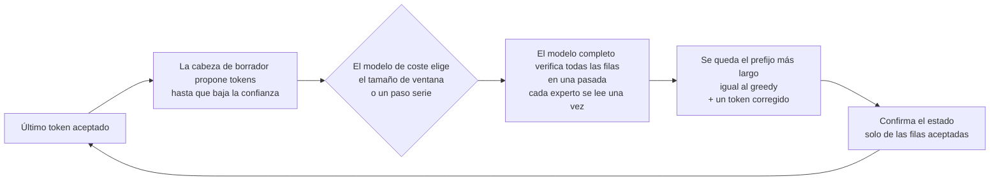
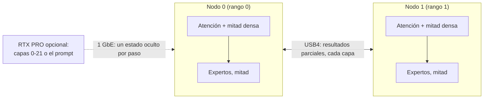

# Strix Halo engine lab

**Inferencia de LLM rápida y exacta, escrita desde cero para AMD Strix Halo: un mini PC, dos unidos por USB4, y una
GPU dedicada cuando la hay.**

[English](README.md) · [Español](README.es.md)

<!-- SCREENSHOT: captura del panel de monitorización del motor cuando exista, p. ej.
<p align="center"></p>
-->

Es nuestro propio motor de inferencia en C++/HIP para **AMD Strix Halo** (Ryzen AI Max+ 395, Radeon 8060S
`gfx1151`, 128 GB de memoria unificada) con Linux y ROCm. Ejecuta modelos grandes de mezcla de expertos (MoE):

- **Qwen3.8-Flash-Next** en un nodo, o como dos réplicas en dos nodos. Una petición de chat de código decodifica a
  **90,7 tok/s** (prosa, unos 55 tok/s); ocho chats de código a la vez suman **255 tok/s** de decode. Con una
  RTX PRO 6000 leyendo el prompt, un prompt de 32K tokens recibe su primer token en **9,0 s**.
- **DeepSeek V4.1 Flash** repartido entre **dos nodos por USB4** (paralelismo tensorial de expertos), con una
  **RTX PRO 6000** opcional que se encarga de las 22 primeras capas. Los prompts de código decodifican a
  **70,6 tok/s** en el par (prosa, unos 42-45 tok/s) y a **81,1 tok/s** con la RTX PRO; un build de lotes más nuevo
  llega a **111,9 tok/s** agregados (2026-10-26, pendiente de publicación).
- **MiniMax M3.1 Flash** en el par ha superado su puerta de calidad de ocho textos; el decode greedy tarda
  **44,57 ms/token a 1K**; el prefill de 8K en una ejecución nueva tarda **17,73 s**. **GLM-5.3 Flash** llega a
  **22,1 tok/s** con la identidad R1 por defecto en su último build medido (2026-10-26; condiciones abajo).
- **DeepSeek en una RTX PRO 6000 (96 GB, Windows WDDM)** ejecuta el modelo objetivo y el borrador DSpark en esa GPU,
  con una caché exclusiva de VRAM + memoria de host fijada: decode exacto de **82–95 tok/s** en código; las tasas
  de código / inglés / español con la misma carga son **82,3 / 87,7 / 94,4 tok/s** (2026-10-25; condiciones abajo).

Cada kernel, disposición de memoria y decisión de planificación está escrita para este chip y estos modelos. La
velocidad sale del decode especulativo exacto (el modelo completo comprueba cada token propuesto), del batching y de
las réplicas, nunca de cambiar la respuesta: la salida especulativa es igual a la decodificación voraz (greedy)
normal allí donde lo afirmamos, y cada una de esas afirmaciones la comprueba una puerta (gate).

> **Estado: motores de producción para todos los modelos de abajo.** Funciona de principio a fin y todos los números de abajo son medidos. Cada
> modelo tiene una herramienta de línea de comandos que imprime un recibo JSON y un servidor HTTP compatible con
> OpenAI/Anthropic (`strix-hip-decode-token --http-serve` para Qwen, `strix-deepseek41-serve` para DeepSeek). El
> laboratorio acoge también trabajo de optimización de cada modelo; ver [Modelos](#modelos).

## De un vistazo

**¿Para quién es?** Para quienes experimentan con **inferencia de LLM nativa, con AMD primero**, en Ryzen AI Max / Strix Halo; no es un framework de inferencia de propósito general que sustituya directamente a otro.

| Pregunta | Respuesta breve |
|---|---|
| ¿Qué es? | Un motor de inferencia independiente en C++/HIP, con rutas de ejecución por modelo, kernels, puertas de verificación y servidor HTTP. |
| ¿Qué hardware? | Un nodo Strix Halo con Linux, dos nodos unidos por USB4 y asistencia RTX PRO opcional para perfiles concretos. |
| ¿Qué modelos? | Qwen, DeepSeek (par, RTX independiente y RTX + par), MiniMax y GLM están en Producción. Ver [Modelos](#modelos). |
| ¿Cambia las salidas del modelo? | Las rutas especulativas cualificadas comprueban los tokens generados frente al decode greedy normal; las demás configuraciones deben superar sus propias puertas de exactitud. |
| ¿Por dónde empiezo? | Lee [qué necesitas](#qué-necesitas), [compilar](#compilar) y después [ejecutar](#ejecutar). |
| ¿Dónde están los resultados reproducibles? | En [metodología y resultados de rendimiento](docs/performance.md), con condiciones de prueba y verificación; las cifras destacadas no son una garantía universal. |

**Límites del proyecto:** [TensorMeld](https://github.com/hyukudan/tensormeld) se encarga de la planificación y el enrutado; [Hyperloom](https://github.com/hyukudan/hyperloom) integra el despliegue y el control; el [driver USB4](https://github.com/hyukudan/strix-halo-usb4-driver) se encarga de la interconexión en Linux. Este repositorio se ocupa de la **ejecución de inferencia**, no de la gestión del conjunto de nodos.

Para los detalles internos de implementación, consulta [Cómo funciona](#cómo-funciona) y los documentos enlazados en las secciones de cada modelo. Los pesos de los modelos y sus licencias son independientes del código del motor.

## Inicio rápido: compilar y ejecutar un modelo

Este ejemplo mínimo es para **un nodo Strix Halo con Linux**, con las herramientas ROCm necesarias, el GGUF del modelo y un fichero `prompt.ids` producido por el tokenizador. Ejecuta **decode greedy normal de Qwen**, no la configuración especulativa de las pruebas de rendimiento.

```bash
git clone https://github.com/hyukudan/strix-halo-engine-lab.git
cd strix-halo-engine-lab
export PATH=/opt/rocm/core-10.1/bin:$PATH
cmake -S . -B build -G Ninja -DCMAKE_BUILD_TYPE=Release \
  -DCMAKE_HIP_ARCHITECTURES=gfx1151 \
  -DCMAKE_HIP_COMPILER=/opt/rocm/core-10.1/bin/amdclang++ \
  -DSTRIX_ENABLE_HIP_RUNTIME=ON \
  -DSTRIX_ENABLE_EXPERIMENTAL_Q4K_A8_RUNTIME=ON \
  -DSTRIX_BUILD_EXPERIMENTAL_Q4K_A8_PROBE=ON \
  -DSTRIX_USE_OPENSSL_SHA256=ON -DBUILD_TESTING=ON
ninja -C build strix-hip-decode-token
ctest --test-dir build --output-on-failure
```

Con el modelo Qwen correspondiente y los IDs de token disponibles en el directorio de trabajo:

```bash
./build/strix-hip-decode-token Qwen3.8-Flash-Next-UD-Q4_K_XL.gguf $(cat prompt.ids) \
  --context 8192 --execution-mode eager --residency register --generate 256 \
  --optimization-profile auto \
  --numerical-profile hc-splitk-f32+q51-q80-a8-down+q5k-a8-gateup+dense-a8-v1
```

El comando produce un recibo JSON con IDs de token y tiempos. Los ficheros reales del modelo y los tokens del prompt **no están incluidos**. Para los recursos del modelo, la aceleración MTP/DSpark opcional, el servidor y el transporte entre dos nodos, continúa con [qué necesitas](#qué-necesitas), [compilar](#compilar), [ejecutar](#ejecutar) y la [referencia completa del motor](docs/getting-started/engine-reference.md). Algunos casos de CTest necesitan la GPU y los recursos del modelo.

## Contenido

[Modelos](#modelos) ·
[Hardware](#hardware) ·
[Velocidad](#velocidad) ·
[Exactitud y calidad](#exactitud-y-calidad) ·
[Qué lo hace distinto](#qué-lo-hace-distinto) ·
[Idiomas](#más-allá-del-inglés) ·
[Qué necesitas](#qué-necesitas) ·
[Compilar](#compilar) ·
[Ejecutar](#ejecutar) ·
[Cómo funciona](#cómo-funciona) ·
[Decisiones de diseño](#decisiones-de-diseño) ·
[Hoja de ruta](#hoja-de-ruta) ·
[Repositorios relacionados](#repositorios-relacionados) ·
[Preguntas frecuentes](#preguntas-frecuentes) ·
[Licencia](#licencia)

## Modelos

| Modelo | Dónde corre | Estado | Puntos clave |
|---|---|---|---|
| **Qwen3.8-Flash-Next** (UD-Q4_K_XL, 111 GB) | 1 nodo; 2 réplicas tras un router | **Producción** | Decode especulativo MTP con cabeza de borrador destilada, idéntico bit a bit al greedy serie; servidor con batching y ventanas de verificación conjuntas; caché de estado de prefijos; [perfil GSQ opt-in](#gsq-perfil-opt-in-que-prioriza-velocidad-sobre-calidad) |
| **DeepSeek V4.1 Flash** (1017; expertos de 2 bits, denso de 6,5 bits + trellis) | 2 nodos por USB4 | **Producción** (defaults de dos nodos D-061) | Decode con paralelismo tensorial de expertos, prefill en dispositivo con paralelismo de expertos, decode especulativo DSpark, decode por lotes, servidor; puertas bit a bit |
| DeepSeek V4.1 Flash + RTX PRO 6000 | RTX PRO (capas 0-21) + 2 nodos (22-39) | **Producción** (D-064) | Reparto en tubería por 1 GbE, servicio de prefill CUDA, colocación de expertos calientes |
| DeepSeek V4.1 Flash, RTX independiente | RTX PRO 6000 (96 GB, Windows WDDM) | **Producción** | Expertos Q2 GGUF, denso Q8_0; caché exclusiva de VRAM + memoria de host fijada; DSpark en GPU con controlador caliente seleccionado como default especulativo |
| MiniMax M3.1 Flash (EXL3, 3,06 bpw) | 2 nodos TP2 por USB4 | **Producción** | Puerta de calidad de ocho textos superada; prefill y decode exactos; mejoras medidas de prefill e intercambio pendientes de publicación |
| GLM-5.3 Flash (EXL3, 4,05 bpw) | 2 nodos TP2 por USB4 | **Producción** | Decode R1 exacto y prefill por bloques con el modelo real; corrección de R≥3 verificada en el par; R1b sigue siendo una identidad opt-in aparte |

El núcleo no conoce ningún modelo: cada familia es un módulo con su contrato, su plan, sus kernels y sus puertas
([docs/models/model-families.md](docs/models/model-families.md)). Los perfiles automáticos solo admiten los ficheros de modelo
fijados en [docs/reference/sources-ledger.md](docs/reference/sources-ledger.md).

## Hardware

- **Nodo:** un mini PC AMD Strix Halo, Ryzen AI Max+ 395 con la iGPU Radeon 8060S (`gfx1151`), 128 GB de memoria
  unificada, Linux, ROCm.
- **Par:** dos nodos unidos por dos cables USB4 directos (un enlace de 40 Gb/s y otro de 20 Gb/s), con nuestra
  [serie de parches del driver USB4](https://github.com/hyukudan/strix-halo-usb4-driver): unos 37 Gb/s por sentido
  con los dos sentidos ocupados, 18,4 µs por un intercambio de 20 KB.
- **GPU dedicada opcional:** una RTX PRO 6000 (96 GB, Windows WDDM), para DeepSeek independiente o
  descarga del prompt; el reparto en tubería de DeepSeek llega al par por 1 GbE.

## Velocidad

Todas las velocidades de abajo están medidas en el laboratorio con decode greedy (temperatura 0). La exactitud
es relativa al perfil numérico indicado; el reparto en tubería con RTX y trellis y el experimento GLM R1b tienen
identidades aparte, como se indica abajo. Los techos de ancho de banda son límites calculados, no rendimiento medido.
Las evidencias, los métodos y los valores anteriores están en **[docs/performance.md](docs/performance.md)**.

Cómo leer las tablas:

- **Mejor** es el mejor resultado medido para ese modo, en la carga que más le conviene (normalmente código o
  texto con mucha copia). **Típico** es el mismo modo con texto corriente, para que sepas qué esperar de un chat
  general.
- **tok/s** es la velocidad de decode después de leer el prompt, para una petición salvo que la concurrencia diga
  otra cosa. **TTFT** es el tiempo hasta el primer token.
- **Build** identifica la revisión de código medida; los resultados corresponden a ese build y esa configuración.
- Medianas de 3 o más ejecuciones salvo que se indique otra cosa. Las últimas filas de 2026-10-25/26 dan el número
  de repeticiones cuando consta; si no se especifica, no debe suponerse que son medianas. Se conservan fechas anteriores para los modos no medidos de nuevo.

Hardware: **1 nodo** = un Strix Halo (128 GB). **2 nodos** = dos Strix Halo unidos por dos cables USB4.
**RTX PRO** = una RTX PRO 6000 Blackwell (96 GB) en un PC por 1 GbE.

### DeepSeek V4.1 Flash

Filas solo del par: DeepSeek V4.1 Flash (checkpoint 1017), expertos enrutados en el GGUF publicado de 2 bits (Q2),
pesos densos en una capa de 6,5 bits con los pesos de atención, del experto compartido y de la cabeza en
codificación trellis. 2 nodos, paralelismo tensorial de expertos (TP2) por USB4.

| Modo | Hardware | Prompt / contexto | Concurrencia | Mejor | Típico | Fecha | Build |
|---|---|---|---:|---:|---:|---|---|
| Decode greedy | 2 nodos | prueba corta de decode | 1 | **29,0 ms/token** (34,5 tok/s; 58,2 % del techo de ancho de banda) | misma prueba, mediana de 3 | 2026-10-25 por la tarde | pre-versión `69c6bdab` |
| Decode especulativo DSpark | 2 nodos | 8 prompts por tipo, 256 tokens cada uno | 1 | **70,6 tok/s** (código) | 41,9 (inglés) / 45,3 (español); 50,0 en los 24 | 2026-10-24 | pre-versión `cab238d6` |
| Decode en lote, sin borrador | 2 nodos | prueba de decode N=8, filas comprobadas frente a la referencia | 8 | **72,20 ms/paso** (110,8 tok/s agregados; 64,4 % del techo de ancho de banda) | mediana de 3 | 2026-10-25 por la tarde | pre-versión `69c6bdab` |
| Prefill en dispositivo (paralelo por expertos) | 2 nodos | 1K | 1 | TTFT **2,18 s** (469 tok/s) | | 2026-10-24 | pre-versión `cab238d6` |
| Prefill en dispositivo | 2 nodos | 8K | 1 | TTFT **10,78 s** (760 tok/s) | | 2026-10-24 | pre-versión `f9332f3e` |
| Prefill en dispositivo | 2 nodos | 16K | 1 | TTFT **20,40 s** (803 tok/s) | | 2026-10-24 | pre-versión `f9332f3e` |
| Prefill en dispositivo | 2 nodos | 32K | 1 | TTFT **39,6 s** (828 tok/s), 2 ejecuciones | | 2026-10-23 | pre-versión `43086d05` + defaults de prefill |
| Servidor, un cliente, chat | 2 nodos | prompt de chat | 1 | **66,9 tok/s** (código) | 34,9 tok/s (prosa) | 2026-10-22 | versión |
| Servidor, 8 chats × 128 tokens | 2 nodos | prompts de chat | 1 / 2 / 4 / 8 | **41,4 / 54,0 / 59,7 / 67,9 tok/s** agregados | | 2026-10-22 | versión |
| Servidor, conjunto corto de 8 categorías | 2 nodos | prompts de 36-303 tokens | 1 / 2 / 4 / 8 | | **39,88 / 61,66 / 66,53 / 74,25 tok/s** agregados | 2026-10-24 | pre-versión `cab238d6` |
| TTFT del servidor | 2 nodos | 8K, servidor caliente en reposo | 1 | **11,80 s** | **26,40 s** con otros 4 flujos decodificando; primera petición con servidor nuevo: 12,72 s | 2026-10-24 | pre-versión `cab238d6` |

**Mediciones más recientes del par — en desarrollo (2026-10-26).** Mismo perfil Q2/6,5 bits/trellis y TP2 por USB4;
fusión shared-down en `cb5ef228` (integrada en `69176409`), tres pares intercalados por celda:

| Prueba de decode | Mediana medida | Fracción del techo calculado | Verificación |
|---|---:|---:|---|
| Un flujo | **28,48 ms/token** | **59,2 %** (mínimo de 16,87 ms) | tokens iguales en los dos rangos |
| Ventana de verificación de seis filas | **53,34 ms/ventana** | **58,6 %** (mínimo de 31,28 ms) | puertas de ventana/rechazo y hash de operaciones iguales |
| Ocho flujos, sin borrador | **71,48 ms/paso** (111,9 tok/s agregados, calculados) | **65,0 %** (mínimo de 46,48 ms) | todas las filas del lote iguales a la referencia |

El tipo de prompt y el contexto no se especifican para estas pruebas cortas de decode. Las ganancias frente a `69c6bdab`
son de unos **1,4 / 1,7 / 1,0 %**, respectivamente. La publicación y la cualificación completa del servidor siguen pendientes:
`69c6bdab` midió **−6,2 %** de rendimiento del servidor con un cliente frente al build anterior en los dos órdenes de prueba
(**44,05 / 43,68 frente a 46,75 / 46,76 tok/s**, campaña del conjunto corto en caliente, IDs de referencia iguales).
La prueba de una petición no establece el rendimiento del servidor.

**Kernel exacto de prefill MoE con gate/up separado ("form 7") — en desarrollo (2026-10-26).** Dos nodos, mismo perfil,
una carga del modelo por comparación, todos los logits idénticos bit a bit a la referencia archivada: TTFT a 2K **−2,75 %**
(8/8 pares intercalados, segunda ejecución −3,7 %), TTFT a 8K **−0,43 s, −3,81 %** (4/4 pares). Tiempo de capa MoE −3 a −6 % a 600–8.192 tokens.
Pendientes la confirmación a 1K y la publicación.

**Selector exacto de prefill denso — en desarrollo, opt-in (2026-10-26, `78ccffce`).** Dos nodos, prefill repartido por filas,
overlay denso de 6,5 bits, TP de expertos desactivado: TTFT a 2K **3,96 → 3,74 s (−5,5 %)** y a 8K
**11,68 → 11,08 s (−5,1 %)**, A/B en el mismo proceso; logits idénticos. La puerta de referencia a profundidad completa
es bit a bit en los dos rangos. No se especifica el tipo de prompt. Siguen pendientes la cualificación de TP de atención,
prefijos/extensión y contextos más largos; las variantes aritméticas FP16 están desactivadas porque no superan la cualificación de calidad.

Las filas de pruebas de `69c6bdab` de arriba también esperan publicación.
El par conserva los lanzamientos agrupados del experto compartido donde se admiten. El calentamiento del plan del servidor
sigue desactivado por defecto: su ganancia en la primera petición no se mantuvo en la carga completa del servidor.
Estos resultados del par no implican que toda configuración de ventanas de verificación o servidor sea más rápida.

**DeepSeek con la RTX PRO, reparto en tubería** (mismos ficheros del modelo; la RTX ejecuta las capas 0-21 con CUDA y los dos
nodos las capas 22-39 y la cabeza):

| Modo | Hardware | Prompt / contexto | Concurrencia | Mejor | Típico | Fecha | Build |
|---|---|---|---:|---:|---:|---|---|
| Decode especulativo DSpark | RTX PRO + 2 nodos | 8 prompts por tipo, 256 tokens cada uno | 1 | **81,1 tok/s** (código) | 50,3 (inglés) / 54,2 (español); 61,8 en los 24 | 2026-10-22 | versión |
| Decode greedy | RTX PRO + 2 nodos | prompt corto | 1 | **38,3 tok/s** | igual | 2026-10-22 | versión |
| Decode en lote, sin borrador | RTX PRO + 2 nodos | 8 prompts de prueba, 48 tokens; 2 grupos en vuelo | 2 / 4 / 8 | **60,1 / 97,5 / 137,2 tok/s** agregados | igual bit a bit a la referencia solo del par | 2026-10-24 | línea del par `6525d5e8`, CUDA `463c08ec` |
| Decode DSpark en lote | RTX PRO + 2 nodos | misma prueba, ventanas del controlador | 1 / 2 / 4 | **52,4 / 91,3 / 156,8 tok/s** agregados de pared | puertas de referencia bit a bit | 2026-10-24 | misma línea |
| Servidor, conjunto corto de 8 categorías | RTX PRO + 2 nodos | prompts cortos, DSpark; 2 grupos en vuelo | 1 / 2 / 4 / 8 | **43,2 / 65,8 / 77,9 / 91,7 tok/s** agregados | IDs de token iguales al par solo en 32/32 peticiones | 2026-10-25 | par `6525d5e8`, CUDA `463c08ec` |
| Lectura del prompt en la RTX PRO (perfil exacto) | RTX PRO | 2K / 8K / 32K | 1 | TTFT **3,64 / 4,39 / 12,20 s** | | 2026-10-22 | versión |

La tubería de lotes/servidor solapa dos grupos de peticiones: la RTX procesa uno mientras el par procesa
el otro (un grupo para una petición sola). Estas filas de lotes/servidor usan expertos Q2, el overlay denso de 6,5 bits
y la identidad de TP de expertos cualificada por separado; no usan el perfil compuesto con trellis de una petición.

La ejecución DSpark de una petición solo en el par con el mismo build da 46,4 tok/s en los 24 prompts (×1,33 con la RTX PRO).
El reparto RTX de una petición es igual bit a bit al par sin los sitios trellis; con ellos (las filas de una petición)
es una identidad compuesta declarada, comprobada frente al par (KL 1,7e-3), no bit a bit. TTFT de la RTX: servicio
residente en caliente, sin contar la carga del modelo, hasta el estado de atención exportado y entregado al endpoint
de importación. Un perfil de prefill CUDA más rápido no pasa la puerta de calidad con prompts largos y no se cita.

**DeepSeek en RTX independiente — Producción (2026-10-25).** Modelo objetivo DeepSeek V4.1 Flash completo en una
RTX PRO 6000 (96 GB, Windows WDDM): gate/up enrutado Q2 GGUF **IQ2_XXS**, down enrutado **Q2_K**, denso **Q8_0**.
Los expertos usan una caché exclusiva de VRAM + memoria de host fijada; el objetivo y el borrador DSpark comparten la GPU.
El borrador conserva los 64 expertos más usados por etapa. Se han adoptado las escrituras de vuelta diferidas/acotadas,
la corrección de instanciación de grafos CUDA y el controlador caliente por defecto; la poda keep-64 midió **+16 %** en código con una ventana de cuatro filas.

| Modo (2026-10-25) | Código | Inglés | Español | Fracción del techo calculado |
|---|---:|---:|---:|---|
| Decode DSpark exacto, controlador caliente + escrituras diferidas, misma carga | **82,3 tok/s** | **87,7 tok/s** | **94,4 tok/s** | **51–58 %** del mínimo de 6,18 ms/token con todos los accesos en caché |
| Decode DSpark exacto, mejores ejecuciones entre cargas | **94–95 tok/s** | **97 tok/s** | **100–101 tok/s** | **58–63 %** del mismo techo |

La cifra de código se cita como **82–95 tok/s**: las cargas varían hasta **~10 %**, así que las comparaciones se aplican dentro de una carga.
Las puertas exactas pasan para este perfil RTX; no se afirma igualdad con el perfil trellis del par.
No se especifican las longitudes de prompt ni los tokens generados para estas últimas mediciones de decode.

| Trabajo de carga / servidor (2026-10-25) | Resultado medido | Estado |
|---|---|---|
| Carga de expertos en tubería | Carga completa **108,7 → 61,8 s**; llenado de expertos **83,1 → 38,0 s**, **2,25 → 6,73 GB/s**, limitado por disco | **En desarrollo** en este motor (cargador publicado en [tierstream](https://github.com/hyukudan/tierstream)); colocación y salidas idénticas bit a bit |
| Proceso de trabajo persistente con modelo cargado | **8–18 s por petición** en las cargas de prueba sin recarga; reinicio de caché con carga nueva **3,4 s** | **En desarrollo**; cada petición idéntica bit a bit a un proceso nuevo |
| Precarga de ventanas | Sin ganancia repetible en comparaciones equivalentes en caliente | Exacta; desactivada por defecto |

**Arranque en frío, mismo perfil RTX independiente (2026-10-26).** Proceso de trabajo persistente en desarrollo,
binario probado `1569bce5`; los interruptores de escritura de vuelta/vaciado en ejecución conservan los tokens, logits y estado
de un proceso nuevo (6/6 comparaciones offline). Son tiempos de pasos, no rendimiento de chat ni TTFT:

| Configuración | Paso 0 | Media de pasos 0–15 | Media de pasos 16–63 |
|---|---:|---:|---:|
| Carga nueva | 332,6 ms | 56,05 ms | 28,15 ms |
| Carga nueva con semilla de residencia guardada | 156,0 ms | 44,67 ms | 25,66 ms |
| Proceso de trabajo con precaptura de grafos | 11,0 ms | 33,99 ms | 27,26 ms |
| Proceso de trabajo, caché de expertos caliente | 10,9 ms | 11,63 ms | 11,49 ms |

La precaptura de grafos añade **1,5 s antes de estar listo**. No se especifican el tipo ni la longitud de prompt para
esta prueba de fase exacta. La carga en tubería y el servidor persistente siguen en desarrollo en este repositorio.
La integración RTX activada por defecto (keep-64, escrituras diferidas, controlador caliente) aún espera su puerta final
sin flags frente a configuración explícita; el rango medido de **82–95 tok/s** en código sigue siendo el resultado citado.

### Qwen3.8-Flash-Next

Todas las filas: Qwen3.8-Flash-Next, GGUF UD-Q4_K_XL (111 GB) más una cabeza de borrador MTP Q8_0 destilada
(2,8 GB), decode especulativo MTP con ventanas 2/4/8, perfil dense A8, sin thinking, 256 tokens generados salvo que
se indique.

| Modo | Hardware | Prompt / contexto | Concurrencia | Mejor | Típico | Fecha | Build |
|---|---|---|---:|---:|---:|---|---|
| Decode MTP | 1 nodo | 1K, código, ventanas auto | 1 | **59,59 tok/s** (69 % del techo por bytes de 86,8 tok/s) | prosa: 55,7 tok/s (`0117a140`, 2026-10-24) | 2026-10-25 | pre-versión `702bc074` |
| Decode MTP | 1 nodo | 8K | 1 | **54,00 tok/s** (código, ventanas auto) | prosa: 49,58 tok/s (`226bb691`, atención exacta del borrador) | 2026-10-25 | código `702bc074`; prosa `226bb691` |
| Decode MTP | 1 nodo | 32K | 1 | **47,9 tok/s** (código; rango observado 44,5–52,6) | mediana de 4 | 2026-10-24 | pre-versión `0117a140` |
| MTP + ventanas de copia (opt-in), edición con copia larga | 1 nodo | documento Markdown (~10 KB) que corregir, respuesta de 2.047 tokens | 1 | **183,5 tok/s** | | 2026-10-24 | pre-versión `e1b115a2` |
| MTP + ventanas de copia (opt-in), edición con copia larga | 1 nodo | fichero Python + diff que aplicar, respuesta de 1.417 tokens | 1 | **163,9 tok/s** | | 2026-10-24 | pre-versión `e1b115a2` |
| MTP + ventanas de copia (opt-in), edición con copia larga | 1 nodo | fichero C++ que reescribir con renombrados, respuesta de 1.711 tokens | 1 | **155,1 tok/s** | | 2026-10-24 | pre-versión `e1b115a2` |
| MTP + ventanas de copia (opt-in), 7 tareas de edición con copia | 1 nodo | entradas de 5-10 KB, respuestas de 1.114-2.047 tokens | 1 | | **125,2 tok/s** (90,2 sin ventanas de copia) | 2026-10-24 | pre-versión `dd65dbd5` |
| MTP + ventanas de copia (opt-in), sesiones de agente | 1 nodo | 6 sesiones de agente de código | 1 | | 59,9 tok/s (las ventanas de copia no lo cambian) | 2026-10-24 | pre-versión `dd65dbd5` |

Las ventanas de copia (`--mtp-ngram-draft=wide --mtp-copy-wide-rows 32`) verifican hasta 32 filas cuando la
respuesta copia texto del prompt; los tokens son idénticos al default en todas las ejecuciones. Ayudan cuando la
respuesta vuelve a emitir tramos largos de la entrada (reescrituras, parches, correcciones de documentos), no hacen
nada con texto nuevo y, por ahora, funcionan con una petición por proceso (todavía no con el servidor en lote).

**Dos réplicas** (un modelo completo por nodo detrás del router, `--http-batch 8`, servidores reiniciados antes de
cada una de 3 rondas, sin calentamiento; ids de token iguales a la ejecución en un nodo en 570/570 respuestas).
Las tasas de pared más recientes de chat de código usan el build `0117a140`, servidores nuevos con una petición de
calentamiento excluida y 3 rondas ABBAAB; 90/90 respuestas iguales a la referencia de un nodo:

| Modo | Hardware | Prompt / contexto | Concurrencia | Mejor: chat de código | Típico: conjunto corto de 8 categorías | Fecha | Build |
|---|---|---|---:|---:|---:|---|---|
| Servidor, dos réplicas | 2 nodos | chat de ~70 tokens / prompts de 36-303 tokens | 1 | **68,2 tok/s** de pared | 42,8 tok/s de pared, TTFT p50 0,89 s | 2026-10-24 código; 2026-10-22 conjunto corto | `0117a140` código; versión conjunto corto |
| Servidor, dos réplicas | 2 nodos | igual | 2 | **136,4 tok/s** de pared | 85,8 de pared, TTFT p50 0,85 s | 2026-10-24 código; 2026-10-22 conjunto corto | `0117a140` código; versión conjunto corto |
| Servidor, dos réplicas | 2 nodos | igual | 4 | **146,8 tok/s** de pared | 102,9 de pared, TTFT p50 1,32 s | 2026-10-24 código; 2026-10-22 conjunto corto | `0117a140` código; versión conjunto corto |
| Servidor, dos réplicas | 2 nodos | igual | 8 | **158,1 tok/s** de pared | 120,4 de pared, TTFT p50 2,55 s | 2026-10-24 código; 2026-10-22 conjunto corto | `0117a140` código; versión conjunto corto |

*De pared* son todos los tokens de respuesta entre el tiempo de pared, incluido el primer token y la cola. La campaña
anterior de chat de código de 2026-10-22 midió **90,7 / 181,5 / 201,6 / 255,0 tok/s** de decode sumado por petición
con concurrencia 1 / 2 / 4 / 8; el decode sumado excluye el tiempo de prompt y de cola de cada petición.

**Lectura del prompt, un nodo** (perfiles y condiciones abajo) y **con la RTX PRO**
(prefill CUDA exacto en la RTX; el estado de atención y el recurrente se envían al nodo por 1 GbE a medida que
termina cada capa, y luego el nodo decodifica; 64 tokens generados idénticos a la ejecución solo en el nodo en
todas las longitudes; una ejecución por longitud):

| Modo | Hardware | 1K | 4K | 8K | 16K | 32K | Fecha | Build |
|---|---|---:|---:|---:|---:|---:|---|---|
| Prefill, TTFT | 1 nodo | **1,12 s** | **3,02 s** | | **14,64 s** | **22,95 s** | 2026-10-24 (1K/16K); 2026-10-25 (4K/32K) | `0117a140` (1K/16K); perfil combinado de abajo (activado por defecto) |
| Descarga del prefill, TTFT | RTX PRO + 1 nodo | **1,36 s** | **1,92 s** | **2,94 s** | **4,95 s** | **8,99 s** | 2026-10-24 | pre-versión `70b93af3` |
| El mismo servidor sin la RTX, TTFT | 1 nodo | 1,80 s | 5,20 s | 10,46 s | 21,43 s | 44,02 s | 2026-10-24 | mismo build del servidor |

La descarga se compara con el mismo servidor de producción al que reenvía (tiles de prompt de 2.048 filas), que
lee los prompts más despacio que la fila de prefill en un nodo de arriba (tiles de 8.192 filas). A 32K la ruta con
la RTX es 4,9× más rápida que ese servidor. Con la descarga activada, el router manda a la RTX PRO los prompts de
1K tokens o más; los más cortos se leen en el nodo.

**Build `0117a140`** (medido frente al build de la versión en la misma sesión,
ejecuciones intercaladas, todas exactas): TTFT un 2,3 % (1K), un 3,4 % (4K) y un 5,1 % (16K, 32K) menor; decode
igual o hasta un 0,4 % más rápido; dos réplicas con concurrencia 4 y 8: un 3,9 % y un 3,6 % más de rendimiento
de pared, y un TTFT un 6,9 % menor con concurrencia 4. Detalles en
[docs/performance.md](docs/performance.md#qwen38-flash-next-1).

**Prefill combinado exacto (2026-10-26).** Un nodo Strix Halo, Qwen3.8-Flash-Next UD-Q4_K_XL,
perfil dense A8; build `8b99cf58`, defaults sin ajustes de entorno. Comparaciones en el mismo nodo
frente a `4a44683b`, salvo la comparación con la opción desactivada en el mismo build al contexto máximo.
Los logits FP32 finales y los tokens coinciden con la referencia en todas las longitudes; los recibos de cualificación
de código-1K y prosa-8K coinciden con la base archivada. No se especifica el tipo de prompt del barrido de longitudes.

| Tokens del prompt | TTFT base | TTFT por defecto | Cambio | tok/s por defecto | Fracción del techo del contrato |
|---|---:|---:|---:|---:|---:|
| 4.096 | 3,53 s | **3,00 s** | −15,0 % | 1.363 | 43,4 % de 3.139 tok/s |
| 17.700 | 14,97 s | **12,81 s** | −14,4 % | 1.382 | 44,7 % de 3.089 tok/s |
| 32.768 | 25,95 s | **23,49 s** | −9,5 % | 1.395 | 45,3 % de 3.078 tok/s |
| 65.536 | 55,37 s | **48,18 s** | −13,0 % | 1.360 | 44,9 % de 3.030 tok/s |
| 131.072 | 120,96 s | **105,84 s** | −12,5 % | 1.238 | 42,6 % de 2.907 tok/s |
| 262.143 | 291,82 s (desactivado en el mismo build) | **240,62 s** | −17,5 % | 1.089 | 40,5 % de 2.687 tok/s |

Dos ejecuciones por variante a 4K / 17.700; a 32K hay una base y dos con defaults; las filas más largas son ejecuciones únicas.
Teselas de prompt: 4.096 a 4K / 128K, 8.192 a 17.700 / 32K / 64K, 2.048 con colas de 256/16 filas a 262.143.
La dispersión entre ejecuciones y entre nodos llega a ~5 %; las comparaciones únicas son orientativas.

[PR #49](https://github.com/hyukudan/strix-halo-engine-lab/pull/49) incorpora como defaults el prefill combinado, el batching de puertas GDN/core16
y la selección del router/staging de activaciones. [PR #50](https://github.com/hyukudan/strix-halo-engine-lab/pull/50)
añade HC output v3 con banda 16 (`5011b842`): TTFT a 32K **−0,52 s (−2,2 %)** en tres pares alternos,
a 4K **−54 ms (−1,8 %)** en dos pares; logits y tokens siguen siendo iguales. Una ejecución única posterior a 32K con ese build
midió **22,03 s, 1.487 tok/s (48,3 % del techo del contrato de 3.078 tok/s)**.
`STRIX_QPF2K_DEFAULTS=0` restaura la ruta anterior de prefill; los interruptores específicos para desactivar HC son
`STRIX_QPF2K_HC_OUTPUT3=0` / `STRIX_QPF2K_HC_OUTPUT3_BAND=0`.

**Batching de etapas QSA — activado por defecto (2026-10-26, [PR #51](https://github.com/hyukudan/strix-halo-engine-lab/pull/51)).**
TTFT exacto a 32K **22,21 / 22,66 / 22,76 → 21,57 / 22,32 / 22,58 s** (tres pares, media **−0,39 s, −1,7 %**);
en el build publicado, 32K en cuatro pares ABBA **−0,17 s** de media (todos los pares más rápidos) y 64K **46,76 → 46,01 s (−1,6 %)**;
17.700 **12,54 → 12,46 s** (un par). Coinciden los tokens, los logits finales y los recibos de cualificación de código-1K / prosa-8K.
`STRIX_QPF2K_QSA_MASK=0x57` restaura las etapas anteriores (default `0x257`).
Estos tiempos son comparaciones separadas, no un nuevo barrido de todas las longitudes.

La atención exacta del borrador MTP y los defaults del router están activados en la línea pública de Qwen.
Los borradores MTP por lotes siguen siendo opt-in. GSQ, abajo, es un perfil aparte que prioriza velocidad sobre calidad.

### GSQ: perfil opt-in que prioriza velocidad sobre calidad

GSQ HYB-Q2 sustituye los expertos enrutados de la receta de calidad por pesos Q2_0; **nunca es el default**.
En la puntuación de ficheros de pesos sobre el conjunto de calidad fijado de 64 prompts (23.552 posiciones puntuadas,
contextos de 2K–32K), el acuerdo top-1 con la referencia Q8_0 es **76,6 %**, frente a **88,1 %** para UD-Q4_K_XL:
una pérdida de **11,5 puntos porcentuales**. Este perfil no supera el criterio de aceptación de la receta de calidad.
Estas puntuaciones de calidad no vuelven a evaluar la ruta de prefill FP16 del motor.

Medido el 2026-10-25, un nodo Strix Halo, Qwen3.8-Flash-Next, una petición, 256 tokens generados,
`702bc074`; el tiempo de decode excluye el prompt. Cada ejecución coincide con los tokens golden de su propia receta.
Las dos recetas tienen pesos distintos y pueden producir respuestas distintas.

| Prompt de código | Ventana MTP | GSQ HYB-Q2, tok/s | Receta de calidad, tok/s | GSQ / calidad |
|---|---|---:|---:|---:|
| 1K | auto | **73,18** | **59,59** | 1,23x |
| 1K | ruta {2} | **49,16** | **41,85** | 1,17x |
| 1K | R2 forzada | **49,17** | **41,82** | 1,18x |
| 1K | R4 forzada | **64,42** | **51,56** | 1,25x |
| 1K | R8 forzada | **66,56** | **52,07** | 1,28x |
| 8K | auto | **65,96** | **54,00** | 1,22x |
| 8K | ruta {2} | **45,51** | **40,05** | 1,14x |
| 8K | R2 forzada | **45,42** | **40,27** | 1,13x |
| 8K | R4 forzada | **59,61** | **51,44** | 1,16x |
| 8K | R8 forzada | **56,60** | **50,05** | 1,13x |

Auto usa la política MTP de producción. La ruta {2} es el ajuste MTP "R1" del arnés, no decode greedy serie.
Aceptación MTP en auto: 1K 0,72 (GSQ) frente a 0,66 (calidad); 8K 0,66 frente a 0,73. Procesamiento del prompt en
las mismas ejecuciones (en caliente): 1K 1,03 s frente a 1,17 s; 8K 7,7-7,8 s frente a 7,9 s. Frente al techo por bytes
de cada receta para código a 1K con MTP, GSQ auto llega a unos 64 % (techo de 113,8 tok/s) y la receta de calidad a unos 69 % (techo de 86,8 tok/s).

### MiniMax M3.1 Flash

Todas las filas: pesos trellis EXL3 a 3,06 bpw, dos nodos Strix Halo TP2 por USB4, referencia greedy.
El motor está en Producción; los conjuntos de optimizaciones más nuevos de abajo están **en desarrollo, pendientes de publicación**.

| Modo | Prompt / contexto | Resultado medido | Fecha | Build / exactitud |
|---|---|---|---|---|
| Decode greedy | prompts de prueba de 1K / 8K, 256 tokens | **44,57 / 46,10 ms/token** (22,44 / 21,69 tok/s) | 2026-10-26 | `8cc30ac0`; los rangos coinciden, IDs de referencia iguales |
| Prefill combinado, ejecución nueva | prompt de prueba de 8K | **17,731 s**, 462 tok/s; base 21,874 s (**−19 %**); **36–39 %** del mínimo calculado de kernels de 6,3–7,0 s | 2026-10-26 | `e0bad3d1`; estado/logits finales de ambos rangos iguales a producción archivada |
| Prefill combinado, ejecución nueva | prompt de prueba de 32K | **91,508 s**, 358 tok/s; **28–32 %** del mínimo calculado de kernels de 26–29 s | 2026-10-26 | `e0bad3d1`; referencia nueva, no una comparación de exactitud con referencia archivada |
| Prefill combinado, mismo proceso | 1K / 8K, tres pares alternos | **2,73–2,77 / 20,3–20,8 s**, **0,848–0,853× / 0,783–0,797×** el tiempo base | 2026-10-26 | `561de319`; comprobaciones de estado/fila final y tokens iguales en ambos rangos |
| Lote, proceso nuevo por variante | N=1 / N=8, prueba de 1K | **43,92 / 130,24 ms/paso** (N8: **61,4 tok/s agregados**, calculados) | 2026-10-26 | `8cc30ac0`; cada fila igual a su ejecución sola; pasa la invariancia por lote |
| DSpark | JSON / Python / prosa, 256 tokens | **54,4 / 34,1 / 24,1 tok/s** | 2026-10-26 | `8cc30ac0`; IDs iguales a greedy |

No se especifican los tipos de prompt de las pruebas de prefill y lotes. Las filas de prefill con ejecución nueva son
ejecuciones únicas; el resultado de primer uso a 1K fue **3,509 s**. La ejecución combinada alcanzó después su límite
de tiempo en otra variante; solo se citan mediciones terminadas. Los nuevos defaults de prefill de `561de319` incluyen
proyecciones densas en teselas, atención/router por lotes y teselas de filas MoE de tamaño exacto. Conservan la identidad de producción.

Los defaults de fronteras de intercambio de `8cc30ac0` están cualificados a 1K/8K/16K (16K con repetición sintética):
las reproducciones equivalentes ahorran **4,20 / 2,82 / 3,09 ms/token**. En A/B por lotes con procesos nuevos, N1/N8 bajan
de **48,22 / 134,03** a **43,92 / 130,24 ms/paso**; la ralentización anterior a N8 se atribuyó a la limitación térmica/de potencia
de la GPU bajo carga sostenida (unos 96 °C, reloj de shaders −20 % en ~100 s), no al motor. Las filas de arriba son
cifras de arranque en frío con procesos nuevos; con servicio sostenido, el decode medido es un 5 % y el prefill un 15 %
más lento con esta refrigeración (29 peticiones secuenciales: 44,9 → 47,2 ms/paso). Esto no justifica una afirmación general
de velocidad del servidor. Las demás variantes MoE/atención siguen desactivadas.

**Puerta de calidad (2026-10-25): superada** la evaluación pre-registrada de ocho textos, incluidas dos ejecuciones TP2
independientes e idénticas byte a byte y todas las comprobaciones de prompt/régimen. La KL media frente a la referencia exacta
es **0,1449**, frente a **0,1425** de la aritmética CPU de producción. El acuerdo top-1 es **0,47 puntos porcentuales menor**
que la referencia CPU, dentro del margen pre-registrado de 2 puntos; la precisión del siguiente token difiere en **+0,01 punto**.
Esta cualificación está condicionada a esos ocho textos; sustituye al fallo anterior con dos prompts.

### GLM-5.3 Flash

EXL3 4,05 bpw, dos nodos Strix Halo TP2 por USB4. Motor en Producción; los builds más nuevos de abajo están
**en desarrollo, pendientes de publicación**. R1 sigue siendo la identidad numérica por defecto.

| Modo | Prompt / contexto | Medido | Fecha | Build / exactitud |
|---|---|---:|---|---|
| Decode greedy, R1 | prompt de chat de 31 tokens + 64 tokens generados | **45,29 ms/token = 22,1 tok/s**; **51 %** del mínimo calculado de 23,2 ms | 2026-10-26 | `1836c99c`; tokens iguales a la referencia |
| Decode en lote, R1 | Ocho filas independientes, contexto de prueba no especificado | **122,0 ms/paso = 65,5 tok/s agregados** | 2026-10-26 | `1836c99c`; tokens iguales a la referencia anterior del par real |
| Prefill exacto por bloques | prompts de prueba de 1K / 8K / 32K, tipo no especificado | TTFT **4,268 / 34,70 / 144,75 s** (240 / 236 / 226 tok/s) | 2026-10-26 | `875ca821`, integrado en `41d8cfdc`; logits de ambos rangos iguales bit a bit al prefill exacto anterior |
| R1b-fast, identidad opt-in | Misma prueba de chat, comparación alterna de 96 tokens | **41,93–41,96 ms/token**, frente a R1 47,33–47,48 (**−11,5 %**, **55 %** del mínimo de 23,2 ms) | 2026-10-26 | `8877de1d`; estable dentro de cada identidad, no bit a bit con R1 |
| Acuerdo teacher-forced R1b | 32 prompts, 256 posiciones cada uno; chat, código, JSON, matemáticas, razonamiento, traducción | **8.126/8.192 = 99,19 %** top-1; KL media **~1,8e-3 nats** | 2026-10-26 | `4dad4c19`; las ejecuciones libres divergen en **28/32** prompts entre 19–227 tokens |

La corrección del búfer R≥3 está verificada en el par real. La última integración usa intercambio directo para las
pasadas normales y MoE v3 exacto para prefill; el oráculo especulativo también pasa con la conmutación de intercambio
tras su vaciado. Las filas de prefill son ejecuciones únicas. Sustituyen al resultado anterior solo sintético.

R1b cambia el orden de suma FP32 y sigue siendo opt-in; no está resuelto qué identidad se acerca más a float64 a
profundidad completa. Los grafos HIP **no están implementados**: el último perfil (`41d8cfdc`) mantiene la GPU ocupada
el **96,3 %** de cada pasada (antes 80,8 %; 909 lanzamientos en lugar de 1.679) y deja solo **2,10 ms de inactividad por pasada**
y un margen recuperable calculado de **≤1,8 ms** (un límite, no una aceleración medida). El avance del host entre
fronteras de intercambio requiere captura segmentada; tienen prioridad los kernels de dispositivo y el desfase entre rangos.

## Exactitud y calidad

**Exacto donde lo decimos.** Estas salidas se comprueban token a token (o byte a byte) contra una referencia:

- El decode especulativo MTP de Qwen es igual al greedy serie con el mismo perfil numérico, bit a bit (error de
  replay del golden 0 en cada ejecución cronometrada; réplicas 570/570 iguales a un nodo).
- El prefill en teselas y la puntuación teacher-forced de Qwen producen los mismos bytes que la ruta serie dentro de
  un perfil.
- DeepSeek en el par: las ventanas greedy y DSpark son iguales a las referencias guardadas en los dos rangos; los
  tokens por lotes y 64/64 respuestas del servidor son iguales a las referencias de la campaña.
- DeepSeek repartido con la RTX PRO: igual bit a bit al par sin los sitios trellis (24/24 prompts). Con ellos es una
  identidad compuesta declarada (KL 1,7e-3 frente al par), no bit a bit.

**La calidad se mide, no se supone.** Un arnés teacher-forced compara la distribución de salida completa del motor
con una referencia en cada posición (divergencia KL y acuerdo top-1), por categoría e idioma.

| Perfil de Qwen | KL frente a la referencia Q8_0 | Acuerdo top-1 |
|---|---|---|
| Exacto (denso FP32) | 0,01940 | 95,52 % |
| Dense A8 (recomendado) | 0,01978 (+1,9 ± 2,0 %) | 95,55 % |

49.001 posiciones ([D-032](docs/decisions/decision-register.md#d-032-dense-a8-in-the-recommended-profile)): dense A8 está tan cerca de la
referencia como el perfil exacto, dentro del margen que separa dos implementaciones exactas de los mismos pesos.
Donde los dos perfiles discrepan (2,8 % de las posiciones) casi siempre es entre candidatos casi empatados.

En DeepSeek, los pesos densos codificados con trellis (mix-B) están tan cerca del modelo en precisión original como
el formato de 6,5 bits (KL 0,0446 frente a 0,0447 en 103.908 tokens) leyendo 2,27 en lugar de 3,63 GB por token y
nodo; se calculó con una emulación de los formatos, no con los kernels del motor.

Metodología: [docs/engine/prefill/teacher-forced-tiled-prefill.md](docs/engine/prefill/teacher-forced-tiled-prefill.md),
[docs/engine/decode/optimization-profile.md](docs/engine/decode/optimization-profile.md),
[docs/reference/qualification-ledger.md](docs/reference/qualification-ledger.md).

## Qué lo hace distinto

- **Decode especulativo exacto.** La cabeza MTP de Qwen y el borrador DSpark de DeepSeek proponen varios tokens; el
  modelo completo los comprueba en una pasada y se queda con el tramo correcto más largo. Los kernels de varias filas
  repiten la aritmética de una fila, así que un fallo cuesta tiempo, nunca exactitud.
- **Varias formas de usar más hardware, cada una medida.** Ventanas de verificación por lotes en un nodo, una réplica
  por nodo, un modelo repartido entre dos nodos por USB4 (paralelismo tensorial de expertos) y una GPU dedicada para
  las primeras capas o para el prompt.
- **Perfiles numéricos con nombre y calidad medida.** El redondeo es una elección con nombre y versión. El prompt
  puede leerse con un perfil y la respuesta escribirse con otro (D-033).
- **Opt-in hasta que se demuestre.** Toda optimización empieza desactivada y solo pasa a ser default cuando se
  demuestra exacta (o de calidad medida) y más rápida en la carga completa, en una campaña de tiempos intercalada.
  Las ideas que fallaron quedan registradas con sus números.
- **AMD primero e independiente.** Los kernels, la planificación, el decode especulativo, el lector GGUF, el
  planificador de memoria y el comunicador de dos nodos son código propio; el motor no envuelve otro runtime de
  inferencia. ROCm/HIP, Linux, el formato GGUF y las herramientas de compilación habituales siguen siendo
  dependencias. El motor sigue siendo plenamente usable en una sola Strix Halo; el multinodo y otras GPUs son etapas
  aparte, cualificadas explícitamente.

## Más allá del inglés

- **Paquetes de vocabulario de borrador por idioma (Qwen).** La cabeza de borrador solo propone desde un subconjunto
  del vocabulario. El repositorio incluye un núcleo de 32k y paquetes de 16k para alemán, español, francés, italiano,
  portugués, ruso, japonés y chino en [`data/draft-vocab/`](data/draft-vocab/); `--mtp-draft-vocab
  auto:data/draft-vocab` elige el paquete que corresponde al prompt. En un prompt de chat en español subió el decode
  de 32,9 a 38,9 tok/s (+18 %). DSpark de DeepSeek usa la misma idea (`--dspark-vocab auto:`). El paquete solo cambia
  cuántas propuestas se aceptan, nunca el texto.
- **Calidad por idioma y categoría.** El arnés da KL y top-1 para texto multilingüe, prosa en español, prosa en
  inglés, código, tareas de agente, matemáticas y chat, cada uno con su margen. Una elección que perjudica a una
  categoría se rechaza aunque la media parezca buena.

## Qué necesitas

| | Qwen3.8-Flash-Next | DeepSeek V4.1 Flash |
|---|---|---|
| **Máquinas** | una Strix Halo (`gfx1151`) con **128 GB** | dos Strix Halo de 128 GB, dos cables USB4 directos, la [serie del driver USB4](https://github.com/hyukudan/strix-halo-usb4-driver); opcionalmente un PC CUDA con una RTX PRO 6000 |
| **SO / pila GPU** | Linux, ROCm/HIP (probado con ROCm core 10.1 en `/opt/rocm/core-10.1`) | igual; CUDA para las partes RTX opcionales |
| **Ficheros del modelo** | GGUF UD-Q4_K_XL (~111 GB) + sidecar MTP Q8_0 | el GGUF de expertos de 2 bits, el overlay denso de 6,5 bits, los paquetes trellis y el borrador DSpark ([docs/models/deepseek-v4.1/production-defaults.md](docs/models/deepseek-v4.1/production-defaults.md#production-identity-environment-of-both-ranks)) |
| **Herramientas** | CMake >= 3.24, Ninja, un compilador C++20, opcionalmente OpenSSL para hashes rápidos | igual |

Las herramientas de línea de comandos reciben IDs de token; los servidores HTTP llevan el tokenizador y la plantilla
de chat de cada modelo.

## Compilar

```sh
export PATH=/opt/rocm/core-10.1/bin:$PATH
cmake -S . -B build -G Ninja \
  -DCMAKE_BUILD_TYPE=Release \
  -DCMAKE_HIP_ARCHITECTURES=gfx1151 \
  -DCMAKE_HIP_COMPILER=/opt/rocm/core-10.1/bin/amdclang++ \
  -DSTRIX_ENABLE_HIP_RUNTIME=ON \
  -DSTRIX_ENABLE_EXPERIMENTAL_Q4K_A8_RUNTIME=ON \
  -DSTRIX_BUILD_EXPERIMENTAL_Q4K_A8_PROBE=ON \
  -DSTRIX_USE_OPENSSL_SHA256=ON \
  -DBUILD_TESTING=ON
ninja -C build strix-hip-decode-token                         # Qwen
ninja -C build strix-deepseek41-rank strix-deepseek41-serve   # DeepSeek (módulo de familia, STRIX_FAMILY_DEEPSEEK41=ON por defecto)
```

Las partes CUDA para la RTX PRO se compilan aparte con `-DSTRIX_ENABLE_CUDA_DS41=ON`. `ctest --test-dir build`
ejecuta los tests de host y de dispositivo (muchos necesitan la GPU y los ficheros del modelo). Todas las opciones
de CMake están en [docs/getting-started/engine-reference.md](docs/getting-started/engine-reference.md#build-options).

## Ejecutar

**Qwen, la ejecución más simple:** decode greedy normal con el perfil recomendado, 256 tokens.

```sh
./build/strix-hip-decode-token Qwen3.8-Flash-Next-UD-Q4_K_XL.gguf $(cat prompt.ids) \
  --context 8192 --execution-mode eager --residency register --generate 256 \
  --optimization-profile auto \
  --numerical-profile hc-splitk-f32+q51-q80-a8-down+q5k-a8-gateup+dense-a8-v1
```

`prompt.ids` contiene el prompt como IDs de token del tokenizador del modelo; el motor imprime un recibo JSON con
`generated_tokens` y los tiempos. Para las velocidades de arriba añade las opciones especulativas (sidecar MTP,
ventanas de verificación 2/4/8, vocabulario de borrador): el comando completo está en
**[docs/getting-started/engine-reference.md → Command line](docs/getting-started/engine-reference.md#command-line)** y en [docs/engine/speculative/mtp-native-cli.md](docs/engine/speculative/mtp-native-cli.md).
El servidor HTTP, los slots por lotes (`--http-batch`) y la caché de prefijos están en
[docs/engine/serving/serving.md](docs/engine/serving/serving.md); varias peticiones en un proceso, en
[docs/engine/scheduling/multi-request-cohort.md](docs/engine/scheduling/multi-request-cohort.md); el muestreo, en
[docs/engine/decode/sampled-decoding.md](docs/engine/decode/sampled-decoding.md).

**DeepSeek en el par:** un rango por nodo, el mismo entorno en los dos (la identidad de producción),
`--transport usb4gpu`; el servidor recibe `--prefill-path device --dspark <DSpark.gguf> --dspark-vocab auto:<vocab>`.
El entorno, los defaults y cómo desactivarlos están en
[docs/models/deepseek-v4.1/production-defaults.md](docs/models/deepseek-v4.1/production-defaults.md); las líneas de comando del reparto con la RTX,
en [docs/models/deepseek-v4.1/pipeline-stages.md](docs/models/deepseek-v4.1/pipeline-stages.md); la colocación de expertos calientes, en
[docs/models/deepseek-v4.1/hot-placement.md](docs/models/deepseek-v4.1/hot-placement.md); los contextos largos, en
[docs/models/deepseek-v4.1/long-context.md](docs/models/deepseek-v4.1/long-context.md).

### Cómo exponer los servidores

Los servidores HTTP (`strix-hip-decode-token --http-serve` y `strix-deepseek41-serve`) escuchan en loopback
salvo que `--http-bind` diga otra cosa. No tienen TLS propio. La autenticación es una única clave compartida
opcional: con `--http-api-key-file FICHERO` todas las rutas de API y de administración (completions,
`/admin/drain`, `/admin/import-state`) exigen `Authorization: Bearer <clave>` o `x-api-key: <clave>`; sin ella el
servidor acepta a cualquier cliente. `/health`, `/metrics` y `/api/status` responden sin clave. Los cuerpos, las
peticiones en cola y las conexiones abiertas están acotados (`--http-max-queue`, `--http-max-connections`). Mantén
los servidores en loopback o en una red privada y pon a los clientes remotos detrás de un frontal con autenticación,
como el router de [TensorMeld](https://github.com/hyukudan/tensormeld) o su canal de control; los rangos de DeepSeek
en dos nodos intercambian tensores por el enlace USB4, y el reparto con la RTX (puerto TCP de la etapa de tubería) y
los servidores de expertos hablan TCP sin cifrar: ninguno lleva autenticación, así que deben quedarse en un cable
directo o en una red privada. Las claves por usuario, el TLS y una interfaz de configuración segura son tareas
pendientes, no funcionalidades.

## Cómo funciona

**Un ciclo de decode especulativo** (el MTP de Qwen y el DSpark de DeepSeek siguen la misma forma):



Un paso de un token está limitado por el ancho de banda de memoria (se leen todos los pesos activos para un token),
así que comprobar 4 u 8 tokens cuesta mucho menos que 4 u 8 pasos. El servidor por lotes va un paso más allá: las
ventanas conjuntas verifican juntas las filas de varias peticiones y leen cada peso una vez para todas.

**DeepSeek en dos nodos.** Cada nodo guarda la mitad de los expertos enrutados y la mitad de cada proyección densa con
paralelismo tensorial. En cada capa las dos GPUs intercambian resultados parciales pequeños por USB4 (cuatro flujos de
host sobre los dos cables); el prompt se lee con paralelismo de expertos y el estado de atención se reparte entre los
nodos.



**Leer un prompt largo (prefill en teselas de Qwen).** El prompt se corta en bloques de hasta 2048 filas; dentro de
un bloque cada peso se lee una vez para todas las filas, y las capas recurrentes (GDN) siguen actualizando las filas
en orden, así que el resultado es idéntico bit a bit a leer el prompt token a token con el mismo perfil.

Todos los documentos están en el [índice de documentación](docs/README.md). La guía de arquitectura es [docs/architecture/README.md](docs/architecture/README.md) (multinodo y USB4:
[docs/architecture/12-multi-node-and-usb4.md](docs/architecture/12-multi-node-and-usb4.md)); la referencia del motor
es [docs/getting-started/engine-reference.md](docs/getting-started/engine-reference.md); el estado actual por área, [docs/reference/implementation-status.md](docs/reference/implementation-status.md).

## Decisiones de diseño

El registro completo, con alternativas, evidencia y la condición para reabrir cada una, está en
[docs/decisions/decision-register.md](docs/decisions/decision-register.md). Las principales:

- **Verificación exacta en lugar de tolerancia (D-021)** y **ventanas adaptativas 2/4/8 con un modelo de coste en
  línea (D-022)**.
- **Perfiles numéricos con nombre (D-024, D-032)** y **un perfil de prefill aparte (D-033)**.
- **Prefill en teselas con bytes idénticos (D-034)**: una puntuación de 16K tokens pasó de 1001 s a 66 s.
- **Servidor: reinicio del controlador por petición (D-057), ventanas conjuntas para peticiones concurrentes (D-058),
  dos réplicas completas tras el router (D-060)**: C4 +8-9 %, y C6/C8 ya escalan por encima de C4.
- **Defaults de DeepSeek en dos nodos (D-061), transporte acotado con envíos pequeños anticipados y staging fusionado
  (D-062), intercambio directo entre GPUs (D-063), una GPU dedicada en el decode (D-064, opt-in).**
- **Medido y rechazado:** captura con hipGraph del bucle de decode, paralelismo tensorial de una petición de Qwen
  entre los nodos (X-021) y más; los números están en la [tabla de rechazados](docs/decisions/decision-register.md#measured-and-rejected).

## Hoja de ruta

En curso, sin cifras prometidas:

- **MiniMax M3.1 Flash (EXL3) en el par:** publicar los defaults medidos de prefill/intercambio y resolver
  la ralentización del servidor que depende del orden; la puerta de calidad de ocho textos está superada.
- **GLM-5.3 Flash:** publicar los cambios medidos de decode/prefill R1, reducir el desfase entre rangos y ampliar la cualificación de R1b.
- **DeepSeek:** una ruta de "listo" de menor latencia para el intercambio USB4 y cerrar la campaña de defaults de los
  flags opt-in más nuevos; tiempo hasta el primer token de extremo a extremo del prefill CUDA exacto a través del
  servidor del par.
- **Qwen:** continuar la cualificación del prefill combinado y del router de decode; GSQ sigue siendo un perfil opt-in que prioriza velocidad sobre calidad.
- **Panel de monitorización**, claves por usuario y TLS a través de la capa de producto.

## Repositorios relacionados

- [strix-halo-usb4-driver](https://github.com/hyukudan/strix-halo-usb4-driver): la serie de parches de Linux que
  convierte los controladores USB4 de Strix Halo en el enlace directo entre los dos nodos.
- [strix-trellis](https://github.com/hyukudan/strix-trellis): la biblioteca de cuantización trellis (estilo
  EXL3/QTIP) que usan los pesos densos de DeepSeek y la inferencia de MiniMax.
- [TensorMeld](https://github.com/hyukudan/tensormeld): colocación y enrutado entre nodos y GPUs; su router sirve
  las réplicas de Qwen.

## Preguntas frecuentes

**¿El decode especulativo cambia la respuesta?**
No, allí donde afirmamos exactitud (ver [Exactitud y calidad](#exactitud-y-calidad)). Cada token emitido lo
comprueba el modelo completo con la misma aritmética que un paso de un token. La única excepción documentada es el
reparto con la RTX con sitios trellis, que es una identidad compuesta declarada.

**¿Qué perfil de Qwen uso?**
Dense A8 es el recomendado por defecto; usa el perfil exacto si necesitas la aritmética densa en FP32. Los dos
pueden elegir tokens distintos donde dos candidatos están casi empatados (2,8 % de las posiciones); cada uno es
determinista y exacto respecto a sí mismo.

**¿Funciona en otras GPUs u otros modelos?**
La ruta de Strix Halo es para `gfx1151`. DeepSeek tiene además un backend CUDA para las partes RTX opcionales. Los
modelos se admiten por contenido fijado; las familias nuevas se añaden como módulos con sus propias puertas
([Modelos](#modelos)).

**¿Por qué hacen falta 128 GB por nodo?**
Solo el fichero de 4 bits de Qwen ocupa unos 111 GB; los expertos de DeepSeek se reparten entre los dos nodos. La
memoria unificada permite a la GPU leer los pesos donde están.

**¿Qué longitud de contexto admite?**
El perfil automático de Qwen está cualificado a 8192 tokens; los contextos más largos funcionan con
`--unqualified-context` (así llega el barrido medido de prefill a 262.143 tokens). Los límites de contexto largo de DeepSeek
están en [docs/models/deepseek-v4.1/long-context.md](docs/models/deepseek-v4.1/long-context.md).

**¿De dónde salen los números?**
De nuestras propias ejecuciones en nuestras máquinas, con fecha, configuración y comprobación de exactitud por fila
en [docs/performance.md](docs/performance.md). Nada de esto es una estimación presentada como resultado.

## Licencia

El código del motor tiene licencia **[Apache License 2.0](LICENSE)**, salvo el módulo experimental del kernel de
Linux en `lab/direct_gpu_stream/kernel/`, que es **GPL-2.0-only** como debe serlo el código del kernel de Linux (sus
textos de licencia están en ese directorio). El código adoptado de otros proyectos conserva su licencia y sus avisos
originales. Los pesos de los modelos se distribuyen con sus propias licencias. Las referencias de terceros usadas para
formatos y semántica de modelos están listadas con sus licencias en [docs/reference/sources-ledger.md](docs/reference/sources-ledger.md).
