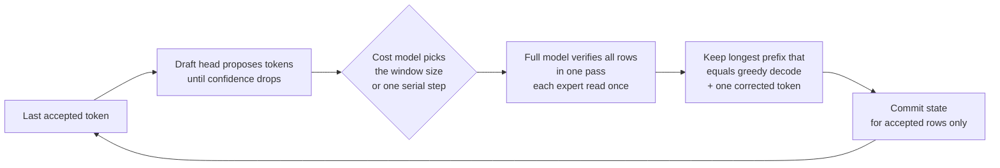
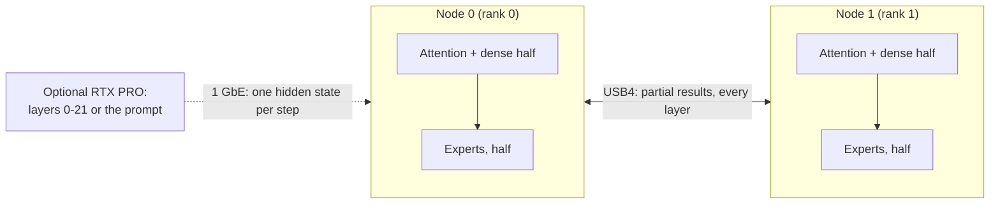

# Strix Halo engine lab

**Fast, exact LLM inference written from scratch for AMD Strix Halo: one mini PC, two linked over USB4, and a
discrete GPU when there is one.**

[English](README.md) · [Español](README.es.md)

<!-- SCREENSHOT: monitor panel of the engine goes here once the panel ships, e.g.
<p align="center"></p>
-->

This is our own C++/HIP inference engine for **AMD Strix Halo** (Ryzen AI Max+ 395, Radeon 8060S `gfx1151`,
128 GB of unified memory) under Linux with ROCm. It runs large mixture-of-experts models:

- **Qwen3.8-Flash-Next** on one node, or as two replicas on two nodes. One coding-chat request decodes at
  **90.7 tok/s** (prose about 55 tok/s); eight concurrent coding chats sum to **255 tok/s** of decode. With an
  RTX PRO 6000 reading the prompt, a 32K-token prompt gets its first token in **9.0 s**.
- **DeepSeek V4.1 Flash** split across **two nodes over USB4** (expert tensor parallel), optionally with an
  **RTX PRO 6000** taking the first 22 layers. Code prompts decode at **70.6 tok/s** on the pair (prose about
  42-45 tok/s) and **91.3 tok/s** with the RTX PRO (2026-10-26); the 2026-10-26 pair build reaches **113.9 tok/s** aggregate (N8, calculated).
- **MiniMax M3.1 Flash** on the pair has passed its eight-text quality gate; greedy decode takes
  **44.57 ms/token at 1K**; fresh 8K prefill takes **17.73 s**. **GLM-5.3 Flash** reaches
  **22.1 tok/s** in the measured R1 identity on its latest measured build (2026-10-26), and with MTP
  self-speculation, now on by default, **37.1 / 44.5 / 40.0 tok/s** on chat / code / JSON (2026-10-27; conditions below).
- **DeepSeek on an RTX PRO 6000 (96 GB, Windows WDDM)** runs the target and DSpark draft on that GPU,
  with an exclusive VRAM + pinned-host cache: exact decode **82–95 tok/s** for code; same-load code / English /
  Spanish rates are **82.3 / 87.7 / 94.4 tok/s** (2026-10-25; conditions below).

Every kernel, memory layout and scheduling choice is written for this chip and these models. The speed comes from
exact speculative decoding (the full model checks every drafted token), batching and replicas, never from changing
the answer: speculative output equals plain greedy decoding wherever we claim it, and every such claim is checked
by a gate.

> **Status: production engines for all models listed below.** It works end to end and every number below is measured. Each model ships a
> command-line tool that prints a JSON receipt and an OpenAI (chat, completions, stateless Responses)/Anthropic-compatible HTTP server
> (`strix-hip-decode-token --http-serve` for Qwen, `strix-deepseek41-serve` for DeepSeek). The lab also hosts
> model-specific optimization work; see [Models](#models).

## At a glance

**Who is this for?** Developers experimenting with **native, AMD-first LLM inference** on Ryzen AI Max / Strix Halo—not a general-purpose drop-in inference framework.

| Question | Short answer |
|---|---|
| What is it? | An independent C++/HIP inference engine, with model-specific execution paths, kernels, verification gates and HTTP serving. |
| Which hardware? | One Strix Halo Linux node, two nodes linked by USB4, and optional RTX PRO assistance for selected profiles. |
| Which models? | Qwen, DeepSeek (pair, standalone RTX and RTX + pair), MiniMax and GLM are Production. See [Models](#models). |
| Does it change model outputs? | Qualified speculative paths check generated tokens against normal greedy decode; other configurations must pass their own exactness gates. |
| How do I verify release assets? | Use the CPU [release asset manifest](docs/operations/release-assets.md) tool for full hashes and explicit role closure. |
| What startup diagnostics are available? | Qwen has default-on [read-only preflight and configured build identity](docs/operations/startup-preflight.md), with explicit off switches. |
| Where do I begin? | Read [requirements](#what-you-need), [build](#build), then [run](#run). |
| Where are reproducible results? | [Performance methodology and results](docs/performance.md), with test conditions and verification; headline throughput is not a universal guarantee. |

**Project boundaries:** [TensorMeld](https://github.com/hyukudan/tensormeld) handles planning and routing; [Hyperloom](https://github.com/hyukudan/hyperloom) integrates deployment and control; the [USB4 driver](https://github.com/hyukudan/strix-halo-usb4-driver) handles the Linux interconnect. This repository owns **inference execution**, not cluster management.

For detailed implementation internals, use [How it works](#how-it-works) and the documents linked throughout the model sections. The model weights and their licences are separate from the engine code.

## Quick start: build and run one model

This minimal example is for **one Linux Strix Halo node** with the required ROCm toolchain, model GGUF and a tokenizer-produced `prompt.ids` file. It runs **Qwen generation with the production defaults**, including automatic fast prefill for eligible prompts.

```bash
git clone https://github.com/hyukudan/strix-halo-engine-lab.git
cd strix-halo-engine-lab
export PATH=/opt/rocm/core-10.1/bin:$PATH
cmake -S . -B build -G Ninja -DCMAKE_BUILD_TYPE=Release \
  -DCMAKE_HIP_ARCHITECTURES=gfx1151 \
  -DCMAKE_HIP_COMPILER=/opt/rocm/core-10.1/bin/amdclang++ \
  -DSTRIX_ENABLE_HIP_RUNTIME=ON \
  -DSTRIX_ENABLE_EXPERIMENTAL_Q4K_A8_RUNTIME=ON \
  -DSTRIX_BUILD_EXPERIMENTAL_Q4K_A8_PROBE=ON \
  -DSTRIX_USE_OPENSSL_SHA256=ON -DBUILD_TESTING=ON
ninja -C build strix-hip-decode-token
ctest --test-dir build --output-on-failure
```

With the matching Qwen model and token IDs available in your working directory:

```bash
./build/strix-hip-decode-token Qwen3.8-Flash-Next-UD-Q4_K_XL.gguf $(cat prompt.ids) --generate 256
```

Add `--print-effective-config` to see what it resolves to before HIP initialization. `--baseline` (or `STRIX_BASELINE=1`) restores the previous minimal resolution.

The command produces a JSON receipt with token IDs and timing. Actual model files and prompt tokens are **not included**. For model assets, optional MTP/DSpark acceleration, serving and two-node transport, continue with [requirements](#what-you-need), [build](#build), [run](#run), and the [full engine reference](docs/getting-started/engine-reference.md). Some CTest cases require the GPU and model assets.

## Contents

[Models](#models) ·
[Hardware](#hardware) ·
[How fast](#how-fast) ·
[How exact, how good](#how-exact-how-good) ·
[Why it is different](#why-it-is-different) ·
[Languages](#beyond-english) ·
[What you need](#what-you-need) ·
[Build](#build) ·
[Run](#run) ·
[Optimizations](#optimizations) ·
[How it works](#how-it-works) ·
[Design decisions](#design-decisions) ·
[Roadmap](#roadmap) ·
[Related repositories](#related-repositories) ·
[FAQ](#faq) ·
[License](#license)

## Models

| Model | Runs on | Status | Highlights |
|---|---|---|---|
| **Qwen3.8-Flash-Next** (UD-Q4_K_XL, 111 GB) | 1 node; 2 replicas behind a router | **Production** | MTP speculative decoding with a distilled draft head, bit-identical to serial greedy; server with as many request slots as memory admits (built on demand); decode keeps streaming during long prompts and short requests are admitted inside them; prefix state cache; [opt-in GSQ profile](#gsq-opt-in-speed-over-quality-profile) |
| **DeepSeek V4.1 Flash** (1017; 2-bit experts, 6.5-bit + trellis dense) | 2 nodes over USB4 | **Production** (two-node defaults D-061) | Expert tensor parallel decode, expert parallel device prefill, DSpark speculative decode, batched decode, server; bitwise gates |
| DeepSeek V4.1 Flash + RTX PRO 6000 | RTX PRO (layers 0-21) + 2 nodes (22-39) | **Production** (D-064) | Pipeline split over 1 GbE, CUDA prefill service, hot-expert placement |
| DeepSeek V4.1 Flash, standalone RTX | RTX PRO 6000 (96 GB, Windows WDDM) | **Production** | Q2 GGUF experts, Q8_0 dense; exclusive VRAM + pinned-host cache; on-GPU DSpark with warm controller selected as the speculative default |
| MiniMax M3.1 Flash (EXL3, 3.06 bpw) | 2 nodes TP2 over USB4 | **Production** | Eight-text quality gate passed; exact prefill and decode; qualified prefill and exchange optimizations on by default |
| GLM-5.3 Flash (EXL3, 4.05 bpw) | 2 nodes TP2 over USB4 | **Production** | R1b decode identity by default; exact MTP self-speculation by default; exact R1 chunked prefill; `--identity r1` restores R1; R≥3 fix verified on the pair |

The core knows no model: each family is a module with its own contract, plan, kernels and gates
([docs/models/model-families.md](docs/models/model-families.md)). The automatic profiles only admit the pinned model files listed in
[docs/reference/sources-ledger.md](docs/reference/sources-ledger.md).

## Hardware

- **Node:** one AMD Strix Halo mini PC, Ryzen AI Max+ 395 with the Radeon 8060S iGPU (`gfx1151`), 128 GB of
  unified memory, Linux, ROCm.
- **Pair:** two nodes joined by two direct USB4 cables (one 40 Gb/s, one 20 Gb/s link), driven by our
  [USB4 driver series](https://github.com/hyukudan/strix-halo-usb4-driver): about 37 Gb/s per direction with both
  directions busy, 18.4 µs for a 20 KB exchange.
- **Optional discrete GPU:** an RTX PRO 6000 (96 GB, Windows WDDM), used for standalone DeepSeek or prompt
  offload; the DeepSeek pipeline split reaches the pair over 1 GbE.

## How fast

Use the [benchmark kit and reproduction guide](docs/reproduce.md) for current commands, model requirements, machine interfaces and issue-ready reports.

Every speed below is measured in the lab with greedy decoding (temperature 0). Exactness is relative to the
named numerical profile; the trellis RTX pipeline split and GLM R1b decode have separate identities, as
noted below. Bandwidth ceilings are calculated bounds, not measured throughput. Evidence, methods and older values are in
**[docs/performance.md](docs/performance.md)**.

How to read the tables:

- **Best** is the best measured result for that mode, on the workload that suits it most (usually code or
  copy-heavy text). **Typical** is the same mode on ordinary text, so you know what to expect from a general chat.
- **tok/s** is decode speed after the prompt has been read, for one request unless the concurrency says
  otherwise. **TTFT** is time to first token.
- **Build** identifies the measured code revision; results apply to that build and configuration.
- Medians of 3 or more runs unless stated otherwise. The latest 2026-10-25/26 rows give repetition counts
  where recorded; unspecified counts must not be assumed to be medians. Older dates remain for modes not re-measured.

Hardware: **1 node** = one Strix Halo (128 GB). **2 nodes** = two Strix Halo joined by two USB4 cables.
**RTX PRO** = an RTX PRO 6000 Blackwell (96 GB) in a PC on 1 GbE.

### DeepSeek V4.1 Flash

Pair-only rows: DeepSeek V4.1 Flash (1017 checkpoint), routed experts in the published 2-bit (Q2) GGUF, dense weights in
a 6.5-bit overlay with trellis-coded attention, shared-expert and head weights. 2 nodes, expert tensor parallel
(TP2) over USB4.

| Mode | Hardware | Prompt / context | Concurrency | Best | Typical | Date | Build |
|---|---|---|---:|---:|---:|---|---|
| Greedy decode | 2 nodes | short decode benchmark, R1 | 1 | **28.333 ms/token** (35.3 tok/s; 59.5 % of calculated ceiling, 16.87 ms floor) | 2 interleaved pairs; tokens identical | 2026-10-26 | `6a5604bf` |
| DSpark speculative decode | 2 nodes | 8 prompts per type, 256 tokens each | 1 | **70.6 tok/s** (code) | 41.9 (English) / 45.3 (Spanish); 50.0 over all 24 | 2026-10-24 | `cab238d6` |
| Batched decode, no drafting | 2 nodes | N8 decode benchmark, all rows equal the reference | 8 | **70.24 ms/step** (113.9 tok/s aggregate, calculated; 66.2 % of calculated ceiling, 46.48 ms floor) | | 2026-10-26 | `6a5604bf` |
| Device prefill (expert parallel) | 2 nodes | 1K benchmark prompt, kind unspecified | 1 | TTFT **1.954 s** | median of 4; logits bit-identical on both ranks | 2026-10-26 | `6a5604bf` |
| Device prefill | 2 nodes | 8K benchmark prompt, kind unspecified | 1 | TTFT **9.757 s** | median of 3; logits bit-identical on both ranks | 2026-10-26 | `6a5604bf` |
| Device prefill | 2 nodes | 16K | 1 | TTFT **20.40 s** (803 tok/s) | | 2026-10-24 | `f9332f3e` |
| Device prefill | 2 nodes | 32K | 1 | TTFT **39.6 s** (828 tok/s), 2 runs | | 2026-10-23 | `43086d05` + prefill defaults |
| Server, one client, chat | 2 nodes | chat prompt | 1 | **66.9 tok/s** (code) | 34.9 tok/s (prose) | 2026-10-22 | release |
| Server, 8 chats × 128 tokens | 2 nodes | chat prompts | 1 / 2 / 4 / 8 | **41.4 / 54.0 / 59.7 / 67.9 tok/s** aggregate | | 2026-10-22 | release |
| Server, 8-category short set | 2 nodes | 36-303-token prompts | 1 / 2 / 4 / 8 | | **39.88 / 61.66 / 66.53 / 74.25 tok/s** aggregate | 2026-10-24 | `cab238d6` |
| Warmed server, 8-category short set | 2 nodes | same short set as above | 1 / 2 / 4 / 8 | **48.00 / 63.97 / 69.20 / 77.00 tok/s** aggregate | 64/64 IDs equal; C8 clean run (see below) | 2026-10-26 | `6a5604bf` |
| Server TTFT | 2 nodes | 8K, warm server idle | 1 | **11.80 s** | **26.40 s** while 4 other streams decode; fresh-server first request 12.72 s | 2026-10-24 | `cab238d6` |

**On by default since 2026-10-26** in the pair build (`6a5604bf`): shared-down fusion
(`STRIX_DS41_SHARED_DOWN_FUSED=0` to disable), split gate/up MoE prefill kernel "form 7"
(`STRIX_DS41_MOE_PREFILL=0`), exact per-site dense prefill selector (`STRIX_DS41_DENSE_SELECT=0`;
FP16 forms stay off), attention window fold / live chunks / f16 tile
(`STRIX_DS41_ATTN_WINDOW_FOLD=0` / `STRIX_DS41_ATTN_LIVE_CHUNKS=0` / `STRIX_DS41_ATTN_TILE_F16=0`),
and server warm-up + DSpark calibration (`STRIX_DS41_SERVE_WARM=0` / `STRIX_DS41_DSPARK_CALIB=0`).
Measured gains versus `69c6bdab`, with the same GPU turns, Q2 experts + 6.5-bit/trellis dense profile,
and two Strix Halo nodes using expert tensor parallel over USB4:

| Measurement | `69c6bdab` → `6a5604bf` | Change | Verification / conditions |
|---|---:|---:|---|
| Device prefill TTFT, 1K | 2.098 → **1.954 s** | −6.9 % | median of 4 |
| Device prefill TTFT, 8K | 11.090 → **9.757 s** | −12.0 % | median of 3 |
| Greedy decode, R1 | 28.873 → **28.333 ms/token** | −1.9 % | 2 interleaved pairs; tokens identical; 35.3 tok/s, 59.5 % of calculated ceiling (16.87 ms floor) |
| Six-row verify window, R6 | 54.01 → **52.70 ms/window** | −2.4 % | identical |
| Eight streams, no drafting, N8 | 71.84 → **70.24 ms/step** | −2.2 % | all rows equal the reference; 113.9 tok/s aggregate (calculated), 66.2 % of calculated ceiling (46.48 ms floor) |
| Warmed server, 8-category short set, C1 / C2 / C4 / C8 | 43.58 / 61.13 / 66.53 / 75.72 → **48.00 / 63.97 / 69.20 / 77.00 tok/s** aggregate | +9.9 / +3.0 / +2.9 / +1.7 % | token IDs 64/64 equal in every run |
| Streaming, single client | 54.67 → **58.77 tok/s** | +7.4 % | same warmed-server campaign |

Prefill uses benchmark prompts of unspecified kind; logits are bit-identical to the archived reference
on every run on both ranks. Prompt kind/context are unspecified for the short decode benchmarks.
Server: two runs per arm in both orders; one of the two new-build runs had a single prefill unit stall
of 3.8 s (cause under investigation), so C8 uses the clean run. The 2026-10-26 pair build supersedes
the earlier single-client serving regression: it serves faster than `69c6bdab`.

**DeepSeek with the RTX PRO, pipeline split** (same model files; the RTX runs layers 0-21 with CUDA, the two nodes run
layers 22-39 and the head):

| Mode | Hardware | Prompt / context | Concurrency | Best | Typical | Date | Build |
|---|---|---|---:|---:|---:|---|---|
| DSpark speculative decode | RTX PRO + 2 nodes | 8 prompts per type, 256 tokens each | 1 | **91.3 tok/s** (code) | 56.0 (English) / 61.5 (Spanish); 69.6 over all 24 (was 61.8, +12.6 %); tokens 24/24 identical to the 2026-10-22 run; exact identity without trellis shared expert: 90.0 / 54.9 / 59.6, 68.2 over all 24 (was 61.7) | 2026-10-26 | pair `6a5604bf`; RTX front = PR #52 code + decode-option wiring (pending publication) |
| Greedy decode | RTX PRO + 2 nodes | same 24 prompts, 256 tokens each | 1 | **43.2 tok/s** (was 38.3, +12.8 %) | same; tokens 24/24 identical, reference-gated | 2026-10-26 | pair `6a5604bf`; RTX front = PR #52 code + decode-option wiring (pending publication) |
| Server TTFT | RTX PRO + 2 nodes | 1K / 8K, warm | 1 | **2.14 / 10.92 s** | pair-only on the same pair build 2.11 / 10.74 s (the split adds 23 / 181 ms); token IDs equal | 2026-10-26 | pair `6a5604bf`; RTX front = PR #52 code + decode-option wiring (pending publication) |
| Batched decode, no drafting | RTX PRO + 2 nodes | 8 benchmark prompts, 48 tokens; 2 groups in flight | 2 / 4 / 8 | **60.1 / 97.5 / 137.2 tok/s** aggregate | bitwise equal to pair-only reference | 2026-10-24 | pair `6525d5e8`, CUDA `463c08ec` line |
| Batched DSpark decode | RTX PRO + 2 nodes | same benchmark, controller windows | 1 / 2 / 4 | **52.4 / 91.3 / 156.8 tok/s** wall aggregate | bitwise reference gates | 2026-10-24 | same line |
| Server, 8-category short set | RTX PRO + 2 nodes | short prompts, DSpark; 2 groups in flight | 1 / 2 / 4 / 8 | **43.2 / 65.8 / 77.9 / 91.7 tok/s** aggregate | token IDs equal pair-only in 32/32 requests | 2026-10-25 | pair `6525d5e8`, CUDA `463c08ec` |
| Prompt reading on the RTX PRO (exact profile) | RTX PRO | 2K / 8K / 32K | 1 | TTFT **3.64 / 4.39 / 12.20 s** | | 2026-10-22 | release |

The batch/serving pipeline overlaps two groups of requests: the RTX processes one while the pair processes
the other (one group for a single request). These batch/serving rows use Q2 experts, the 6.5-bit dense overlay and the separately gated expert-TP
identity; they do not use the single-request trellis-composed profile.

The pair-only single-request DSpark run on the same build gives 46.4 tok/s over the 24 prompts (×1.33 with the RTX PRO). The single-request RTX
split is bitwise equal to the pair without the trellis sites; with them (the single-request rows) it is a declared composed
identity, checked against the pair (KL 1.7e-3), not bitwise. RTX TTFT: warm resident service, model load
excluded, up to the exported attention state handed to the import endpoint. A faster CUDA prefill profile fails
the quality gate on long prompts and is not quoted.

**Standalone RTX DeepSeek — Production (2026-10-25).** Full DeepSeek V4.1 Flash target on an
RTX PRO 6000 (96 GB, Windows WDDM): Q2 GGUF routed gate/up **IQ2_XXS**, routed down **Q2_K**, dense **Q8_0**.
Experts use an exclusive VRAM + pinned-host cache; the target and DSpark draft share the GPU. The draft keeps
the 64 most-used experts per stage. Deferred/bounded write-backs, the CUDA-graph instantiation fix and the
warm controller default are adopted; keep-64 pruning measured **+16 %** on code with a four-row window.

| Mode (2026-10-25) | Code | English | Spanish | Calculated ceiling share |
|---|---:|---:|---:|---|
| Exact DSpark decode, warm controller + deferred write-backs, same load | **82.3 tok/s** | **87.7 tok/s** | **94.4 tok/s** | **51–58 %** of the 6.18 ms/token all-hit floor |
| Exact DSpark decode, best runs across loads | **94–95 tok/s** | **97 tok/s** | **100–101 tok/s** | **58–63 %** of the same ceiling |

Quote code throughput as **82–95 tok/s**: loads vary by up to **~10 %**, so comparisons apply within one load.
Exact gates pass for this RTX profile; equality against the pair's trellis profile is not claimed.
Prompt lengths and generated-token counts are unspecified for these latest decode measurements.

| Loading / serving work (2026-10-25) | Measured result | Status |
|---|---|---|
| Pipelined expert loading | Full load **108.7 → 61.8 s**; expert fill **83.1 → 38.0 s**, **2.25 → 6.73 GB/s**, disk-bound | **Published, on by default** ([PR #52](https://github.com/hyukudan/strix-halo-engine-lab/pull/52)); bitwise-identical placement and outputs |
| Persistent loaded worker | **8–18 s per request** on test workloads without reload; fresh-load cache reset **3.4 s** | **Published** (`--serve`, PR #52); each request bitwise identical to a fresh process |
| Window prefetch | No repeatable gain in matched warm comparisons | Exact; default off |

**Cold start, same standalone RTX profile (2026-10-26).** Persistent worker,
tested binary `1569bce5`; runtime write-back/flush switches preserve fresh-process tokens, logits and state
(6/6 offline comparisons). These are step timings, not chat throughput or TTFT:

| Configuration | Step 0 | Mean steps 0–15 | Mean steps 16–63 |
|---|---:|---:|---:|
| Fresh load | 332.6 ms | 56.05 ms | 28.15 ms |
| Fresh load with saved residency seed | 156.0 ms | 44.67 ms | 25.66 ms |
| Worker with graph pre-capture | 11.0 ms | 33.99 ms | 27.26 ms |
| Worker, warm expert cache | 10.9 ms | 11.63 ms | 11.49 ms |

Graph pre-capture adds **1.5 s before readiness**. Prompt kind/length are unspecified for this exact-phase
benchmark. The worker, residency seed and graph pre-capture are published with
[PR #52](https://github.com/hyukudan/strix-halo-engine-lab/pull/52) (2026-10-26): the adopted exact settings (keep-64, deferred
write-backs, warm controller, decode kernel bundle and fusions) are on by default with off switches, and a no-flag run
matched the explicit configuration (all gates 64/64, identical speculation traces, 21/21 chat tokens) on a reduced
pinned cache, so that gate does not give speed numbers. The measured **82–95 tok/s** code range remains the quoted result.
Build, run and defaults: [docs/models/deepseek-v4.1/rtx-standalone.md](docs/models/deepseek-v4.1/rtx-standalone.md).

### Qwen3.8-Flash-Next

All rows: Qwen3.8-Flash-Next, UD-Q4_K_XL GGUF (111 GB) plus a distilled Q8_0 MTP draft head (2.8 GB), MTP
speculative decoding with windows 2/4/8, dense A8 profile, thinking off, 256 generated tokens unless stated.

| Mode | Hardware | Prompt / context | Concurrency | Best | Typical | Date | Build |
|---|---|---|---:|---:|---:|---|---|
| MTP decode | 1 node | 1K, code, auto windows | 1 | **59.59 tok/s** (69 % of 86.8 tok/s byte ceiling) | prose: 55.7 tok/s (`0117a140`, 2026-10-24) | 2026-10-25 | `702bc074` |
| MTP decode | 1 node | 8K | 1 | **54.00 tok/s** (code, auto windows) | prose: 49.58 tok/s (`226bb691`, exact draft attention) | 2026-10-25 | code `702bc074`; prose `226bb691` |
| MTP decode | 1 node | 32K | 1 | **47.9 tok/s** (code; observed range 44.5–52.6) | median of 4 | 2026-10-24 | `0117a140` |
| MTP + copy windows (opt-in), long copy-edit | 1 node | Markdown document (~10 KB) to fix, 2,047-token answer | 1 | **183.5 tok/s** | | 2026-10-24 | `e1b115a2` |
| MTP + copy windows (opt-in), long copy-edit | 1 node | Python file + diff to apply, 1,417-token answer | 1 | **163.9 tok/s** | | 2026-10-24 | `e1b115a2` |
| MTP + copy windows (opt-in), long copy-edit | 1 node | C++ file to rewrite with renames, 1,711-token answer | 1 | **155.1 tok/s** | | 2026-10-24 | `e1b115a2` |
| MTP + copy windows (opt-in), 7 copy-edit tasks | 1 node | 5-10 KB inputs, 1,114-2,047-token answers | 1 | | **125.2 tok/s** (90.2 without copy windows) | 2026-10-24 | `dd65dbd5` |
| MTP + copy windows (opt-in), agent sessions | 1 node | 6 coding-agent sessions | 1 | | 59.9 tok/s (unchanged by copy windows) | 2026-10-24 | `dd65dbd5` |

Copy windows (`--mtp-ngram-draft=wide --mtp-copy-wide-rows 32`) verify up to 32 rows when the answer copies text
from the prompt; tokens are identical to the default in every run. They help when the answer re-emits long spans
of the input (rewrites, patches, document fixes), do nothing on new text, and currently work for one request per
process (not yet with the batched server).

**Two replicas** (one complete model per node behind the router, `--http-batch 8`, servers restarted before each
of 3 rounds, no warm-up; token ids equal the single-node run in 570/570 responses). Newer coding-chat wall
rates use build `0117a140`, fresh servers with one excluded warm-up request, 3 ABBAAB rounds; 90/90
responses equal the single-node reference:

| Mode | Hardware | Prompt / context | Concurrency | Best: coding chat | Typical: 8-category short set | Date | Build |
|---|---|---|---:|---:|---:|---|---|
| Server, two replicas | 2 nodes | ~70-token chat / 36-303-token prompts | 1 | **68.2 tok/s** wall | 42.8 tok/s wall, TTFT p50 0.89 s | 2026-10-24 coding; 2026-10-22 short set | `0117a140` coding; release short set |
| Server, two replicas | 2 nodes | same | 2 | **136.4 tok/s** wall | 85.8 wall, TTFT p50 0.85 s | 2026-10-24 coding; 2026-10-22 short set | `0117a140` coding; release short set |
| Server, two replicas | 2 nodes | same | 4 | **146.8 tok/s** wall | 102.9 wall, TTFT p50 1.32 s | 2026-10-24 coding; 2026-10-22 short set | `0117a140` coding; release short set |
| Server, two replicas | 2 nodes | same | 8 | **158.1 tok/s** wall | 120.4 wall, TTFT p50 2.55 s | 2026-10-24 coding; 2026-10-22 short set | `0117a140` coding; release short set |

*Wall* is all completion tokens over wall time including the first token and queueing. The earlier
2026-10-22 coding-chat campaign measured **90.7 / 181.5 / 201.6 / 255.0 tok/s** summed per-request decode
at concurrency 1 / 2 / 4 / 8; summed decode excludes each request's prompt and queueing time.

**Prompt reading, one node** (profiles and conditions below) and **with the RTX PRO** (exact CUDA
prefill on the RTX, attention and recurrent state streamed to the node over 1 GbE as each layer finishes, then the
node decodes; 64 generated tokens identical to the node-only run at every length; one run per length):

| Mode | Hardware | 1K | 4K | 8K | 16K | 32K | Date | Build |
|---|---|---:|---:|---:|---:|---:|---|---|
| Prefill, TTFT | 1 node | **1.12 s** | **3.02 s** | | **14.64 s** | **22.95 s** | 2026-10-24 (1K/16K); 2026-10-25 (4K/32K) | `0117a140` (1K/16K); combined profile below (default on) |
| Prefill offload, TTFT | RTX PRO + 1 node | **1.36 s** | **1.92 s** | **2.94 s** | **4.95 s** | **8.99 s** | 2026-10-24 | `70b93af3` |
| Same server without the RTX, TTFT | 1 node | 1.80 s | 5.20 s | 10.46 s | 21.43 s | 44.02 s | 2026-10-24 | same server build |

The offload compares against the same production server it forwards to (2,048-row prompt tiles), which reads
prompts more slowly than the one-node prefill row above (8,192-row tiles). At 32K the RTX path is 4.9× faster than
that server. With the offload enabled, the router sends prompts of 1K tokens or more to the RTX PRO; shorter ones
are read on the node.

**Build `0117a140`** ( measured against the release build in the same session, interleaved runs,
every run exact): TTFT 2.3 % (1K), 3.4 % (4K) and 5.1 % (16K, 32K) lower; decode equal or up to 0.4 % faster;
two replicas at concurrency 4 and 8: 3.9 % and 3.6 % more wall throughput, and a 6.9 % lower TTFT at
concurrency 4. Details in [docs/performance.md](docs/performance.md#qwen38-flash-next-1).

**Exact combined prefill (2026-10-26).** One Strix Halo node, Qwen3.8-Flash-Next UD-Q4_K_XL,
dense-A8 decode with a separate fast FP16 prefill identity; build `8b99cf58`, defaults without environment overrides. Same-node comparisons
against `4a44683b`, except the maximum-context same-build off comparison. Terminal FP32 logits and tokens
match the reference at every length; code-1K and prose-8K qualification receipts match the archived baseline.
Prompt kind is unspecified for the length sweep.

| Prompt tokens | Baseline TTFT | Default TTFT | Change | Default tok/s | Contract ceiling share |
|---|---:|---:|---:|---:|---:|
| 4,096 | 3.53 s | **3.00 s** | −15.0 % | 1,363 | 43.4 % of 3,139 tok/s |
| 17,700 | 14.97 s | **12.81 s** | −14.4 % | 1,382 | 44.7 % of 3,089 tok/s |
| 32,768 | 25.95 s | **23.49 s** | −9.5 % | 1,395 | 45.3 % of 3,078 tok/s |
| 65,536 | 55.37 s | **48.18 s** | −13.0 % | 1,360 | 44.9 % of 3,030 tok/s |
| 131,072 | 120.96 s | **105.84 s** | −12.5 % | 1,238 | 42.6 % of 2,907 tok/s |
| 262,143 | 291.82 s (same-build off) | **240.62 s** | −17.5 % | 1,089 | 40.5 % of 2,687 tok/s |

Two runs per arm at 4K / 17,700; 32K has one baseline and two default runs; longer rows are single runs.
Prompt tiles: 4,096 at 4K / 128K, 8,192 at 17,700 / 32K / 64K, 2,048 with 256/16-row tails at 262,143.
Run-to-run and node-to-node spread reaches ~5 %; single comparisons are indicative.

[PR #49](https://github.com/hyukudan/strix-halo-engine-lab/pull/49) ships combined prefill, GDN gates batching/core16,
and router selection/activation staging as defaults. [PR #50](https://github.com/hyukudan/strix-halo-engine-lab/pull/50)
adds HC output v3 with band 16 (`5011b842`): 32K TTFT **−0.52 s (−2.2 %)** in three alternating pairs,
4K **−54 ms (−1.8 %)** in two pairs; logits and tokens remain equal. A later single 32K run on that build
measured **22.03 s, 1,487 tok/s (48.3 % of the 3,078 tok/s contract ceiling)**.
`STRIX_QPF2K_DEFAULTS=0` suppresses the prefill default set and declines automatic tiling; HC-specific off switches are
`STRIX_QPF2K_HC_OUTPUT3=0` / `STRIX_QPF2K_HC_OUTPUT3_BAND=0`.

**QSA stage batching — on by default (2026-10-26, [PR #51](https://github.com/hyukudan/strix-halo-engine-lab/pull/51)).**
Exact 32K TTFT **22.21 / 22.66 / 22.76 → 21.57 / 22.32 / 22.58 s** (three pairs, mean **−0.39 s, −1.7 %**);
on the published build, 32K in four ABBA pairs **−0.17 s** on average (every pair faster) and 64K **46.76 → 46.01 s (−1.6 %)**;
17,700 **12.54 → 12.46 s** (one pair). Tokens, terminal logits and the code-1K / prose-8K qualification receipts match.
`STRIX_QPF2K_QSA_MASK=0x57` restores the previous stages (default `0x257`).
These timings are separate comparisons, not a new full-length sweep.

The plain CLI now resolves to the measured production route. On one Strix Halo node, the fast FP16
prefill identity measured **22.03 s / 1,487 tok/s at 32K**, **100.3 s at 131,072 tokens**, and
**202.8 s / 1,293 tok/s at 262,143 tokens** (T8192 at the long lengths, PLE page reclaim admitted).
Digests match that identity's reference at 32K/64K/128K/262K; this is not dense-A8 serial bit equality
or a new long-context model-fidelity qualification. The previous documented default was reported at
about 119 tok/s prefill, versus about 822 with expert union and router rows; that external observation
is separate from the local measurements. See the [catalog](docs/optimizations.md#qwen-tiled).

Exact MTP draft attention and the router defaults are enabled in the public Qwen line.
Batched MTP drafting remains opt-in. The HTTP server sizes its request slots from memory (`--http-batch N` caps, `0` = one at a time), serves decoding requests at layer boundaries inside long prompt blocks (`STRIX_BATCH_SERVICE_MS=250`), runs short prompts first and nests them into a paused long prompt (`STRIX_BATCH_NEST_ROWS=2048`), and cancels at those boundaries; every request keeps the token IDs and committed state it has alone. With a 32K prompt arriving among three decoding streams (default command) the p90 decode gap went from 14.3 s to 0.54 s and a short request's first token from 42-52 s to 2.3-3.8 s ([serving](docs/engine/serving/serving.md#batched-decoding)).
GSQ below is a separate speed-over-quality profile.

### GSQ: opt-in speed-over-quality profile

GSQ HYB-Q2 replaces the quality recipe's routed experts with Q2_0 weights; it is **never the default**.
In weight-file scoring on the locked 64-prompt quality set (23,552 scored positions, 2K–32K contexts), top-1 agreement with the
Q8_0 reference is **76.6 %**, versus **88.1 %** for UD-Q4_K_XL: an **11.5 percentage-point** loss. This profile
does not pass the quality recipe's acceptance criterion. These quality scores do not rescore the engine's FP16 prefill path.

Measured 2026-10-25, one Strix Halo node, Qwen3.8-Flash-Next, single request, 256 generated tokens,
`702bc074`; decode time excludes the prompt. Each run matches its own recipe's golden tokens.
The two recipes have different weights and can produce different answers.

| Code prompt | MTP window | GSQ HYB-Q2, tok/s | Quality recipe, tok/s | GSQ / quality |
|---|---|---:|---:|---:|
| 1K | auto | **73.18** | **59.59** | 1.23x |
| 1K | {2} route | **49.16** | **41.85** | 1.17x |
| 1K | forced R2 | **49.17** | **41.82** | 1.18x |
| 1K | forced R4 | **64.42** | **51.56** | 1.25x |
| 1K | forced R8 | **66.56** | **52.07** | 1.28x |
| 8K | auto | **65.96** | **54.00** | 1.22x |
| 8K | {2} route | **45.51** | **40.05** | 1.14x |
| 8K | forced R2 | **45.42** | **40.27** | 1.13x |
| 8K | forced R4 | **59.61** | **51.44** | 1.16x |
| 8K | forced R8 | **56.60** | **50.05** | 1.13x |

Auto uses the production MTP policy. The {2} route is the harness's "R1" MTP setting, not serial greedy decode.
MTP acceptance at auto: 1K 0.72 (GSQ) vs 0.66 (quality); 8K 0.66 vs 0.73. Prompt processing in the same runs
(warm): 1K 1.03 s vs 1.17 s; 8K 7.7-7.8 s vs 7.9 s. Against each recipe's byte ceiling for code 1K with MTP,
GSQ auto reaches about 64 % (113.8 tok/s ceiling) and the quality recipe about 69 % (86.8 tok/s ceiling).

### MiniMax M3.1 Flash

All rows: EXL3 trellis weights at 3.06 bpw, two Strix Halo nodes TP2 over USB4, greedy reference.
The engine is Production; the qualified optimization sets below are public and on by default.

| Mode | Prompt / context | Measured result | Date | Build / exactness |
|---|---|---|---|---|
| Greedy decode | 1K / 8K benchmark prompts, 256 tokens | **44.57 / 46.10 ms/token** (22.44 / 21.69 tok/s) | 2026-10-26 | `8cc30ac0`; ranks agree, reference IDs equal |
| Fresh combined prefill | 8K benchmark prompt | **17.731 s**, 462 tok/s; baseline 21.874 s (**−19 %**); **36–39 %** of the calculated 6.3–7.0 s kernel floor | 2026-10-26 | `e0bad3d1`; both ranks' state/final logits equal archived production |
| Fresh combined prefill | 32K benchmark prompt | **91.508 s**, 358 tok/s; **28–32 %** of the calculated 26–29 s kernel floor | 2026-10-26 | `e0bad3d1`; new reference, not an archived-reference exactness comparison |
| Combined prefill, same process | 1K / 8K, three alternating pairs | **2.73–2.77 / 20.3–20.8 s**, **0.848–0.853× / 0.783–0.797×** baseline time | 2026-10-26 | `561de319`; state/final-row checks and tokens equal on both ranks |
| Batch, fresh process per arm | N=1 / N=8, 1K benchmark | **43.92 / 130.24 ms/step** (N8: **61.4 tok/s aggregate**, calculated) | 2026-10-26 | `8cc30ac0`; each row equals running alone; batch invariance passes |
| DSpark | JSON / Python / prose, 256 tokens | **54.4 / 34.1 / 24.1 tok/s** | 2026-10-26 | `8cc30ac0`; IDs equal greedy |

Prompt kinds are unspecified for the prefill and batch benchmarks. Fresh-prefill rows are single runs;
the 1K first-use result was **3.509 s**. The combined run later hit its time limit in another arm; only completed
measurements are quoted. New prefill defaults in `561de319` include tiled dense projections, batched attention/router
and exact-fit MoE row tiles. They preserve the production identity.

Exchange-boundary defaults in `8cc30ac0` are qualified at 1K/8K/16K (16K synthetic repetition): matched
replays save **4.20 / 2.82 / 3.09 ms/token**. In fresh-process batch A/B, N1/N8 fall from **48.22 / 134.03**
to **43.92 / 130.24 ms/step**; the earlier N8 slowdown was traced to GPU thermal/power throttling under
sustained load (about 96 °C, shader clock −20 % within ~100 s), not to the engine. The rows above are
cold-start numbers from fresh processes; under sustained serving, measured decode is about 5 % and prefill
about 15 % slower on this cooling (29 sequential requests: 44.9 → 47.2 ms/step). This does not justify a general serving speed claim. Further MoE/attention variants remain off.

**Quality gate (2026-10-25): passed** the pre-registered eight-text evaluation, including two independent,
byte-identical TP2 runs and all prompt/regime checks. Mean KL to the exact reference is **0.1449** versus
**0.1425** for the production CPU arithmetic. Top-1 agreement is **0.47 percentage points lower** than the CPU
reference, within the pre-registered 2-point margin; next-token accuracy differs by **+0.01 point**. This
qualification is conditional on those eight texts; it supersedes the earlier two-prompt failure.

### GLM-5.3 Flash

EXL3 4.05 bpw, two Strix Halo nodes TP2 over USB4. Production engine. R1b is the default decode identity; prompts use exact R1 chunked prefill;
decode uses exact MTP self-speculation by default (`--mtp 0` = plain decode).
`--identity r1` restores R1 throughout. The historical R1 measurements below keep their original identity.

| Mode | Prompt / context | Measured | Date | Build / exactness |
|---|---|---:|---|---|
| Greedy decode, R1 | 31-token chat prompt + 64 generated tokens | **45.29 ms/token = 22.1 tok/s**; **51 %** of calculated 23.2 ms floor | 2026-10-26 | `1836c99c`; tokens equal the reference |
| Batch decode, R1 | Eight independent rows, benchmark context unspecified | **122.0 ms/step = 65.5 tok/s aggregate** | 2026-10-26 | `1836c99c`; tokens equal the earlier real-pair reference |
| Exact chunked prefill | 1K / 8K / 32K benchmark prompts, kind unspecified | TTFT **4.268 / 34.70 / 144.75 s** (240 / 236 / 226 tok/s) | 2026-10-26 | `875ca821`, integrated in `41d8cfdc`; both ranks' logits bitwise equal the previous exact prefill |
| R1b-fast, now the default decode identity | Same chat benchmark, 96-token alternating comparison | **41.93–41.96 ms/token**, vs R1 47.33–47.48 (**−11.5 %**, **55 %** of 23.2 ms floor) | 2026-10-26 | `8877de1d`; stable within each identity, not bitwise to R1 |
| MTP self-speculation (default) | Chat / code / JSON prompts, 64–128 generated tokens, rank 0 | **26.98 / 22.46 / 24.98 ms/token = 37.1 / 44.5 / 40.0 tok/s** (1.50× / 1.79× / 1.62× plain 40.3–40.6 ms/token); TTFT 8K **31.13 s** (+2.9 %), 32K **140.9 s** (+8.7 %: MTP cache fill of the extra layer) | 2026-10-27 | Full token vectors and prompt logits equal `--mtp 0` on 7 prompts, both ranks; plain TTFT unchanged |
| Exact chunked prefill, X2 linear core (default) | 1K / 8K / 32K benchmark prompts | TTFT **3.78 / 27.93 / 120.26 s** (271 / 293 / 272 tok/s); same run with `STRIX_GLM_PF_EXACT_X=0`: 1K 3.84 s, 8K 29.59 s (**−5.6 %** at 8K) | 2026-10-28 | logits bitwise equal the X=0 path on both ranks; decode anchors and speculative oracle unchanged |
| Exact chunked prefill, X2 linear core + MoE auto (default) | 1K / 8K / 32K benchmark prompts | TTFT **3.74 / 26.85 / 113.73 s** (274 / 305 / 288 tok/s); same run with `STRIX_GLM_PF_EXACTMOE_V=3`: 1K 3.76 s, 8K 28.17 s (**−4.7 %** at 8K) | 2026-10-28 | outputs bitwise equal the v3 path on both ranks (internal FP32 NaN payloads may differ only in the FP16 overflow case); decode anchors and speculative oracle unchanged |
| R1b teacher-forced agreement | 32 prompts, 256 positions each; chat, code, JSON, math, reasoning, translation | **8,126/8,192 = 99.19 %** top-1; mean KL **~1.8e-3 nats** | 2026-10-26 | `4dad4c19`; free runs diverge on **28/32** prompts within 19–227 tokens |

The R≥3 buffer fix is verified on the real pair. The latest integration uses direct exchange for plain
forwards and exact MoE v3 for prefill; the speculative oracle also passes with drained exchange switching.
Prefill rows are single runs. They replace the earlier synthetic-only result.

R1b changes FP32 summation order and is not bit-identical to R1; which identity is closer to float64 at full depth is
unresolved. HIP graphs are **not implemented**: the latest profile (`41d8cfdc`) keeps the GPU busy **96.3 %** of each forward (was 80.8 %; 909 launches instead of 1,679) and leaves only **2.10 ms idle per forward**
and a calculated recoverable gap of **≤1.8 ms** (a bound, not a measured speedup). Host progress across
exchange boundaries requires segmented capture; device kernels and rank skew take priority.

## How exact, how good

**Exact where we say so.** These outputs are checked token for token (or byte for byte) against a reference:

- Qwen MTP speculative decoding equals serial greedy decode with the same numerical profile, bit for bit
  (golden replay error 0 on every timed run; replicas 570/570 equal to one node).
- Qwen tiled prefill and teacher-forced scoring produce the same bytes as the serial route within a profile.
- DeepSeek on the pair: greedy and DSpark windows equal the stored references on both ranks; batch tokens and
  64/64 server responses equal the campaign references.
- DeepSeek split with the RTX PRO: bitwise equal to the pair without the trellis sites (24/24 prompts). With them
  it is a declared composed identity (KL 1.7e-3 against the pair), not bitwise.

**Quality is measured, not assumed.** A teacher-forced harness compares the engine's full output distribution with
a reference at every position (KL divergence and top-1 agreement), per category and language.

| Qwen profile | KL to Q8_0 reference | Top-1 agreement |
|---|---|---|
| Exact (FP32 dense) | 0.01940 | 95.52 % |
| Dense A8 (recommended) | 0.01978 (+1.9 ± 2.0 %) | 95.55 % |

49,001 positions ([D-032](docs/decisions/decision-register.md#d-032-dense-a8-in-the-recommended-profile)): dense A8 is as close to the
reference as the exact profile, within the margin between two exact implementations of the same weights. Where the
two profiles disagree (2.8 % of positions) it is almost always between near-equal candidates.

For DeepSeek, the trellis-coded dense weights (mix-B) are as close to the original-precision model as the 6.5-bit
format (KL 0.0446 against 0.0447 over 103,908 tokens) at 2.27 instead of 3.63 GB read per token per node; this was
computed in an emulation of the formats, not with the engine's kernels.

Methodology: [docs/engine/prefill/teacher-forced-tiled-prefill.md](docs/engine/prefill/teacher-forced-tiled-prefill.md),
[docs/engine/decode/optimization-profile.md](docs/engine/decode/optimization-profile.md),
[docs/reference/qualification-ledger.md](docs/reference/qualification-ledger.md).

## Why it is different

- **Exact speculative decoding.** Qwen's MTP head and DeepSeek's DSpark drafter propose several tokens; the full
  model checks them in one pass and keeps the longest correct run. Multi-row kernels repeat the one-row arithmetic,
  so a wrong guess costs time, never correctness.
- **Several ways to use more hardware, each measured.** Batched verify windows on one node, one replica per node,
  one model split across two nodes over USB4 (expert tensor parallel), and a discrete GPU for the first layers or
  the prompt.
- **Named numerical profiles with measured quality.** Rounding is a named, versioned choice. The prompt can be read
  with one profile and the answer written with another (D-033).
- **Opt-in until proven.** Every optimization starts disabled and becomes a default only after it is shown exact
  (or of measured quality) and faster on the complete workload, in an interleaved timing campaign. Ideas that failed
  are recorded with their numbers.
- **AMD-first and independent.** The kernels, scheduling, speculative decoding, GGUF reader, memory planner and the
  two-node communicator are our own code; the engine does not wrap another inference runtime. ROCm/HIP, Linux, the
  GGUF format and the usual build tools remain dependencies. The engine stays fully usable on a single Strix Halo;
  multi-node operation and other GPUs are separate, explicitly qualified stages.

## Beyond English

- **Draft vocabulary packs per language (Qwen).** The draft head drafts from a subset of the vocabulary. The
  repository ships a 32k core plus 16k packs for German, Spanish, French, Italian, Portuguese, Russian, Japanese and
  Chinese in [`data/draft-vocab/`](data/draft-vocab/); `--mtp-draft-vocab auto:data/draft-vocab` picks the pack
  that matches the prompt. On a Spanish chat prompt this raised decode from 32.9 to 38.9 tok/s (+18 %). DeepSeek's
  DSpark uses the same idea (`--dspark-vocab auto:`). The pack only changes how many guesses are accepted, never the
  text.
- **Quality per language and category.** The harness reports KL and top-1 for multilingual text, Spanish prose,
  English prose, code, agent tasks, math and chat, each with a margin. A choice that hurts one category is rejected
  even when the average looks fine.

## What you need

| | Qwen3.8-Flash-Next | DeepSeek V4.1 Flash |
|---|---|---|
| **Machines** | one Strix Halo (`gfx1151`) with **128 GB** | two Strix Halo with 128 GB each, two direct USB4 cables, the [USB4 driver series](https://github.com/hyukudan/strix-halo-usb4-driver); optionally a CUDA PC with an RTX PRO 6000 |
| **OS / GPU stack** | Linux, ROCm/HIP (tested with ROCm core 10.1 under `/opt/rocm/core-10.1`) | same; CUDA for the optional RTX parts |
| **Model files** | UD-Q4_K_XL GGUF (~111 GB) + Q8_0 MTP sidecar | the 2-bit expert GGUF, the 6.5-bit dense overlay, the trellis packs and the DSpark drafter ([docs/models/deepseek-v4.1/production-defaults.md](docs/models/deepseek-v4.1/production-defaults.md#production-identity-environment-of-both-ranks)) |
| **Build tools** | CMake >= 3.24, Ninja, a C++20 compiler, optionally OpenSSL for fast hashing | same |

The command-line tools take token IDs; the HTTP servers carry the models' own tokenizers and chat templates.

## Build

```sh
export PATH=/opt/rocm/core-10.1/bin:$PATH
cmake -S . -B build -G Ninja \
  -DCMAKE_BUILD_TYPE=Release \
  -DCMAKE_HIP_ARCHITECTURES=gfx1151 \
  -DCMAKE_HIP_COMPILER=/opt/rocm/core-10.1/bin/amdclang++ \
  -DSTRIX_ENABLE_HIP_RUNTIME=ON \
  -DSTRIX_ENABLE_EXPERIMENTAL_Q4K_A8_RUNTIME=ON \
  -DSTRIX_BUILD_EXPERIMENTAL_Q4K_A8_PROBE=ON \
  -DSTRIX_USE_OPENSSL_SHA256=ON \
  -DBUILD_TESTING=ON
ninja -C build strix-hip-decode-token                         # Qwen
ninja -C build strix-deepseek41-rank strix-deepseek41-serve   # DeepSeek (family module, STRIX_FAMILY_DEEPSEEK41=ON by default)
```

The CUDA parts for the RTX PRO build separately with `-DSTRIX_ENABLE_CUDA_DS41=ON`. `ctest --test-dir build` runs
the host and device tests (many device tests need the GPU and the model files). All CMake options are listed in
[docs/getting-started/engine-reference.md](docs/getting-started/engine-reference.md#build-options).

## Run

<a id="qwen-recommended-command"></a>

**Qwen, recommended run:** the plain command selects the production defaults, 256 tokens.

```sh
./build/strix-hip-decode-token Qwen3.8-Flash-Next-UD-Q4_K_XL.gguf $(cat prompt.ids) --generate 256
```

Add `--print-effective-config` to see what it resolves to before HIP initialization. `--baseline` (or `STRIX_BASELINE=1`) restores the previous minimal resolution.

Eligible plain CLI prompts automatically select known-prefix tiled prefill (T8192 for long prompts,
T4096 at 4K), expert union, router rows and `fast-prefill-f16wmma-v1`. Context is sized automatically;
beyond 8192 the resolver adds `--unqualified-context`. Registered residency (`--residency register`)
is the default on UMA. FP16 prefill has its own exact reference and is not bit-identical to dense-A8 serial prefill.
MTP decode and the HTTP server **do not get fast prefill automatically yet**. See the
[auto route and off switches](docs/getting-started/engine-reference.md#command-line).

`prompt.ids` holds the prompt as token IDs from the model's tokenizer; the engine prints a JSON receipt with
`generated_tokens` and timings. For the speeds above add the speculative options (MTP sidecar, verify windows
2/4/8, draft vocabulary): the complete command is in **[docs/getting-started/engine-reference.md → Command line](docs/getting-started/engine-reference.md#command-line)**
and [docs/engine/speculative/mtp-native-cli.md](docs/engine/speculative/mtp-native-cli.md). The HTTP server, batched slots (`--http-batch`) and the
prefix cache are in [docs/engine/serving/serving.md](docs/engine/serving/serving.md); several requests in one process in
[docs/engine/scheduling/multi-request-cohort.md](docs/engine/scheduling/multi-request-cohort.md); sampling in
[docs/engine/decode/sampled-decoding.md](docs/engine/decode/sampled-decoding.md).

**DeepSeek on the pair:** one rank per node, the same environment on both ranks (the production identity),
`--transport usb4gpu`; the server takes `--prefill-path device --dspark <DSpark.gguf> --dspark-vocab auto:<vocab>`.
The environment, defaults and opt-outs are in [docs/models/deepseek-v4.1/production-defaults.md](docs/models/deepseek-v4.1/production-defaults.md);
the RTX split command lines in [docs/models/deepseek-v4.1/pipeline-stages.md](docs/models/deepseek-v4.1/pipeline-stages.md); hot-expert placement in
[docs/models/deepseek-v4.1/hot-placement.md](docs/models/deepseek-v4.1/hot-placement.md); long contexts in
[docs/models/deepseek-v4.1/long-context.md](docs/models/deepseek-v4.1/long-context.md).

### Exposing the servers

The HTTP servers (`strix-hip-decode-token --http-serve` and `strix-deepseek41-serve`) listen on loopback unless
`--http-bind` says otherwise. They have no TLS of their own. Authentication is one optional shared key:
with `--http-api-key-file FILE` every API and admin route (completions, `/admin/drain`, `/admin/import-state`)
needs `Authorization: Bearer <key>` or `x-api-key: <key>`; without it the server accepts any client. `/health`,
`/metrics` and `/api/status` answer without the key. Bodies, queued requests and open connections are bounded
(`--http-max-queue`, `--http-max-connections`). Keep the servers on loopback or a private network and put
remote clients behind an authenticating front end such as the [TensorMeld](https://github.com/hyukudan/tensormeld)
router or its control channel; the two-node DeepSeek ranks exchange tensors over the USB4 link, and the RTX split
(pipeline stage TCP port) and the expert servers talk plain TCP: none of these carry authentication, so they must
stay on a direct cable or a private network. Per-user keys, TLS and a secure configuration interface are
work items, not features.

## Optimizations

The fast path is the default for all five engines. `auto` applies the documented admission guards;
exactness is relative to the named numerical identity. Gains are workload-specific and must not be added.
Full item lists, preconditions, notices and evidence: [optimization catalog](docs/optimizations.md)
([machine-readable catalog](docs/optimizations.json)). Coding agents: [AGENTS.md](AGENTS.md).

| Engine / optimization | What | Default | Gain | Exact? | Off switch |
|---|---|---|---|---|---|
| Qwen: tiled prefill | Auto tile/context, expert union, router rows | Auto | 32K: 22.03 s, 1,487 tok/s | Own FP16 reference; differs from dense A8 | `STRIX_PREFILL_F16=0` |
| Qwen: QPF2K + wrapper kernels | Dense/GDN/QSA/HC/MoE, dispatch and head work | On when admitted | Combined 32K 25.95 → 23.49 s | Within profile | `STRIX_QPF2K_DEFAULTS=0` |
| Qwen: fused exact prefill | QSA scorer rows, PLE row groups, shared-expert preimage, MoE merge+commit and header reuse | On (automatic route) | 32K −0.71 s (−3.2 %) vs the five off | Bitwise (logits/digests equal) | Per item `=0`; [catalog](docs/optimizations.md#qwen-qsa-score-rows) |
| Qwen: long-context QSA | Attend-union merge, persistent pooled decode keys, decode selection from maxima, R64 scorer above 65,536 blocks | On (by context length; decode items on the plain serial CLI route only) | Plain serial CLI decode at 262K −30 % (75.7 → 53.0 ms/step), 131K −14.7 %; the default MTP/HTTP route does not use them yet | Bitwise (QSA trace and tokens equal) | Per item `=0`; [catalog](docs/optimizations.md#qwen-qsa-union-merge) |
| Qwen: PLE reclaim | Drop and prefetch file pages for long tiled prompts | Auto | Enables T8192 at 128K/262K | Same bytes | `STRIX_PLE_RECLAIMABLE=0` |
| DeepSeek pair: production resolver | Discover packs/draft, TP attention, device prefill | Auto | Build: 8K TTFT −12.0% | Within pack identity | `STRIX_DS41_BASELINE=1` |
| DeepSeek pair: operators/transport | Dense, MoE, attention, shared down, CRC and overlap | On/auto | R1 −1.9%, N8 −2.2% (build) | Bitwise gates | Per-item `=0`; see catalog |
| DeepSeek RTX: decode/cache | Kernels, fusions, Q8 R1, write-backs, load/residency | On/auto | All-hit 12.62 → 10.50 ms/token | Within Q2/Q8 identity | `--baseline` |
| DeepSeek RTX: drafter/controller | Keep-64, warm controller, auto vocabulary | On/auto | Keep-64: code +16% at four rows | Target-greedy | `--draft-keep 0`; `--controller-prior none` |
| MiniMax: decode/exchange | Wide MoE, concurrent index, fused boundaries | On (29-item resolver) | Boundary set: 48.56 → 44.40 ms/token | Built-in gates | `STRIX_MM_BASELINE=1` |
| MiniMax: prefill/transport | v4 core, batching, pipeline, CRC overlap | On/auto | Prefill bundle: 8K TTFT −20% | Bitwise gates | Per-item off values; see catalog |
| GLM: R1b decode | Faster FP32 summation identity | On | 41.93–41.96 vs R1 47.33–47.48 ms/token | Own identity; differs from R1 | `--identity r1` |
| GLM: MTP self-speculation | Native MTP drafter + verify on the exchange, KDA verify tree 2, chunked MTP-fill prefill, adaptive K | On | Decode 1.50–1.79× (37.1–44.5 tok/s); TTFT +2.9 % at 8K, +8.7 % at 32K | Tokens equal plain decode | `--mtp 0`; [catalog](docs/optimizations.md#glm-mtp-spec) |
| GLM: exact chunked prefill | R1 gemv identity, MoE/MLA/indexer kernels, two-layer pipeline with async exchange, 4096-row chunks, register-blocked X2 linear core and MoE for large calls | Auto (resolver defaults) | 8K: 26.9 s (305 tok/s); 32K: 113.7 s (288 tok/s) | R1 bitwise | `--prefill ref`; `--baseline`; `STRIX_GLM_PF_EXACT_X=0`; `STRIX_GLM_PF_EXACTMOE_V=3` |
| Qwen server: thinking budget, logprobs, logit transforms | Opt-in per request on resolved MTP/serial host routes; SSE prefill progress comments | On (opt-in per request; progress on) | Usability (no speed claim) | Logprobs/progress: same tokens; budget/transforms: declared token-changing policies | `--http-selection-mtp off`, `--http-thinking-budget off`, `--http-logprobs off`, `--http-logit-transforms off`, `--http-sse-progress-interval 0`; [catalog](docs/optimizations.md#qwen-serve-thinking-budget) |
| Qwen server: constrained JSON output | `json_object` / JSON-schema answers valid by construction (greedy, admitted MTP/serial host route) | On (opt-in per request) | Usability (no speed claim) | Exact to its constrained target; other requests unchanged | `--http-selection-mtp off`, `--http-constraints off`; [catalog](docs/optimizations.md#qwen-serve-constraints) |
| Qwen/DeepSeek server: API surface | Stateless `/v1/responses`, `/v1/capabilities`, applied policy (filters, echoed seed) in every stream, SSE keepalive | On | Usability (no speed claim) | Same token IDs on/off | `--http-responses off` etc.; [catalog](docs/optimizations.md#qwen-serve-api) |

Master baselines: Qwen `--baseline` / `STRIX_BASELINE=1`; DeepSeek pair `STRIX_DS41_BASELINE=1`;
RTX `--baseline` / `STRIX_DS41_RTX_BASELINE=1`; MiniMax `STRIX_MM_BASELINE=1`;
GLM `--baseline` / `STRIX_GLM_BASELINE=1`. Each restores its resolver's preceding configuration;
see the catalog for scope and explicit-override precedence. Inspect the resolution with
`--print-effective-config` (RTX: `--print-config`) before running. Avoid legacy opt-in flags on the plain path.

## How it works

**One speculative decode cycle** (Qwen's MTP and DeepSeek's DSpark follow the same shape):



A one-token step is limited by memory bandwidth (all active weights are read for one token), so checking 4 or 8
tokens costs far less than 4 or 8 steps. Batched serving goes one step further: joint windows verify the rows of
several requests together, reading each weight once for all of them.

**DeepSeek on two nodes.** Each node holds half of the routed experts and half of each tensor-parallel dense
projection. Per layer, the two GPUs exchange small partial results over USB4 (four host streams over the two cables);
the prompt is read expert parallel, and the attention state is split between the nodes.



**Reading a long prompt (Qwen tiled prefill).** The prompt is cut into blocks of up to 2048 rows; inside a block each
weight is read once for all rows, and the recurrent (GDN) layers still update rows in order, so the result is
bit-identical to reading the prompt one token at a time with the same profile.

Every document is listed in the [documentation index](docs/README.md). The architecture guide is [docs/architecture/README.md](docs/architecture/README.md) (multi-node and USB4:
[docs/architecture/12-multi-node-and-usb4.md](docs/architecture/12-multi-node-and-usb4.md)); the engine reference
is [docs/getting-started/engine-reference.md](docs/getting-started/engine-reference.md); current status per area is [docs/reference/implementation-status.md](docs/reference/implementation-status.md).

## Design decisions

The full record, with alternatives, evidence and the condition for reopening each one, is
[docs/decisions/decision-register.md](docs/decisions/decision-register.md). The main ones:

- **Exact verification over tolerance (D-021)** and **adaptive windows 2/4/8 with an online cost model (D-022)**.
- **Named numerical profiles (D-024, D-032)** and **a separate prefill profile (D-033)**.
- **Tiled prefill with identical bytes (D-034)**: a 16K-token scoring run went from 1001 s to 66 s.
- **Serving: per-request controller reset (D-057), joint windows for concurrent requests (D-058), two full replicas
  behind the router (D-060)**: C4 +8-9 %, and C6/C8 now scale past C4.
- **DeepSeek two-node defaults (D-061), bounded transport with eager small sends and fused staging (D-062),
  GPU-direct exchange (D-063), a discrete GPU in the decode (D-064, opt-in).**
- **Measured and rejected:** hipGraph capture of the decode loop, tensor parallelism of one Qwen request across the
  nodes (X-021), and more; numbers in the
  [rejected table](docs/decisions/decision-register.md#measured-and-rejected).

## Roadmap

In progress, without promised numbers:

- **MiniMax M3.1 Flash (EXL3) on the pair:** publish the measured prefill/exchange defaults and resolve
  order-dependent serving slowdown; the eight-text quality gate has passed.
- **GLM-5.3 Flash:** publish measured R1 decode/prefill changes, reduce rank skew and qualify R1b more widely.
- **DeepSeek:** a lower-latency ready path for the USB4 exchange and a closed defaults campaign for the newest
  opt-in flags; end-to-end time to first token of the exact CUDA prefill through the pair's server.
- **Qwen:** continue combined prefill and decode-router qualification; GSQ remains an opt-in speed-over-quality profile.
- **Monitor panel**, per-user keys and TLS through the product layer.

## Related repositories

- [strix-halo-usb4-driver](https://github.com/hyukudan/strix-halo-usb4-driver): the Linux patch series that turns
  the Strix Halo USB4 controllers into the direct link between the two nodes.
- [strix-trellis](https://github.com/hyukudan/strix-trellis): the trellis-quantization (EXL3/QTIP-style) library
  used for DeepSeek's dense weights and MiniMax inference.
- [TensorMeld](https://github.com/hyukudan/tensormeld): placement and routing across nodes and GPUs; its router
  serves the Qwen replicas.

## FAQ

**Does speculative decoding change the answer?**
No, where we claim exactness (see [How exact](#how-exact-how-good)). Every emitted token is checked by the full
model with the same arithmetic as a one-token step. The one documented exception is the RTX split with trellis
sites, which is a declared composed identity.

**Which Qwen profile should I use?**
Dense A8 is the recommended default; use the exact profile when you need the FP32-dense arithmetic. The two can
pick different tokens where two candidates are nearly tied (2.8 % of positions); each is deterministic and exact
with respect to itself.

**Does it run on other GPUs or other models?**
The Strix Halo path targets `gfx1151`. DeepSeek also has a CUDA backend for the optional RTX parts. Models are
admitted by pinned content; new families are added as modules with their own gates ([Models](#models)).

**Why does it need 128 GB per node?**
The Qwen 4-bit file alone is about 111 GB; DeepSeek's experts are split across the two nodes. Unified memory lets
the GPU read the weights where they sit.

**What context length is supported?**
Qwen's automatic profile is qualified at 8192 tokens; longer contexts run with `--unqualified-context` (the measured prefill
sweep reaches 262,143 tokens that way). A retrieval pilot with the default command found the needle in all 19
cases from 8K to 262,143 tokens; that is a pilot, not a qualification
([long-context checks](docs/reproduce.md#long-context-retrieval-and-reasoning-checks-qwen)). Beyond 262,144 there is an
experimental opt-in static YaRN mode (`--rope-yarn 2|4` with an explicit `--context`, plain CLI only; it changes outputs
at every position and is off by default): [YaRN mode](docs/reference/qwen-yarn-host-table.md). DeepSeek's long-context limits are in
[docs/models/deepseek-v4.1/long-context.md](docs/models/deepseek-v4.1/long-context.md).

**Where are the numbers from?**
From our own runs on our own machines, with date, configuration and exactness check per row in
[docs/performance.md](docs/performance.md). Nothing here is an estimate presented as a result.

## License

The engine source is licensed under the **[Apache License 2.0](LICENSE)**, except the experimental Linux kernel
module under `lab/direct_gpu_stream/kernel/`, which is **GPL-2.0-only** as Linux kernel code must be (its license
texts are kept in that directory). Code adopted from other projects keeps its original license and notices. Model
weights are distributed under their own licenses. Third-party references used for formats and model semantics are
listed with their licenses in [docs/reference/sources-ledger.md](docs/reference/sources-ledger.md).
