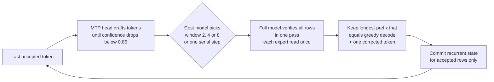
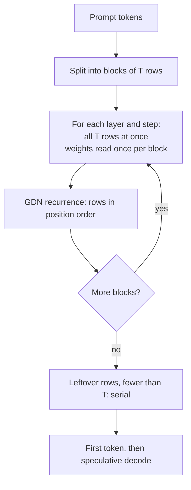

# Strix Halo engine

**A fast, exact LLM inference engine for one AMD mini PC and one big model.**

[English](README.md) · [Español](README.es.md)

<p align="center">
  <picture>
    <source media="(prefers-color-scheme: dark)" srcset="docs/media/speed-dark.svg">
    
  </picture>
</p>

<!-- SCREENSHOT: monitor panel of the engine goes here once the panel ships, e.g.
<p align="center"></p>
-->

This engine runs **Qwen3.8-Flash-Next**, a large mixture-of-experts model, on a single **AMD Strix Halo**
machine (Ryzen AI Max+ 395, 128 GB of unified memory) under Linux with ROCm. It is written from scratch for that
chip and that model, so every kernel, memory layout and scheduling choice can assume exactly what the hardware
and the model are.

It answers about **53-55 tokens per second** on a code prompt and reads prompts at **about 700 tokens per
second**, and the text it writes is **exactly** the text plain one-token-at-a-time greedy decoding would write.
The speed comes from guessing several tokens ahead and checking all the guesses at once, never from changing
the answer.

**AMD-first and independent.** The model-execution kernels, scheduling and speculative decoding are our own C++/HIP
code for Strix Halo (`gfx1151`); the engine does not wrap another inference runtime, and every number in this README
comes from our `strix-hip-decode-token` executable. ROCm/HIP, Linux, the GGUF format and the usual build tools remain
dependencies: *independent* does not mean dependency-free. The engine is meant to stay fully usable on a single Strix
Halo without the distributed orchestration work in [TensorMeld](https://github.com/hyukudan/tensormeld); multi-node
operation and other GPUs are separate, explicitly qualified stages. First priority: the best correct end-to-end
performance from AMD hardware.

> **Status: research engine.** It works end to end and the numbers below are measured, but the interface is a
> command-line tool that takes token IDs and prints a JSON receipt. There is no chat server yet; see the
> [roadmap](#roadmap).

## Contents

[Why it is different](#why-it-is-different) ·
[How fast](#how-fast) ·
[How good](#how-good-quality) ·
[Languages](#beyond-english) ·
[What you need](#what-you-need) ·
[Build](#build) ·
[Run](#run) ·
[How it works](#how-it-works) ·
[Design decisions](#design-decisions) ·
[Roadmap](#roadmap) ·
[FAQ](#faq) ·
[License](#license)

## Why it is different

- **Exact speculative decoding.** A small built-in predictor (the model's MTP head) drafts the next few
  tokens. The full model then checks 2, 4 or 8 of them in one pass and keeps the longest correct run. Every
  multi-row kernel does each row's arithmetic exactly like the one-row kernel, so every emitted token equals
  serial greedy decode, bit for bit. No tolerance, no "close enough".
- **Named numerical profiles with measured quality.** How the engine rounds numbers is a named, versioned
  choice, not a hidden detail. Two are recommended today: the **exact profile** (dense projections in FP32) and
  **dense A8** (int8 activations for the dense projections, faster, with a measured, small quality cost). The
  prompt can be read with one profile and the answer written with another (D-033).
- **Quality is measured, not assumed.** A teacher-forced harness compares the engine's full output
  distribution against a Q8_0 reference over tens of thousands of positions (KL divergence and top-1
  agreement), broken down by category and language.
- **Opt-in until proven.** Every optimization starts disabled. It becomes the default only after it is shown
  to be bit-exact (or, for a new numerical profile, to have measured quality) and faster on the real
  hardware, on the complete workload. Ideas that failed are recorded with their numbers.
- **AMD-first and independent.** Written for `gfx1151` with HIP, its own GGUF reader, its own kernels and its
  own memory planner for unified memory.

## How fast

Measured on **one Bosgame M5** (Ryzen AI Max+ 395, 128 GB), model UD-Q4_K_XL, one request at a time, at commit
`dff1dbe` on **2026-10-18**. These numbers will be refreshed after the current benchmark campaign.

<!-- BENCH: refresh every value in this section (and tools/gen_readme_chart.py, then rerun it) at the final campaign commit; update commit and date. -->

**Writes answers** (decode, speculative with MTP windows 2/4/8, code prompt, 256 generated tokens, replay error 0):

| Profile | Tokens per second |
|---|---|
| Exact (FP32 dense) | **53.1** |
| Dense A8 (recommended) | **54.9** |

<!-- BENCH: decode per workload (English prose, Spanish prose, other languages, chat) for both profiles. -->

Code is the easiest case for the predictor. Prose accepts fewer drafted tokens per check, so it decodes
slower: at an earlier commit (`b0d1cd1`) English prose ran at 37.2 tok/s where code ran at 48.5 tok/s. A
per-workload table for the current build is pending; see [docs/ENGINE.md](docs/ENGINE.md#decode-by-workload-earlier-measurement).

**Reads your prompt** (prefill, tiled, tokens per second of the whole request):

| Prompt length | Exact (FP32 dense) | Dense A8 (recommended) |
|---|---|---|
| 1K tokens | ~401 | **703** |
| 4K tokens | ~388 | **694** |
| 16K tokens | ~375 | **668** |
| 32K tokens | ~371 | **656** |

**Time to first token:**

| Prompt length | Exact | Dense A8 |
|---|---|---|
| 1K tokens | <!-- BENCH: TTFT 1K exact --> pending | <!-- BENCH: TTFT 1K dense A8 --> pending |
| 4K tokens | <!-- BENCH: TTFT 4K exact --> pending | <!-- BENCH: TTFT 4K dense A8 --> pending |
| 16K tokens | <!-- BENCH: TTFT 16K exact --> pending | <!-- BENCH: TTFT 16K dense A8 --> pending |
| 32K tokens | <!-- BENCH: TTFT 32K exact --> pending | <!-- BENCH: TTFT 32K dense A8 --> pending |

Until TTFT is measured directly: at the prefill rates above, reading a 32K-token prompt takes roughly 50 s with
dense A8 and 88 s with the exact profile (arithmetic from the throughput, not a separate measurement). Loading
the model takes about 11 s once its checksum is cached; the very first start hashes the 111 GB file, about 50 s.

## How good (quality)

The harness feeds the same documents to the engine and to a Q8_0 reference of the same model, one token at a
time ("teacher-forced"), and compares the full probability distribution at every position:

- **KL divergence**: how far the engine's probabilities are from the reference. Lower is better; 0 means
  identical.
- **Top-1 agreement**: how often the engine's most likely next token is the reference's most likely next token.

| Profile | KL to Q8_0 reference | Top-1 agreement |
|---|---|---|
| Exact (FP32 dense) | 0.01940 | 95.52 % |
| Dense A8 (recommended) | 0.01978 (+1.9 ± 2.0 %) | 95.55 % |

49,001 positions, measured for [D-032](DECISIONS.md#d-032-dense-a8-in-the-recommended-profile). In plain words:
dense A8 is as close to the reference as the exact profile, within the margin that separates any two exact
implementations of the same weights. Where the two profiles disagree (2.8 % of positions) it is almost always
between two near-equal candidates. For comparison, quantizing activations to Q8_1 cost +30 % KL and was not
adopted.

<!-- BENCH: refresh this table with the final quality campaign (per category: multilingual, Spanish prose, English prose, code, agent, math, chat). -->

Methodology: [docs/teacher-forced-tiled-prefill.md](docs/teacher-forced-tiled-prefill.md) (how the logits are
produced, byte-identical to the serial route),
[docs/decode-optimization-profile.md](docs/decode-optimization-profile.md) (scoring and logits file format) and
[docs/qualification-ledger.md](docs/qualification-ledger.md).

## Beyond English

We work to avoid losing quality or speed outside English.

- **Speed: draft vocabulary packs per language.** The predictor only drafts from a subset of the vocabulary,
  which keeps drafting cheap. The repository ships a 32k language-independent core plus 16k packs for German,
  Spanish, French, Italian, Portuguese, Russian, Japanese and Chinese in [`data/draft-vocab/`](data/draft-vocab/).
  With `--mtp-draft-vocab auto:data/draft-vocab` the engine picks the pack that matches the prompt. On a Spanish
  chat prompt this raised decode from 32.9 to 38.9 tok/s (+18 %). The pack only changes how many guesses are
  accepted, never the text.
- **Quality: measured per language and category.** The quality harness reports KL and top-1 separately for
  multilingual text, Spanish prose, English prose, code, agent tasks, math and chat, each with an explicit
  margin. A numerical choice that hurts one of these categories is rejected even when the average looks fine;
  for example, the dense A8 decision records the one per-category signal it found (Spanish prose top-1,
  −0.55 ± 0.23 points, with unchanged KL).

## What you need

| | |
|---|---|
| **Machine** | AMD Strix Halo with the Radeon 8060S iGPU (`gfx1151`), e.g. Ryzen AI Max+ 395, with **128 GB** of unified memory. Measured on a Bosgame M5. |
| **OS** | Linux. |
| **GPU stack** | ROCm/HIP. Tested with ROCm **core 10.1** installed under `/opt/rocm/core-10.1`. |
| **Build tools** | CMake >= 3.24, Ninja, a C++20 compiler, optionally OpenSSL for fast file hashing. |
| **Model** | Qwen3.8-Flash-Next **UD-Q4_K_XL** GGUF (about 111 GB) and the **Q8_0 MTP sidecar** GGUF, from the snapshot pinned in [SOURCES_LEDGER.md](SOURCES_LEDGER.md). The automatic profile only admits the exact pinned model content. |
| **Disk** | Room for the model files (111 GB plus the sidecar), the build and, for MTP, a small reference file per prompt (about 1 MB per prompt token). A fast NVMe drive keeps start-up short. |
| **Tokenizer** | The engine takes token IDs. Use the model's own tokenizer to turn text into IDs and back. |

## Build

```sh
export PATH=/opt/rocm/core-10.1/bin:$PATH
cmake -S . -B build -G Ninja \
  -DCMAKE_BUILD_TYPE=Release \
  -DCMAKE_HIP_ARCHITECTURES=gfx1151 \
  -DCMAKE_HIP_COMPILER=/opt/rocm/core-10.1/bin/amdclang++ \
  -DSTRIX_ENABLE_HIP_RUNTIME=ON \
  -DSTRIX_ENABLE_EXPERIMENTAL_Q4K_A8_RUNTIME=ON \
  -DSTRIX_BUILD_EXPERIMENTAL_Q4K_A8_PROBE=ON \
  -DSTRIX_USE_OPENSSL_SHA256=ON \
  -DBUILD_TESTING=ON
ninja -C build strix-hip-decode-token
```

`ctest --test-dir build` runs the host and device tests (many device tests need the GPU and the model files).
All CMake options are listed in [docs/ENGINE.md](docs/ENGINE.md#build-options).

## Run

The simplest run: plain greedy decode with the recommended profile, 256 tokens.

```sh
./build/strix-hip-decode-token Qwen3.8-Flash-Next-UD-Q4_K_XL.gguf $(cat prompt.ids) \
  --context 8192 --execution-mode eager --residency register --generate 256 \
  --optimization-profile auto \
  --numerical-profile hc-splitk-f32+q51-q80-a8-down+q5k-a8-gateup+dense-a8-v1
```

`prompt.ids` holds the prompt as whitespace-separated token IDs, produced with the model's tokenizer. The engine prints a JSON receipt with
`generated_tokens` and timings; decode the tokens with the model's tokenizer.

For the full speed shown above, add the speculative decoding options (MTP sidecar, verify windows 2/4/8,
draft vocabulary). They are explicit and verbose on purpose: files are pinned by SHA-256 and every memory
reservation is declared. The complete, copy-ready command with every flag explained is in
**[docs/ENGINE.md → Command line](docs/ENGINE.md#command-line)**, and the MTP options in
[docs/mtp-native-cli.md](docs/mtp-native-cli.md). Long prompts use the tiled prefill
([docs/ENGINE.md → Prompt prefill](docs/ENGINE.md#prompt-prefill)).

To use the exact profile instead, pass
`--numerical-profile hc-splitk-f32+q51-q80-a8-down+q5k-a8-gateup-v1`.

Several requests (up to four) can decode together in one process: `--mtp-cohort-request TOKENS_FILE,GOLDEN,SHA256`
(repeatable) adds requests next to the positional prompt, each with its own state, MTP runtime and golden. Their
drafts are verified in cohort windows that read the projection, expert, HC and head weights once for the rows of all
requests, while every request produces exactly the tokens it produces alone. See [docs/multi-request-cohort.md](docs/multi-request-cohort.md)
(D-039).

Decoding is greedy unless `--mtp-sample-temperature` is above zero: sampled decoding (top-k/top-p/min-p, seed)
keeps the MTP drafts as speculative proposals and stays reproducible for a seed. See
[docs/sampled-decoding.md](docs/sampled-decoding.md) (D-040).

Teacher-forced scoring (`--teacher-forced-score`, `--teacher-logits-file`) also runs over the tiled prefill with the
all-rows output policy, producing byte-identical logits files to the serial route within a profile, several times
faster. See [docs/teacher-forced-tiled-prefill.md](docs/teacher-forced-tiled-prefill.md) (D-034).

## How it works

**One decode cycle.** The predictor drafts until it is no longer confident; a cost model picks the window size;
the full model checks the whole window in one pass; the longest run of matching tokens is kept, plus the full
model's own next token.



A one-token step is limited by memory bandwidth (all active weights are read for one token), so checking 4 or 8
tokens costs far less than 4 or 8 steps. Because the full model has the last word on every token, a wrong guess
only costs time, never correctness.

**Reading a long prompt (tiled prefill).** The prompt is cut into blocks of T rows (up to 2048). Inside a block
the engine runs each step of the layer for all T rows before moving on, so each weight is read once per block
instead of once per token. The recurrent (GDN) layers still update rows strictly in order, so the result is
bit-identical to reading the prompt one token at a time with the same profile.



The architecture guide is in [docs/README.md](docs/README.md); the deeper engine reference is
[docs/ENGINE.md](docs/ENGINE.md).

## Design decisions

The full record, with alternatives, evidence and the condition for reopening each one, is
[DECISIONS.md](DECISIONS.md). The main ones:

- **Exact verification over tolerance (D-021).** Multi-row kernels repeat the one-row arithmetic exactly, so
  speculative decoding never changes the output. Tolerance-based verification was rejected because output
  identity is the correctness gate.
- **Adaptive windows 2/4/8 with an online cost model (D-022).** The window grows when the predictor is
  confident and shrinks when it is not; moving from {2,4} to {2,4,8} was the largest single gain.
- **Longest-prefix acceptance without checkpoints (D-023).** Accepted rows are committed to the recurrent
  state by the next window instead of saving and restoring state every cycle (46 % faster on the run where it
  was measured).
- **Named numerical profiles (D-024, D-032).** Int8 activations in the MoE, then in the dense projections, each
  adopted only with a measured quality table.
- **A separate prefill profile (D-033).** The prompt can be read with a faster profile while decode keeps its
  own; both identities travel with every receipt and reference file.
- **Tiled prefill and teacher-forced scoring on it (D-034).** Same bytes as the serial route, a 16K-token
  scoring run went from 1001 s to 66 s.
- **Measured and rejected.** hipGraph capture of the decode loop, coarse-grained weight registration, fused
  HC normalization, several kernel variants and other draft thresholds were all measured and not adopted; the
  numbers are in the [rejected table](DECISIONS.md#measured-and-rejected).

## Roadmap

In progress, in no particular order and without promised numbers:

- **Prefix cache with GDN state** *(landed, D-035)*: a request whose prompt starts with a cached prefix restores the complete model state at a tiled-prefill block boundary and reads only the rest, with bit-identical output (`--prefix-cache-host-bytes N`, optional `--prefix-cache-dir DIR`; see [docs/prefix-state-cache.md](docs/prefix-state-cache.md)). Timings follow the next benchmark campaign.
- **Monitor panel**: live view of requests, speed and memory.
- **Several requests at once**.
- **KV cache in int8**.
- **Sampling with speculative decoding** (today decoding is greedy).
- **6-bit trunk** weights.

## FAQ

**Does speculative decoding change the answer?**
No. Every emitted token is verified by the full model, and the verify kernels repeat the one-token arithmetic
exactly. The output equals plain greedy decode with the same numerical profile, bit for bit.

**Which profile should I use?**
Dense A8 is the recommended default: faster, with quality within measurement margin of the exact profile. Use
the exact profile when you need the FP32-dense arithmetic.

**Do the two profiles give the same text?**
Not always. They round differently, so they can pick different tokens where two candidates are nearly tied
(2.8 % of positions in the quality run). Each one is deterministic and exact with respect to itself.

**Does it run on other GPUs or other models?**
No. It targets `gfx1151` and admits only the pinned Qwen3.8-Flash-Next content. That focus is the point of the
project.

**Why does it need 128 GB?**
The 4-bit model file alone is about 111 GB. Unified memory lets the GPU read the weights where they sit.

**What context length is supported?**
The automatic profile is qualified at 8192 tokens. Longer contexts run with `--unqualified-context`; the
prefill numbers above go up to 32K that way.

**Why token IDs and not text?**
The engine is the compute core. Tokenization, the chat template and serving sit outside it for now.

**Where are the numbers from?**
From our own runs on our own machines, with the commit and date next to each table. Nothing here is a
theoretical estimate presented as a result.

## License

The engine source is licensed under the **[Apache License 2.0](LICENSE)**, except the experimental Linux kernel
module under `lab/direct_gpu_stream/kernel/`, which is **GPL-2.0-only** as Linux kernel code must be (its license
texts are kept in that directory). Code adopted from other projects keeps its original license and notices. The
model weights are distributed under their own license (Qwen Community License). Third-party references used for
formats and model semantics are listed with their licenses in [SOURCES_LEDGER.md](SOURCES_LEDGER.md).
