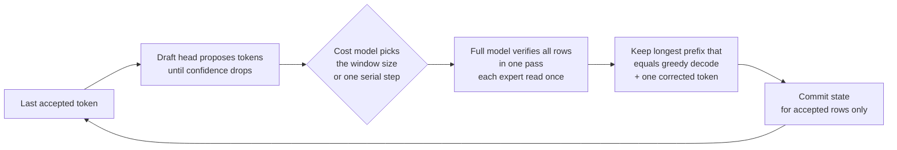
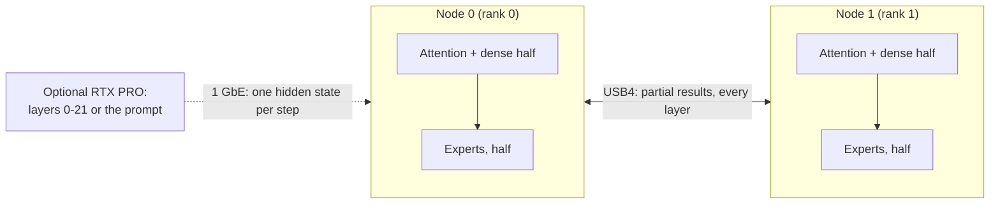

# Strix Halo engine lab

**Fast, exact LLM inference written from scratch for AMD Strix Halo: one mini PC, two linked over USB4, and a
discrete GPU when there is one.**

[English](README.md) · [Español](README.es.md)

This C++/HIP inference engine targets **AMD Strix Halo** (Ryzen AI Max+ 395, Radeon 8060S
`gfx1151`, 128 GB unified memory) under Linux with ROCm. Five engines are **Production**, with exact
execution and fast defaults: Qwen on one node, DeepSeek on a USB4 pair or standalone RTX, and MiniMax and GLM on
the pair. DeepSeek also supports RTX + pair execution. Two more are opt-in: **Nemotron 3.5 Bolt E4B** on one node
(`--profile default|fast|quality`, with a published [MTP drafter](https://huggingface.co/hyukudan/Nemotron-3.5-Bolt-E4B-MTP-Drafter) and [EXL3 quality pack](https://huggingface.co/hyukudan/Nemotron-3.5-Bolt-E4B-EXL3)) and
**GLM-5.3 Flash on one RTX PRO 6000** (draft, Windows).

Published measurements include:

- **Nemotron 3.5 Bolt E4B (one node):** 85.1 tok/s at one request with the MTP drafter on the official Q4_K_M;
  337.5 tok/s aggregate at eight requests with `fast`; the `quality` EXL3 pack agrees with BF16 on 92.9 % of
  top-1 tokens (Q4_K_M: 87.0 %).
- **Qwen3.8-Flash-Next:** 59.59 / 54.00 tok/s on 1K / 8K code prompts with MTP;
  two replicas reach 158.1 tok/s wall throughput at eight concurrent coding chats.
- **DeepSeek V4.1 Flash pair:** 70.6 tok/s on code with DSpark; eight plain decode rows
  reach 113.9 tok/s aggregate (calculated from measured step time); exact prompt processing (server time to first
  token, one client, cache off) 9.00 / 31.94 / 45.46 s at 8.4K / 32.5K / 44.7K tokens.
- **DeepSeek standalone RTX PRO 6000:** same-load code / English / Spanish decode
  at 82.3 / 87.7 / 94.4 tok/s with the target and draft on the GPU.
- **MiniMax M3.1 Flash:** 44.57 ms/token at 1K with plain decode; DSpark reaches
  54.4 / 34.1 / 24.1 tok/s on JSON / Python / prose.
- **GLM-5.3 Flash:** default exact MTP self-speculation reaches
  37.1 / 44.5 / 40.0 tok/s on chat / code / JSON.
- **GLM-5.3 Flash on one RTX PRO 6000:** exact prefill (time to first token 17.7 s at 8K, 41.2 s at 32K tokens) and
  exact decode (3.3 tok/s) with an expert cache across VRAM, pinned RAM and disk; decode speed work is ongoing.

These are workload-specific results, not speed guarantees. [How fast](#how-fast) preserves the
hardware, profiles, concurrency and measurement limits; [published performance](docs/performance.md)
contains the supporting records.

**Exactness means token-identical to the declared reference path.** Speculation and concurrency
preserve that contract; changing weights, rotary semantics, numerical identity or request policy
changes the reference. See [Exactness](#exactness).

Each family ships command-line execution and qualification tools. Qwen and DeepSeek pair expose
chat, completions and stateless Responses HTTP routes; MiniMax ships `strix-minimax-serve`.
Standalone RTX uses a persistent file-queue worker. See [Run](#run) for each engine's launch contract.

## At a glance

**Who is this for?** Developers deploying or studying native, model-specific LLM inference on Ryzen AI Max / Strix Halo.

| Question | Short answer |
|---|---|
| What is it? | An independent C++/HIP inference engine, with model-specific execution paths, kernels, verification gates and HTTP serving. |
| Which hardware? | One Strix Halo Linux node, two nodes linked by USB4, and optional RTX PRO assistance for selected profiles. |
| Which models? | Qwen, DeepSeek (pair, standalone RTX and RTX + pair), MiniMax and GLM are Production; Nemotron 3.5 Bolt E4B (one node) and GLM on one RTX PRO 6000 are opt-in. See [Models](#models). |
| Does it change model outputs? | Exact by default relative to a declared profile and reference; speculative and concurrent execution preserve that sequence. See [Exactness](#exactness). |
| How do I verify release assets? | Use the CPU [release asset manifest](docs/operations/release-assets.md) tool for full hashes and explicit role closure. |
| What startup diagnostics are available? | Qwen has default-on [read-only preflight and configured build identity](docs/operations/startup-preflight.md), with explicit off switches. |
| Where do I begin? | Read [requirements](#what-you-need), [build](#build), then [run](#run). |
| Where are reproducible results? | [Performance methodology and results](docs/performance.md), with test conditions and verification; headline throughput is not a universal guarantee. |

**Project boundaries:** [TensorMeld](https://github.com/hyukudan/tensormeld) handles planning and routing; the [USB4 driver](https://github.com/hyukudan/strix-halo-usb4-driver) handles the Linux interconnect. This repository owns **inference execution**, not cluster management.

For detailed implementation internals, use [How it works](#how-it-works) and the documents linked throughout the model sections. The model weights and their licences are separate from the engine code.

## Quick start: build and run one model

For other engines, jump to [DeepSeek pair](#deepseek-pair), [standalone RTX](#deepseek-standalone-rtx),
[MiniMax](#minimax-pair) or [GLM](#glm-pair).

This minimal example is for **one Linux Strix Halo node** with the required ROCm toolchain, model GGUF and a tokenizer-produced `prompt.ids` file. It runs **Qwen generation with the production defaults**, including automatic fast prefill for eligible prompts.

```bash
git clone https://github.com/hyukudan/strix-halo-engine-lab.git
cd strix-halo-engine-lab
export PATH=/opt/rocm/core-10.1/bin:$PATH
cmake -S . -B build -G Ninja -DCMAKE_BUILD_TYPE=Release \
  -DCMAKE_HIP_ARCHITECTURES=gfx1151 \
  -DCMAKE_HIP_COMPILER=/opt/rocm/core-10.1/bin/amdclang++ \
  -DSTRIX_ENABLE_HIP_RUNTIME=ON \
  -DSTRIX_ENABLE_EXPERIMENTAL_Q4K_A8_RUNTIME=ON \
  -DSTRIX_BUILD_EXPERIMENTAL_Q4K_A8_PROBE=ON \
  -DSTRIX_USE_OPENSSL_SHA256=ON -DBUILD_TESTING=ON
ninja -C build strix-hip-decode-token
ctest --test-dir build --output-on-failure
```

Every HIP target builds for the AMD GPU targets in `STRIX_HIP_ARCHITECTURES` (default `gfx1151`); to add an
architecture, pass for example `-DSTRIX_HIP_ARCHITECTURES="gfx1151;gfx1160"`. The runtime still decides which kernel
sets a given architecture may run.

With the matching Qwen model and token IDs available in your working directory:

```bash
./build/strix-hip-decode-token Qwen3.8-Flash-Next-UD-Q4_K_XL.gguf $(cat prompt.ids) --generate 256
```

Add `--print-effective-config` to inspect before HIP initialization. See [Defaults and off switches](#defaults-and-off-switches) for baseline scope.

The command produces a JSON receipt with token IDs and timing. Actual model files and prompt tokens are **not included**. For model assets, optional MTP/DSpark acceleration, serving and two-node transport, continue with [requirements](#what-you-need), [build](#build), [run](#run), and the [full engine reference](docs/getting-started/engine-reference.md). Some CTest cases require the GPU and model assets.

## Contents

[Models](#models) ·
[Hardware](#hardware) ·
[How fast](#how-fast) ·
[How exact, how good](#how-exact-how-good) ·
[Exactness](#exactness) ·
[Why it is different](#why-it-is-different) ·
[Languages](#beyond-english) ·
[What you need](#what-you-need) ·
[Build](#build) ·
[Run](#run) ·
[Defaults and off switches](#defaults-and-off-switches) ·
[Optimizations](#optimizations) ·
[How it works](#how-it-works) ·
[Design decisions](#design-decisions) ·
[Roadmap](#roadmap) ·
[Related repositories](#related-repositories) ·
[FAQ](#faq) ·
[License](#license)

## Models

| Model | Runs on | Status | Highlights |
|---|---|---|---|
| **Qwen3.8-Flash-Next** (UD-Q4_K_XL, 111 GB) | 1 node; 2 replicas behind a router | **Production** | Exact MTP with a distilled draft head; native context through 262K and explicit YaRN through 1M; automatic HTTP tiled prefill; server with as many request slots as memory admits (built on demand); decode keeps streaming during long prompts and short requests are admitted inside them; prefix state cache; [opt-in GSQ profile](#gsq-opt-in-speed-over-quality-profile) |
| **DeepSeek V4.1 Flash** (1017; 2-bit experts, 6.5-bit + trellis dense) | 2 nodes over USB4 | **Production** | Expert tensor parallel decode, expert parallel device prefill, DSpark speculative decode, batched decode, server; prepared expert discovery and bounded prefix retention; bitwise gates |
| DeepSeek V4.1 Flash + RTX PRO 6000 | RTX PRO (layers 0-21) + 2 nodes (22-39) | **Production** (D-064) | Pipeline split over 1 GbE, CUDA prefill service, hot-expert placement |
| DeepSeek V4.1 Flash, standalone RTX | RTX PRO 6000 (96 GB, Windows WDDM) | **Production** | Q2 GGUF experts, Q8_0 dense; exclusive VRAM + pinned-host cache; on-GPU DSpark with warm controller selected as the speculative default |
| MiniMax M3.1 Flash (EXL3, 3.06 bpw) | 2 nodes TP2 over USB4 | **Production** | Eight-text quality gate passed; exact prefill/decode; DSpark serving auto admission and MSA mode 5; prefill/exchange defaults on |
| GLM-5.3 Flash (EXL3, 4.05 bpw) | 2 nodes TP2 over USB4 | **Production** | R1b decode identity by default; exact MTP self-speculation by default; exact R1 chunked prefill; `--identity r1` restores R1; R≥3 fix verified on the pair |
| GLM-5.3 Flash on one RTX PRO 6000 (draft) | RTX PRO 6000 (96 GB, Windows) | **Opt-in** | Exact prefill and greedy decode; routed experts streamed through the [tierstream](https://github.com/hyukudan/tierstream) device-gated cache (device, pinned RAM, unit file); `--profile`; [guide](src/glm/rtxpf/README.md) |
| Nemotron 3.5 Bolt E4B (Q4_K_M; EXL3 pack for `quality`) | 1 node | **Opt-in build** (`STRIX_FAMILY_GEMMA4=ON`) | `--profile default\|fast\|quality`; exact decode at every batch size; exact MTP drafter at C1; continuous-batching server |

The core knows no model: each family is a module with its own contract, plan, kernels and gates
([docs/models/model-families.md](docs/models/model-families.md)). Automatic routes admit model assets under their documented contracts; provenance and licenses are recorded in
[docs/reference/sources-ledger.md](docs/reference/sources-ledger.md).

## Hardware

- **Node:** one AMD Strix Halo mini PC, Ryzen AI Max+ 395 with the Radeon 8060S iGPU (`gfx1151`), 128 GB of
  unified memory, Linux, ROCm.
- **Pair:** two nodes joined by two direct USB4 cables (one 40 Gb/s, one 20 Gb/s link), driven by our
  [USB4 driver series](https://github.com/hyukudan/strix-halo-usb4-driver): about 37 Gb/s per direction with both
  directions busy, 18.4 µs for a 20 KB exchange.
- **Optional discrete GPU:** an RTX PRO 6000 (96 GB, Windows WDDM), used for standalone DeepSeek or prompt
  offload; the DeepSeek pipeline split reaches the pair over 1 GbE.

## How fast

Use the [benchmark kit and reproduction guide](docs/reproduce.md) for current commands, model requirements, machine interfaces and issue-ready reports.

Every speed below is measured in the lab with greedy decoding (temperature 0). Exactness is relative to the
named numerical profile; the trellis RTX pipeline split and GLM R1b decode have separate identities, as
noted below. Bandwidth ceilings are calculated bounds, not measured throughput. Evidence, methods and older values are in
**[docs/performance.md](docs/performance.md)**.

How to read the tables:

- **Best** is the best measured result for that mode, on the workload that suits it most (usually code or
  copy-heavy text). **Typical** is the same mode on ordinary text, so you know what to expect from a general chat.
- **tok/s** is decode speed after the prompt has been read, for one request unless the concurrency says
  otherwise. **TTFT** is time to first token.
- **Build** identifies the measured code revision; results apply to that build and configuration.
  Calendar metadata and complete provenance remain in the linked performance records.
- Repetition counts are stated where recorded. Unspecified counts must not be assumed to be medians;
  single runs and separate campaigns remain labeled.

Hardware: **1 node** = one Strix Halo (128 GB). **2 nodes** = two Strix Halo joined by two USB4 cables.
**RTX PRO** = an RTX PRO 6000 Blackwell (96 GB) in a PC on 1 GbE.

### DeepSeek V4.1 Flash

Sources: [published performance](docs/performance.md) and [current pair defaults](docs/models/deepseek-v4.1/production-defaults.md).

Pair-only rows: DeepSeek V4.1 Flash (1017 checkpoint), routed experts in the published 2-bit (Q2) GGUF, dense weights in
a 6.5-bit overlay with trellis-coded attention, shared-expert and head weights. 2 nodes, expert tensor parallel
(TP2) over USB4.

| Mode | Hardware | Prompt / context | Concurrency | Best | Typical | Build |
|---|---|---|---:|---:|---:|---|
| Greedy decode | 2 nodes | short decode benchmark, R1 | 1 | **28.333 ms/token** (35.3 tok/s; 59.5 % of calculated ceiling, 16.87 ms floor) | 2 interleaved pairs; tokens identical | `6a5604bf` |
| DSpark speculative decode | 2 nodes | 8 prompts per type, 256 tokens each | 1 | **70.6 tok/s** (code) | 41.9 (English) / 45.3 (Spanish); 50.0 over all 24 | `cab238d6` |
| Batched decode, no drafting | 2 nodes | N8 decode benchmark, all rows equal the reference | 8 | **70.24 ms/step** (113.9 tok/s aggregate, calculated; 66.2 % of calculated ceiling, 46.48 ms floor) | | `6a5604bf` |
| Device prefill (expert parallel) | 2 nodes | 1K benchmark prompt, kind unspecified | 1 | TTFT **1.954 s** | median of 4; logits bit-identical on both ranks | `6a5604bf` |
| Device prefill | 2 nodes | 8K benchmark prompt, kind unspecified | 1 | TTFT **9.757 s** | median of 3; logits bit-identical on both ranks | `6a5604bf` |
| Device prefill | 2 nodes | 16K | 1 | TTFT **20.40 s** (803 tok/s) | | `f9332f3e` |
| Device prefill | 2 nodes | 32K | 1 | TTFT **39.6 s** (828 tok/s), 2 runs | | `43086d05` + prefill defaults |
| Server, one client, chat | 2 nodes | chat prompt | 1 | **66.9 tok/s** (code) | 34.9 tok/s (prose) | release |
| Server, 8 chats × 128 tokens | 2 nodes | chat prompts | 1 / 2 / 4 / 8 | **41.4 / 54.0 / 59.7 / 67.9 tok/s** aggregate | | release |
| Server, 8-category short set | 2 nodes | 36-303-token prompts | 1 / 2 / 4 / 8 | | **39.88 / 61.66 / 66.53 / 74.25 tok/s** aggregate | `cab238d6` |
| Warmed server, 8-category short set | 2 nodes | same short set as above | 1 / 2 / 4 / 8 | **48.00 / 63.97 / 69.20 / 77.00 tok/s** aggregate | 64/64 IDs equal; C8 clean run (see below) | `6a5604bf` |
| Server TTFT | 2 nodes | 8K, warm server idle | 1 | **11.80 s** | **26.40 s** while 4 other streams decode; fresh-server first request 12.72 s | `cab238d6` |

**On by default** in the pair build (`6a5604bf`): shared-down fusion
(`STRIX_DS41_SHARED_DOWN_FUSED=0` to disable), split gate/up MoE prefill kernel "form 7"
(`STRIX_DS41_MOE_PREFILL=0`), exact per-site dense prefill selector (`STRIX_DS41_DENSE_SELECT=0`;
FP16 forms stay off), attention window fold / live chunks / f16 tile
(`STRIX_DS41_ATTN_WINDOW_FOLD=0` / `STRIX_DS41_ATTN_LIVE_CHUNKS=0` / `STRIX_DS41_ATTN_TILE_F16=0`),
and server warm-up + DSpark calibration (`STRIX_DS41_SERVE_WARM=0` / `STRIX_DS41_DSPARK_CALIB=0`).
Measured gains versus `69c6bdab`, with the same GPU turns, Q2 experts + 6.5-bit/trellis dense profile,
and two Strix Halo nodes using expert tensor parallel over USB4:

| Measurement | `69c6bdab` → `6a5604bf` | Change | Verification / conditions |
|---|---:|---:|---|
| Device prefill TTFT, 1K | 2.098 → **1.954 s** | −6.9 % | median of 4 |
| Device prefill TTFT, 8K | 11.090 → **9.757 s** | −12.0 % | median of 3 |
| Greedy decode, R1 | 28.873 → **28.333 ms/token** | −1.9 % | 2 interleaved pairs; tokens identical; 35.3 tok/s, 59.5 % of calculated ceiling (16.87 ms floor) |
| Six-row verify window, R6 | 54.01 → **52.70 ms/window** | −2.4 % | identical |
| Eight streams, no drafting, N8 | 71.84 → **70.24 ms/step** | −2.2 % | all rows equal the reference; 113.9 tok/s aggregate (calculated), 66.2 % of calculated ceiling (46.48 ms floor) |
| Warmed server, 8-category short set, C1 / C2 / C4 / C8 | 43.58 / 61.13 / 66.53 / 75.72 → **48.00 / 63.97 / 69.20 / 77.00 tok/s** aggregate | +9.9 / +3.0 / +2.9 / +1.7 % | token IDs 64/64 equal in every run |
| Streaming, single client | 54.67 → **58.77 tok/s** | +7.4 % | same warmed-server campaign |

Prefill uses benchmark prompts of unspecified kind; logits are bit-identical to the archived reference
on every run on both ranks. Prompt kind/context are unspecified for the short decode benchmarks.
Server: two runs per arm in both orders; one of the two new-build runs had a single prefill unit stall
of 3.8 s (cause under investigation), so C8 uses the clean run. The measured pair build supersedes
the earlier single-client serving regression: it serves faster than `69c6bdab`.

**On by default** (exact, same logits and generated ids): attention lean chunk
kernel (`STRIX_DS41_ATTN_LEAN=0` to disable), split prefill MoE kernels v2 (`STRIX_DS41_PREFILL_MOE_V2=0`), and
Engram lookahead between server prefill pieces (`STRIX_DS41_ENGRAM_LOOKAHEAD=0`). Server TTFT, one client, cache off,
cold English prompts, 2 nodes:

| Prompt | Before (main #148) | Now | Change |
|---|---:|---:|---:|
| 8,399 tokens | 10.44 s | **9.70 s** | −7.1 % |
| 32,499 tokens | 36.85 s | **33.79 s** | −8.3 % |
| 44,699 tokens | 53.62 s | **48.27 s** | −10.0 % |

Logits and the 32 generated ids equal the published references at all three lengths. Per lever (same GPU turn or
separate turns, one load per arm): MoE v2 −5.9 / −6.9 / −8.0 %, Engram lookahead −3.3 % at 32,499 and −2.8 % at
44,699 tokens, attention lean −1.4 to −2.4 %.

`--profile fast` turns on the relaxed-order MoE lever `STRIX_DS41_FAST_MOE=1`: **8.53 / 29.24 / 41.90 s** on the same
prompts. It changes logits; its quality qualification is in progress, and `default` is unchanged.

**DeepSeek with the RTX PRO, pipeline split** (same model files; the RTX runs layers 0-21 with CUDA, the two nodes run
layers 22-39 and the head):

| Mode | Hardware | Prompt / context | Concurrency | Best | Typical | Build |
|---|---|---|---:|---:|---:|---|
| Batched decode, no drafting | RTX PRO + 2 nodes | 8 benchmark prompts, 48 tokens; 2 groups in flight | 2 / 4 / 8 | **60.1 / 97.5 / 137.2 tok/s** aggregate | bitwise equal to pair-only reference | pair `6525d5e8`, CUDA `463c08ec` line |
| Batched DSpark decode | RTX PRO + 2 nodes | same benchmark, controller windows | 1 / 2 / 4 | **52.4 / 91.3 / 156.8 tok/s** wall aggregate | bitwise reference gates | same line |
| Server, 8-category short set | RTX PRO + 2 nodes | short prompts, DSpark; 2 groups in flight | 1 / 2 / 4 / 8 | **43.2 / 65.8 / 77.9 / 91.7 tok/s** aggregate | token IDs equal pair-only in 32/32 requests | pair `6525d5e8`, CUDA `463c08ec` |
| Prompt reading on the RTX PRO (exact profile) | RTX PRO | 2K / 8K / 32K | 1 | TTFT **3.64 / 4.39 / 12.20 s** | | release |

The batch/serving pipeline overlaps two groups of requests: the RTX processes one while the pair processes
the other (one group for a single request). These batch/serving rows use Q2 experts, the 6.5-bit dense overlay and the separately gated expert-TP
identity; they do not use the single-request trellis-composed profile.

The single-request RTX
split is bitwise equal to the pair without the trellis sites; with trellis sites it is a declared composed
identity, checked against the pair (KL 1.7e-3), not bitwise. RTX TTFT: warm resident service, model load
excluded, up to the exported attention state handed to the import endpoint. A faster CUDA prefill profile fails
the quality gate on long prompts and is not quoted.

**Standalone RTX DeepSeek — Production.** Full DeepSeek V4.1 Flash target on an
RTX PRO 6000 (96 GB, Windows WDDM): Q2 GGUF routed gate/up **IQ2_XXS**, routed down **Q2_K**, dense **Q8_0**.
Experts use an exclusive VRAM + pinned-host cache; the target and DSpark draft share the GPU. The draft keeps
the 64 most-used experts per stage. Deferred/bounded write-backs, the CUDA-graph instantiation fix and the
warm controller default are adopted; keep-64 pruning measured **+16 %** on code with a four-row window.

| Mode | Code | English | Spanish | Calculated ceiling share |
|---|---:|---:|---:|---|
| Exact DSpark decode, warm controller + deferred write-backs, same load | **82.3 tok/s** | **87.7 tok/s** | **94.4 tok/s** | **51–58 %** of the 6.18 ms/token all-hit floor |
| Exact DSpark decode, best runs across loads | **94–95 tok/s** | **97 tok/s** | **100–101 tok/s** | **58–63 %** of the same ceiling |

Quote code throughput as **82–95 tok/s**: loads vary by up to **~10 %**, so comparisons apply within one load.
Exact gates pass for this RTX profile; equality against the pair's trellis profile is not claimed.
Prompt lengths and generated-token counts are unspecified for these latest decode measurements.

| Loading / serving work | Measured result | Status |
|---|---|---|
| Pipelined expert loading | Full load **108.7 → 61.8 s**; expert fill **83.1 → 38.0 s**, **2.25 → 6.73 GB/s**, disk-bound | **Published, on by default** ([PR #52](https://github.com/hyukudan/strix-halo-engine-lab/pull/52)); bitwise-identical placement and outputs |
| Persistent loaded worker | **8–18 s per request** on test workloads without reload; fresh-load cache reset **3.4 s** | **Published** (`--serve`, PR #52); each request bitwise identical to a fresh process |
| Window prefetch | No repeatable gain in matched warm comparisons | Exact; default off |

**Cold start, same standalone RTX profile.** Persistent worker,
tested binary `1569bce5`; runtime write-back/flush switches preserve fresh-process tokens, logits and state
(6/6 offline comparisons). These are step timings, not chat throughput or TTFT:

| Configuration | Step 0 | Mean steps 0–15 | Mean steps 16–63 |
|---|---:|---:|---:|
| Fresh load | 332.6 ms | 56.05 ms | 28.15 ms |
| Fresh load with saved residency seed | 156.0 ms | 44.67 ms | 25.66 ms |
| Worker with graph pre-capture | 11.0 ms | 33.99 ms | 27.26 ms |
| Worker, warm expert cache | 10.9 ms | 11.63 ms | 11.49 ms |

Graph pre-capture adds **1.5 s before readiness**. Prompt kind/length are unspecified for this exact-phase
benchmark. The worker, residency seed and graph pre-capture are published with
[PR #52](https://github.com/hyukudan/strix-halo-engine-lab/pull/52): the adopted exact settings (keep-64, deferred
write-backs, warm controller, decode kernel bundle and fusions) are on by default with off switches, and a no-flag run
matched the explicit configuration (all gates 64/64, identical speculation traces, 21/21 chat tokens) on a reduced
pinned cache, so that gate does not give speed numbers. The measured **82–95 tok/s** code range remains the quoted result.
Build, run and defaults: [docs/models/deepseek-v4.1/rtx-standalone.md](docs/models/deepseek-v4.1/rtx-standalone.md).

### Qwen3.8-Flash-Next

Sources: [prefill/default measurements](docs/performance.md#qwen-prefill-and-defaults) and [decode/serving results](docs/performance.md).

All rows: Qwen3.8-Flash-Next, UD-Q4_K_XL GGUF (111 GB) plus a distilled Q8_0 MTP draft head (2.8 GB), MTP
speculative decoding with windows 2/4/8, dense A8 profile, thinking off, 256 generated tokens unless stated.

| Mode | Hardware | Prompt / context | Concurrency | Best | Typical | Build |
|---|---|---|---:|---:|---:|---|
| MTP decode | 1 node | 1K, code, auto windows | 1 | **59.59 tok/s** (69 % of 86.8 tok/s byte ceiling) | prose: 55.7 tok/s (`0117a140`) | `702bc074` |
| MTP decode | 1 node | 8K | 1 | **54.00 tok/s** (code, auto windows) | prose: 49.58 tok/s (`226bb691`, exact draft attention) | code `702bc074`; prose `226bb691` |
| MTP decode | 1 node | 32K | 1 | **47.9 tok/s** (code; observed range 44.5–52.6) | median of 4 | `0117a140` |
| MTP + copy windows (opt-in), long copy-edit | 1 node | Markdown document (~10 KB) to fix, 2,047-token answer | 1 | **183.5 tok/s** | | `e1b115a2` |
| MTP + copy windows (opt-in), long copy-edit | 1 node | Python file + diff to apply, 1,417-token answer | 1 | **163.9 tok/s** | | `e1b115a2` |
| MTP + copy windows (opt-in), long copy-edit | 1 node | C++ file to rewrite with renames, 1,711-token answer | 1 | **155.1 tok/s** | | `e1b115a2` |
| MTP + copy windows (opt-in), 7 copy-edit tasks | 1 node | 5-10 KB inputs, 1,114-2,047-token answers | 1 | | **125.2 tok/s** (90.2 without copy windows) | `dd65dbd5` |
| MTP + copy windows (opt-in), agent sessions | 1 node | 6 coding-agent sessions | 1 | | 59.9 tok/s (unchanged by copy windows) | `dd65dbd5` |

Copy windows (`--mtp-ngram-draft=wide --mtp-copy-wide-rows 32`) verify up to 32 rows when the answer copies text
from the prompt; tokens are identical to the default in every run. They help when the answer re-emits long spans
of the input (rewrites, patches, document fixes), do nothing on new text, and currently work for one request per
process (not yet with the batched server).

**Two replicas** (one complete model per node behind the router, `--http-batch 8`, servers restarted before each
of 3 rounds, no warm-up; token ids equal the single-node run in 570/570 responses). Newer coding-chat wall
rates use build `0117a140`, fresh servers with one excluded warm-up request, 3 ABBAAB rounds; 90/90
responses equal the single-node reference:

| Mode | Hardware | Prompt / context | Concurrency | Best: coding chat | Typical: 8-category short set | Build |
|---|---|---|---:|---:|---:|---|
| Server, two replicas | 2 nodes | ~70-token chat / 36-303-token prompts | 1 | **68.2 tok/s** wall | 42.8 tok/s wall, TTFT p50 0.89 s | `0117a140` coding; release short set |
| Server, two replicas | 2 nodes | same | 2 | **136.4 tok/s** wall | 85.8 wall, TTFT p50 0.85 s | `0117a140` coding; release short set |
| Server, two replicas | 2 nodes | same | 4 | **146.8 tok/s** wall | 102.9 wall, TTFT p50 1.32 s | `0117a140` coding; release short set |
| Server, two replicas | 2 nodes | same | 8 | **158.1 tok/s** wall | 120.4 wall, TTFT p50 2.55 s | `0117a140` coding; release short set |

*Wall* is all completion tokens over wall time including the first token and queueing. The earlier
coding-chat campaign measured **90.7 / 181.5 / 201.6 / 255.0 tok/s** summed per-request decode
at concurrency 1 / 2 / 4 / 8; summed decode excludes each request's prompt and queueing time.

**Prompt reading, one node** (profiles and conditions below) and **with the RTX PRO** (exact CUDA
prefill on the RTX, attention and recurrent state streamed to the node over 1 GbE as each layer finishes, then the
node decodes; 64 generated tokens identical to the node-only run at every length; one run per length):

| Mode | Hardware | 1K | 4K | 8K | 16K | 32K | Build |
|---|---|---:|---:|---:|---:|---:|---|
| Prefill, TTFT | 1 node | **1.12 s** | **3.02 s** | | **14.64 s** | **22.95 s** | `0117a140` (1K/16K); combined profile below (default on) |
| Prefill offload, TTFT | RTX PRO + 1 node | **1.36 s** | **1.92 s** | **2.94 s** | **4.95 s** | **8.99 s** | `70b93af3` |
| Same server without the RTX, TTFT | 1 node | 1.80 s | 5.20 s | 10.46 s | 21.43 s | 44.02 s | same server build |

The offload compares against the same production server it forwards to (2,048-row prompt tiles), which reads
prompts more slowly than the one-node prefill row above (8,192-row tiles). At 32K the RTX path is 4.9× faster than
that server. With the offload enabled, the router sends prompts of 1K tokens or more to the RTX PRO; shorter ones
are read on the node.

**Build `0117a140`** (measured against the release build in the same session, interleaved runs,
every run exact): TTFT 2.3 % (1K), 3.4 % (4K) and 5.1 % (16K, 32K) lower; decode equal or up to 0.4 % faster;
two replicas at concurrency 4 and 8: 3.9 % and 3.6 % more wall throughput, and a 6.9 % lower TTFT at
concurrency 4. Details in [docs/performance.md](docs/performance.md#qwen38-flash-next-1).

**Exact combined prefill.** One Strix Halo node, Qwen3.8-Flash-Next UD-Q4_K_XL,
dense-A8 decode with a separate fast FP16 prefill identity; build `8b99cf58`, defaults without environment overrides. Same-node comparisons
against `4a44683b`, except the maximum-context same-build off comparison. Terminal FP32 logits and tokens
match the reference at every length; code-1K and prose-8K qualification receipts match the archived baseline.
Prompt kind is unspecified for the length sweep.

| Prompt tokens | Baseline TTFT | Default TTFT | Change | Default tok/s | Contract ceiling share |
|---|---:|---:|---:|---:|---:|
| 4,096 | 3.53 s | **3.00 s** | −15.0 % | 1,363 | 43.4 % of 3,139 tok/s |
| 17,700 | 14.97 s | **12.81 s** | −14.4 % | 1,382 | 44.7 % of 3,089 tok/s |
| 32,768 | 25.95 s | **23.49 s** | −9.5 % | 1,395 | 45.3 % of 3,078 tok/s |
| 65,536 | 55.37 s | **48.18 s** | −13.0 % | 1,360 | 44.9 % of 3,030 tok/s |
| 131,072 | 120.96 s | **105.84 s** | −12.5 % | 1,238 | 42.6 % of 2,907 tok/s |
| 262,143 | 291.82 s (same-build off) | **240.62 s** | −17.5 % | 1,089 | 40.5 % of 2,687 tok/s |

Two runs per arm at 4K / 17,700; 32K has one baseline and two default runs; longer rows are single runs.
Prompt tiles: 4,096 at 4K / 128K, 8,192 at 17,700 / 32K / 64K, 2,048 with 256/16-row tails at 262,143.
Run-to-run and node-to-node spread reaches ~5 %; single comparisons are indicative.

[PR #49](https://github.com/hyukudan/strix-halo-engine-lab/pull/49) ships combined prefill, GDN gates batching/core16,
and router selection/activation staging as defaults. [PR #50](https://github.com/hyukudan/strix-halo-engine-lab/pull/50)
adds HC output v3 with band 16 (`5011b842`): 32K TTFT **−0.52 s (−2.2 %)** in three alternating pairs,
4K **−54 ms (−1.8 %)** in two pairs; logits and tokens remain equal. A later single 32K run on that build
measured **22.03 s, 1,487 tok/s (48.3 % of the 3,078 tok/s contract ceiling)**.
`STRIX_QPF2K_DEFAULTS=0` suppresses the prefill default set and declines automatic tiling; HC-specific off switches are
`STRIX_QPF2K_HC_OUTPUT3=0` / `STRIX_QPF2K_HC_OUTPUT3_BAND=0`.

**QSA stage batching — on by default, [PR #51](https://github.com/hyukudan/strix-halo-engine-lab/pull/51).**
Exact 32K TTFT **22.21 / 22.66 / 22.76 → 21.57 / 22.32 / 22.58 s** (three pairs, mean **−0.39 s, −1.7 %**);
on the published build, 32K in four ABBA pairs **−0.17 s** on average (every pair faster) and 64K **46.76 → 46.01 s (−1.6 %)**;
17,700 **12.54 → 12.46 s** (one pair). Tokens, terminal logits and the code-1K / prose-8K qualification receipts match.
`STRIX_QPF2K_QSA_MASK=0x57` restores the previous stages (default `0x2257`; `0x257` keeps everything except the attend occupancy variant).
These timings are separate comparisons, not a new full-length sweep.

The plain CLI now resolves to the measured production route. On one Strix Halo node, the fast FP16
prefill identity measured **22.03 s / 1,487 tok/s at 32K**, **100.3 s at 131,072 tokens**, and
**202.8 s / 1,293 tok/s at 262,143 tokens** (T8192 at the long lengths, PLE page reclaim admitted).
Digests match that identity's reference at 32K/64K/128K/262K; this is not dense-A8 serial bit equality
or a new long-context model-fidelity qualification. See the [catalog](docs/optimizations.md#qwen-tiled).

Exact MTP draft attention and the router defaults are enabled in the public Qwen line.
Batched MTP drafting remains opt-in. The HTTP server sizes its request slots from memory (`--http-batch N` caps, `0` = one at a time), serves decoding requests at layer boundaries inside long prompt blocks (`STRIX_BATCH_SERVICE_MS=250`), runs short prompts first and nests them into a paused long prompt (`STRIX_BATCH_NEST_ROWS=2048`), and cancels at those boundaries; every request keeps the token IDs and committed state it has alone. With a 32K prompt arriving among three decoding streams (default command) the p90 decode gap went from 14.3 s to 0.54 s and a short request's first token from 42-52 s to 2.3-3.8 s ([serving](docs/engine/serving/serving.md#batched-decoding)).
GSQ below is a separate speed-over-quality profile.

### GSQ: opt-in speed-over-quality profile

GSQ HYB-Q2 replaces the quality recipe's routed experts with Q2_0 weights; it is **never the default**.
In weight-file scoring on the locked 64-prompt quality set (23,552 scored positions, 2K–32K contexts), top-1 agreement with the
Q8_0 reference is **76.6 %**, versus **88.1 %** for UD-Q4_K_XL: an **11.5 percentage-point** loss. This profile
does not pass the quality recipe's acceptance criterion. These quality scores do not rescore the engine's FP16 prefill path.

Measured on one Strix Halo node, Qwen3.8-Flash-Next, single request, 256 generated tokens,
`702bc074`; decode time excludes the prompt. Each run matches its own recipe's golden tokens.
The two recipes have different weights and can produce different answers.

| Code prompt | MTP window | GSQ HYB-Q2, tok/s | Quality recipe, tok/s | GSQ / quality |
|---|---|---:|---:|---:|
| 1K | auto | **73.18** | **59.59** | 1.23x |
| 1K | {2} route | **49.16** | **41.85** | 1.17x |
| 1K | forced R2 | **49.17** | **41.82** | 1.18x |
| 1K | forced R4 | **64.42** | **51.56** | 1.25x |
| 1K | forced R8 | **66.56** | **52.07** | 1.28x |
| 8K | auto | **65.96** | **54.00** | 1.22x |
| 8K | {2} route | **45.51** | **40.05** | 1.14x |
| 8K | forced R2 | **45.42** | **40.27** | 1.13x |
| 8K | forced R4 | **59.61** | **51.44** | 1.16x |
| 8K | forced R8 | **56.60** | **50.05** | 1.13x |

Auto uses the production MTP policy. The {2} route is the harness's "R1" MTP setting, not serial greedy decode.
MTP acceptance at auto: 1K 0.72 (GSQ) vs 0.66 (quality); 8K 0.66 vs 0.73. Prompt processing in the same runs
(warm): 1K 1.03 s vs 1.17 s; 8K 7.7-7.8 s vs 7.9 s. Against each recipe's byte ceiling for code 1K with MTP,
GSQ auto reaches about 64 % (113.8 tok/s ceiling) and the quality recipe about 69 % (86.8 tok/s ceiling).

### MiniMax M3.1 Flash

Sources: [performance records](docs/performance.md) and [current optimization evidence](docs/optimizations.md#minimax).

All rows: EXL3 trellis weights at 3.06 bpw, two Strix Halo nodes TP2 over USB4, greedy reference.
The engine is Production; the qualified optimization sets below are public and on by default.
The [grouped host prefill scheduling changes](docs/minimax-grouped-prefill.md) default on for
grouped calls whose every member has at least 2048 rows. Balanced 7940-token prompts measured
2.3–2.6% lower prefill time with identical complete token IDs; unbalanced small tails use the ordinary path.

| Mode | Prompt / context | Measured result | Build / exactness |
|---|---|---|---|
| Greedy decode | 1K / 8K benchmark prompts, 256 tokens | **44.57 / 46.10 ms/token** (22.44 / 21.69 tok/s) | `8cc30ac0`; ranks agree, reference IDs equal |
| Fresh combined prefill | 8K benchmark prompt | **17.731 s**, 462 tok/s; baseline 21.874 s (**−19 %**); **36–39 %** of the calculated 6.3–7.0 s kernel floor | `e0bad3d1`; both ranks' state/final logits equal archived production |
| Fresh combined prefill | 32K benchmark prompt | **91.508 s**, 358 tok/s; **28–32 %** of the calculated 26–29 s kernel floor | `e0bad3d1`; new reference, not an archived-reference exactness comparison |
| Combined prefill, same process | 1K / 8K, three alternating pairs | **2.73–2.77 / 20.3–20.8 s**, **0.848–0.853× / 0.783–0.797×** baseline time | `561de319`; state/final-row checks and tokens equal on both ranks |
| Batch, fresh process per arm | N=1 / N=8, 1K benchmark | **43.92 / 130.24 ms/step** (N8: **61.4 tok/s aggregate**, calculated) | `8cc30ac0`; each row equals running alone; batch invariance passes |
| DSpark | JSON / Python / prose, 256 tokens | **54.4 / 34.1 / 24.1 tok/s** | `8cc30ac0`; IDs equal greedy |

Prompt kinds are unspecified for the prefill and batch benchmarks. Fresh-prefill rows are single runs;
the 1K first-use result was **3.509 s**. The combined run later hit its time limit in another arm; only completed
measurements are quoted. New prefill defaults in `561de319` include tiled dense projections, batched attention/router
and exact-fit MoE row tiles. They preserve the production identity.

Exchange-boundary defaults in `8cc30ac0` are qualified at 1K/8K/16K (16K synthetic repetition): matched
replays save **4.20 / 2.82 / 3.09 ms/token**. In fresh-process batch A/B, N1/N8 fall from **48.22 / 134.03**
to **43.92 / 130.24 ms/step**; the earlier N8 slowdown was traced to GPU thermal/power throttling under
sustained load (about 96 °C, shader clock −20 % within ~100 s), not to the engine. The rows above are
cold-start numbers from fresh processes; under sustained serving, measured decode is about 5 % and prefill
about 15 % slower on this cooling (29 sequential requests: 44.9 → 47.2 ms/step). This does not justify a general serving speed claim. Later selective MoE/attention defaults are listed in the [catalog](docs/optimizations.md#minimax).

**Quality gate : passed** the pre-registered eight-text evaluation, including two independent,
byte-identical TP2 runs and all prompt/regime checks. Mean KL to the exact reference is **0.1449** versus
**0.1425** for the production CPU arithmetic. Top-1 agreement is **0.47 percentage points lower** than the CPU
reference, within the pre-registered 2-point margin; next-token accuracy differs by **+0.01 point**. This
qualification is conditional on those eight texts; it supersedes the earlier two-prompt failure.

### GLM-5.3 Flash

Sources: [performance records](docs/performance.md) and [current GLM defaults/evidence](docs/optimizations.md#glm).

EXL3 4.05 bpw, two Strix Halo nodes TP2 over USB4. Production engine. R1b is the default decode identity; prompts use exact R1 chunked prefill;
decode uses exact MTP self-speculation by default (`--mtp 0` = plain decode).
`--identity r1` restores R1 throughout. The historical R1 measurements below keep their original identity.

Prompt prefill in two-rank decode runs defaults to 8192 rows when both ranks admit the calibrated load
and all prefill owners; otherwise both use 4096. This applies to production decode with MTP
self-speculation and plain chunked prefill inside `--decode` runs. Selection uses the load admission's RAM
and GTT headroom, staging, reserves, whole-tensor reads and bounce buffer, plus prefill and communication
growth and the device-free guard.
The largest of the load margin, prefill margin and 8 GiB is retained. Normal two-rank Comm decode reuses
its existing configuration exchange and mismatch vote for mode agreement and the minimum proposed rows.
Fixed modes preserve their payload bytes and tag order; mixed auto/fixed modes refuse on both ranks.
Auto communication pools start at 4096 and grow only after agreement on 8192. A fresh admission
check after growth uses one auto-only minimum vote and shrinks both pools on a 4096 fallback.
Two-rank Comm runs without that handshake (prefill-only, reference gates and batch-only) use 4096 in auto
mode, with source `auto-4096-no-handshake`, without a control exchange. Explicit row counts must match.
`--pf-ttft` and gate harnesses keep 4096 unless `--max-rows 8192` is given explicitly.
Fixed row mismatches there cannot be checked at startup without
changing the existing protocol. External `--xch xfer` auto uses 4096 without an agreement exchange.
Reference prefill (`--prefill ref`, automatic prefill under `r1b-all` or `--idcheck` with decode) uses
4096 in auto mode (`auto-4096-ref`) without a row-count agreement exchange.
The exact prefill route preserves its arithmetic across chunk sizes; measured TTFT on the chunked-prefill
route at 8192 rows improves 4 % at 8K and 116.3 to 109.9 s (5.5 %) at 32K, using about 7.3 GiB more
GPU memory per node.
`STRIX_GLM_MAX_ROWS_AUTO=0` restores fixed 4096; `--baseline` keeps 1024, and explicit `--max-rows` keeps its value.
`--print-effective-config` reports the host-independent candidate and startup policy; stderr reports
admission headroom and the final value with its source. See the [catalog](docs/optimizations.md#glm-max-rows-auto).

| Mode | Prompt / context | Measured | Build / exactness |
|---|---|---:|---|
| Greedy decode, R1 | 31-token chat prompt + 64 generated tokens | **45.29 ms/token = 22.1 tok/s**; **51 %** of calculated 23.2 ms floor | `1836c99c`; tokens equal the reference |
| Batch decode, R1 | Eight independent rows, benchmark context unspecified | **122.0 ms/step = 65.5 tok/s aggregate** | `1836c99c`; tokens equal the earlier real-pair reference |
| Exact chunked prefill | 1K / 8K / 32K benchmark prompts, kind unspecified | TTFT **4.268 / 34.70 / 144.75 s** (240 / 236 / 226 tok/s) | `875ca821`, integrated in `41d8cfdc`; both ranks' logits bitwise equal the previous exact prefill |
| R1b-fast, now the default decode identity | Same chat benchmark, 96-token alternating comparison | **41.93–41.96 ms/token**, vs R1 47.33–47.48 (**−11.5 %**, **55 %** of 23.2 ms floor) | `8877de1d`; stable within each identity, not bitwise to R1 |
| MTP self-speculation (default) | Chat / code / JSON prompts, 64–128 generated tokens, rank 0 | **26.98 / 22.46 / 24.98 ms/token = 37.1 / 44.5 / 40.0 tok/s** (1.50× / 1.79× / 1.62× plain 40.3–40.6 ms/token); TTFT 8K **31.13 s** (+2.9 %), 32K **140.9 s** (+8.7 %: MTP cache fill of the extra layer) | Full token vectors and prompt logits equal `--mtp 0` on 7 prompts, both ranks; plain TTFT unchanged |
| Exact chunked prefill, X2 linear core (default) | 1K / 8K / 32K benchmark prompts | TTFT **3.78 / 27.93 / 120.26 s** (271 / 293 / 272 tok/s); same run with `STRIX_GLM_PF_EXACT_X=0`: 1K 3.84 s, 8K 29.59 s (**−5.6 %** at 8K) | logits bitwise equal the X=0 path on both ranks; decode anchors and speculative oracle unchanged |
| Exact chunked prefill, X2 linear core + MoE auto (default) | 1K / 8K / 32K benchmark prompts | TTFT **3.74 / 26.85 / 113.73 s** (274 / 305 / 288 tok/s); same run with `STRIX_GLM_PF_EXACTMOE_V=3`: 1K 3.76 s, 8K 28.17 s (**−4.7 %** at 8K) | outputs bitwise equal the v3 path on both ranks (internal FP32 NaN payloads may differ only in the FP16 overflow case); decode anchors and speculative oracle unchanged |
| R1b teacher-forced agreement | 32 prompts, 256 positions each; chat, code, JSON, math, reasoning, translation | **8,126/8,192 = 99.19 %** top-1; mean KL **~1.8e-3 nats** | `4dad4c19`; free runs diverge on **28/32** prompts within 19–227 tokens |

The R≥3 buffer fix is verified on the real pair. The latest integration uses direct exchange for plain
forwards and exact MoE v3 for prefill; the speculative oracle also passes with drained exchange switching.
Prefill rows are single runs. They replace the earlier synthetic-only result.

R1b changes FP32 summation order and is not bit-identical to R1; which identity is closer to float64 at full depth is
unresolved. HIP graphs are **not implemented**: the latest profile (`41d8cfdc`) keeps the GPU busy **96.3 %** of each forward (was 80.8 %; 909 launches instead of 1,679) and leaves only **2.10 ms idle per forward**
and a calculated recoverable gap of **≤1.8 ms** (a bound, not a measured speedup). Host progress across
exchange boundaries requires segmented capture; device kernels and rank skew take priority.

**GLM-5.3 Flash on one RTX PRO 6000 (draft, opt-in, Windows).** The trunk, dense layers and shared experts stay
on the card; the 43 x 288 routed experts are served by the [tierstream](https://github.com/hyukudan/tierstream)
device-gated cache, and prefill reads them through the same cache, so the card holds one copy of every expert.
Prefill and decode are exact (bitwise digests of logits and state; prefill state equal across row tiles 2048 / 4096 /
8192). Full card: TTFT **17.7 s** at 8K and **41.2 s** at 32K with the best row tile (17.7-22.7 s / 41-55 s across
tiles); decode about **3.3 tok/s** warm (2.5 cold), bound by compute and launch overhead and still being optimised.
Smaller configurations (for example 24 GiB VRAM + 32 GiB RAM with most experts read from the unit file) do not work
yet. Build, unit file and options: [GLM RTX guide](src/glm/rtxpf/README.md).

### Nemotron 3.5 Bolt E4B

Sources: [model guide](docs/models/nemotron-3.5-bolt-e4b/README.md).

One Strix Halo node (gfx1151, 128 GB), official Q4_K_M GGUF for `default` and `fast`, EXL3 pack for `quality`;
256-token English chat decode, greedy. C4 and C8 are aggregate tok/s across concurrent requests. Each llama.cpp
value comes from the same measuring session as the row it is compared with.

| Profile | C1 with the [MTP drafter](https://huggingface.co/hyukudan/Nemotron-3.5-Bolt-E4B-MTP-Drafter) (shipped) | C1, drafter off | C4 | C8 |
|---|---:|---:|---:|---:|
| `default` (exact, `g4-v1`) | **85.1** | 55.9 | 169.3 | 237.9 |
| `fast` (`g4-a8-v1`, qualified) | **92.2** | 53.9 | 205.1 | 337.5 |
| `quality` ([EXL3 M4 pack](https://huggingface.co/hyukudan/Nemotron-3.5-Bolt-E4B-EXL3), `g4-exl3-v3`) | **72.1** | 44.4 | 153.0 | 258.7 |
| llama.cpp `74a4fb00`, same Q4_K_M | — | 55.4 | 193.3 | 281.9 |

With the drafter, token ids equal drafting off (verified for English, Spanish, Japanese and code at C1, and at C4).

**MTP drafter** - [hyukudan/Nemotron-3.5-Bolt-E4B-MTP-Drafter](https://huggingface.co/hyukudan/Nemotron-3.5-Bolt-E4B-MTP-Drafter). A small assistant model (Google's
Gemma-4-E4B-it MTP assistant, 78.8M parameters) proposes the next few tokens and the main model verifies them, so the
output is identical to decoding without it; only the speed changes. The speed-up comes from the MTP assistant
architecture and the engine's exact speculative decoding: C1 decode goes from 52.2 to 85.1 tok/s in English
(`default`, drafter off and on in the same session, x1.63), and [Google's untuned assistant](https://huggingface.co/google/gemma-4-E4B-it-assistant) is just as fast in
this engine (see the comparison below). We lightly fine-tuned it on about 6.3M tokens that Nemotron 3.5 Bolt E4B
generated from 17,865 prompts in eight languages plus code, tool calls and reasoning; on a held-out set of 697 prompts
that adds about 1.5 % expected tokens per cycle (English 3.61 -> 3.65, Japanese 2.52 -> 2.60), within noise on the
measured prompts. Download it into `MODEL_DIR/drafter-mtp/`; the engine uses it automatically.

**EXL3 M4 pack (`quality` profile)** - [hyukudan/Nemotron-3.5-Bolt-E4B-EXL3](https://huggingface.co/hyukudan/Nemotron-3.5-Bolt-E4B-EXL3). An EXL3 (trellis-coded,
scaled-Hessian) quantization of the BF16 model: MLP at 4 bits, attention q/o at 5, k/v and the output head at 6,
embedding and per-layer tables kept in BF16 - 4.65 bits per weight across the quantized linears, a 9.7 GB download
(2.5 GB of quantized weights) that reads 2.70 GB of weights per token (about 14 % less than Q4_K_M). On a held-out
40-document, 8-language set its output is closer to the original BF16 model than the standard Q4_K_M: top-1 agreement
92.94 % vs 87.0 %, mean KL 0.0367 vs 0.141. Pick it (`--profile quality --exl3-arm DIR`) when you want output closer
to BF16; stay on `default` or `fast` with Q4_K_M for the highest speed. `quality` decodes at 72.1 tok/s with the
drafter (44.4 without, token ids unchanged); its prefill and decode are still being optimised.

**Compared with NVIDIA's official releases.** NVIDIA publishes the main model as [BF16](https://huggingface.co/nvidia/NVIDIA-Nemotron-3.5-Bolt-E4B-BF16) and as one
quantization, the [Q4_K_M GGUF](https://huggingface.co/nvidia/NVIDIA-Nemotron-3.5-Bolt-E4B-4GB), plus a [DFlash drafter](https://huggingface.co/nvidia/NVIDIA-Nemotron-3.5-Bolt-E4B-4GB-DFlash). Measured cells only; an empty cell was not
measured. Same machine, greedy, 256-token chat decode, tok/s.

| Model (engine profile) | Download GB | Weight bytes read per token | Top-1 vs BF16 | Mean KL vs BF16 | C1 with MTP drafter | C1 plain | C4 | C8 | Prefill 2K | Prefill 8K |
|---|---:|---:|---:|---:|---:|---:|---:|---:|---:|---:|
| Official BF16, reference | 16.06 | 9.29 GB | 100 % | 0 | 38.1 | 19.8 | 72.4 | 156.7 | 565 | 534 |
| Official Q4_K_M, `default` | 6.18 | 3.13 GB | 87.0 % | 0.141 | 85.1 | 55.9 | 169.3 | 237.9 | 466 | 429 |
| Official Q4_K_M, `fast` | 6.18 | 3.13 GB | 86.7 % | 0.150 | 92.2 | 53.9 | 205.1 | 337.5 | 458 | 414 |
| **EXL3 M4**, `quality` | 9.71 | **2.70 GB** | **92.94 %** | **0.0367** | 72.1 | 44.4 | 153.0 | 258.7 | 769 | 701 |
| llama.cpp `74a4fb00`, official Q4_K_M | 6.18 | 3.13 GB | | | | 55.4 | 193.3 | 281.9 | 2,052 | 1,873 |

Weight bytes per token: all linear layers plus one row of the embedding and per-layer tables (the EXL3 download is
larger because it carries those tables in BF16). Fidelity: the held-out 40-document, 8-language set against the
official BF16 logits; the `fast` row comes from the int8-activation evaluation, which measured `default` at
86.95 % / 0.144 side by side. C4 and C8 run without drafting. The EXL3 prefill cells come from a later session, in which
llama.cpp measured 2,053 / 1,875 tok/s.

Drafters on the official Q4_K_M (`default`, C1, token ids identical to drafting off for every drafter):

| Prompt | Our MTP drafter: tokens / step | tok/s | Google assistant, untuned: tokens / step | tok/s | NVIDIA DFlash (360M): tokens / step | tok/s | Drafting off: tok/s |
|---|---:|---:|---:|---:|---:|---:|---:|
| English | 2.02 | **85.1** | 2.03 | **85.2** | 2.21 | 69.0 | 52.1 |
| Spanish | 1.73 | **78.6** | 1.83 | **79.9** | 1.55 | 58.5 | 52.0 |
| Japanese | 1.83 | **76.5** | 1.84 | **76.9** | 1.56 | 59.9 | 52.1 |
| Code | 2.33 | **98.1** | 2.27 | **95.3** | 2.15 | 73.6 | 52.0 |

DFlash gets more tokens per step in English, but each of its draft steps costs about 10 ms on this machine against
about 1 ms for the MTP assistant, so its speed-up is lower (x1.12-1.41 vs x1.47-1.89).

Prefill (tok/s; every profile uses exact prefill):

| Prompt | `default` | `fast` | `quality` | llama.cpp |
|---|---:|---:|---:|---:|
| 512 | 471 | 474 | 768 | 2,065 |
| 2K | 466 | 458 | 769 | 2,052 |
| 8K | 429 | 414 | 701 | 1,873 |
| 16K | 404 | 403 | 618 | 1,684 |
| 32K | 358 | 355 | 520 | 1,373 |

Exact prefill uses FP32 arithmetic without contraction: `default` and `fast` reach about a quarter of llama.cpp's
speed, `quality` (EXL3, exact many-row prefill) about 37-38 % at every length. The `quality` column was
measured in a later session, where llama.cpp gave 2,048 / 2,053 / 1,875 / 1,664 / 1,371 tok/s;
`STRIX_G4_PREFILL_EXACT_MANYROW=0` restores the eight-row passes with the same bytes. The `fast` profile's WMMA
prefill is pending qualification and is not applied. `default` C4/C8 is below llama.cpp; `fast` is above it.

llama.cpp commands: C1 `llama-bench -m Q4_K_M.gguf -fa 1 -ngl 99 -n 128 -p 0 -r 3`; C4/C8
`llama-batched-bench -m Q4_K_M.gguf -fa on -ngl 99 -c 2048 -npp 64 -ntg 32 -npl 1,4,8`; prefill
`llama-bench -m Q4_K_M.gguf -fa 1 -ngl 99 -n 0 -r 2 -p 512,2048,8192` and `-r 1 -p 8192,16384,32768`.

### Shipped changes beyond the historical campaigns

The detailed campaigns above retain their measured build identities. Main also ships the following
changes; these measurements do not form a new combined performance sweep:

| Shipped default | Published measurement and scope | Evidence |
|---|---|---|
| Qwen HTTP automatic tiled prefill | T8192 vs explicit T2048: cold 17K TTFT 21.95 vs 22.93 s; two 8.5K prompts 11.08/11.11 vs 11.53/11.58 s. Same binary, interleaved arms, identical IDs. Memory tradeoff: 29 vs 55 slots in this configuration. | [Serving prefill](docs/optimizations.md#qwen-serve-prefill) |
| Qwen MoE XOR rows | Routed-call time −2.6% to −8.2% at 3072–4864 rows on real layers, ABBA; no change at T8192. Default only for admitted automatic CLI shapes. | [XOR rows](docs/optimizations.md#qwen-moe-xor-rows) |
| Qwen vector merge+commit | 3.81 vs 3.99 ms per admitted T8192 merge call; about −0.02 s at 32K. Byte-equal fixture outputs and equal 4K/32K generated tokens. | [Vector merge](docs/optimizations.md#vector-moe-mergecommit-in-tiled-prefill) |
| DeepSeek prepared expert discovery | Fresh-process ABBA ×2: whole-run wall mean 66.0 → 43.8 s; includes a cold page-cache visit in the original-loader arm. R1 position records equal on both ranks. This is loading, not decode throughput. | [Prepared loading](docs/optimizations.md#ds-prepared-load) |
| DeepSeek bounded agent prefix retention | Cached 2K prefix in an 8K prompt: −3.63 s (−24%) mean; fresh-process ABBA ×2, identical text and IDs. | [Prefix qualification](docs/engine/serving/ds41-prefix-cache-qualification.md) |
| DeepSeek F16 Engram projection prefetch | Isolated 1024-row projection 88.1 → 75.8 ms; aligned F16 views only, byte-equal output. End-to-end TTFT not separately measured. | [Engram prefetch](docs/optimizations.md#engram-prefill-projection-tile-with-prefetch) |
| DeepSeek attention LDS swizzle | R6 decode −0.20%, R1 neutral; N8 median −0.04%. Both-rank exact gates; no broad throughput gain claimed. | [Pair operator defaults](docs/models/deepseek-v4.1/production-defaults.md) |
| RTX write-back stream / copy-engine pacing | Stream: DSpark plain/controller per-commit time −2.0%/−6.4% over four alternating loads, identical chat tokens. Pacing: bracketed comparison within noise. | [Stream](docs/optimizations.md#write-back-stream), [pacing](docs/optimizations.md#rtx-ce-pacing) |
| MiniMax DSpark serving auto | Same-load, per-request qualification: JSON −34.6%, code −17.5% wall time; tested prose stays plain and is not slower; identical IDs in every class. | [Automatic admission](docs/optimizations.md#dspark-automatic-admission) |
| MiniMax MSA mode 5 | Mode 5 vs 3: 8K/1K TTFT −0.129/−0.109 s, n=6 each; intervals include zero. Both-rank tokens/state/final-row digests identical. | [MSA mode 5](docs/optimizations.md#msa-prefill-mode-5) |
| MiniMax prefill gather and q/k/v | Fresh process per arm, 4 interleaved A/B runs: 8K TTFT −2.3 to −4.3 %, 32K −4.3 to −5.3 %. Both-rank tokens/state/final-row digests identical; operator outputs byte-identical. | [Token-major gather](docs/optimizations.md#prefill-moe-token-major-gather), [q/k/v on the v4 core](docs/optimizations.md#prefill-qkv-projections-on-the-v4-core) |
| RTX multi-disk expert streaming | Exact prefill service, one/two/one drive: 8K 13.27/13.12 → 10.64 s; 32K 19.39/18.98 → 17.44 s. State hash, logits and next token equal. Decode throughput was not measured. | [Two-drive measurements](docs/models/deepseek-v4.1/rtx-two-drives.md#measurements) |

Qwen dense form-4 WMMA register-bank pinning also ships default-on: it keeps operand banks distinct
without changing instructions or values. Each build can be checked with
[`tools/check_wmma_banks.py`](tools/check_wmma_banks.py); the
[catalog](docs/optimizations.md#register-blocked-dense-projections) does not publish a complete-workload speed gain.

## How exact, how good

### Exactness

All engines are exact by default **to their declared reference path**: identical token IDs for the
same model assets, numerical profile pair, prompt/state and selection policy. Exactness is independent
of speculative decoding and concurrency. Drafting changes how work is proposed; batching, nesting,
prefix restore and replicas change when it runs. Their gates must preserve each request's complete
sequence and committed state relative to its reference.

An optimization's off switch restores its previous execution path. A baseline or identity switch
can also change arithmetic: preserve the model, profile, capacity and state when testing equality.
FP16 Qwen prefill has its own reference; GLM R1b has its own decode identity; YaRN has its own rotary
identity. None implies equality to a different identity or full-precision weights.

These outputs are checked token for token (or byte for byte) against a matching reference:

- Qwen MTP speculative decoding equals serial greedy decode with the same numerical profile, bit for bit
  (golden replay error 0 on every timed run; replicas 570/570 equal to one node).
- Qwen tiled prefill and teacher-forced scoring preserve their declared profile reference; the automatic
  fast FP16 prefill path is not dense-A8 serial bit equality.
- DeepSeek on the pair: greedy and DSpark windows equal the stored references on both ranks; batch tokens and
  64/64 server responses equal the campaign references.
- DeepSeek split with the RTX PRO: bitwise equal to the pair without the trellis sites (24/24 prompts). With them
  it is a declared composed identity (KL 1.7e-3 against the pair), not bitwise.

- MiniMax gates compare golden logits, decode/verify and exchange; GLM uses G3/G4, identity,
  prefill-logit and speculative-oracle gates on both ranks. GLM MTP matches `--mtp 0`.
- Qwen YaRN MTP has full 262K and 1M equality evidence and target-scope 524K evidence against
  serial YaRN; these results do not establish native-rotary equality or general long-context quality.
  [Qualification scope](docs/optimizations.md#qwen-yarn-mtp).

The [benchmark kit](docs/reproduce.md) is present. On the execution hardware, inspect availability and
run the exactness suite with an engine key reported by `list`:

```sh
bash scripts/bench/bench.sh list
bash scripts/bench/bench.sh check --engine E --only exactness --suite quick --json
bash scripts/bench/bench.sh run --engine E --only exactness --suite quick --json
```

`EXACT`, `MISMATCH` and `NO-REFERENCE` are distinct verdicts. Missing reference data is not a pass.
CPU tests and config inspection do not qualify native execution.

### Model fidelity

**Quality is measured, not assumed.** A teacher-forced harness compares the engine's full output distribution with
a reference at every position (KL divergence and top-1 agreement), per category and language.

| Qwen profile | KL to Q8_0 reference | Top-1 agreement |
|---|---|---|
| Exact (FP32 dense) | 0.01940 | 95.52 % |
| Dense A8 (recommended) | 0.01978 (+1.9 ± 2.0 %) | 95.55 % |

49,001 positions ([D-032](docs/decisions/decision-register.md#d-032-dense-a8-in-the-recommended-profile)): dense A8 is as close to the
reference as the exact profile, within the margin between two exact implementations of the same weights. Where the
two profiles disagree (2.8 % of positions) it is almost always between near-equal candidates.

For DeepSeek, the trellis-coded dense weights (mix-B) are as close to the original-precision model as the 6.5-bit
format (KL 0.0446 against 0.0447 over 103,908 tokens) at 2.27 instead of 3.63 GB read per token per node; this was
computed in an emulation of the formats, not with the engine's kernels.

Methodology: [docs/engine/prefill/teacher-forced-tiled-prefill.md](docs/engine/prefill/teacher-forced-tiled-prefill.md),
[docs/engine/decode/optimization-profile.md](docs/engine/decode/optimization-profile.md),
[docs/reference/qualification-ledger.md](docs/reference/qualification-ledger.md).

## Why it is different

- **Exact speculative decoding.** Qwen's MTP head and DeepSeek's DSpark drafter propose several tokens; the full
  model checks them in one pass and keeps the longest correct run. Multi-row kernels repeat the one-row arithmetic,
  so a wrong guess costs time, never correctness.
- **Several ways to use more hardware, each measured.** Batched verify windows on one node, one replica per node,
  one model split across two nodes over USB4 (expert tensor parallel), and a discrete GPU for the first layers or
  the prompt.
- **Named numerical profiles with measured quality.** Rounding is a named, versioned choice. The prompt can be read
  with one profile and the answer written with another (D-033).
- **Fast defaults with explicit evidence.** Production optimizations are on when their admission guards pass;
  use off switches for A/B. The catalog distinguishes operator tests, native exactness and complete-workload
  measurements. Draft proposals and isolated kernel wins do not establish a new production speed claim.
- **AMD-first and independent.** The kernels, scheduling, speculative decoding, GGUF reader, memory planner and the
  two-node communicator are our own code; the engine does not wrap another inference runtime. ROCm/HIP, Linux, the
  GGUF format and the usual build tools remain dependencies. The engine stays fully usable on a single Strix Halo;
  multi-node operation and other GPUs are separate, explicitly qualified stages.

## Beyond English

- **Draft vocabulary packs per language (Qwen).** The draft head drafts from a subset of the vocabulary. The
  repository ships a 32k core plus 16k packs for German, Spanish, French, Italian, Portuguese, Russian, Japanese and
  Chinese in [`data/draft-vocab/`](data/draft-vocab/); `--mtp-draft-vocab auto:data/draft-vocab` picks the pack
  that matches the prompt. On a Spanish chat prompt this raised decode from 32.9 to 38.9 tok/s (+18 %). DeepSeek's
  DSpark uses the same idea (`--dspark-vocab auto:`). The pack only changes how many guesses are accepted, never the
  text.
- **Quality per language and category.** The harness reports KL and top-1 for multilingual text, Spanish prose,
  English prose, code, agent tasks, math and chat, each with a margin. A choice that hurts one category is rejected
  even when the average looks fine.

## What you need

| | Qwen3.8-Flash-Next | DeepSeek V4.1 Flash |
|---|---|---|
| **Machines** | one Strix Halo (`gfx1151`) with **128 GB** | two Strix Halo with 128 GB each, two direct USB4 cables, the [USB4 driver series](https://github.com/hyukudan/strix-halo-usb4-driver); optionally a CUDA PC with an RTX PRO 6000 |
| **OS / GPU stack** | Linux, ROCm/HIP (tested with ROCm core 10.1 under `/opt/rocm/core-10.1`) | same; CUDA for the optional RTX parts |
| **Model files** | UD-Q4_K_XL GGUF (~111 GB) + Q8_0 MTP sidecar | the 2-bit expert GGUF, the 6.5-bit dense overlay, the trellis packs and the DSpark drafter ([docs/models/deepseek-v4.1/production-defaults.md](docs/models/deepseek-v4.1/production-defaults.md#production-identity-environment-of-both-ranks)) |
| **Build tools** | CMake >= 3.24, Ninja, a C++20 compiler, optionally OpenSSL for fast hashing | same |

MiniMax needs its admitted EXL3 3.06-bpw directory and compatible local draft assets for DSpark;
GLM needs its EXL3 4.05-bpw directory and native MTP assets. Both use two Linux Strix Halo ranks
with the USB4 driver and trellis library. Standalone RTX needs Windows WDDM, CUDA, the admitted
Q2/Q8 model and receipt/state/reference assets. Model manifests, conversion provenance and required
notices are listed in [models and provenance](docs/reproduce.md#models-and-provenance).

Kernel/IOMMU settings belong to the machine owner. Keep USB4 controllers translated; never disable
IOMMU for speed. Record the running kernel and `amdgpu.iommu_perfopt` in timing receipts and compare
PerfOpt on/off only on the same kernel.

The command-line tools take token IDs; the HTTP servers carry the models' own tokenizers and chat templates.

## Build

```sh
export PATH=/opt/rocm/core-10.1/bin:$PATH
cmake -S . -B build -G Ninja \
  -DCMAKE_BUILD_TYPE=Release \
  -DCMAKE_HIP_ARCHITECTURES=gfx1151 \
  -DCMAKE_HIP_COMPILER=/opt/rocm/core-10.1/bin/amdclang++ \
  -DSTRIX_ENABLE_HIP_RUNTIME=ON \
  -DSTRIX_ENABLE_EXPERIMENTAL_Q4K_A8_RUNTIME=ON \
  -DSTRIX_BUILD_EXPERIMENTAL_Q4K_A8_PROBE=ON \
  -DSTRIX_USE_OPENSSL_SHA256=ON \
  -DBUILD_TESTING=ON
ninja -C build strix-hip-decode-token                         # Qwen
ninja -C build strix-deepseek41-rank strix-deepseek41-serve   # DeepSeek (family module, STRIX_FAMILY_DEEPSEEK41=ON by default)
```

MiniMax and GLM also need the adopted trellis headers and archive. After the common HIP configuration,
use a relative `TRELLIS` checkout containing `include/strix_trellis.h` and
`build-qualification-v03/libstrix_trellis.a`:

```sh
cmake -S . -B build -DSTRIX_FAMILY_MINIMAX=ON -DSTRIX_MINIMAX_TRELLIS_DIR=TRELLIS
ninja -C build strix-minimax-rank strix-minimax-serve
cmake -S . -B build -DSTRIX_FAMILY_GLM5=ON -DSTRIX_GLM5_TRELLIS_DIR=TRELLIS
ninja -C build strix-glm5-rank
```

DeepSeek production trellis API/library settings and the complete per-engine build instructions are in
[Build each engine](docs/reproduce.md#build-each-engine). Configure and build both ranks identically.
MiniMax and GLM family targets require these build options even though their execution defaults are fast.

The CUDA parts for the RTX PRO build separately with `-DSTRIX_ENABLE_CUDA_DS41=ON`. `ctest --test-dir build` runs
the host and device tests (many device tests need the GPU and the model files). All CMake options are listed in
[docs/getting-started/engine-reference.md](docs/getting-started/engine-reference.md#build-options).

## Run

<a id="qwen-recommended-command"></a>

### Qwen

Recommended run: the plain command selects the production defaults, 256 tokens.

```sh
./build/strix-hip-decode-token Qwen3.8-Flash-Next-UD-Q4_K_XL.gguf $(cat prompt.ids) --generate 256
```

Add `--print-effective-config` to inspect before HIP initialization. See [Defaults and off switches](#defaults-and-off-switches) for baseline scope.

Eligible plain CLI prompts automatically select known-prefix tiled prefill (T8192 for long prompts,
T4096 at 4K), expert union, router rows and `fast-prefill-f16wmma-v1`. Context is sized automatically;
beyond 8192 the resolver adds `--unqualified-context`. Registered residency (`--residency register`)
is the default on UMA; registered model pages are locked by default when `RLIMIT_MEMLOCK` covers them
(`STRIX_MODEL_REGISTER_MLOCK=0`), see [Registered page lock](docs/operations/model-weight-residency.md#registered-page-lock). FP16 prefill has its own exact reference and is not bit-identical to dense-A8 serial prefill.
Plain native MTP retains its asset-dependent prefill contract. HTTP serving now automatically admits
T8192 (falling back through smaller tiles under memory pressure), with its existing arithmetic and
1024-row checkpoints for a configured prefix cache. This is separate from CLI FP16 auto prefill.
See [HTTP prefill](docs/engine/serving/serving.md#default-prompt-prefill). See the
[auto route and off switches](docs/getting-started/engine-reference.md#command-line).

`prompt.ids` holds the prompt as token IDs from the model's tokenizer; the engine prints a JSON receipt with
`generated_tokens` and timings. For the speeds above add the speculative options (MTP sidecar, verify windows
2/4/8, draft vocabulary): the complete command is in **[docs/getting-started/engine-reference.md → Command line](docs/getting-started/engine-reference.md#command-line)**
and [docs/engine/speculative/mtp-native-cli.md](docs/engine/speculative/mtp-native-cli.md). The HTTP server, batched slots (`--http-batch`) and the
prefix cache are in [docs/engine/serving/serving.md](docs/engine/serving/serving.md); several requests in one process in
[docs/engine/scheduling/multi-request-cohort.md](docs/engine/scheduling/multi-request-cohort.md); sampling in
[docs/engine/decode/sampled-decoding.md](docs/engine/decode/sampled-decoding.md).

Qwen's [prefix-state cache](docs/engine/serving/prefix-state-cache.md) restores complete attention/GDN
state at admitted boundaries and reads only the suffix. Configure `--prefix-cache-host-bytes N` and
optionally `--prefix-cache-dir DIR`; fair retention is default (`--prefix-cache-retention lru` restores
LRU). Captures reserve memory before pinned copies. `"state_cache":{"retain":false}` permits reads
without storing new prefixes; `GET /v1/cache/stats` reports retention and eviction reasons.
`--prefix-cache off` / `STRIX_PREFIX_CACHE=0` disables it. Certified caching is on by default only for
single tiled-MTP HTTP (`--http-batch 0`, or automatic capacity resolving to the single runner) at T=2048 with
the default profile and assets and context up to 16,384; there the automatic budget after native residency is
`min(4 GiB, A/16, A - reserve)` of available memory A, and results are bitwise identical to cache-off. Every
other automatic configuration, including the plain serve command (which resolves T=8192), declines by name and
runs exactly as cache-off; explicit host bytes keep their behaviour. Startup, `--print-effective-config`,
`/v1/capabilities` and `/v1/cache/stats` report the requested and effective policy and its reason. In-flight
prefix joining (a request waits for the certified checkpoint another slot is producing instead of recomputing it)
is on by default wherever the cache is on and only acts on concurrent strict-L0 certified batch routes;
`STRIX_PREFIX_CACHE_INFLIGHT=0` / `--prefix-cache-inflight off` turns it off. MTP restore accepts only suffix plans equivalent to the uncached execution;
checkpoint copies follow existing block boundaries.

### DeepSeek pair

Run one rank on each node with matching assets and environment; set `R` to 0 or 1 locally:

```sh
./build/strix-deepseek41-serve MODEL.gguf --rank R --transport usb4auto
```

The resolver discovers production packs and the drafter, enables TP attention and device prefill,
and discovers matching offline-prepared expert packs. A missing prepared pack uses the original loader
with a notice; execution never prepares packs itself. Bounded agent prefix retention is on by default.
See [production defaults](docs/models/deepseek-v4.1/production-defaults.md),
[one-time expert preparation](docs/models/deepseek-v4.1/prepared-load.md),
[prefix caching](docs/engine/serving/prefix-state-cache.md#deepseek-pair-agent-prefix-cache),
[long contexts](docs/models/deepseek-v4.1/long-context.md) and
[hot-expert placement](docs/models/deepseek-v4.1/hot-placement.md).

Every pair app (`rank`, `batch`, `prefill`, `serve`) accepts `--profile default|fast|quality`; run the
same profile on both ranks. `default` is the exact production configuration above and sets nothing. `fast`
adds the relaxed MoE epilogue (`STRIX_DS41_FAST_MOE=1`, bit-changing; its qualification is in progress) and lists
the still-pending FP16 sparse attention in the receipt and in one stderr line. `quality` has no pack for this model and runs `default` with a notice. An explicit environment
variable or option always wins; `--allow-pending` runs pending options whose code is in the build, for
benchmarks only, stamped `unqualified`. `--print-effective-config` lists the profile and every option.

**RTX + pair:** use the [pipeline stage launch contract](docs/models/deepseek-v4.1/pipeline-stages.md).
The RTX runs layers 0–21; the pair runs layers 22–39 and the head. Preserve the declared composed
identity and its assets when comparing references.

### DeepSeek standalone RTX

This is an imported-state runner on Windows WDDM. The model receipt, exported attention state,
matching greedy reference, drafter and tokenized chat file are required external assets:

```powershell
.\build-rtx\strix-cuda-ds41-replica.exe MODEL.gguf `
  --receipt MODEL.receipt.json --import-state STATE.bin --ref GREEDY.log `
  --draft DRAFTER.gguf --draft-device 0 `
  --phases exact0,pressure,exact8,wforce0,spec0,exact0,chats0,schats0,chats0 `
  --steps 64 --max-rows 6 --max-positions 4096 `
  --seqs-file CHATS.tsv --chats 0 --chat-prompt 96 --chat-steps 128 `
  --qual --json RESULTS.jsonl
```

The plain options use the fast resolver, including an automatically sized arena. Imported position,
requested work and safety allowance must fit capacity. Add `--print-config` to inspect without CUDA.
For persistent `--serve SPOOL` execution and required asset preparation, follow the
[standalone command](docs/models/deepseek-v4.1/rtx-standalone.md#run-and-persistent-worker).
Exact conversation sessions are documented in [RTX session cache](docs/models/deepseek-v4.1/rtx-session-cache.md).

Tierstream supports verified partial stripes across multiple disks through `--weight-dirs`;
without a secondary directory it retains the model-file route. Stripe failure falls back to the model
file. Preparation, verification, read eligibility and startup hashing costs are in
[two-drive streaming](docs/models/deepseek-v4.1/rtx-two-drives.md). This is storage configuration,
not a different numerical profile.

### MiniMax pair

Run once per node with `R` set to 0 or 1 and matching EXL3 assets:

```sh
./build/strix-minimax-rank MODEL_DIR R usb4-auto OUTPUT_DIR
```

The [resolver](src/minimax/engine/mm_defaults.cpp) enables the production decode/prefill/exchange set,
including MSA prefill mode 5. `strix-minimax-serve` uses structural DSpark auto admission with compatible
local assets; eligible uncontended requests may draft, while competing/grouped or unsupported requests
stay plain. See [admission and qualification](docs/engine/serving/dspark-auto-qualification.md).

### GLM pair

Run once per node with `R` set to 0 or 1 and the same tokenized prompt on both:

```sh
./build/strix-glm5-rank MODEL_DIR --world 2 --rank R --transport usb4-auto --prompt PROMPT.u32 --decode 64
```

Default R1b decode uses exact MTP self-speculation and R1 prompt prefill; `--mtp 0` runs plain decode
with the same tokens. `--identity r1` selects a different reference identity. Prefill automatically uses
8192 rows if both ranks admit them, otherwise 4096. See the [resolver](apps/glm_rank_defaults.hpp),
[model families](docs/models/model-families.md) and [qualification/performance](docs/performance.md).

### GLM on one RTX PRO 6000

Windows only, opt-in: build with `pwsh src/glm/rtxpf/producer/build.ps1` against a tierstream source export, build
the unit file once with `glm_unit_file.exe`, then run `decode_qualification_window.py --full-card --allow-gpu`. Every
step, the pinned tierstream commit and the options (`--profile`, `--print-effective-config`, `--vram-total-gib`) are
in the [GLM RTX guide](src/glm/rtxpf/README.md).

### Nemotron 3.5 Bolt E4B

Build with `-DSTRIX_FAMILY_GEMMA4=ON` (default OFF) and `ninja -C build strix-gemma4-serve`. Generate the rotary
tables once, then serve on one node:

```sh
python src/gemma4/ref/make_rope_tables.py rotary-tables --positions 65536 --workers 6
./build/strix-gemma4-serve MODEL_DIR --rope-tables rotary-tables --tokenizer MODEL_DIR/tokenizer.json --profile default
```

`--profile fast` selects int8 activations; `--profile quality` needs `--exl3-arm DIR`. An MTP drafter package in
`MODEL_DIR/drafter-mtp/` is used automatically (`--draft off` disables it). Download the published packs:

```sh
hf download hyukudan/Nemotron-3.5-Bolt-E4B-MTP-Drafter --local-dir MODEL_DIR/drafter-mtp
hf download hyukudan/Nemotron-3.5-Bolt-E4B-EXL3 --local-dir EXL3_DIR
./build/strix-gemma4-serve MODEL_DIR --rope-tables rotary-tables --tokenizer MODEL_DIR/tokenizer.json --profile quality --exl3-arm EXL3_DIR
```

Without the drafter folder, decode runs exactly as without a drafter. See the
[model guide](docs/models/nemotron-3.5-bolt-e4b/README.md).

### Qwen long context

Native capacity is 262,144 positions; prompt plus generation must fit. The resolver automatically
marks native contexts above the 8192-token fidelity qualification as unqualified. A capacity or
exactness pass does not establish task accuracy at that length.

YaRN is an opt-in rotary identity, CLI only. With the verified
[distill-g bundle recipe](recipes/qwen-distill-g-yarn.mtp-bundle.json) and matching sidecar/vocabulary
beside the model, a bare YaRN command selects exact MTP automatically:

```sh
./build/strix-hip-decode-token MODEL.gguf --prompt-ids prompt.ids --rope-yarn 2 --context 524288 --generate 256
```

Use factor 4 with `--context 1048576` for 1M capacity. `--prompt-ids` avoids shell argument limits.
The QSA committed MTP pool and rolling PLE are default-on on admitted routes. Memory admission tries
the storage ladder before smaller prompt tiles and reports `storage_ladder_step` and `yarn_mtp_storage`.
A missing/invalid bundle before mutation falls back to serial YaRN with a notice; explicit `--mtp`
retains its pinned-asset contract. `STRIX_QWEN_YARN_MTP=0` selects serial YaRN.

Full 262K/1M and target-scope 524K MTP equality checks are published; these are relative to serial
YaRN, not native rotary, and do not qualify general 1M model fidelity or complete workloads.
Measured on one Strix Halo node, default route (code `a199c8e0` plus the bundle selection of #137), diverse
real prose (50 public-domain books in six languages), greedy decoding, automatic storage ladder (no storage
overrides). TTFT runs from process launch to the first token and includes model load.

| Context (YaRN factor) | Exact gate (MTP == serial == pool off) | TTFT serial / MTP | Prefill, serial | Decode serial / MTP | MTP acceptance |
|---|---|---|---|---|---|
| 262,400 (2) | Full scope | 219 s / 224 s | 1,254 tok/s | 19.9 / **56.0 tok/s** (2.8x) | 75 % |
| 524,288 (2) | Target scope | 470 s / 508 s | 1,215 tok/s | 19.7 / **60.6 tok/s** (3.1x) | 85 % |
| 1,048,576 (4) | Full scope, plus the default-path receipt | 1,005 s / 1,096 s | 1,081 tok/s (MTP route about 970) | 18.7 / **55.9 tok/s** (3.0x) | 83 % |

See [YaRN MTP and bundles](docs/engine/speculative/mtp-native-cli.md#explicit-yarn-mtp-cli),
[pool/PLE route matrix](docs/engine/qsa-committed-pool.md) and
[long-context fidelity checks](tools/qualification/longctx_fidelity/README.md).

### Exposing the servers

Qwen and DeepSeek publish executed features at `GET /v1/capabilities`; each response's `strix` object
states requested versus effective sampling policy. Unsupported generation fields return 400 naming
the field. Qwen supports constrained JSON exact to its constrained target, thinking budgets, logprobs,
logit transforms and SSE progress. Budgets/transforms are declared token-changing policies;
logprobs/progress preserve tokens. Policy selection uses admitted serial-equivalent MTP windows or
serial fallback; `--http-selection-mtp off` forces the latter. See
[chat request contracts](docs/engine/serving/serving.md#chat-requests) and
[constrained output](docs/engine/serving/serving.md#constrained-json-output).

The HTTP servers (`strix-hip-decode-token --http-serve` and `strix-deepseek41-serve`) listen on loopback unless
`--http-bind` says otherwise. They have no TLS of their own. Authentication is one optional shared key:
with `--http-api-key-file FILE` every API and admin route (completions, `/admin/drain`, `/admin/import-state`)
needs `Authorization: Bearer <key>` or `x-api-key: <key>`; without it the server accepts any client. `/health`,
`/metrics` and `/api/status` answer without the key. Bodies, queued requests and open connections are bounded
(`--http-max-queue`, `--http-max-connections`). Keep the servers on loopback or a private network and put
remote clients behind an authenticating front end such as the [TensorMeld](https://github.com/hyukudan/tensormeld)
router or its control channel; the two-node DeepSeek ranks exchange tensors over the USB4 link, and the RTX split
(pipeline stage TCP port) and the expert servers talk plain TCP: none of these carry authentication, so they must
stay on a direct cable or a private network.

## Defaults and off switches

Start with the plain command for the selected engine. Production optimizations are **ON by default**
when their model, shape, resource and reference guards pass. Legacy opt-in organization flags can take
over route selection and decline the automatic path. Required assets, rank arguments and explicit
numerical policies remain part of the launch contract.

| Engine | Inspect before device work | Master baseline |
|---|---|---|
| Qwen | `--print-effective-config` | `--baseline` / `STRIX_BASELINE=1` |
| DeepSeek pair | `--print-effective-config` | `STRIX_DS41_BASELINE=1` |
| DeepSeek RTX | `--print-config` | `--baseline` / `STRIX_DS41_RTX_BASELINE=1` |
| MiniMax | `--print-effective-config` | `STRIX_MM_BASELINE=1` |
| GLM | `--print-effective-config` | `--baseline` / `STRIX_GLM_BASELINE=1` |

Add inspection to the engine's normal command, retaining required assets and rank arguments.
Inspection exits before device execution. Qwen execution also emits one `strix-build-info` and one
`strix-startup-event` JSON record on stderr; advisory fields are not failures. `STRIX_RELEASE_EVENTS=0`
disables both. [Startup preflight and build identity](docs/operations/startup-preflight.md).

Use one item's off switch at a time for A/B. Restart startup-cached readers and both ranks as needed,
compare complete tokens and logits/state digests first, then interleaved timing medians. Master
baselines have engine-specific scope and may change arithmetic; they are not a universal way to hold
the reference fixed. See [precedence, guards and fallbacks](docs/optimizations.md#baselines-inspection-and-exactness)
and the [JSON catalog](docs/optimizations.json).

## Optimizations

The fast path is the default for all five engines. `auto` applies the documented admission guards;
exactness is relative to the named numerical identity. Gains are workload-specific and must not be added.
Full item lists, preconditions, notices and evidence: [optimization catalog](docs/optimizations.md)
([machine-readable catalog](docs/optimizations.json)). Coding agents: [AGENTS.md](AGENTS.md).

| Engine / optimization | What | Default | Gain | Exact? | Off switch |
|---|---|---|---|---|---|
| Qwen: tiled prefill | Auto tile/context, expert union, router rows | Auto | 32K: 22.03 s, 1,487 tok/s | Own FP16 reference; differs from dense A8 | `STRIX_PREFILL_F16=0` |
| Qwen: QPF2K + wrapper kernels | Dense/GDN/QSA/HC/MoE, dispatch and head work | On when admitted | Combined 32K 25.95 → 23.49 s | Within profile | `STRIX_QPF2K_DEFAULTS=0` |
| Qwen: fused exact prefill | QSA scorer rows, PLE row groups, shared-expert preimage, MoE merge+commit and header reuse | On (automatic route) | 32K −0.71 s (−3.2 %) vs the five off | Bitwise (logits/digests equal) | Per item `=0`; [catalog](docs/optimizations.md#qwen-qsa-score-rows) |
| Qwen: long-context QSA | Attend-union merge, persistent pooled decode keys, decode selection from maxima, R64 scorer above 65,536 blocks | On (by context length; decode items on the plain serial CLI route only) | Plain serial CLI decode at 262K −30 % (75.7 → 53.0 ms/step), 131K −14.7 %; MTP has its separate committed-pool service; HTTP keeps its own guards | Bitwise (QSA trace and tokens equal) | Per item `=0`; [catalog](docs/optimizations.md#qwen-qsa-union-merge) |
| Qwen: HTTP prefill/checkpoints | Admit largest fitting tile, T8192 first; configured cache checkpoints at 1024 rows | Auto | See recent measurements above | Existing HTTP arithmetic | `STRIX_SERVE_PREFILL=0` with explicit tiling; `--prefix-cache-block-rows 0` |
| Qwen: YaRN MTP storage | Verified bundle selection, QSA committed pool, rolling PLE, storage ladder | On within explicit YaRN CLI | Capacity/equality through 1M; no broad fidelity claim | Serial YaRN reference | `STRIX_QWEN_YARN_MTP=0`; `STRIX_QSA_MTP_POOL=0`; `STRIX_PLE_ROLLING=0` |
| Qwen: MoE XOR rows / vector merge | Same operands and per-output reduction order; guarded shapes | On when admitted | Operator measurements above | Byte/token gates | `STRIX_QPF2K_MOE_XOR64=0`; `STRIX_PREFILL_MOE_MERGE_VEC=0` |
| Qwen: WMMA bank pin | Register assignment at dense form 4 | On independently of resolver | No complete-workload claim | Same instructions/values | `STRIX_QPF2K_WMMA_PIN=0` (restart process) |
| DeepSeek pair: prepared load / prefix retention | Discover prepared packs; bounded agent prefix cache | Auto / on | Loading and cache measurements above | Both-rank gates | `STRIX_DS41_PREPARED_LOAD=0`; `--cache-profile off` (keeps explicit options); `--no-prefix-cache` (hard veto) |
| DeepSeek pair: F16 Engram / attention swizzle | Aligned projection prefetch; f32 LDS vector permutation composed with F16 tiles | On when eligible | Operator measurements above | Byte/both-rank gates | `STRIX_DS41_ENGRAM_F16_PF=0`; `STRIX_DS41_ATTN_LDS_SWIZZLE=0` |
| DeepSeek pair: staged prefill exchanges | MoE partial sums, MoE inputs and final K/V entries go straight from and into the communicator's pinned staging buffers, so each transfer crosses while the other rank is still computing | On | 8K prompt rows −5.3 %, 16K −2.4 % (pair, interleaved, same kernels and summation order) | Bitwise, both ranks | `STRIX_DS41_PREFILL_STAGED_HALF=0` (also turns off gather staging); `STRIX_DS41_PREFILL_STAGED_GATHER=0` |
| DeepSeek RTX: write-back stream / pacing | Dedicated D2H stream, bounded copy-engine queue | On | Per-commit measurements above | Same transfers, identical chat IDs | `--no-wb-stream`; `--no-ce-pacing` |
| MiniMax: DSpark auto / MSA 5 | Structural serving admission; packed attention evaluation | Auto / 5 | Scoped measurements above | Target-greedy / both-rank state | `--dspark-mode off`; `STRIX_MM_PF_MSA_REWORK=3` (previous) or `0` (original) |
| Qwen: PLE reclaim | Drop and prefetch file pages for long tiled prompts | Auto | Enables T8192 at 128K/262K | Same bytes | `STRIX_PLE_RECLAIMABLE=0` |
| DeepSeek pair: production resolver | Discover packs/draft, TP attention, device prefill | Auto | Build: 8K TTFT −12.0% | Within pack identity | `STRIX_DS41_BASELINE=1` |
| DeepSeek pair: operators/transport | Dense, MoE, attention, shared down, CRC and overlap | On/auto | R1 −1.9%, N8 −2.2% (build) | Bitwise gates | Per-item `=0`; see catalog |
| DeepSeek RTX: decode/cache | Kernels, fusions, Q8 R1, write-backs, load/residency | On/auto | All-hit 12.62 → 10.50 ms/token | Within Q2/Q8 identity | `--baseline` |
| DeepSeek RTX: drafter/controller | Keep-64, warm controller, auto vocabulary | On/auto | Keep-64: code +16% at four rows | Target-greedy | `--draft-keep 0`; `--controller-prior none` |
| MiniMax: decode/exchange | Wide MoE, concurrent index, fused boundaries | On (resolver) | Boundary set: 48.56 → 44.40 ms/token | Built-in gates | `STRIX_MM_BASELINE=1` |
| MiniMax: prefill/transport | v4 core, batching, pipeline, CRC overlap | On/auto | Prefill bundle: 8K TTFT −20% | Bitwise gates | Per-item off values; see catalog |
| MiniMax: prefill gather and q/k/v | Token-major MoE gather; q/k/v projections on the v4 core (pieces ≥ 1024 rows, 3–8-bit weights except 7) | On | 8K TTFT −2.3 to −4.3 %, 32K −4.3 to −5.3 % | Bitwise (both-rank digests) | `STRIX_MMX_PREFILL_GATHER_TOK=0`; `STRIX_MM_PF_DENSE_QKV=0`; `STRIX_MM_BASELINE=1` |
| MiniMax: serving | Deadline resumes and short-first admission | On | Mixed first-short TTFT 1.19/1.03 vs 14.2/13.4 s; long TTFT +20%/+19%; burst throughput lower in these runs | Both-rank resume 11/11 identical; extended coverage remains scoped | `STRIX_MM_SERVE_SCHED=off`; `STRIX_MM_SERVE_SERVICE_MS=0`; `STRIX_MM_SERVE_SHORT_FIRST=0` |
| MiniMax: nested admission | Child activation bank preserves paused parent | On | Second-short TTFT 1.25/2.06 vs 13.2/12.5 s; long TTFT about +20% | Both-rank nested 512-token child 10/10 and whole 511-token child 6/6 identical | `STRIX_MM_SERVE_NEST=0`; `/admin/sched` `nest=false` |
| GLM: R1b decode | Faster FP32 summation identity | On | 41.93–41.96 vs R1 47.33–47.48 ms/token | Own identity; differs from R1 | `--identity r1` |
| GLM: MTP self-speculation | Native MTP drafter + verify on the exchange, KDA verify tree 2, chunked MTP-fill prefill, adaptive K | On | Decode 1.50–1.79× (37.1–44.5 tok/s); TTFT +2.9 % at 8K, +8.7 % at 32K | Tokens equal plain decode | `--mtp 0`; [catalog](docs/optimizations.md#glm-mtp-spec) |
| GLM: exact chunked prefill | R1 gemv identity, MoE/MLA/indexer kernels, two-layer pipeline with async exchange, 8192-row chunks when both ranks fit (4096 otherwise), register-blocked X2 linear core and MoE for large calls | Auto (resolver defaults) | At 4096 rows: 8K 26.9 s (305 tok/s), 32K 113.7 s (288 tok/s); separate 8192-row comparison: 8K TTFT -4 %, 32K -5.5 % | R1 bitwise | `--prefill ref`; `--baseline`; `STRIX_GLM_MAX_ROWS_AUTO=0`; `STRIX_GLM_PF_EXACT_X=0`; `STRIX_GLM_PF_EXACTMOE_V=3` |
| Qwen server: thinking budget, logprobs, logit transforms | Opt-in per request on resolved MTP/serial host routes; SSE prefill progress comments | On (opt-in per request; progress on) | Usability (no speed claim) | Logprobs/progress: same tokens; budget/transforms: declared token-changing policies | `--http-selection-mtp off`, `--http-thinking-budget off`, `--http-logprobs off`, `--http-logit-transforms off`, `--http-sse-progress-interval 0`; [catalog](docs/optimizations.md#qwen-serve-thinking-budget) |
| Qwen server: constrained JSON output | `json_object` / JSON-schema answers valid by construction (greedy, admitted MTP/serial host route) | On (opt-in per request) | Usability (no speed claim) | Exact to its constrained target; other requests unchanged | `--http-selection-mtp off`, `--http-constraints off`; [catalog](docs/optimizations.md#qwen-serve-constraints) |
| Qwen/DeepSeek server: API surface | Stateless `/v1/responses`, `/v1/capabilities`, applied policy (filters, echoed seed) in every stream, SSE keepalive | On | Usability (no speed claim) | Same token IDs on/off | `--http-responses off` etc.; [catalog](docs/optimizations.md#qwen-serve-api) |

MiniMax serving measurements are paired runs, not a throughput improvement claim. C4 throughput was
28.1/29.2 vs 30.0/31.1 tok/s off; C8 31.5/32.7 vs 32.3/35.8. C8 worst decode gaps fell to
1.19/1.11 from 7.49/6.79 s. The gates compare complete IDs, committed state, all normalized prompt-row
digests and first/continuation logits on both ranks, plus parked parent/child state for nesting;
either rank's mismatch fails both. Reference choice depends on whole-prefill, FIFO or standalone-B1
execution. Draft-array coverage remains limited to the documented legacy route; extended
legacy/reorder coverage awaits GPU requalification. See
[measured policy, oracle scopes and open costs](docs/engine/serving/serving.md#measured-deadline-based-and-nested-serving-policy).

For master switches and inspection, see [Defaults and off switches](#defaults-and-off-switches).

## How it works

**One speculative decode cycle** (Qwen's MTP and DeepSeek's DSpark follow the same shape):



A one-token step is limited by memory bandwidth (all active weights are read for one token), so checking 4 or 8
tokens costs far less than 4 or 8 steps. Batched serving goes one step further: joint windows verify the rows of
several requests together, reading each weight once for all of them.

**DeepSeek on two nodes.** Each node holds half of the routed experts and half of each tensor-parallel dense
projection. Per layer, the two GPUs exchange small partial results over USB4 (four host streams over the two cables);
the prompt is read expert parallel, and the attention state is split between the nodes.



**Reading a long prompt (Qwen tiled prefill).** The prompt is cut into admitted tiles (up to 8192 rows on the automatic route); inside a block each
weight is read once for all rows, and the recurrent (GDN) layers still update rows in order, so the result is
exact to the declared prefill reference. CLI fast FP16 and HTTP prefill retain separate arithmetic contracts.

Every document is listed in the [documentation index](docs/README.md). The architecture guide is [docs/architecture/README.md](docs/architecture/README.md) (multi-node and USB4:
[docs/architecture/12-multi-node-and-usb4.md](docs/architecture/12-multi-node-and-usb4.md)); the engine reference
is [docs/getting-started/engine-reference.md](docs/getting-started/engine-reference.md); current status per area is [docs/reference/implementation-status.md](docs/reference/implementation-status.md).

## Design decisions

The full record, with alternatives, evidence and the condition for reopening each one, is
[docs/decisions/decision-register.md](docs/decisions/decision-register.md). The main ones:

- **Exact verification over tolerance (D-021)** and **adaptive windows 2/4/8 with an online cost model (D-022)**.
- **Named numerical profiles (D-024, D-032)** and **a separate prefill profile (D-033)**.
- **Tiled prefill with identical bytes (D-034)**: a 16K-token scoring run went from 1001 s to 66 s.
- **Serving: per-request controller reset (D-057), joint windows for concurrent requests (D-058), two full replicas
  behind the router (D-060)**: C4 +8-9 %, and C6/C8 now scale past C4.
- **DeepSeek two-node defaults (D-061), bounded transport with eager small sends and fused staging (D-062),
  GPU-direct exchange (D-063), a discrete GPU in the decode (D-064, opt-in).**
- **Measured and rejected:** hipGraph capture of the decode loop, tensor parallelism of one Qwen request across the
  nodes (X-021), and more; numbers in the
  [rejected table](docs/decisions/decision-register.md#measured-and-rejected).

## Roadmap

Production execution is shipped for every engine in [Models](#models). Automatic HTTP tiled prefill,
prefix checkpoints, DeepSeek prepared loading and agent prefix retention, MiniMax DSpark auto admission
and GLM exact MTP are implemented; they are not future promises.

Remaining qualification and engineering work is recorded with its scope in the
[implementation status](docs/reference/implementation-status.md),
[optimization catalog](docs/optimizations.md) and [decision register](docs/decisions/decision-register.md).
This includes broader long-context model fidelity, additional MiniMax grouped/nested serving coverage,
GLM numerical-identity evaluation and complete-workload measurements for isolated kernel changes.
Compiler success, memory estimates and theoretical throughput do not close those gates.

## Related repositories

- [strix-halo-usb4-driver](https://github.com/hyukudan/strix-halo-usb4-driver): the Linux patch series that turns
  the Strix Halo USB4 controllers into the direct link between the two nodes.
- [strix-trellis](https://github.com/hyukudan/strix-trellis): the trellis-quantization (EXL3/QTIP-style) library
  used for DeepSeek's dense weights and MiniMax inference.
- [TensorMeld](https://github.com/hyukudan/tensormeld): placement and routing across nodes and GPUs; its router
  serves the Qwen replicas.
- [tierstream](https://github.com/hyukudan/tierstream): tiered expert streaming across VRAM, pinned host memory
  and NVMe used by the standalone DeepSeek RTX route.


## FAQ

**Does speculative decoding or concurrency change the answer?**
No. Both preserve the token sequence of the declared reference path. A composed RTX profile, a
rotary mode or a numerical identity defines which reference is used; it is not an exception to
speculative verification. Compare the same assets, profile pair and request policy. See [Exactness](#exactness).

**Which Qwen profile should I use?**
Start with the plain command: dense-A8 decode and eligible fast FP16 CLI prefill. FP16 prefill is a
separate reference identity. Use the FP32-dense profile when you need that arithmetic. The two can
pick different tokens where two candidates are nearly tied (2.8 % of positions); each is deterministic and exact
with respect to itself.

**Does it run on other GPUs or other models?**
The Strix Halo path targets `gfx1151`. DeepSeek also has a CUDA backend for the optional RTX parts. Models are
admitted by pinned content; new families are added as modules with their own gates ([Models](#models)).

**Why does it need 128 GB per node?**
The Qwen 4-bit file alone is about 111 GB; DeepSeek's experts are split across the two nodes. Unified memory lets
the GPU read the weights where they sit.

**What context length is supported?**
Qwen native capacity is 262,144 positions. Native fidelity qualification remains 8192; the published
8K–262K retrieval pilot is not a general accuracy qualification. Explicit CLI YaRN supports admitted
factor-2 capacity through 524,288 and factor-4 through 1,048,576, with exact MTP relative to serial
YaRN and default-on QSA MTP pool/rolling PLE. YaRN changes native outputs and is opt-in.
Use the [long-context commands and evidence](#qwen-long-context), not just a larger capacity flag.
DeepSeek limits are in [long context](docs/models/deepseek-v4.1/long-context.md).

**Do I need flags to enable the fast path?**
No. Use the model's [plain launch command](#run) with its required assets. Inspect with
`--print-effective-config` (RTX: `--print-config`); use exact off switches for controlled A/B.
MTP/DSpark asset requirements and explicit numerical modes still apply.

**Where are the numbers from?**
From project measurements, with build, configuration, repetition count where recorded and exactness evidence in
[docs/performance.md](docs/performance.md). Nothing here is an estimate presented as a result.

## License

The engine source is licensed under the **[Apache License 2.0](LICENSE)**, except the Linux kernel
module under `lab/direct_gpu_stream/kernel/`, which is **GPL-2.0-only** as Linux kernel code must be (its license
texts are kept in that directory). Code adopted from other projects keeps its original license and notices. Model
weights are distributed under their own licenses. **Built with MiniMax M3.1-Flash**; its model license
is non-commercial by default. Preserve model and conversion notices and review the applicable terms. Third-party references used for formats and model semantics are
listed with their licenses in [docs/reference/sources-ledger.md](docs/reference/sources-ledger.md).
