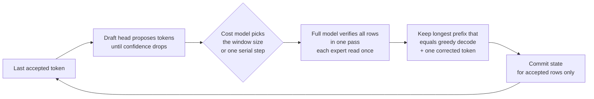
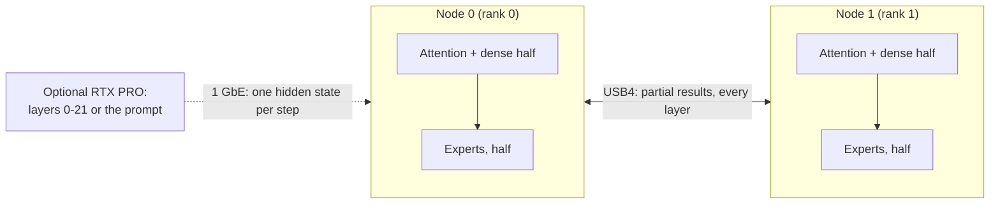

# Strix Halo engine lab

**Fast, exact LLM inference written from scratch for AMD Strix Halo: one mini PC, two linked over USB4, and a
discrete GPU when there is one.**

[English](README.md) · [Español](README.es.md)

<!-- SCREENSHOT: monitor panel of the engine goes here once the panel ships, e.g.
<p align="center"></p>
-->

This is our own C++/HIP inference engine for **AMD Strix Halo** (Ryzen AI Max+ 395, Radeon 8060S `gfx1151`,
128 GB of unified memory) under Linux with ROCm. It runs large mixture-of-experts models:

- **Qwen3.8-Flash-Next** on one node, or as two replicas on two nodes. One coding-chat request decodes at
  **90.7 tok/s** (prose about 55 tok/s); eight concurrent coding chats sum to **255 tok/s** of decode. With an
  RTX PRO 6000 reading the prompt, a 32K-token prompt gets its first token in **9.0 s**.
- **DeepSeek V4.1 Flash** split across **two nodes over USB4** (expert tensor parallel), optionally with an
  **RTX PRO 6000** taking the first 22 layers. Code prompts decode at **70.6 tok/s** on the pair (prose about
  42-45 tok/s) and **81.1 tok/s** with the RTX PRO; the latest batch benchmark reaches **110.8 tok/s** aggregate.
- **MiniMax M3.1 Flash** on the pair has passed its eight-text quality gate; the decode candidate takes
  **44.40 ms/token at 1K**. **GLM-5.3 Flash** now decodes on the pair at **21.07 tok/s**.
- **DeepSeek on an RTX PRO 6000 (96 GB, Windows WDDM)** runs the target and DSpark draft on that GPU,
  with an exclusive VRAM + pinned-host cache: exact decode **82–95 tok/s** for code; same-load code / English /
  Spanish rates are **82.3 / 87.7 / 94.4 tok/s** (2026-10-25; conditions below).

Every kernel, memory layout and scheduling choice is written for this chip and these models. The speed comes from
exact speculative decoding (the full model checks every drafted token), batching and replicas, never from changing
the answer: speculative output equals plain greedy decoding wherever we claim it, and every such claim is checked
by a gate.

> **Status: research engine.** It works end to end and every number below is measured. Each model ships a
> command-line tool that prints a JSON receipt and an OpenAI/Anthropic-compatible HTTP server
> (`strix-hip-decode-token --http-serve` for Qwen, `strix-deepseek41-serve` for DeepSeek). The lab also hosts
> the bring-up of further models; see [Models](#models).

## At a glance

**Who is this for?** Developers experimenting with **native, AMD-first LLM inference** on Ryzen AI Max / Strix Halo—not a general-purpose drop-in inference framework.

| Question | Short answer |
|---|---|
| What is it? | An independent C++/HIP inference engine, with model-specific execution paths, kernels, verification gates and HTTP serving. |
| Which hardware? | One Strix Halo Linux node, two nodes linked by USB4, and optional RTX PRO assistance for selected profiles. |
| Which models? | Qwen and DeepSeek have production-designated engine profiles; MiniMax and GLM have measured integration candidates. See [Models](#models). |
| Does it change model outputs? | Qualified speculative paths check generated tokens against normal greedy decode; other configurations must pass their own exactness gates. |
| Where do I begin? | Read [requirements](#what-you-need), [build](#build), then [run](#run). |
| Where are reproducible results? | [Performance methodology and results](docs/performance.md), with test conditions and verification; headline throughput is not a universal guarantee. |

**Project boundaries:** [TensorMeld](https://github.com/hyukudan/tensormeld) handles planning and routing; [Hyperloom](https://github.com/hyukudan/hyperloom) integrates deployment and control; the [USB4 driver](https://github.com/hyukudan/strix-halo-usb4-driver) handles the Linux interconnect. This repository owns **inference execution**, not cluster management.

For detailed implementation internals, use [How it works](#how-it-works) and the documents linked throughout the model sections. The model weights and their licences are separate from the engine code.

## Quick start: build and run one model

This minimal example is for **one Linux Strix Halo node** with the required ROCm toolchain, model GGUF and a tokenizer-produced `prompt.ids` file. It runs **plain greedy Qwen decoding**, not the speculative benchmark configuration.

```bash
git clone https://github.com/hyukudan/strix-halo-engine-lab.git
cd strix-halo-engine-lab
export PATH=/opt/rocm/core-10.1/bin:$PATH
cmake -S . -B build -G Ninja -DCMAKE_BUILD_TYPE=Release \
  -DCMAKE_HIP_ARCHITECTURES=gfx1151 \
  -DCMAKE_HIP_COMPILER=/opt/rocm/core-10.1/bin/amdclang++ \
  -DSTRIX_ENABLE_HIP_RUNTIME=ON \
  -DSTRIX_ENABLE_EXPERIMENTAL_Q4K_A8_RUNTIME=ON \
  -DSTRIX_BUILD_EXPERIMENTAL_Q4K_A8_PROBE=ON \
  -DSTRIX_USE_OPENSSL_SHA256=ON -DBUILD_TESTING=ON
ninja -C build strix-hip-decode-token
ctest --test-dir build --output-on-failure
```

With the matching Qwen model and token IDs available in your working directory:

```bash
./build/strix-hip-decode-token Qwen3.8-Flash-Next-UD-Q4_K_XL.gguf $(cat prompt.ids) \
  --context 8192 --execution-mode eager --residency register --generate 256 \
  --optimization-profile auto \
  --numerical-profile hc-splitk-f32+q51-q80-a8-down+q5k-a8-gateup+dense-a8-v1
```

The command produces a JSON receipt with token IDs and timing. Actual model files and prompt tokens are **not included**. For model assets, optional MTP/DSpark acceleration, serving and two-node transport, continue with [requirements](#what-you-need), [build](#build), [run](#run), and the [full engine reference](docs/getting-started/engine-reference.md). Some CTest cases require the GPU and model assets.

## Contents

[Models](#models) ·
[Hardware](#hardware) ·
[How fast](#how-fast) ·
[How exact, how good](#how-exact-how-good) ·
[Why it is different](#why-it-is-different) ·
[Languages](#beyond-english) ·
[What you need](#what-you-need) ·
[Build](#build) ·
[Run](#run) ·
[How it works](#how-it-works) ·
[Design decisions](#design-decisions) ·
[Roadmap](#roadmap) ·
[Related repositories](#related-repositories) ·
[FAQ](#faq) ·
[License](#license)

## Models

| Model | Runs on | Status | Highlights |
|---|---|---|---|
| **Qwen3.8-Flash-Next** (UD-Q4_K_XL, 111 GB) | 1 node; 2 replicas behind a router | **Production** | MTP speculative decoding with a distilled draft head, bit-identical to serial greedy; batched serving with joint verify windows; prefix state cache |
| **DeepSeek V4.1 Flash** (1017; 2-bit experts, 6.5-bit + trellis dense) | 2 nodes over USB4 | **Production** (two-node defaults D-061) | Expert tensor parallel decode, expert parallel device prefill, DSpark speculative decode, batched decode, server; bitwise gates |
| DeepSeek V4.1 Flash + RTX PRO 6000 | RTX PRO (layers 0-21) + 2 nodes (22-39) | **Experimental** (opt-in, D-064) | Pipeline split over 1 GbE, CUDA prefill service, hot-expert placement |
| DeepSeek V4.1 Flash, standalone RTX | RTX PRO 6000 (96 GB, Windows WDDM) | **Measured candidate**, opt-in | Q2 GGUF experts, Q8_0 dense; exclusive VRAM + pinned-host cache; on-GPU DSpark with warm controller selected as the speculative default |
| MiniMax M3.1 Flash (EXL3, 3.06 bpw) | 2 nodes TP2 over USB4 | **Integration candidate**, not in this release | Eight-text quality gate passed; faster exact prefill and decode; combined-default confirmation pending |
| GLM-5.3 Flash (EXL3, 4.05 bpw) | 2 nodes TP2 over USB4 | **Measured candidate** | Exact default R1 decode, fused attention projections; R≥3 buffer fault fixed; R1b summation order remains an opt-in, versioned identity |

The core knows no model: each family is a module with its own contract, plan, kernels and gates
([docs/models/model-families.md](docs/models/model-families.md)). The automatic profiles only admit the pinned model files listed in
[docs/reference/sources-ledger.md](docs/reference/sources-ledger.md).

## Hardware

- **Node:** one AMD Strix Halo mini PC, Ryzen AI Max+ 395 with the Radeon 8060S iGPU (`gfx1151`), 128 GB of
  unified memory, Linux, ROCm.
- **Pair:** two nodes joined by two direct USB4 cables (one 40 Gb/s, one 20 Gb/s link), driven by our
  [USB4 driver series](https://github.com/hyukudan/strix-halo-usb4-driver): about 37 Gb/s per direction with both
  directions busy, 18.4 µs for a 20 KB exchange.
- **Optional discrete GPU:** an RTX PRO 6000 (96 GB, Windows WDDM), used for standalone DeepSeek or prompt
  offload; the older DeepSeek pipeline split reaches the pair over 1 GbE (opt-in).

## How fast

Every speed below is measured in the lab with greedy decoding (temperature 0). Exactness is relative to the
named numerical profile; the older RTX pipeline split and GLM R1b experiment have separate identities, as
noted below. Bandwidth ceilings are calculated bounds, not measured throughput. Evidence, methods and older values are in
**[docs/performance.md](docs/performance.md)**.

How to read the tables:

- **Best** is the best measured result for that mode, on the workload that suits it most (usually code or
  copy-heavy text). **Typical** is the same mode on ordinary text, so you know what to expect from a general chat.
- **tok/s** is decode speed after the prompt has been read, for one request unless the concurrency says
  otherwise. **TTFT** is time to first token.
- **Build:** *release* is the code in this repository. *Pre-release* rows come from integration builds measured
  after this release (the hash is our build id); they are candidates for integration, and the release value is
  given next to them where it differs.
- Medians of 3 or more runs unless stated otherwise; repetition counts are unspecified for the latest
  2026-10-25 candidate measurements. *Updating* marks rows whose confirmation run is still in progress;
  they show the latest final measurement and its date.

Hardware: **1 node** = one Strix Halo (128 GB). **2 nodes** = two Strix Halo joined by two USB4 cables.
**RTX PRO** = an RTX PRO 6000 Blackwell (96 GB) in a PC on 1 GbE.

### DeepSeek V4.1 Flash

All rows: DeepSeek V4.1 Flash (1017 checkpoint), routed experts in the published 2-bit (Q2) GGUF, dense weights in
a 6.5-bit overlay with trellis-coded attention, shared-expert and head weights. 2 nodes, expert tensor parallel
(TP2) over USB4.

| Mode | Hardware | Prompt / context | Concurrency | Best | Typical | Date | Build |
|---|---|---|---:|---:|---:|---|---|
| Greedy decode | 2 nodes | short decode benchmark | 1 | **29.0 ms/token** (34.5 tok/s; 58.2 % of bandwidth ceiling) | same benchmark, median of 3 | 2026-10-25 evening | pre-release `69c6bdab`; release: 28.5 tok/s |
| DSpark speculative decode | 2 nodes | 8 prompts per type, 256 tokens each | 1 | **70.6 tok/s** (code) | 41.9 (English) / 45.3 (Spanish); 50.0 over all 24 | 2026-10-24 | pre-release `cab238d6` |
| Batched decode, no drafting | 2 nodes | N=8 decode benchmark, rows checked against reference | 8 | **72.20 ms/step** (110.8 tok/s aggregate; 64.4 % of bandwidth ceiling) | median of 3 | 2026-10-25 evening | pre-release `69c6bdab` |
| Device prefill (expert parallel) | 2 nodes | 1K | 1 | TTFT **2.18 s** (469 tok/s) | | 2026-10-24 | pre-release `cab238d6` |
| Device prefill | 2 nodes | 8K | 1 | TTFT **10.78 s** (760 tok/s) | | 2026-10-24 | pre-release `f9332f3e`; release: 734 tok/s |
| Device prefill | 2 nodes | 16K | 1 | TTFT **20.40 s** (803 tok/s) | | 2026-10-24 | pre-release `f9332f3e` |
| Device prefill | 2 nodes | 32K | 1 | TTFT **39.6 s** (828 tok/s), 2 runs | | 2026-10-23 | pre-release `43086d05` + prefill defaults |
| Server, one client, chat | 2 nodes | chat prompt | 1 | **66.9 tok/s** (code) | 34.9 tok/s (prose) | 2026-10-22 | release |
| Server, 8 chats × 128 tokens | 2 nodes | chat prompts | 1 / 2 / 4 / 8 | **41.4 / 54.0 / 59.7 / 67.9 tok/s** aggregate | | 2026-10-22 | release |
| Server, 8-category short set | 2 nodes | 36-303-token prompts | 1 / 2 / 4 / 8 | | 38.4 / 52.7 / 59.3 / 66.8 tok/s aggregate | 2026-10-22 | release |
| Server TTFT | 2 nodes | 8K, server idle | 1 | **15.8 s** | 26.4 s while 4 other streams decode (pre-release `cab238d6`, 2026-10-24) | 2026-10-22 | release |

The pair candidate retains grouped shared-expert launches where admitted. Server plan warm-up remains off by
default: its first-request gain did not hold across the complete serving workload. These pair results do not
imply that every verify-window or serving configuration is faster.

**DeepSeek with the RTX PRO, older pipeline split** (opt-in; same model files; the RTX runs layers 0-21 with CUDA, the two nodes run
layers 22-39 and the head):

| Mode | Hardware | Prompt / context | Concurrency | Best | Typical | Date | Build |
|---|---|---|---:|---:|---:|---|---|
| DSpark speculative decode | RTX PRO + 2 nodes | 8 prompts per type, 256 tokens each | 1 | **81.1 tok/s** (code) | 50.3 (English) / 54.2 (Spanish); 61.8 over all 24 | 2026-10-22 | release |
| Greedy decode | RTX PRO + 2 nodes | short prompt | 1 | **38.3 tok/s** | same | 2026-10-22 | release |
| Prompt reading on the RTX PRO (exact profile) | RTX PRO | 2K / 8K / 32K | 1 | TTFT **3.64 / 4.39 / 12.20 s** | | 2026-10-22 | release |

The pair-only DSpark run on the same build gives 46.4 tok/s over the 24 prompts (×1.33 with the RTX PRO). The RTX
split is bitwise equal to the pair without the trellis sites; with them (these rows) it is a declared composed
identity, checked against the pair (KL 1.7e-3), not bitwise. RTX TTFT: warm resident service, model load
excluded, up to the exported attention state handed to the import endpoint. A faster CUDA prefill profile fails
the quality gate on long prompts and is not quoted.

**Standalone RTX DeepSeek candidate (2026-10-25).** Full DeepSeek V4.1 Flash target on an
RTX PRO 6000 (96 GB, Windows WDDM): Q2 GGUF routed gate/up **IQ2_XXS**, routed down **Q2_K**, dense **Q8_0**.
Experts use an exclusive VRAM + pinned-host cache; the target and DSpark draft share the GPU. The draft keeps
the 64 most-used experts per stage. Deferred/bounded write-backs, the CUDA-graph instantiation fix and the
warm controller default are adopted; keep-64 pruning measured **+16 %** on code with a four-row window.

| Exact speculative decode | Code | English | Spanish | Calculated ceiling share |
|---|---:|---:|---:|---|
| Warm controller + deferred write-backs, same load | **82.3 tok/s** | **87.7 tok/s** | **94.4 tok/s** | **51–58 %** of the 6.18 ms/token all-hit floor |
| Best runs across loads | **94–95 tok/s** | **97 tok/s** | **100–101 tok/s** | **58–63 %** of the same ceiling |

Quote code throughput as **82–95 tok/s**: loads vary by up to **~10 %**, so comparisons apply within one load.
Exact gates pass for this RTX profile; equality against the pair's trellis profile is not claimed.
Prompt lengths and generated-token counts are unspecified for these latest decode measurements.

| Loading / serving work | Measured result | Status |
|---|---|---|
| Pipelined expert loading | Full load **108.7 → 61.8 s**; expert fill **83.1 → 38.0 s**, **2.25 → 6.73 GB/s**, disk-bound | **In development**; bitwise-identical placement and outputs |
| Persistent loaded worker | **8–18 s per request** on test workloads without reload; fresh-load cache reset **3.4 s** | **In development**; each request bitwise identical to a fresh process |
| Window prefetch | Gain not established | Implemented, exact; default off, under investigation |

### Qwen3.8-Flash-Next

All rows: Qwen3.8-Flash-Next, UD-Q4_K_XL GGUF (111 GB) plus a distilled Q8_0 MTP draft head (2.8 GB), MTP
speculative decoding with windows 2/4/8, dense A8 profile, thinking off, 256 generated tokens unless stated.

| Mode | Hardware | Prompt / context | Concurrency | Best | Typical | Date | Build |
|---|---|---|---:|---:|---:|---|---|
| MTP decode | 1 node | 1K | 1 | **60.0 tok/s** (code) | 55.7 tok/s (prose) | 2026-10-24 | pre-release `0117a140` (release: 59.8 / 55.5 in the same session) |
| MTP decode | 1 node | 8K | 1 | | 48.9 tok/s (prose) | 2026-10-22 | release |
| MTP decode | 1 node | 32K | 1 | **51.8 tok/s** (code) | | 2026-10-22 | release |
| MTP + copy windows (opt-in), long copy-edit | 1 node | Markdown document (~10 KB) to fix, 2,047-token answer | 1 | **183.5 tok/s** | | 2026-10-24 | pre-release `e1b115a2` |
| MTP + copy windows (opt-in), long copy-edit | 1 node | Python file + diff to apply, 1,417-token answer | 1 | **163.9 tok/s** | | 2026-10-24 | pre-release `e1b115a2` |
| MTP + copy windows (opt-in), long copy-edit | 1 node | C++ file to rewrite with renames, 1,711-token answer | 1 | **155.1 tok/s** | | 2026-10-24 | pre-release `e1b115a2` |
| MTP + copy windows (opt-in), 7 copy-edit tasks | 1 node | 5-10 KB inputs, 1,114-2,047-token answers | 1 | | **125.2 tok/s** (90.2 without copy windows) | 2026-10-24 | pre-release `dd65dbd5` |
| MTP + copy windows (opt-in), agent sessions | 1 node | 6 coding-agent sessions | 1 | | 59.9 tok/s (unchanged by copy windows) | 2026-10-24 | pre-release `dd65dbd5` |

Copy windows (`--mtp-ngram-draft=wide --mtp-copy-wide-rows 32`) verify up to 32 rows when the answer copies text
from the prompt; tokens are identical to the default in every run. They help when the answer re-emits long spans
of the input (rewrites, patches, document fixes), do nothing on new text, and currently work for one request per
process (not yet with the batched server).

**Two replicas** (one complete model per node behind the router, `--http-batch 8`, servers restarted before each
of 3 rounds, no warm-up; token ids equal the single-node run in 570/570 responses):

| Mode | Hardware | Prompt / context | Concurrency | Best: coding chat | Typical: 8-category short set | Date | Build |
|---|---|---|---:|---:|---:|---|---|
| Server, two replicas | 2 nodes | ~70-token chat / 36-303-token prompts | 1 | **90.7 tok/s** decode (68.1 wall) | 42.8 tok/s wall, TTFT p50 0.89 s | 2026-10-22 | release |
| Server, two replicas | 2 nodes | same | 2 | **181.5** summed decode (136.2 wall) | 85.8 wall, TTFT p50 0.85 s | 2026-10-22 | release |
| Server, two replicas | 2 nodes | same | 4 | **201.6** summed decode (146.9 wall) | 102.9 wall, TTFT p50 1.32 s | 2026-10-22 | release |
| Server, two replicas | 2 nodes | same | 8 | **255.0** summed decode (166.7 wall) | 120.4 wall, TTFT p50 2.55 s | 2026-10-22 | release |

*Summed decode* adds each request's own decode rate; *wall* is all completion tokens over the wall time including
the first token and queueing (what a client sees).

**Prompt reading, one node** (fast prompt profile, fresh process per run) and **with the RTX PRO** (exact CUDA
prefill on the RTX, attention and recurrent state streamed to the node over 1 GbE as each layer finishes, then the
node decodes; 64 generated tokens identical to the node-only run at every length; one run per length):

| Mode | Hardware | 1K | 4K | 8K | 16K | 32K | Date | Build |
|---|---|---:|---:|---:|---:|---:|---|---|
| Prefill, TTFT | 1 node | **1.13 s** | | | | | 2026-10-22 | release; current opt-in results below |
| Prefill offload, TTFT | RTX PRO + 1 node | **1.36 s** | **1.92 s** | **2.94 s** | **4.95 s** | **8.99 s** | 2026-10-24 | pre-release `70b93af3` |
| Same server without the RTX, TTFT | 1 node | 1.80 s | 5.20 s | 10.46 s | 21.43 s | 44.02 s | 2026-10-24 | same server build |

The offload compares against the same production server it forwards to (2,048-row prompt tiles), which reads
prompts more slowly than the one-node prefill row above (8,192-row tiles). At 32K the RTX path is 4.9× faster than
that server. With the offload enabled, the router sends prompts of 1K tokens or more to the RTX PRO; shorter ones
are read on the node.

**Next release candidate** (`0117a140`, measured against the release build in the same session, interleaved runs,
every run exact): TTFT 2.3 % (1K), 3.4 % (4K) and 5.1 % (16K, 32K) lower; decode equal or up to 0.4 % faster;
two replicas at concurrency 4 and 8: 3.9 % and 3.6 % more wall throughput, and a 6.9 % lower TTFT at
concurrency 4. Details in [docs/performance.md](docs/performance.md#qwen38-flash-next-1).

**Exact combined prefill candidate (2026-10-25).** One Strix Halo node, Qwen3.8-Flash-Next
UD-Q4_K_XL, opt-in flags; TTFT includes prompt processing. Prompt kind, repetition counts and generated-token
counts are unspecified for these latest measurements.

| Prompt length | Baseline TTFT | Candidate TTFT | Change | Candidate tok/s |
|---|---:|---:|---:|---:|
| 4K | 3.31 s | **3.02 s** | −8.6 % | 1,356 |
| 17.7K | 14.63 s | **12.52 s** | −14.4 % | 1,414 |
| 32K | 25.78 s | **22.95 s** | −11.0 % | 1,428 |
| 64K | 52.98 s | **46.86 s** | −11.5 % | 1,398 |
| 128K | 122.2 s | **114.2 s** | −6.5 % | 1,147 |
| 262,143 tokens | 294.5 s | **248.0 s** | −15.8 % | 1,057 |

About **39–49 %** of the calculated single-node bandwidth ceiling. The 128K result used an earlier variant.
The candidate remains opt-in; outputs are exact.

Exact MTP draft attention is enabled in the integration candidate. Decode-router work remains under evaluation:
one-row activation staging improves the draft router, but the combined end-to-end gain is not yet established.
Batched MTP drafting remains opt-in. The GSQ measurements below cover a separate opt-in speed-over-quality
profile.

### GSQ: opt-in speed-over-quality profile

GSQ HYB-Q2 replaces the quality recipe's routed experts with Q2_0 weights; it is **never the default**.
On the locked 64-prompt quality set (23,552 scored positions, 2K–32K contexts), top-1 agreement with the
Q8_0 reference is **76.6 %**, versus **88.1 %** for UD-Q4_K_XL: an **11.5 percentage-point** loss. This profile
does not pass the quality recipe's acceptance criterion.

Measured 2026-10-25, one Strix Halo node, Qwen3.8-Flash-Next, single request, 256 generated tokens,
`702bc074`; decode time excludes the prompt. Each run matches its own recipe's golden tokens.
The two recipes have different weights and can produce different answers.

| Code prompt | MTP window | GSQ HYB-Q2, tok/s | Quality recipe, tok/s | GSQ / quality |
|---|---|---:|---:|---:|
| 1K | auto | **73.18** | **59.59** | 1.23x |
| 1K | {2} route | **49.16** | **41.85** | 1.17x |
| 1K | forced R2 | **49.17** | **41.82** | 1.18x |
| 1K | forced R4 | **64.42** | **51.56** | 1.25x |
| 1K | forced R8 | **66.56** | **52.07** | 1.28x |
| 8K | auto | **65.96** | **54.00** | 1.22x |
| 8K | {2} route | **45.51** | **40.05** | 1.14x |
| 8K | forced R2 | **45.42** | **40.27** | 1.13x |
| 8K | forced R4 | **59.61** | **51.44** | 1.16x |
| 8K | forced R8 | **56.60** | **50.05** | 1.13x |

Auto uses the production MTP policy. The {2} route is the harness's "R1" MTP setting, not serial greedy decode.
MTP acceptance at auto: 1K 0.72 (GSQ) vs 0.66 (quality); 8K 0.66 vs 0.73. Prompt processing in the same runs
(warm): 1K 1.03 s vs 1.17 s; 8K 7.7-7.8 s vs 7.9 s. Against each recipe's byte ceiling for code 1K with MTP,
GSQ auto reaches about 64 % (113.8 tok/s ceiling) and the quality recipe about 69 % (86.8 tok/s ceiling).

### MiniMax M3.1 Flash (integration candidate)

All rows: MiniMax M3.1 Flash, EXL3 trellis weights at 3.06 bits per weight, two Strix Halo nodes TP2 over USB4.
The integration candidate is not in this release; older batch and speculative rows retain their measured build.

| Mode | Hardware | Prompt / context | Concurrency | Best | Typical | Date | Build |
|---|---|---|---:|---:|---:|---|---|
| Output check | 2 nodes | chat-templated prompts (prose, code, JSON, C++ edit) | 1 | coherent answers; speculative ids equal plain greedy in 4/4 | | 2026-10-24 | pre-release `44ec61f4` |
| Greedy decode, exchange-boundary candidate | 2 nodes | 1K matched replay | 1 | **44.40 ms/token** (22.52 tok/s; 65.7 % of bandwidth ceiling) | exact replay against same-build baseline | 2026-10-25 | integrated in `8cc30ac0`; combined confirmation pending |
| Greedy decode, exchange-boundary candidate | 2 nodes | 8K matched replay | 1 | **48.32 ms/token** (20.70 tok/s; 60.4 % of bandwidth ceiling) | exact replay against same-build baseline | 2026-10-25 | same candidate |
| Prefill, fresh baseline | 2 nodes | 8K benchmark prompt | 1 | **21.87 s** (374.5 tok/s) | exact; combined fresh result not yet measured | 2026-10-25 | integration candidate |
| Batched decode | 2 nodes | all-defaults bench | 1 / 2 / 4 / 8 | **20.75 / 30.52 / 42.09 / 57.59 tok/s** aggregate | each row identical to running alone | 2026-10-24 | pre-release `3ba49a3d` |
| DSpark speculative decode | 2 nodes | JSON table conversion, 256 tokens | 1 | **52.03 tok/s** (×2.52) | | 2026-10-24 | pre-release `3ba49a3d` |
| DSpark speculative decode | 2 nodes | Python code / prose, 256 tokens | 1 | **32.73 tok/s** (code, ×1.59) | DSpark roughly at or below plain speed on prose: 0.88-0.95× on a 6-language set (2026-10-25) | 2026-10-24 | pre-release `3ba49a3d` |

The older DSpark and batch rows retain their measured build; they have not been re-timed on the new decode
candidate. New exact prefill items measure **0.78–0.83×** baseline time at 8K and **0.82–0.85×** at 1K
in the same process;
a fresh run with all changes enabled is not yet measured. The bitwise expert gate/up kernel fix reduces MoE
layer time by **3–8 %**; engine A/B confirmation is pending.

**Quality gate (2026-10-25): passed** the pre-registered eight-text evaluation, including two independent,
byte-identical TP2 runs and all prompt/regime checks. Mean KL to the exact reference is **0.1449** versus
**0.1425** for the production CPU arithmetic. Top-1 agreement is **0.47 percentage points lower** than the CPU
reference, within the pre-registered 2-point margin; next-token accuracy differs by **+0.01 point**. This
qualification is conditional on those eight texts; it supersedes the earlier two-prompt failure.

### GLM-5.3 Flash

EXL3 4.05 bpw, two Strix Halo nodes TP2 over USB4; default R1 identity.
Prompt lengths and generated-token counts are unspecified for the latest decode measurement.

| Mode | Prompt / context | Measured | Date | Status / exactness |
|---|---|---:|---|---|
| Greedy decode | Decode workload; default R1 | **47.47–47.51 ms/token = 21.07 tok/s**, previously 54.82 ms/token | 2026-10-25 | exact |
| Fraction of bandwidth ceiling | same | **49 %** (calculated 23.2 ms/token floor) | 2026-10-25 | calculated bound |
| Exact prefill rework | Synthetic gate model | **12.98 → 3.80 ms/token** (**3.4×** faster) | 2026-10-25 | real-model TTFT not yet measured |
| R1b summation-order experiment | Alternative numerical identity | **99.14 %** top-1 agreement; closer to a float64 reference | 2026-10-25 | opt-in; not the default |

Fused attention projections and the revised HC path preserve the default identity. The R≥3 memory fault was
fixed by removing a shadowed dimension constant; synthetic multi-row checks pass, while real-pair batch timing
still needs confirmation. The exact prefill speedup above is measured only on the synthetic gate model;
real-model TTFT remains unmeasured.

R1b changes FP32 summation order: it diverges from default greedy output on chat and code, while the tested
prose and JSON continuations agree. Wider quality and timing qualification remains open; it is never silently
substituted for R1.

## How exact, how good

**Exact where we say so.** These outputs are checked token for token (or byte for byte) against a reference:

- Qwen MTP speculative decoding equals serial greedy decode with the same numerical profile, bit for bit
  (golden replay error 0 on every timed run; replicas 570/570 equal to one node).
- Qwen tiled prefill and teacher-forced scoring produce the same bytes as the serial route within a profile.
- DeepSeek on the pair: greedy and DSpark windows equal the stored references on both ranks; batch tokens and
  64/64 server responses equal the campaign references.
- DeepSeek split with the RTX PRO: bitwise equal to the pair without the trellis sites (24/24 prompts). With them
  it is a declared composed identity (KL 1.7e-3 against the pair), not bitwise.

**Quality is measured, not assumed.** A teacher-forced harness compares the engine's full output distribution with
a reference at every position (KL divergence and top-1 agreement), per category and language.

| Qwen profile | KL to Q8_0 reference | Top-1 agreement |
|---|---|---|
| Exact (FP32 dense) | 0.01940 | 95.52 % |
| Dense A8 (recommended) | 0.01978 (+1.9 ± 2.0 %) | 95.55 % |

49,001 positions ([D-032](docs/decisions/decision-register.md#d-032-dense-a8-in-the-recommended-profile)): dense A8 is as close to the
reference as the exact profile, within the margin between two exact implementations of the same weights. Where the
two profiles disagree (2.8 % of positions) it is almost always between near-equal candidates.

For DeepSeek, the trellis-coded dense weights (mix-B) are as close to the original-precision model as the 6.5-bit
format (KL 0.0446 against 0.0447 over 103,908 tokens) at 2.27 instead of 3.63 GB read per token per node; this was
computed in an emulation of the formats, not with the engine's kernels.

Methodology: [docs/engine/prefill/teacher-forced-tiled-prefill.md](docs/engine/prefill/teacher-forced-tiled-prefill.md),
[docs/engine/decode/optimization-profile.md](docs/engine/decode/optimization-profile.md),
[docs/reference/qualification-ledger.md](docs/reference/qualification-ledger.md).

## Why it is different

- **Exact speculative decoding.** Qwen's MTP head and DeepSeek's DSpark drafter propose several tokens; the full
  model checks them in one pass and keeps the longest correct run. Multi-row kernels repeat the one-row arithmetic,
  so a wrong guess costs time, never correctness.
- **Several ways to use more hardware, each measured.** Batched verify windows on one node, one replica per node,
  one model split across two nodes over USB4 (expert tensor parallel), and a discrete GPU for the first layers or
  the prompt.
- **Named numerical profiles with measured quality.** Rounding is a named, versioned choice. The prompt can be read
  with one profile and the answer written with another (D-033).
- **Opt-in until proven.** Every optimization starts disabled and becomes a default only after it is shown exact
  (or of measured quality) and faster on the complete workload, in an interleaved timing campaign. Ideas that failed
  are recorded with their numbers.
- **AMD-first and independent.** The kernels, scheduling, speculative decoding, GGUF reader, memory planner and the
  two-node communicator are our own code; the engine does not wrap another inference runtime. ROCm/HIP, Linux, the
  GGUF format and the usual build tools remain dependencies. The engine stays fully usable on a single Strix Halo;
  multi-node operation and other GPUs are separate, explicitly qualified stages.

## Beyond English

- **Draft vocabulary packs per language (Qwen).** The draft head drafts from a subset of the vocabulary. The
  repository ships a 32k core plus 16k packs for German, Spanish, French, Italian, Portuguese, Russian, Japanese and
  Chinese in [`data/draft-vocab/`](data/draft-vocab/); `--mtp-draft-vocab auto:data/draft-vocab` picks the pack
  that matches the prompt. On a Spanish chat prompt this raised decode from 32.9 to 38.9 tok/s (+18 %). DeepSeek's
  DSpark uses the same idea (`--dspark-vocab auto:`). The pack only changes how many guesses are accepted, never the
  text.
- **Quality per language and category.** The harness reports KL and top-1 for multilingual text, Spanish prose,
  English prose, code, agent tasks, math and chat, each with a margin. A choice that hurts one category is rejected
  even when the average looks fine.

## What you need

| | Qwen3.8-Flash-Next | DeepSeek V4.1 Flash |
|---|---|---|
| **Machines** | one Strix Halo (`gfx1151`) with **128 GB** | two Strix Halo with 128 GB each, two direct USB4 cables, the [USB4 driver series](https://github.com/hyukudan/strix-halo-usb4-driver); optionally a CUDA PC with an RTX PRO 6000 |
| **OS / GPU stack** | Linux, ROCm/HIP (tested with ROCm core 10.1 under `/opt/rocm/core-10.1`) | same; CUDA for the optional RTX parts |
| **Model files** | UD-Q4_K_XL GGUF (~111 GB) + Q8_0 MTP sidecar | the 2-bit expert GGUF, the 6.5-bit dense overlay, the trellis packs and the DSpark drafter ([docs/models/deepseek-v4.1/production-defaults.md](docs/models/deepseek-v4.1/production-defaults.md#production-identity-environment-of-both-ranks)) |
| **Build tools** | CMake >= 3.24, Ninja, a C++20 compiler, optionally OpenSSL for fast hashing | same |

The command-line tools take token IDs; the HTTP servers carry the models' own tokenizers and chat templates.

## Build

```sh
export PATH=/opt/rocm/core-10.1/bin:$PATH
cmake -S . -B build -G Ninja \
  -DCMAKE_BUILD_TYPE=Release \
  -DCMAKE_HIP_ARCHITECTURES=gfx1151 \
  -DCMAKE_HIP_COMPILER=/opt/rocm/core-10.1/bin/amdclang++ \
  -DSTRIX_ENABLE_HIP_RUNTIME=ON \
  -DSTRIX_ENABLE_EXPERIMENTAL_Q4K_A8_RUNTIME=ON \
  -DSTRIX_BUILD_EXPERIMENTAL_Q4K_A8_PROBE=ON \
  -DSTRIX_USE_OPENSSL_SHA256=ON \
  -DBUILD_TESTING=ON
ninja -C build strix-hip-decode-token                         # Qwen
ninja -C build strix-deepseek41-rank strix-deepseek41-serve   # DeepSeek (family module, STRIX_FAMILY_DEEPSEEK41=ON by default)
```

The CUDA parts for the RTX PRO build separately with `-DSTRIX_ENABLE_CUDA_DS41=ON`. `ctest --test-dir build` runs
the host and device tests (many device tests need the GPU and the model files). All CMake options are listed in
[docs/getting-started/engine-reference.md](docs/getting-started/engine-reference.md#build-options).

## Run

**Qwen, simplest run:** plain greedy decode with the recommended profile, 256 tokens.

```sh
./build/strix-hip-decode-token Qwen3.8-Flash-Next-UD-Q4_K_XL.gguf $(cat prompt.ids) \
  --context 8192 --execution-mode eager --residency register --generate 256 \
  --optimization-profile auto \
  --numerical-profile hc-splitk-f32+q51-q80-a8-down+q5k-a8-gateup+dense-a8-v1
```

`prompt.ids` holds the prompt as token IDs from the model's tokenizer; the engine prints a JSON receipt with
`generated_tokens` and timings. For the speeds above add the speculative options (MTP sidecar, verify windows
2/4/8, draft vocabulary): the complete command is in **[docs/getting-started/engine-reference.md → Command line](docs/getting-started/engine-reference.md#command-line)**
and [docs/engine/speculative/mtp-native-cli.md](docs/engine/speculative/mtp-native-cli.md). The HTTP server, batched slots (`--http-batch`) and the
prefix cache are in [docs/engine/serving/serving.md](docs/engine/serving/serving.md); several requests in one process in
[docs/engine/scheduling/multi-request-cohort.md](docs/engine/scheduling/multi-request-cohort.md); sampling in
[docs/engine/decode/sampled-decoding.md](docs/engine/decode/sampled-decoding.md).

**DeepSeek on the pair:** one rank per node, the same environment on both ranks (the production identity),
`--transport usb4gpu`; the server takes `--prefill-path device --dspark <DSpark.gguf> --dspark-vocab auto:<vocab>`.
The environment, defaults and opt-outs are in [docs/models/deepseek-v4.1/production-defaults.md](docs/models/deepseek-v4.1/production-defaults.md);
the RTX split command lines in [docs/models/deepseek-v4.1/pipeline-stages.md](docs/models/deepseek-v4.1/pipeline-stages.md); hot-expert placement in
[docs/models/deepseek-v4.1/hot-placement.md](docs/models/deepseek-v4.1/hot-placement.md); long contexts in
[docs/models/deepseek-v4.1/long-context.md](docs/models/deepseek-v4.1/long-context.md).

### Exposing the servers

The HTTP servers (`strix-hip-decode-token --http-serve` and `strix-deepseek41-serve`) listen on loopback unless
`--http-bind` says otherwise. They have no TLS of their own. Authentication is one optional shared key:
with `--http-api-key-file FILE` every API and admin route (completions, `/admin/drain`, `/admin/import-state`)
needs `Authorization: Bearer <key>` or `x-api-key: <key>`; without it the server accepts any client. `/health`,
`/metrics` and `/api/status` answer without the key. Bodies, queued requests and open connections are bounded
(`--http-max-queue`, `--http-max-connections`). Keep the servers on loopback or a private network and put
remote clients behind an authenticating front end such as the [TensorMeld](https://github.com/hyukudan/tensormeld)
router or its control channel; the two-node DeepSeek ranks exchange tensors over the USB4 link, and the RTX split
(pipeline stage TCP port) and the expert servers talk plain TCP: none of these carry authentication, so they must
stay on a direct cable or a private network. Per-user keys, TLS and a secure configuration interface are
work items, not features.

## How it works

**One speculative decode cycle** (Qwen's MTP and DeepSeek's DSpark follow the same shape):



A one-token step is limited by memory bandwidth (all active weights are read for one token), so checking 4 or 8
tokens costs far less than 4 or 8 steps. Batched serving goes one step further: joint windows verify the rows of
several requests together, reading each weight once for all of them.

**DeepSeek on two nodes.** Each node holds half of the routed experts and half of each tensor-parallel dense
projection. Per layer, the two GPUs exchange small partial results over USB4 (four host streams over the two cables);
the prompt is read expert parallel, and the attention state is split between the nodes.



**Reading a long prompt (Qwen tiled prefill).** The prompt is cut into blocks of up to 2048 rows; inside a block each
weight is read once for all rows, and the recurrent (GDN) layers still update rows in order, so the result is
bit-identical to reading the prompt one token at a time with the same profile.

Every document is listed in the [documentation index](docs/README.md). The architecture guide is [docs/architecture/README.md](docs/architecture/README.md) (multi-node and USB4:
[docs/architecture/12-multi-node-and-usb4.md](docs/architecture/12-multi-node-and-usb4.md)); the engine reference
is [docs/getting-started/engine-reference.md](docs/getting-started/engine-reference.md); current status per area is [docs/reference/implementation-status.md](docs/reference/implementation-status.md).

## Design decisions

The full record, with alternatives, evidence and the condition for reopening each one, is
[docs/decisions/decision-register.md](docs/decisions/decision-register.md). The main ones:

- **Exact verification over tolerance (D-021)** and **adaptive windows 2/4/8 with an online cost model (D-022)**.
- **Named numerical profiles (D-024, D-032)** and **a separate prefill profile (D-033)**.
- **Tiled prefill with identical bytes (D-034)**: a 16K-token scoring run went from 1001 s to 66 s.
- **Serving: per-request controller reset (D-057), joint windows for concurrent requests (D-058), two full replicas
  behind the router (D-060)**: C4 +8-9 %, and C6/C8 now scale past C4.
- **DeepSeek two-node defaults (D-061), bounded transport with eager small sends and fused staging (D-062),
  GPU-direct exchange (D-063), a discrete GPU in the decode (D-064, opt-in).**
- **Measured and rejected:** hipGraph capture of the decode loop, tensor parallelism of one Qwen request across the
  nodes (X-021), and more; numbers in the
  [rejected table](docs/decisions/decision-register.md#measured-and-rejected).

## Roadmap

In progress, without promised numbers:

- **MiniMax M3.1 Flash (EXL3) on the pair:** confirm combined decode defaults, measure combined prefill changes,
  and finish serving qualification; the eight-text quality gate has passed.
- **GLM-5.3 Flash:** faster default decode, real-pair prefill and batch confirmation, and wider R1b qualification.
- **DeepSeek:** a lower-latency ready path for the USB4 exchange and a closed defaults campaign for the newest
  opt-in flags; end-to-end time to first token of the exact CUDA prefill through the pair's server.
- **Qwen:** qualify the combined prefill candidate, decode-router changes and opt-in GSQ speed/quality results.
- **Monitor panel**, per-user keys and TLS through the product layer.

## Related repositories

- [strix-halo-usb4-driver](https://github.com/hyukudan/strix-halo-usb4-driver): the Linux patch series that turns
  the Strix Halo USB4 controllers into the direct link between the two nodes.
- [strix-trellis](https://github.com/hyukudan/strix-trellis): the trellis-quantization (EXL3/QTIP-style) library
  used for DeepSeek's dense weights and the MiniMax bring-up.
- [TensorMeld](https://github.com/hyukudan/tensormeld): placement and routing across nodes and GPUs; its router
  serves the Qwen replicas.

## FAQ

**Does speculative decoding change the answer?**
No, where we claim exactness (see [How exact](#how-exact-how-good)). Every emitted token is checked by the full
model with the same arithmetic as a one-token step. The one documented exception is the RTX split with trellis
sites, which is a declared composed identity.

**Which Qwen profile should I use?**
Dense A8 is the recommended default; use the exact profile when you need the FP32-dense arithmetic. The two can
pick different tokens where two candidates are nearly tied (2.8 % of positions); each is deterministic and exact
with respect to itself.

**Does it run on other GPUs or other models?**
The Strix Halo path targets `gfx1151`. DeepSeek also has a CUDA backend for the optional RTX parts. Models are
admitted by pinned content; new families are added as modules with their own gates ([Models](#models)).

**Why does it need 128 GB per node?**
The Qwen 4-bit file alone is about 111 GB; DeepSeek's experts are split across the two nodes. Unified memory lets
the GPU read the weights where they sit.

**What context length is supported?**
Qwen's automatic profile is qualified at 8192 tokens; longer contexts run with `--unqualified-context` (the prefill
numbers go up to 32K that way). DeepSeek's long-context limits are in
[docs/models/deepseek-v4.1/long-context.md](docs/models/deepseek-v4.1/long-context.md).

**Where are the numbers from?**
From our own runs on our own machines, with date, configuration and exactness check per row in
[docs/performance.md](docs/performance.md). Nothing here is an estimate presented as a result.

## License

The engine source is licensed under the **[Apache License 2.0](LICENSE)**, except the experimental Linux kernel
module under `lab/direct_gpu_stream/kernel/`, which is **GPL-2.0-only** as Linux kernel code must be (its license
texts are kept in that directory). Code adopted from other projects keeps its original license and notices. Model
weights are distributed under their own licenses. Third-party references used for formats and model semantics are
listed with their licenses in [docs/reference/sources-ledger.md](docs/reference/sources-ledger.md).
