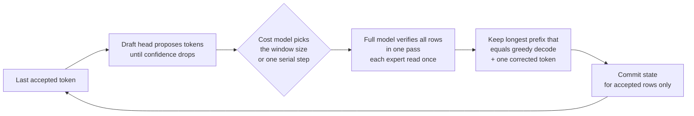
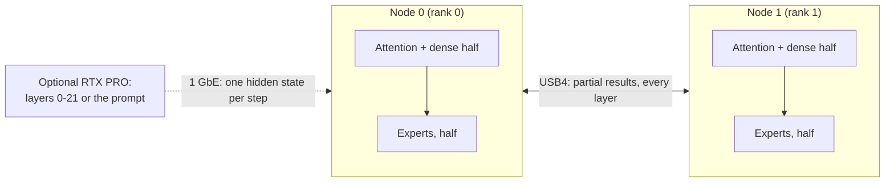

# Strix Halo engine lab

**Fast, exact LLM inference written from scratch for AMD Strix Halo: one mini PC, two linked over USB4, and a
discrete GPU when there is one.**

[English](README.md) · [Español](README.es.md)

<!-- SCREENSHOT: monitor panel of the engine goes here once the panel ships, e.g.
<p align="center"></p>
-->

This is our own C++/HIP inference engine for **AMD Strix Halo** (Ryzen AI Max+ 395, Radeon 8060S `gfx1151`,
128 GB of unified memory) under Linux with ROCm. It runs large mixture-of-experts models:

- **Qwen3.8-Flash-Next** on one node, or as two replicas on two nodes. One coding-chat request decodes at
  **90.7 tok/s**; eight concurrent coding chats sum to **255 tok/s** of decode.
- **DeepSeek V4.1 Flash** split across **two nodes over USB4** (expert tensor parallel), optionally with an
  **RTX PRO 6000** taking the first 22 layers. Code prompts decode at **62.3 tok/s** on the pair and **81.1 tok/s**
  with the RTX PRO.

Every kernel, memory layout and scheduling choice is written for this chip and these models. The speed comes from
exact speculative decoding (the full model checks every drafted token), batching and replicas, never from changing
the answer: speculative output equals plain greedy decoding wherever we claim it, and every such claim is checked
by a gate.

> **Status: research engine.** It works end to end and every number below is measured. Each model ships a
> command-line tool that prints a JSON receipt and an OpenAI/Anthropic-compatible HTTP server
> (`strix-hip-decode-token --http-serve` for Qwen, `strix-deepseek41-serve` for DeepSeek). The lab also hosts
> the bring-up of further models; see [Models](#models).

## Contents

[Models](#models) ·
[Hardware](#hardware) ·
[How fast](#how-fast) ·
[How exact, how good](#how-exact-how-good) ·
[Why it is different](#why-it-is-different) ·
[Languages](#beyond-english) ·
[What you need](#what-you-need) ·
[Build](#build) ·
[Run](#run) ·
[How it works](#how-it-works) ·
[Design decisions](#design-decisions) ·
[Roadmap](#roadmap) ·
[Related repositories](#related-repositories) ·
[FAQ](#faq) ·
[License](#license)

## Models

| Model | Runs on | Status | Highlights |
|---|---|---|---|
| **Qwen3.8-Flash-Next** (UD-Q4_K_XL, 111 GB) | 1 node; 2 replicas behind a router | **Production** | MTP speculative decoding with a distilled draft head, bit-identical to serial greedy; batched serving with joint verify windows; prefix state cache |
| **DeepSeek V4.1 Flash** (1017; 2-bit experts, 6.5-bit + trellis dense) | 2 nodes over USB4 | **Production** (two-node defaults D-061) | Expert tensor parallel decode, expert parallel device prefill, DSpark speculative decode, batched decode, server; bitwise gates |
| DeepSeek V4.1 Flash + RTX PRO 6000 | RTX PRO (layers 0-21) + 2 nodes (22-39) | **Experimental** (opt-in, D-064) | Pipeline split over 1 GbE, CUDA prefill service, hot-expert placement |
| MiniMax M3.1 Flash (EXL3, 3.06 bpw) | 2 nodes | **Bring-up**, not in this release | Format reader and CPU reference work; no speed claims yet |
| GLM-5.3 Flash (GGUF) | 2 nodes | **Planned tests** | Not started in the engine |

The core knows no model: each family is a module with its own contract, plan, kernels and gates
([docs/model-families.md](docs/model-families.md)). The automatic profiles only admit the pinned model files listed in
[SOURCES_LEDGER.md](SOURCES_LEDGER.md).

## Hardware

- **Node:** one AMD Strix Halo mini PC, Ryzen AI Max+ 395 with the Radeon 8060S iGPU (`gfx1151`), 128 GB of
  unified memory, Linux, ROCm.
- **Pair:** two nodes joined by two direct USB4 cables (one 40 Gb/s, one 20 Gb/s link), driven by our
  [USB4 driver series](https://github.com/hyukudan/strix-halo-usb4-driver): about 37 Gb/s per direction with both
  directions busy, 18.4 µs for a 20 KB exchange.
- **Optional discrete GPU:** an NVIDIA RTX PRO 6000 Blackwell (96 GB) in a PC, reaching the pair over 1 GbE
  (DeepSeek only, opt-in).

## How fast

All numbers are measured on the hardware above, greedy (temperature 0), medians of 3 or more runs, on
2026-10-22/23. The full table, with the conditions and the exactness check of every row, is
**[docs/performance.md](docs/performance.md)**.

> A defaults campaign is re-timing the newest opt-in flags of both models on 2026-10-23. When it closes, the
> DeepSeek greedy, batch, prefill and server rows and the Qwen prefill and per-replica server rows are refreshed.
> The values below are the last clean measurements.

### Code

| Workload | Setup | Decode |
|---|---|---|
| Qwen, coding chat, one request | one node (through the router) | **90.7 tok/s** |
| Qwen, coding chat, 2 / 4 / 8 concurrent requests | two replicas | **181.5 / 201.6 / 255.0 tok/s** summed over requests |
| Qwen, code with a 1K-token prompt | one node | **59.9 tok/s** |
| Qwen, code with a 32K-token prompt | one node | 51.8 tok/s |
| DeepSeek, code prompts (8 × 256 tokens), DSpark | pair | **62.3 tok/s** |
| DeepSeek, code chat through the server, one client | pair | 66.9 tok/s after the first token |
| DeepSeek, code prompts, DSpark | pair + RTX PRO | **81.1 tok/s** |

Code is where speculative decoding pays most: code repeats names and structure, so the draft heads guess long
runs right. Summed decode counts each request's own decode rate; a client also waits for its first token (coding
chat wall aggregate 68.1 / 136.2 / 146.9 / 166.7 tok/s at 1 / 2 / 4 / 8 requests).

### Qwen3.8-Flash-Next

One node, dense A8 profile, MTP windows 2/4/8, 256 generated tokens:

| Decode | Code, 1K prompt | Prose, 1K | Prose, 8K | Code, 32K |
|---|---:|---:|---:|---:|
| tok/s | **59.9** | **55.5** | 48.9 | 51.8 |

| Prompt reading (fast prompt profile) | 1K | 4K | 16K | 32K |
|---|---:|---:|---:|---:|
| Prefill, tok/s | 916 | 1,085 | 1,089 | 1,065 |
| Time to first token | **1.13 s** | 3.78 s | 15.05 s | 30.76 s |

Two replicas, one complete model per node, behind the [TensorMeld](https://github.com/hyukudan/tensormeld) router
(D-060), 8-category short set (36-303-token prompts), wall aggregate including the first token:

| Clients | 1 | 2 | 4 | 6 | 8 |
|---|---:|---:|---:|---:|---:|
| tok/s | **42.8** | **85.8** | **102.9** | **110.6** | **120.4** |
| TTFT p50 | 0.89 s | 0.85 s | 1.32 s | 1.91 s | 2.55 s |

Every response equals the single-node response, 570/570.

### DeepSeek V4.1 Flash

Two nodes over USB4, production defaults:

| What | Measured |
|---|---|
| Greedy decode, one stream | **28.5** tok/s |
| DSpark speculative decode, one stream (English / Spanish / code) | **37.5 / 39.3 / 62.3** tok/s (46.4 over 24 prompts) |
| Batched decode, 8 streams, aggregate | **95.9** tok/s |
| Device prefill, 8K tokens | **734** tok/s (1K / 4K / 16K: 458 / 640 / 758 on an earlier build) |
| Server, 8-category short set, 1 / 2 / 4 / 8 clients | **38.4 / 52.7 / 59.3 / 66.8** tok/s aggregate |
| Server time to first token, 8K-token prompt, idle | **15.8 s** |

With the RTX PRO 6000 (opt-in), same pair build in both columns:

| What | Pair only | Pair + RTX PRO |
|---|---:|---:|
| DSpark decode, all 24 prompts | 46.4 tok/s | **61.8** tok/s (×1.33) |
| DSpark decode, English / Spanish / code | 37.5 / 39.3 / 62.3 | **50.3 / 54.2 / 81.1** tok/s |
| Greedy decode | 27.7 tok/s | 38.3 tok/s |
| Time to first token, 2K / 8K / 32K (exact CUDA prefill service) | 15.8 s at 8K | **3.6 / 4.4 / 12.2 s** |

The RTX prefill times are measured on a warm resident service up to the exported attention state (handed to a local
import endpoint). A faster CUDA prefill profile exists but fails the quality gate on long prompts; it stays
experimental and is not quoted.

## How exact, how good

**Exact where we say so.** These outputs are checked token for token (or byte for byte) against a reference:

- Qwen MTP speculative decoding equals serial greedy decode with the same numerical profile, bit for bit
  (golden replay error 0 on every timed run; replicas 570/570 equal to one node).
- Qwen tiled prefill and teacher-forced scoring produce the same bytes as the serial route within a profile.
- DeepSeek on the pair: greedy and DSpark windows equal the stored references on both ranks; batch tokens and
  64/64 server responses equal the campaign references.
- DeepSeek split with the RTX PRO: bitwise equal to the pair without the trellis sites (24/24 prompts). With them
  it is a declared composed identity (KL 1.7e-3 against the pair), not bitwise.

**Quality is measured, not assumed.** A teacher-forced harness compares the engine's full output distribution with
a reference at every position (KL divergence and top-1 agreement), per category and language.

| Qwen profile | KL to Q8_0 reference | Top-1 agreement |
|---|---|---|
| Exact (FP32 dense) | 0.01940 | 95.52 % |
| Dense A8 (recommended) | 0.01978 (+1.9 ± 2.0 %) | 95.55 % |

49,001 positions ([D-032](DECISIONS.md#d-032-dense-a8-in-the-recommended-profile)): dense A8 is as close to the
reference as the exact profile, within the margin between two exact implementations of the same weights. Where the
two profiles disagree (2.8 % of positions) it is almost always between near-equal candidates.

For DeepSeek, the trellis-coded dense weights (mix-B) are as close to the original-precision model as the 6.5-bit
format (KL 0.0446 against 0.0447 over 103,908 tokens) at 2.27 instead of 3.63 GB read per token per node; this was
computed in an emulation of the formats, not with the engine's kernels.

Methodology: [docs/teacher-forced-tiled-prefill.md](docs/teacher-forced-tiled-prefill.md),
[docs/decode-optimization-profile.md](docs/decode-optimization-profile.md),
[docs/qualification-ledger.md](docs/qualification-ledger.md).

## Why it is different

- **Exact speculative decoding.** Qwen's MTP head and DeepSeek's DSpark drafter propose several tokens; the full
  model checks them in one pass and keeps the longest correct run. Multi-row kernels repeat the one-row arithmetic,
  so a wrong guess costs time, never correctness.
- **Several ways to use more hardware, each measured.** Batched verify windows on one node, one replica per node,
  one model split across two nodes over USB4 (expert tensor parallel), and a discrete GPU for the first layers or
  the prompt.
- **Named numerical profiles with measured quality.** Rounding is a named, versioned choice. The prompt can be read
  with one profile and the answer written with another (D-033).
- **Opt-in until proven.** Every optimization starts disabled and becomes a default only after it is shown exact
  (or of measured quality) and faster on the complete workload, in an interleaved timing campaign. Ideas that failed
  are recorded with their numbers.
- **AMD-first and independent.** The kernels, scheduling, speculative decoding, GGUF reader, memory planner and the
  two-node communicator are our own code; the engine does not wrap another inference runtime. ROCm/HIP, Linux, the
  GGUF format and the usual build tools remain dependencies. The engine stays fully usable on a single Strix Halo;
  multi-node operation and other GPUs are separate, explicitly qualified stages.

## Beyond English

- **Draft vocabulary packs per language (Qwen).** The draft head drafts from a subset of the vocabulary. The
  repository ships a 32k core plus 16k packs for German, Spanish, French, Italian, Portuguese, Russian, Japanese and
  Chinese in [`data/draft-vocab/`](data/draft-vocab/); `--mtp-draft-vocab auto:data/draft-vocab` picks the pack
  that matches the prompt. On a Spanish chat prompt this raised decode from 32.9 to 38.9 tok/s (+18 %). DeepSeek's
  DSpark uses the same idea (`--dspark-vocab auto:`). The pack only changes how many guesses are accepted, never the
  text.
- **Quality per language and category.** The harness reports KL and top-1 for multilingual text, Spanish prose,
  English prose, code, agent tasks, math and chat, each with a margin. A choice that hurts one category is rejected
  even when the average looks fine.

## What you need

| | Qwen3.8-Flash-Next | DeepSeek V4.1 Flash |
|---|---|---|
| **Machines** | one Strix Halo (`gfx1151`) with **128 GB** | two Strix Halo with 128 GB each, two direct USB4 cables, the [USB4 driver series](https://github.com/hyukudan/strix-halo-usb4-driver); optionally a CUDA PC with an RTX PRO 6000 |
| **OS / GPU stack** | Linux, ROCm/HIP (tested with ROCm core 10.1 under `/opt/rocm/core-10.1`) | same; CUDA for the optional RTX parts |
| **Model files** | UD-Q4_K_XL GGUF (~111 GB) + Q8_0 MTP sidecar | the 2-bit expert GGUF, the 6.5-bit dense overlay, the trellis packs and the DSpark drafter ([docs/ds41-production-defaults.md](docs/ds41-production-defaults.md#production-identity-environment-of-both-ranks)) |
| **Build tools** | CMake >= 3.24, Ninja, a C++20 compiler, optionally OpenSSL for fast hashing | same |

The command-line tools take token IDs; the HTTP servers carry the models' own tokenizers and chat templates.

## Build

```sh
export PATH=/opt/rocm/core-10.1/bin:$PATH
cmake -S . -B build -G Ninja \
  -DCMAKE_BUILD_TYPE=Release \
  -DCMAKE_HIP_ARCHITECTURES=gfx1151 \
  -DCMAKE_HIP_COMPILER=/opt/rocm/core-10.1/bin/amdclang++ \
  -DSTRIX_ENABLE_HIP_RUNTIME=ON \
  -DSTRIX_ENABLE_EXPERIMENTAL_Q4K_A8_RUNTIME=ON \
  -DSTRIX_BUILD_EXPERIMENTAL_Q4K_A8_PROBE=ON \
  -DSTRIX_USE_OPENSSL_SHA256=ON \
  -DBUILD_TESTING=ON
ninja -C build strix-hip-decode-token                         # Qwen
ninja -C build strix-deepseek41-rank strix-deepseek41-serve   # DeepSeek (family module, STRIX_FAMILY_DEEPSEEK41=ON by default)
```

The CUDA parts for the RTX PRO build separately with `-DSTRIX_ENABLE_CUDA_DS41=ON`. `ctest --test-dir build` runs
the host and device tests (many device tests need the GPU and the model files). All CMake options are listed in
[docs/ENGINE.md](docs/ENGINE.md#build-options).

## Run

**Qwen, simplest run:** plain greedy decode with the recommended profile, 256 tokens.

```sh
./build/strix-hip-decode-token Qwen3.8-Flash-Next-UD-Q4_K_XL.gguf $(cat prompt.ids) \
  --context 8192 --execution-mode eager --residency register --generate 256 \
  --optimization-profile auto \
  --numerical-profile hc-splitk-f32+q51-q80-a8-down+q5k-a8-gateup+dense-a8-v1
```

`prompt.ids` holds the prompt as token IDs from the model's tokenizer; the engine prints a JSON receipt with
`generated_tokens` and timings. For the speeds above add the speculative options (MTP sidecar, verify windows
2/4/8, draft vocabulary): the complete command is in **[docs/ENGINE.md → Command line](docs/ENGINE.md#command-line)**
and [docs/mtp-native-cli.md](docs/mtp-native-cli.md). The HTTP server, batched slots (`--http-batch`) and the
prefix cache are in [docs/serving.md](docs/serving.md); several requests in one process in
[docs/multi-request-cohort.md](docs/multi-request-cohort.md); sampling in
[docs/sampled-decoding.md](docs/sampled-decoding.md).

**DeepSeek on the pair:** one rank per node, the same environment on both ranks (the production identity),
`--transport usb4gpu`; the server takes `--prefill-path device --dspark <DSpark.gguf> --dspark-vocab auto:<vocab>`.
The environment, defaults and opt-outs are in [docs/ds41-production-defaults.md](docs/ds41-production-defaults.md);
the RTX split command lines in [docs/ds41-pipeline-stage.md](docs/ds41-pipeline-stage.md); hot-expert placement in
[docs/ds41-hot-placement.md](docs/ds41-hot-placement.md); long contexts in
[docs/deepseek41-long-context.md](docs/deepseek41-long-context.md).

### Exposing the servers

The HTTP servers (`strix-hip-decode-token --http-serve` and `strix-deepseek41-serve`) listen on `127.0.0.1` unless
`--http-bind` says otherwise. They have no TLS of their own. Authentication is one optional shared key:
with `--http-api-key-file FILE` every API and admin route (completions, `/admin/drain`, `/admin/import-state`)
needs `Authorization: Bearer <key>` or `x-api-key: <key>`; without it the server accepts any client. `/health`,
`/metrics` and `/api/status` answer without the key. Bodies, queued requests and open connections are bounded
(`--http-max-queue`, `--http-max-connections`). Keep the servers on loopback or a private network and put
remote clients behind an authenticating front end such as the [TensorMeld](https://github.com/hyukudan/tensormeld)
router or its control channel; the two-node DeepSeek ranks exchange tensors over the USB4 link, and the RTX split
(pipeline stage TCP port) and the expert servers talk plain TCP: none of these carry authentication, so they must
stay on a direct cable or a private network. Per-user keys, TLS and a secure configuration interface are
work items, not features.

## How it works

**One speculative decode cycle** (Qwen's MTP and DeepSeek's DSpark follow the same shape):



A one-token step is limited by memory bandwidth (all active weights are read for one token), so checking 4 or 8
tokens costs far less than 4 or 8 steps. Batched serving goes one step further: joint windows verify the rows of
several requests together, reading each weight once for all of them.

**DeepSeek on two nodes.** Each node holds half of the routed experts and half of each tensor-parallel dense
projection. Per layer, the two GPUs exchange small partial results over USB4 (four host streams over the two cables);
the prompt is read expert parallel, and the attention state is split between the nodes.



**Reading a long prompt (Qwen tiled prefill).** The prompt is cut into blocks of up to 2048 rows; inside a block each
weight is read once for all rows, and the recurrent (GDN) layers still update rows in order, so the result is
bit-identical to reading the prompt one token at a time with the same profile.

The architecture guide is [docs/README.md](docs/README.md) (multi-node and USB4:
[docs/architecture/12-multi-node-and-usb4.md](docs/architecture/12-multi-node-and-usb4.md)); the engine reference
is [docs/ENGINE.md](docs/ENGINE.md); current status per area is [IMPLEMENTATION_STATUS.md](IMPLEMENTATION_STATUS.md).

## Design decisions

The full record, with alternatives, evidence and the condition for reopening each one, is
[DECISIONS.md](DECISIONS.md). The main ones:

- **Exact verification over tolerance (D-021)** and **adaptive windows 2/4/8 with an online cost model (D-022)**.
- **Named numerical profiles (D-024, D-032)** and **a separate prefill profile (D-033)**.
- **Tiled prefill with identical bytes (D-034)**: a 16K-token scoring run went from 1001 s to 66 s.
- **Serving: per-request controller reset (D-057), joint windows for concurrent requests (D-058), two full replicas
  behind the router (D-060)**: C4 +8-9 %, and C6/C8 now scale past C4.
- **DeepSeek two-node defaults (D-061), bounded transport with eager small sends and fused staging (D-062),
  GPU-direct exchange (D-063), a discrete GPU in the decode (D-064, opt-in).**
- **Measured and rejected:** hipGraph capture of the decode loop, tensor parallelism of one Qwen request across the
  nodes (X-021), and more; numbers in the
  [rejected table](DECISIONS.md#measured-and-rejected).

## Roadmap

In progress, without promised numbers:

- **MiniMax M3.1 Flash (EXL3) on the pair:** format reader and CPU reference of the attention are in bring-up;
  device kernels and a layer gate come next.
- **GLM-5.3 Flash:** first tests on the pair.
- **DeepSeek:** a lower-latency ready path for the USB4 exchange and a closed defaults campaign for the newest
  opt-in flags; end-to-end time to first token of the exact CUDA prefill through the pair's server.
- **Qwen:** faster exact prefill schedules (MoE and dense) that beat the default.
- **Monitor panel**, per-user keys and TLS through the product layer.

## Related repositories

- [strix-halo-usb4-driver](https://github.com/hyukudan/strix-halo-usb4-driver): the Linux patch series that turns
  the Strix Halo USB4 controllers into the direct link between the two nodes.
- [strix-trellis](https://github.com/hyukudan/strix-trellis): the trellis-quantization (EXL3/QTIP-style) library
  used for DeepSeek's dense weights and the MiniMax bring-up.
- [TensorMeld](https://github.com/hyukudan/tensormeld): placement and routing across nodes and GPUs; its router
  serves the Qwen replicas.

## FAQ

**Does speculative decoding change the answer?**
No, where we claim exactness (see [How exact](#how-exact-how-good)). Every emitted token is checked by the full
model with the same arithmetic as a one-token step. The one documented exception is the RTX split with trellis
sites, which is a declared composed identity.

**Which Qwen profile should I use?**
Dense A8 is the recommended default; use the exact profile when you need the FP32-dense arithmetic. The two can
pick different tokens where two candidates are nearly tied (2.8 % of positions); each is deterministic and exact
with respect to itself.

**Does it run on other GPUs or other models?**
The Strix Halo path targets `gfx1151`. DeepSeek also has a CUDA backend for the optional RTX parts. Models are
admitted by pinned content; new families are added as modules with their own gates ([Models](#models)).

**Why does it need 128 GB per node?**
The Qwen 4-bit file alone is about 111 GB; DeepSeek's experts are split across the two nodes. Unified memory lets
the GPU read the weights where they sit.

**What context length is supported?**
Qwen's automatic profile is qualified at 8192 tokens; longer contexts run with `--unqualified-context` (the prefill
numbers go up to 32K that way). DeepSeek's long-context limits are in
[docs/deepseek41-long-context.md](docs/deepseek41-long-context.md).

**Where are the numbers from?**
From our own runs on our own machines, with date, configuration and exactness check per row in
[docs/performance.md](docs/performance.md). Nothing here is an estimate presented as a result.

## License

The engine source is licensed under the **[Apache License 2.0](LICENSE)**, except the experimental Linux kernel
module under `lab/direct_gpu_stream/kernel/`, which is **GPL-2.0-only** as Linux kernel code must be (its license
texts are kept in that directory). Code adopted from other projects keeps its original license and notices. Model
weights are distributed under their own licenses. Third-party references used for formats and model semantics are
listed with their licenses in [SOURCES_LEDGER.md](SOURCES_LEDGER.md).
